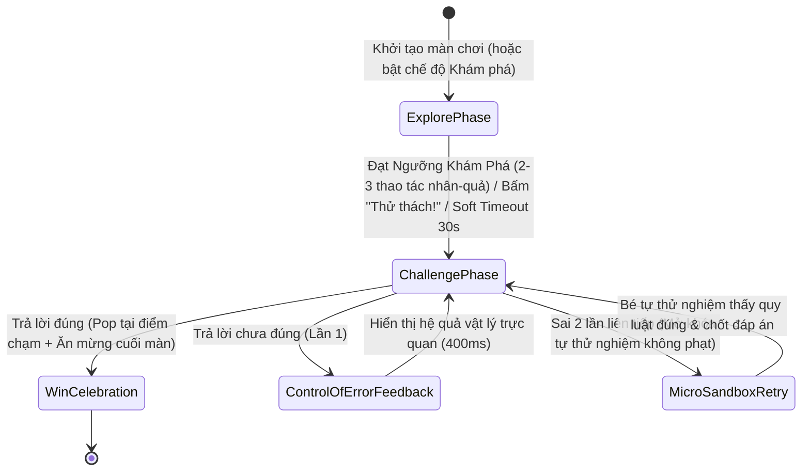

# Bản Thiết Kế Tổng Thể: Bộ Game Toán Tư Duy Montessori 2-Pha (Explore → Challenge) & Tự Kiểm Chứng Lỗi (Control of Error)

> **Nguồn cảm hứng & Căn cứ Sư phạm:** 22 tập PDF *"Toán tư duy New 2026 - 3-5 tuổi"* (Chặng 00 – Chặng 21: *Chuyến Tàu Toán Học — Vương Quốc Số*).
> **Mục tiêu kép:**
> 1. **Gây hứng thú tự nhiên (Intrinsic Motivation):** Trẻ được chạm, kéo, cân thử, lắc hộp, ghép quy luật âm nhạc và thấy phản hồi vật lý tức thì.
> 2. **Đề cao giáo dục tư duy (Deep Mathematical Thinking):** Áp dụng tiến trình **CPA (Concrete → Pictorial → Abstract)** kết hợp cơ chế **2 Pha (Vọc thử tự do → Giải đố tư duy)** và **Tự kiểm chứng lỗi bằng trực quan (Control of Error + Micro-Sandbox Retry)**.

---

## 1. Kiến trúc Sư phạm Cốt lõi: Vòng lặp 2 Pha + Control of Error

### 1.1. Pha 1 — Vọc thử tự do theo Ngưỡng Khám Phá (`ExplorePhase`)
- Trẻ thao tác trực tiếp trên giáo cụ (đặt vật lên cân, chạm lật manh mối, đặt thử mảnh ghép vào ma trận, gán thử giá trị biểu tượng, đổi chỗ toa tàu).
- **Ngưỡng Khám Phá (`exploreMilestoneTarget = 2..3`)**: Khi trẻ thực hiện đủ `2–3` thao tác khám phá nhân-quả có ý nghĩa (hoặc sau thời gian mềm `30,000ms`), trạng thái `isExploreReadyForChallenge` bật `true`, Mascot đúc kết quy luật vừa quan sát được và mở nút chuyển sang **Pha 2 (Giải đố)**.
- **Tương thích ngược 100%**: Mọi thao tác trả lời đúng mục tiêu ngay từ đầu đều được ghi nhận hợp lệ để không phá vỡ các bài kiểm thử tự động hiện có.

### 1.2. Pha 2 — Giải đố Tư duy & Tự Kiểm Chứng Lỗi (`Control of Error`)
- Khi trẻ chọn chưa đúng ở Pha 2:
  1. **Không trừng phạt**: Tuyệt đối không dùng màu đỏ (`danger`), không trừ điểm, không âm thanh báo lỗi gay gắt (tuân thủ `07-game-engine.md`).
  2. **Diễn hoạt Nhân–Quả Vật lý (`controlOfErrorHint`)**: Thay vì chỉ rung nhẹ vô nghĩa, hệ thống diễn hoạt và hiển thị rõ **tại sao** lựa chọn đó chưa khớp quy luật toán học (ví dụ: *"Gộp 2 và 1 được 3, cần 5"*, *"Bên trái (5) vẫn nặng hơn bên phải (3)"*, *"Hình này vướng manh mối 2"*, *"Chưa khớp quy luật cột dọc"*).
  3. **Mở khóa Micro-Sandbox khi sai 2 lần liên tiếp (`consecutiveWrongCount >= 2`)**: Tự động kích hoạt chế độ `isMicroSandboxActive = true` cho phép bé chạm/đặt thử các phương án lên giáo cụ để quan sát kết quả vật lý mà không bị tính thêm lỗi, giúp bé tự ngộ ra đáp án đúng.

---

## 2. Thiết kế Chi tiết 5 Nhóm Giáo cụ Tư duy Montessori (9 Templates Chủ lực)

### Nhóm 1: Cân Đĩa Vật Lý (`GT-014`) & Đồng Hồ Ngày–Đêm (`GT-016`) — Chặng 05, 16, 18
| Thành phần | Cơ chế Vọc thử & Vật lý (Explore) | Cơ chế Tự Kiểm Chứng Lỗi (Control of Error) |
|---|---|---|
| **`GT-014` (`BalanceScaleSession`)** | • Đĩa cân có nội suy góc nghiêng mượt (`smoothTiltAngleDeg`) theo trọng lượng thực hai bên. • Theo dõi số lần bé đặt/thả vật để thử độ nghiêng (`exploreActionsCount`). | • Khi chọn sai bên nặng/nhẹ hoặc đặt vật chưa cân bằng, tính độ chênh lệch `leftW` vs `rightW` và phát thông điệp nhân–quả: *"Bên trái (${leftW}) nặng hơn bên phải (${rightW})"*. • Sai 2 lần liên tiếp → bật `isMicroSandboxActive` để bé tự do đặt thử các quả nặng lên cân xem kim cân bằng ở đâu. |
| **`GT-016` (`ClockHandsSession`)** | • Khi xoay kim đồng hồ (`adjust_time`), cung bầu trời hiển thị trạng thái Ban ngày / Buổi chiều / Ban đêm tương ứng với góc kim giờ. • Theo dõi số bước xoay kim khám phá (`exploreActionsCount`). | • Khi chọn sai thẻ giờ hoặc nộp sai giờ, đối chiếu trực quan giữa giờ hiện tại trên mặt đồng hồ (`currentTime`) và giờ mục tiêu (`target_time`): *"Đồng hồ đang chỉ X giờ, cần chỉnh tới Y giờ"*. • Sai 2 lần liên tiếp → bật `isMicroSandboxActive` dẫn hướng từng nấc kim. |

### Nhóm 2: Sơ Đồ Gộp–Tách Hạt (`GT-007`) & Đếm Theo Nhóm/Khung 10 Ô (`GT-028`) — Chặng 01, 07, 12, 13
| Thành phần | Cơ chế Vọc thử & Vật lý (Explore) | Cơ chế Tự Kiểm Chứng Lỗi (Control of Error) |
|---|---|---|
| **`GT-007` (`GT007Session`)** | • Hỗ trợ `previewOption(optionId)`: chạm thử lựa chọn để xem các hạt từ nhánh con chạy vào ô tổng tạo thành bao nhiêu hạt. | • Khi điền sai giá trị `v` vào nhánh khuyết (khi tổng là `W` và nhánh đã biết là `K`), tính tổng thực tế `actualSum = K + v` và hiển thị đối chiếu 1-1: *"Gộp ${K} và ${v} được ${actualSum} (cần ${W})"*. • Sai 2 lần liên tiếp → bật `isMicroSandboxActive` cho phép chạm thử từng thẻ để nhìn tổng hạt biến đổi. |
| **`GT-028` (`GT028Session`)** | • Mỗi lần chạm vật thể (`tap_item`), bộ đếm nhảy thêm đúng bước nhảy `step` (1, 2, 5...) kèm hiệu ứng gom nhóm trực quan. | • Khi bấm nộp (`submit_count`) mà `currentTotal !== target_total`, chỉ rõ độ lệch lượng: *"Đang có ${currentTotal}, thiếu ${target - current}"* hoặc *"thừa ${current - target}"*. • Sai 2 lần liên tiếp → bật `isMicroSandboxActive` hiển thị thanh đo tiến độ trực quan tới `target_total`. |

### Nhóm 3: Thay Thế Biểu Tượng & Hộp Bí Ẩn Xác Suất (`GT-010`) — Chặng 20
| Thành phần | Cơ chế Vọc thử & Vật lý (Explore) | Cơ chế Tự Kiểm Chứng Lỗi (Control of Error) |
|---|---|---|
| **`GT-010` (`SubstitutionSession`)** | • Trẻ chạm ghim thử giá trị cho từng biểu tượng (`pinSymbolValue`), các hàng phép tính thế ngay con số vào vị trí biểu tượng để trẻ kiểm chứng tổng hàng ngang. | • Khi chọn đáp án `v` chưa đúng so với `expectedAnswer`, hiển thị phép kiểm chứng thay thế trực quan: *"Thay số ${v} vào chưa khớp tổng (cần ${expectedAnswer})"*. • Sai 2 lần liên tiếp → tự động ghim gợi ý biểu tượng cơ sở đầu tiên (`autoPinFirstKnownSymbol`) trong chế độ `isMicroSandboxActive`. |

### Nhóm 4: Đoàn Tàu Quy Luật Âm Nhạc (`GT-006`) & Lưới Không Lặp Sudoku (`GT-015`) — Chặng 08, 15, 17
| Thành phần | Cơ chế Vọc thử & Vật lý (Explore) | Cơ chế Tự Kiểm Chứng Lỗi (Control of Error) |
|---|---|---|
| **`GT-006` (`GT006Session`)** | • Gán cao độ nốt nhạc (`getStepPitchIndex`: 0..4 tương ứng Đô–Rê–Mi–Pha–Son) cho từng mẫu toa tàu để trẻ cảm nhận nhịp điệu quy luật khi hoán đổi toa (`reorderSteps`). | • Khi bấm nộp dãy toa (`onSubmitSequence`) chưa đúng, xác định chính xác vị trí toa đầu tiên bị lệch quy luật (`firstMismatchIndex`) và hiển thị phản hồi tại đúng toa đó thay vì báo sai cả đoàn tàu. • Sai 2 lần liên tiếp → bật `isMicroSandboxActive` khóa nhẹ các toa đầu đã đứng đúng vị trí để trẻ chỉ cần tập trung sắp xếp các toa còn lệch. |
| **`GT-015` (`GT015Session`)** | • Hỗ trợ soi tia hàng ngang & cột dọc (`previewCellSymbol`) để trẻ nhìn các hình đã có trên cùng hàng/cột. | • Khi điền hình gây trùng lặp trên hàng hoặc cột, tìm chính xác tọa độ ô bị đụng độ (`findConflictingCells`) và phát thông điệp nhân–quả: *"Trùng hình ở hàng ${r + 1} / cột ${c + 1}"*. • Sai 2 lần liên tiếp → bật `isMicroSandboxActive` làm sáng các hình còn thiếu trên hàng/cột đó. |

### Nhóm 5: Suy Luận Loại Trừ Manh Mối (`GT-009`) & Ma Trận 2 Chiều / Góc Nhìn 3D (`GT-011`) — Chặng 03, 14, 17, 21
| Thành phần | Cơ chế Vọc thử & Vật lý (Explore) | Cơ chế Tự Kiểm Chứng Lỗi (Control of Error) |
|---|---|---|
| **`GT-009` (`GT009Session`)** | • Pha Khám phá: Trẻ chạm từng thẻ manh mối (`onClueRevealed`) để xem các ứng viên vi phạm bị gạch chéo mờ đi từng bước. | • Nếu trẻ chạm chọn một ứng viên sai (`candidateId !== answer_candidate_id`), hàm `findViolatedClueForCandidate(candidateId)` tìm đúng manh mối loại trừ ứng viên đó và báo: *"Vướng manh mối: ${clueText}"*. • Sai 2 lần liên tiếp → tự động lật mở manh mối bị vi phạm đó (`isMicroSandboxActive`) để gạch bỏ ứng viên sai ngay trước mắt trẻ. |
| **`GT-011` (`GT011Session`)** | • Chạm thử lựa chọn (`onOptionPreviewed`) để đặt vào ô trống và xem tia sáng kiểm tra quy luật Hàng ngang (`row_matches`) và Cột dọc (`col_matches`). | • Khi chọn phương án sai, phân tích rõ chiều nào chưa khớp: *"Khớp hàng ngang nhưng chưa khớp cột dọc"* hoặc *"Khớp cột dọc nhưng chưa khớp hàng ngang"*. • Sai 2 lần liên tiếp → bật `isMicroSandboxActive` chuyển thao tác chạm thành đặt thử (`preview`) cho tới khi cả 2 tia Hàng & Cột cùng sáng xanh. |

---

## 3. Cấu trúc Module & Phân công Subagent Team

1. **Module Nền tảng dùng chung (`packages/game-engine/src/systems/montessori-explore-system.ts` & `packages/game-engine/src/render/montessori-feedback.ts`)**:
   - Class `MontessoriExploreTracker`: Quản lý trạng thái 2 Pha (`explore` / `challenge`), bộ đếm `exploreActionsCount`, ngưỡng `exploreMilestoneTarget`, bộ đếm `consecutiveWrongCount`, trạng thái `isMicroSandboxActive`, và thông điệp nhân–quả `controlOfErrorHint`.
   - Helper render `drawMontessoriPhaseCallout(ctx, box, tracker)`: Vẽ huy hiệu trạng thái Khám phá / Tự kiểm chứng lỗi trên Canvas 2D hoàn toàn bằng `designTokens` và `applyCanvasFontAtSize` (0 hex literals, 0 inline font).
2. **5 Subagent Chuyên biệt (Chạy song song, tối đa ≤ 10 subagents)**:
   - **Subagent 1**: Triển khai Nhóm 1 (`GT-014` Balance Scale + `GT-016` Clock Hands) + unit tests.
   - **Subagent 2**: Triển khai Nhóm 2 (`GT-007` Number Bond + `GT-028` Tap Count) + unit tests.
   - **Subagent 3**: Triển khai Nhóm 3 (`GT-010` Substitution / Mystery Box) + unit tests.
   - **Subagent 4**: Triển khai Nhóm 4 (`GT-006` Pattern Train + `GT-015` Sudoku Mini) + unit tests.
   - **Subagent 5**: Triển khai Nhóm 5 (`GT-009` Clue Deduction + `GT-011` Matrix Choice) + unit tests.
3. **Kiểm định & Chụp ảnh Nghiệm thu Trực tiếp**:
   - Chạy toàn bộ test suite (`vitest`), `biome check`, `lint:game-tokens` (0 hex literals), và chụp ảnh trực tiếp trên `http://localhost:3000/play/preview-sandbox`.
