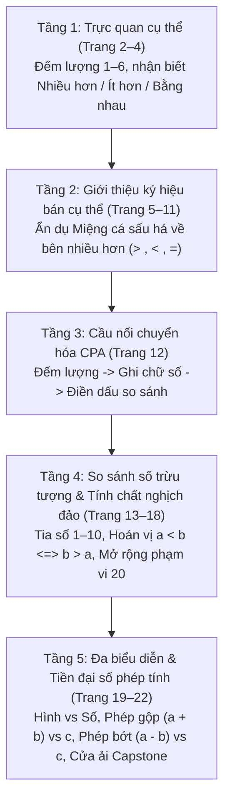

# Chặng 6: Thung Lũng Cân Bằng — Nhiều Hơn, Ít Hơn, Bằng Nhau

## 1. Objective (Mục tiêu cốt lõi)

Tài liệu này sở hữu đặc tả kỹ thuật và sư phạm nhằm tích hợp toàn diện kho dữ liệu trích xuất từ tài liệu PDF **"Chặng 6: Thung Lũng Cân Bằng — Nhiều hơn – Ít hơn – Bằng nhau"** (`docs/montessori/extracted/chang-06/analysis.json`, nguồn: *6 - So sanh so luong.pdf*, 23 trang, thuộc bộ giáo trình *Gấu Logic & Thỏ Quan Sát - Chuyến Tàu Toán Học*, Montessori VN) vào nền tảng **TiniMath v2**.

### Mục tiêu chiến lược:
1. **Thiết lập Vũ trụ Cốt truyện & Động lực Học tập**:
   - **Bối cảnh**: Sau Cơn Bão Lộn Xộn, Chuyến Tàu Toán Học tiến vào **Thung Lũng Cân Bằng**. Tại đây, cây cầu treo cổ kính bắc qua dòng suối phép thuật đang bị nghiêng ngả, mất thăng bằng nghiêm trọng. Viên Ngọc Cân Bằng (ngọc lục bảo xanh lá gắn tại đài vinh danh trên đỉnh núi) đã bị lu mờ ánh sáng.
   - **Nhiệm vụ sư phạm (Learning Quest)**: Bé đồng hành cùng Gấu Logic và Thỏ Quan Sát, vận dụng tư duy so sánh lượng trực quan và ký hiệu toán học để phục hồi trạng thái cân bằng cho các đĩa cân, dựng lại cây cầu và thắp sáng Viên Ngọc Cân Bằng.
2. **Khai thác triệt để các Game Engine hiện hữu (`GT-000`..`GT-037`)**:
   - **TUYỆT ĐỐI KHÔNG TẠO MỚI `GT-038+`**.
   - Phân giải 23 trang PDF thành 3 dạng bài chuẩn (`WB06-D1`, `WB06-D2`, `WB06-D3`) tương thích 100% với 3 khuôn tương tác cốt lõi đã có:
     - `GT-001` (`TapSelectSession` — Chọn một đáp án đúng): Chạm chọn nhóm có nhiều hơn / ít hơn; chọn nút dấu so sánh đúng giữa 3 lựa chọn trắc nghiệm.
     - `GT-008` (`DragToSlotSession` — Kéo thả vào ô đích): Kéo thẻ dấu so sánh cá sấu (`>`, `<`, `=`) vào ô trống giữa hai nhóm hình, giữa hai số, hoặc giữa phép tính tiền đại số và số.
     - `GT-014` (`BalanceScaleSession` — Cân thăng bằng hai bên): Quan sát độ nghiêng đĩa cân bập bênh để nhận biết bên nặng hơn / nhẹ hơn (`pick_heavier`, `pick_lighter`), hoặc thêm / bớt vật thể / quả cân để hai đĩa cân đạt trạng thái thăng bằng tuyệt đối (`goal: "balance"`).
3. **Phổ biến Kho Ngữ Liệu `SkillDataset` & `SkillLevelPlan[]`**:
   - Bổ sung hệ thống vật phẩm (`items`), câu thoại đồng hành (`phrasing`), ma trận đối nghịch (`relations`), và thang phát triển 5 bậc (`ladder`) vào các seeder kỹ năng so sánh thuộc strand `C1.CMP`:
     - `C1.CMP.01`: So sánh lớn hơn (Greater than `>`)
     - `C1.CMP.02`: So sánh nhỏ hơn (Less than `<`)
     - `C1.CMP.03`: So sánh bằng nhau (Equal `=`)
     - `C1.CMP.04`: Nhận biết nhiều hơn (More)
     - `C1.CMP.05`: Nhận biết ít hơn (Fewer / Less)
   - Cấp mã level chuẩn `GL-<COMP>-<STRAND>-<MECH>-01xx` (sequence $\ge 0101$), gắn nhãn `montessori_ref: "WB06-D<n>"`, phân bổ `access_tier` tương ứng `difficulty` (1: `free`, 2: `login`, 3: `standard`, 4: `premium`), tuân thủ nghiêm ngặt `BR-MCM-06` (không chứa từ khóa thương mại IQ/Raven/trí tuệ).
4. **Hiện thực hóa Tiến trình Sư phạm CPA & Tiền đại số 5 tầng**:
   - Cụ thể hóa lộ trình từ lượng cụ thể (đếm vật, nối cặp tương ứng 1-1) $\rightarrow$ bán cụ thể (ẩn dụ miệng cá sấu há về bên nhiều hơn) $\rightarrow$ chuyển tiếp CPA (Đếm lượng $\rightarrow$ Ghi số $\rightarrow$ Điền dấu) $\rightarrow$ ký hiệu số trừu tượng và tính chất hoán vị nghịch đảo ($a < b \Leftrightarrow b > a$) $\rightarrow$ tiền đại số bất đẳng thức phép tính ($a \pm b$ vs $c$) và cửa ải tổng hợp Capstone.

---

## 2. Actors & Pedagogical Roles

| Tác nhân / Nhân vật | Vai trò hệ thống | Vai trò sư phạm & Đặc điểm nhận diện trong Chặng 6 |
|---|---|---|
| **Bé (Kid Player)** | Người chơi chính (3–6 tuổi) | Nhập vai kỹ sư cân bằng nhỏ, tương tác chạm và kéo thả để làm thăng bằng các đĩa cân, nối các móc xích toa tàu số, thu thập đủ ánh sáng mở cánh cổng Thung Lũng Cân Bằng. |
| **Gấu Logic (`gau_logic`)** | Nhân vật đồng hành (Scaffolding Guide - Trục Logic) | Đại diện tư duy trừu tượng, phân tích và trật tự số. Ngoại hình: Gấu nâu đeo kính tròn xanh dương, áo gile có cúc vàng, cầm các thẻ số và bảng tính. Thường đưa ra câu hỏi định hướng logic: *"Hai bên thung lũng có những đàn chim khác nhau!", "Miệng cá sấu luôn há về phía có nhiều hơn!", "Khi hai số đổi chỗ, dấu cũng phải quay lại!", "Số nào đứng sau trên tia số thì lớn hơn!"*. |
| **Thỏ Quan Sát (`tho_quan_sat`)** | Nhân vật đồng hành (Sensory Observer - Trục Trực quan) | Đại diện tư duy thị giác, đếm xúc giác và tương ứng 1-1. Ngoại hình: Thỏ trắng đeo kính lúp thám tử viền vàng cam, túi da chéo. Lời thoại nhắc nhở phương pháp đếm trực quan: *"Chạm tay vào từng hình khi đếm nhé!", "Đếm cả hai bên rồi mới chọn!", "Bé có thể nối từng cặp để so sánh!", "Đếm theo hàng để không bị sót!", "Hình xếp lộn xộn vẫn cần đếm từng hình!"*. |
| **Phụ huynh / Giáo viên** | Người đồng hành ngoài màn hình | Hướng dẫn theo mô hình 4 bước: Khơi gợi $\rightarrow$ Khám phá $\rightarrow$ Giải quyết $\rightarrow$ Khen ngợi nỗ lực. Cùng bé đánh giá 3 ngôi sao và tô màu Viên Ngọc Cân Bằng ở trang tổng kết 23. |
| **Content Seeder Engine** | Hệ thống tự động | Chuyển hóa `SkillLevelPlan[]` thành `ContentSeed` hợp lệ, kiểm duyệt Zod schema và xác thực qua bộ cổng `montessori-gate.ts`. |

---

## 3. Entry Points & File Mapping

```
docs/montessori/extracted/chang-06/analysis.json (WB06, 23 trang)
   │
   ├──> docs/montessori/dataset/activity-types-table.md  (Cập nhật WB06-D1..D2, thêm WB06-D3)
   ├──> docs/specs/05-content/montessori-corpus-mapping.md (Cập nhật hàng 06: GT-001, GT-008, GT-014)
   │
   ├──> packages/content/src/skills/c1/cmp/C1.CMP.04.ts (WB06-D1 -> GT-001: GL-C1-CMP-TAP-0101, GT-014: GL-C1-CMP-BAL-0101)
   ├──> packages/content/src/skills/c1/cmp/C1.CMP.05.ts (WB06-D1 -> GT-001: GL-C1-CMP-TAP-0102, GT-014: GL-C1-CMP-BAL-0102)
   ├──> packages/content/src/skills/c1/cmp/C1.CMP.03.ts (WB06-D1/D2 -> GT-008: GL-C1-CMP-SLOT-0101, GT-014: GL-C1-CMP-BAL-0103)
   ├──> packages/content/src/skills/c1/cmp/C1.CMP.01.ts (WB06-D2/D3 -> GT-008: GL-C1-CMP-SLOT-0102, GL-C1-CMP-SLOT-0103, GL-C1-CMP-SLOT-0104)
   └──> packages/content/src/skills/c1/cmp/C1.CMP.02.ts (WB06-D2/D3 -> GT-001: GL-C1-CMP-TAP-0103, GT-008: GL-C1-CMP-SLOT-0105)
```

- **Mã nguồn Engine sử dụng**:
  - `packages/game-engine/src/templates/GT-001/` (`TapSelectSession` — Single Choice Tap Select).
  - `packages/game-engine/src/templates/GT-008/` (`DragToSlotSession` — Drag and Drop to Target Slots).
  - `packages/game-engine/src/templates/GT-014/` (`BalanceScaleSession` — Interactive Balance Pan Beam).
- **Phạm vi kiểm thử & Xác thực**:
  - `packages/content-build/src/gates/montessori-gate.ts`.
  - `packages/content-build/tests/gates/montessori-corpus.test.ts`.

---

## 4. Pedagogical Deconstruction: Tiến Trình 23 Trang PDF Chặng 6

Giáo trình Chặng 6 được thiết kế theo 5 tầng nhận thức tăng dần cực kỳ chặt chẽ theo tinh thần Montessori và CPA:



### 4.1. Tầng 1: So sánh trực quan cụ thể (Trang 2 – 4)
- **Trang 1 (Bìa mở đầu)**: Cây cầu treo thung lũng có 2 cổng khắc dấu `>` và `<`. Gấu Logic cầm thẻ số, Thỏ Quan Sát cầm kính lúp dẫn đầu đoàn tàu số.
- **Trang 2 (Nhiều hơn)**: So sánh đàn chim đậu trên cành: Chim sẻ đỏ ($2$ vs $5$ $\rightarrow$ phải), Chim xanh dương ($4$ vs $1$ $\rightarrow$ trái), Chim hoàng yến vàng ($3$ vs $6$ $\rightarrow$ phải). Hướng dẫn xúc giác: *"Chạm tay vào từng hình khi đếm"*.
- **Trang 3 (Ít hơn)**: So sánh giỏ quả mây: Táo đỏ ($4$ vs $2$ $\rightarrow$ phải), Dâu tây ($1$ vs $5$ $\rightarrow$ trái), Cam tròn ($6$ vs $3$ $\rightarrow$ phải). Chuyển đổi lăng kính chú ý (cognitive flexibility) để tìm nhóm ít hơn.
- **Trang 4 (Bằng nhau)**: Giới thiệu dấu bằng `=`: Cà rốt ($3 = 3$), Bướm hồng ($4 = 4$), Bóng bãi biển ($5 = 5$). Khái niệm cân bằng: khi hai bên có cùng số hình thì đĩa cân thăng bằng tuyệt đối.

### 4.2. Tầng 2: Ký hiệu bán cụ thể & Ẩn dụ Miệng cá sấu (Trang 5 – 11)
- **Trang 5 (Ẩn dụ Cá sấu)**: Giới thiệu dấu `>` và `<` qua mô hình *Miệng cá sấu luôn há về bên nhiều hơn*. Động vật nông trại: Vịt con ($2 < 5$), Bò sữa ($4 > 1$), Heo con ($3 < 6$).
- **Trang 6 (Ba dấu trọn vẹn)**: Vườn hoa cân bằng: Hoa đỏ ($4 = 4$), Hoa vàng ($2 < 5$), Hoa tím ($6 > 3$). Bộ 3 quan hệ so sánh hoàn chỉnh (Trichotomy Law).
- **Trang 7 (Mảng phân tán ngẫu nhiên)**: Ao cá bơi lội nhiều góc nghiêng: Cá tím ($5 > 4$), Cá cam ($4 = 4$), Cá xanh biển ($2 < 6$). Rèn chiến lược đếm có hệ thống để không sót đối tượng.
- **Trang 8 (Phương pháp ghép tương ứng 1-1)**: Bữa tiệc bánh ngọt: Cupcake dâu ($1 < 4$), Donut sô-cô-la ($5 > 2$), Bánh quy sao ($6 = 6$). Nối ruy băng từng cặp bánh giữa 2 bàn: bên nào thừa vật thể thì bên đó nhiều hơn.
- **Trang 9 (Đếm theo hàng mảng lớn)**: Gara xe nhộn nhịp: Ô tô đỏ ($7 > 4$), Xe buýt vàng ($3 < 6$), Xe tải xanh ($5 < 8$). Chiến lược đếm theo hàng (Row-by-row strategy).
- **Trang 10 (Đếm mảng lớn tiệm cận 10)**: Rừng muông thú: Sóc hạt dẻ ($9 > 5$), Hươu sao ($4 < 8$), Nhím gai ($7 = 7$). Kỹ năng đánh dấu nhẹ đối tượng đã đếm để giảm tải bộ nhớ làm việc (working memory).
- **Trang 11 (Mốc chuẩn 10 cụ thể)**: Kho báu thung lũng: Tiền vàng ngôi sao ($6 < 10$), Kim cương xanh ($8 > 5$), Hồng ngọc đỏ ($7 = 7$).

### 4.3. Tầng 3: Cầu nối chuyển hóa CPA (Trang 12)
- **Trang 12 (Đếm lượng $\rightarrow$ Viết số $\rightarrow$ Điền dấu)**:
  - Dòng 1: Đếm $3$ quả táo đỏ $\rightarrow$ ghi số $3$; đếm $6$ quả táo $\rightarrow$ ghi số $6$; so sánh $3 < 6$.
  - Dòng 2: Đếm $5$ chú bướm $\rightarrow$ ghi số $5$; đếm $2$ chú bướm $\rightarrow$ ghi số $2$; so sánh $5 > 2$.
  - Dòng 3: Đếm $4$ quả bóng $\rightarrow$ ghi số $4$; đếm $4$ quả bóng $\rightarrow$ ghi số $4$; so sánh $4 = 4$.
  - Đây là mắt xích sư phạm quan trọng nhất giúp trẻ chuyển hóa mượt mà từ tri giác hình ảnh sang ký hiệu số học trừu tượng.

### 4.4. Tầng 4: So sánh số thuần trừu tượng & Tính chất nghịch đảo (Trang 13 – 18)
- **Trang 13 (Cặp số 1–10)**: Tia số tâm trí (Mental Number Line): $2 < 5$, $8 > 3$, $4 = 4$, $7 < 9$, $10 > 6$, $1 = 1$. Quy tắc: *Số nào đứng sau thì lớn hơn*.
- **Trang 14 (Đá rêu phong)**: Điền dấu vào cặp số trên đá tự nhiên: $5 < 7$, $9 > 2$, $6 = 6$, $3 < 8$, $10 > 4$, $1 = 1$.
- **Trang 15 (Tính chất nghịch đảo & Đối xứng)**:
  - Khi hoán đổi hai số, chiều của dấu quay ngược lại:
    $$2 < 8 \iff 8 > 2$$
    $$3 < 7 \iff 7 > 3$$
    $$5 = 5 \iff 5 = 5 \text{ (dấu = giữ nguyên)}$$
  - Rèn tư duy đại số quan hệ (relational thinking) sâu sắc.
- **Trang 16 (Trắc nghiệm 3 lựa chọn)**: Khoanh vào dấu đúng giữa 3 nút tròn: $6 [>] 2$, $4 [<] 9$, $7 [=] 7$.
- **Trang 17 (Toa tàu số)**: Nối móc xích toa tàu: $3 < 8$, $9 > 5$, $6 = 6$, $1 < 7$, $10 > 4$, $2 = 2$.
- **Trang 18 (Mở rộng số có 2 chữ số phạm vi 20)**:
  - So sánh số 2 chữ số vs số 1 chữ số: $12 > 7$, $9 < 15$, $6 < 20$.
  - So sánh hai số có cùng hàng chục là 1: đối chiếu hàng đơn vị ($18 > 11$ vì $8 > 1$).
  - Số bằng nhau: $14 = 14$, $17 = 17$.

### 4.5. Tầng 5: Đa biểu diễn & Tiền đại số phép tính (Trang 19 – 23)
- **Trang 19 (Nhóm hình vs Chữ số)**: Đối chiếu đa biểu diễn chéo: $5 \text{ quả táo} < 7$, $8 \text{ con cá} = 8$, $9 \text{ ngôi sao} > 6$.
- **Trang 20 (Tiền đại số phép cộng: $a + b$ vs $c$)**: Gộp nhóm rồi so sánh:
  - $2 \text{ táo} + 3 \text{ táo} = 5 \text{ quả} < 6$
  - $4 \text{ sao} + 2 \text{ sao} = 6 \text{ sao} > 5$
  - $3 \text{ cá} + 3 \text{ cá} = 6 \text{ con} = 6$
- **Trang 21 (Tiền đại số phép trừ: $a - b$ vs $c$)**: Tính nhẩm rồi so sánh:
  - $7 - 2 = 5 > 4$
  - $9 - 3 = 6 = 6$
  - $8 - 1 = 7 < 9$
  - $10 - 4 = 6 > 5$
  - $6 - 2 = 4 = 4$
  - $5 - 3 = 2 < 3$
- **Trang 22 (Cửa ải cân bằng - Capstone Assessment)**: Thử thách tổng hợp 6 phép so sánh mở cánh cổng:
  1. Hình vs Số: $4 \text{ quả táo} < 7$
  2. Số 2 chữ số vs 1 chữ số: $12 > 9$
  3. Hình vs Hình: $5 \text{ ngôi sao} = 5 \text{ ngôi sao}$
  4. Phép cộng vs Số: $2 + 4 = 6 > 5$
  5. Phép trừ vs Số: $9 - 3 = 6 = 6$
  6. Hai số phạm vi 20: $15 < 18$
- **Trang 23 (Vinh danh & Chuyển giao Chặng 7)**: Cây cầu được khôi phục, Viên Ngọc Cân Bằng bừng sáng, đánh giá 3 ngôi sao và chuẩn bị sang Chặng 7 (Khu Vườn 2 Nhánh - Number Bonds).

---

## 5. Dạng Bài Chuẩn Hóa & Ánh Xạ Game Engine

Để tối ưu hóa trải nghiệm tương tác số và không tạo engine dư thừa, Chặng 6 được quy tụ vào **3 dạng bài chủ đạo**:

### 5.1. Dạng bài `WB06-D1`: So sánh trực quan 2 nhóm vật thể (Nhiều hơn / Ít hơn / Bằng nhau)
- **Trang PDF đại diện**: Trang 2, 3, 4.
- **Mục tiêu sư phạm**: Nhận biết và phân biệt khái niệm "nhiều hơn", "ít hơn", "bằng nhau" qua số lượng phần tử của 2 tập hợp vật thể trực quan (phạm vi 1–6).
- **Khuôn Game Engine**:
  - **`GT-001` (tap-select)**: Hiển thị 2 nhóm vật thể (hoặc 2 giỏ quả / 2 cành chim). Trẻ chạm trực tiếp vào nhóm có số lượng nhiều hơn (hoặc ít hơn) theo yêu cầu của đề bài.
  - **`GT-014` (balance-scale)**: Bàn cân bập bênh hiển thị 2 đĩa cân chứa 2 nhóm vật thể. Trẻ chạm chọn đĩa cân nặng hơn (`goal: "pick_heavier"`) hoặc nhẹ hơn (`goal: "pick_lighter"`). Bàn cân mô phỏng độ nghiêng vật lý chân thực.
- **Kỹ năng mục tiêu**: `C1.CMP.04` (Nhiều hơn), `C1.CMP.05` (Ít hơn), `C1.CMP.03` (Bằng nhau).

### 5.2. Dạng bài `WB06-D2`: Điền dấu quan hệ `>`, `<`, `=` giữa 2 nhóm hình ảnh
- **Trang PDF đại diện**: Trang 5, 6, 7, 8, 9, 10, 11.
- **Mục tiêu sư phạm**: Giới thiệu và vận dụng quy tắc ký hiệu bất đẳng thức/đẳng thức qua mô hình ẩn dụ "Miệng cá sấu há về bên nhiều hơn". Mở rộng phạm vi đếm lên đến 10 đối tượng trên các cách bố trí mảng thẳng hàng, mảng phân tán tự do và nối cặp tương ứng 1-1.
- **Khuôn Game Engine**:
  - **`GT-008` (drag-to-slot)**: Hai nhóm hình ảnh nằm ở hai bên; ở giữa có một ô tròn trung tâm. Bên dưới là khay chứa các thẻ bài dấu cá sấu `>`, `<`, `=`. Trẻ kéo thẻ dấu thích hợp thả vào ô tròn giữa hai nhóm.
  - **`GT-001` (tap-select trắc nghiệm)**: Dành cho bài trắc nghiệm nhanh: màn hình hiện 2 nhóm hình, bên dưới có 3 nút tròn chứa ký hiệu `>`, `<`, `=`. Trẻ tap vào nút đúng.
- **Kỹ năng mục tiêu**: `C1.CMP.01` (Lớn hơn `>`), `C1.CMP.02` (Nhỏ hơn `<`), `C1.CMP.03` (Bằng nhau `=`).

### 5.3. Dạng bài `WB06-D3`: Cân bằng đĩa cân, Chuyển tiếp CPA & Tiền đại số phép tính
- **Trang PDF đại diện**: Trang 12, 13, 14, 15, 16, 17, 18, 19, 20, 21, 22.
- **Mục tiêu sư phạm**:
  - Bước chuyển tiếp CPA: Đếm lượng $\rightarrow$ Ghi số $\rightarrow$ Điền dấu.
  - Thao tác cân bằng đĩa cân: Thêm hoặc bớt vật thể / quả cân để đạt trạng thái thăng bằng tuyệt đối ($=$).
  - So sánh số thuần trừu tượng phạm vi 20 và vận dụng tính chất hoán vị nghịch đảo ($a < b \iff b > a$).
  - Tiền đại số: So sánh kết quả phép tính gộp/bớt ($a \pm b$) với một số.
- **Khuôn Game Engine**:
  - **`GT-014` (balance-scale — `goal: "balance"`)**: Hai đĩa cân chưa thăng bằng. Khay dưới chứa các vật phẩm hoặc quả cân số. Trẻ kéo vật thả vào đĩa nhẹ hơn (hoặc bớt ra) để kim cân chỉ đúng vạch thăng bằng trung tâm.
  - **`GT-008` (drag-to-slot đa ô)**: Kéo thẻ số vào ô đếm rồi kéo dấu vào ô so sánh; hoặc kéo dấu so sánh vào giữa biểu thức phép tính ($a \pm b$) và số $c$.
- **Kỹ năng mục tiêu**: `C1.CMP.01`, `C1.CMP.02`, `C1.CMP.03`, tích hợp `C1.ADD.02`, `C1.SUB.02`.

---

## 6. Thiết Kế Kho Ngữ Liệu `SkillDataset` (Enriched Corpus)

Hệ thống ngữ liệu lấy cảm hứng trực tiếp từ các hình ảnh, nhân vật, và câu thoại giàu tính sư phạm trong 23 trang PDF Chặng 6:

### 6.1. Dataset Đặc Trưng Chặng 6: `WB06_VALLEY_COMPARISON_DATASET`

```typescript
export const WB06_VALLEY_COMPARISON_DATASET: SkillDataset = {
  skill_code: "C1.CMP.04",
  concept_label: "So sánh nhiều hơn, ít hơn và bằng nhau tại Thung Lũng Cân Bằng",
  surface: "game",
  items: [
    // Đàn chim thung lũng (Trang 2)
    {
      id: "wb06_sparrow_pair",
      label: "hai chú chim sẻ đỏ",
      glyph: "🐦🐦",
      value: 2,
      contrast_group: "valley_birds",
      ordering: 1,
      image: { kind: "emoji", ref: "🐦" },
      category: { type: "đàn chim nhỏ" }
    },
    {
      id: "wb06_sparrow_flock",
      label: "năm chú chim sẻ đỏ",
      glyph: "🐦🐦🐦🐦🐦",
      value: 5,
      contrast_group: "valley_birds",
      ordering: 2,
      image: { kind: "emoji", ref: "🐦" },
      category: { type: "đàn chim đông" }
    },
    {
      id: "wb06_bluebird_flock",
      label: "bốn chú chim xanh",
      glyph: "🐦🐦🐦🐦",
      value: 4,
      contrast_group: "valley_birds",
      ordering: 3,
      image: { kind: "emoji", ref: "🐦" },
      category: { type: "đàn chim đông" }
    },
    {
      id: "wb06_bluebird_single",
      label: "một chú chim xanh",
      glyph: "🐦",
      value: 1,
      contrast_group: "valley_birds",
      ordering: 4,
      image: { kind: "emoji", ref: "🐦" },
      category: { type: "chim đơn lẻ" }
    },
    // Giỏ quả nông trại (Trang 3)
    {
      id: "wb06_apple_basket_4",
      label: "bốn quả táo đỏ",
      glyph: "🍎🍎🍎🍎",
      value: 4,
      contrast_group: "fruit_baskets",
      ordering: 5,
      image: { kind: "emoji", ref: "🍎" },
      category: { type: "giỏ nhiều quả" }
    },
    {
      id: "wb06_apple_basket_2",
      label: "hai quả táo đỏ",
      glyph: "🍎🍎",
      value: 2,
      contrast_group: "fruit_baskets",
      ordering: 6,
      image: { kind: "emoji", ref: "🍎" },
      category: { type: "giỏ ít quả" }
    },
    {
      id: "wb06_strawberry_1",
      label: "một quả dâu tây",
      glyph: "🍓",
      value: 1,
      contrast_group: "fruit_baskets",
      ordering: 7,
      image: { kind: "emoji", ref: "🍓" },
      category: { type: "giỏ ít quả" }
    },
    {
      id: "wb06_strawberry_5",
      label: "năm quả dâu tây",
      glyph: "🍓🍓🍓🍓🍓",
      value: 5,
      contrast_group: "fruit_baskets",
      ordering: 8,
      image: { kind: "emoji", ref: "🍓" },
      category: { type: "giỏ nhiều quả" }
    },
    // Vật thể bằng nhau (Trang 4)
    {
      id: "wb06_carrots_equal_3",
      label: "ba củ cà rốt cam",
      glyph: "🥕🥕🥕",
      value: 3,
      contrast_group: "equal_groups",
      ordering: 9,
      image: { kind: "emoji", ref: "🥕" },
      category: { type: "nhóm cân bằng" }
    },
    {
      id: "wb06_butterflies_equal_4",
      label: "bốn chú bướm hồng",
      glyph: "🦋🦋🦋🦋",
      value: 4,
      contrast_group: "equal_groups",
      ordering: 10,
      image: { kind: "emoji", ref: "🦋" },
      category: { type: "nhóm cân bằng" }
    },
    // Động vật nông trại & Thẻ dấu cá sấu (Trang 5)
    {
      id: "wb06_ducks_group_2",
      label: "hai chú vịt con",
      glyph: "🦆🦆",
      value: 2,
      contrast_group: "farm_animals",
      ordering: 11,
      image: { kind: "emoji", ref: "🦆" },
      category: { type: "nhóm vịt" }
    },
    {
      id: "wb06_ducks_group_5",
      label: "năm chú vịt con",
      glyph: "🦆🦆🦆🦆🦆",
      value: 5,
      contrast_group: "farm_animals",
      ordering: 12,
      image: { kind: "emoji", ref: "🦆" },
      category: { type: "nhóm vịt" }
    },
    // Kho báu & Đá quý thung lũng (Trang 11, 23)
    {
      id: "wb06_gold_coins_6",
      label: "sáu đồng tiền vàng",
      glyph: "🪙🪙🪙🪙🪙🪙",
      value: 6,
      contrast_group: "treasures",
      ordering: 13,
      image: { kind: "emoji", ref: "🪙" },
      category: { type: "tiền vàng" }
    },
    {
      id: "wb06_gold_coins_10",
      label: "mười đồng tiền vàng",
      glyph: "🪙🪙🪙🪙🪙🪙🪙🪙🪙🪙",
      value: 10,
      contrast_group: "treasures",
      ordering: 14,
      image: { kind: "emoji", ref: "🪙" },
      category: { type: "tiền vàng" }
    },
    {
      id: "wb06_balance_gem",
      label: "Viên Ngọc Cân Bằng",
      glyph: "💎",
      value: 20,
      contrast_group: "treasures",
      ordering: 15,
      image: { kind: "emoji", ref: "💎" },
      category: { type: "bảo ngọc thung lũng" }
    }
  ],
  relations: [
    { type: "contrast", source_id: "wb06_sparrow_pair", target_id: "wb06_sparrow_flock" },
    { type: "contrast", source_id: "wb06_bluebird_single", target_id: "wb06_bluebird_flock" },
    { type: "contrast", source_id: "wb06_apple_basket_2", target_id: "wb06_apple_basket_4" },
    { type: "contrast", source_id: "wb06_strawberry_1", target_id: "wb06_strawberry_5" },
    { type: "equivalent", source_id: "wb06_carrots_equal_3", target_id: "wb06_carrots_equal_3" },
    { type: "equivalent", source_id: "wb06_butterflies_equal_4", target_id: "wb06_butterflies_equal_4" }
  ],
  ladder: [
    { rung: 1, dimension: "range", description: "So sánh trực quan 2 nhóm vật phạm vi 1–5", representation: "discrete-object" },
    { rung: 2, dimension: "range", description: "Làm quen dấu so sánh qua ẩn dụ miệng cá sấu", representation: "discrete-object" },
    { rung: 3, dimension: "distractor_count", description: "So sánh mảng phân tán và đối chiếu tương ứng 1-1", representation: "ten-frame" },
    { rung: 4, dimension: "item_count", description: "So sánh số trừu tượng và tính chất hoán vị nghịch đảo", representation: "symbolic" },
    { rung: 5, dimension: "speed_scaffolding", description: "Tiền đại số phép tính và cửa ải cân bằng tổng hợp", representation: "symbolic" }
  ],
  phrasing: {
    prompt_template: "Bé hãy tìm nhóm {label} hoặc điền dấu thích hợp để giúp cây cầu thăng bằng nhé!",
    narration_template: "Chào mừng bé đến với Thung Lũng Cân Bằng! Cùng Gấu Logic và Thỏ Quan Sát khôi phục sự thăng bằng nhé!"
  },
  ordering: [
    "wb06_sparrow_pair", "wb06_sparrow_flock",
    "wb06_bluebird_single", "wb06_bluebird_flock",
    "wb06_apple_basket_2", "wb06_apple_basket_4",
    "wb06_strawberry_1", "wb06_strawberry_5",
    "wb06_carrots_equal_3", "wb06_butterflies_equal_4",
    "wb06_ducks_group_2", "wb06_ducks_group_5",
    "wb06_gold_coins_6", "wb06_gold_coins_10",
    "wb06_balance_gem"
  ]
};
```

---

## 7. Ma Trận `SkillLevelPlan[]` Database Seeder

Tất cả các màn chơi được sinh ra từ Chặng 6 tuân thủ nghiêm ngặt quy tắc đặt mã `GL-<COMP>-<STRAND>-<MECH>-01xx` (sequence $\ge 0101$), gắn nhãn `montessori_ref: "WB06-D<n>"`, phân bổ `access_tier` tương ứng `difficulty`:
- `difficulty: 1` $\rightarrow$ `access_tier: "free"`
- `difficulty: 2` $\rightarrow$ `access_tier: "login"`
- `difficulty: 3` $\rightarrow$ `access_tier: "standard"`
- `difficulty: 4` $\rightarrow$ `access_tier: "premium"`

### Bảng Kế Hoạch 10 Level Mẫu Phổ Biến Chặng 6:

| Mã Level Plan | Template | Band | Diff | Tier | Ref | Skill Code | Tên & Kịch bản sư phạm |
|---|:---:|:---:|:---:|:---:|:---:|:---:|---|
| `GL-C1-CMP-TAP-0101` | `GT-001` | 3-4 | 1 | `free` | `WB06-D1` | `C1.CMP.04` | **Đàn chim bên nào đông hơn?** (Trang 2). Chạm chọn đàn chim sẻ hoặc chim hoàng yến có số lượng nhiều hơn ($2$ vs $5$, $4$ vs $1$, $3$ vs $6$). |
| `GL-C1-CMP-TAP-0102` | `GT-001` | 3-4 | 1 | `free` | `WB06-D1` | `C1.CMP.05` | **Giỏ quả bên nào ít hơn?** (Trang 3). Chạm chọn giỏ táo đỏ hoặc dâu tây có số lượng ít hơn ($4$ vs $2$, $1$ vs $5$, $6$ vs $3$). |
| `GL-C1-CMP-BAL-0101` | `GT-014` | 3-4 | 2 | `login` | `WB06-D1` | `C1.CMP.04` | **Bàn cân thung lũng — Tìm bên nặng hơn** (Trang 2–3). Quan sát đĩa cân bập bênh nghiêng về bên chứa nhiều vật thể hơn; tap chọn đĩa nặng hơn (`goal: "pick_heavier"`). |
| `GL-C1-CMP-BAL-0102` | `GT-014` | 3-4 | 2 | `login` | `WB06-D1` | `C1.CMP.05` | **Bàn cân thung lũng — Tìm bên nhẹ hơn** (Trang 2–3). Quan sát đĩa cân bập bênh nâng cao hơn; tap chọn đĩa nhẹ hơn (`goal: "pick_lighter"`). |
| `GL-C1-CMP-SLOT-0101` | `GT-008` | 3-4 | 2 | `login` | `WB06-D2` | `C1.CMP.03` | **Hai bên bằng nhau** (Trang 4, 6). Kéo thả thẻ dấu bằng `=` vào ô giữa hai nhóm cà rốt ($3 = 3$), bướm hồng ($4 = 4$), bóng bãi biển ($5 = 5$) hoặc vườn hoa ($4 = 4$). |
| `GL-C1-CMP-SLOT-0102` | `GT-008` | 4-5 | 2 | `login` | `WB06-D2` | `C1.CMP.01` | **Miệng cá sấu nông trại** (Trang 5, 8). Kéo thẻ dấu cá sấu `>` hoặc `<` vào ô giữa các đàn vịt, bò sữa, bánh cupcake. Mnemonic: Cá sấu luôn há miệng về bên nhiều hơn. |
| `GL-C1-CMP-SLOT-0103` | `GT-008` | 4-5 | 3 | `standard` | `WB06-D2` | `C1.CMP.01` | **Kho báu & Gara xe mảng lớn** (Trang 9, 10, 11). Kéo dấu so sánh vào ô giữa các mảng xe và đá quý phạm vi 10 đối tượng mảng 2 hàng và phân tán. |
| `GL-C1-CMP-SLOT-0104` | `GT-008` | 4-5 | 3 | `standard` | `WB06-D3` | `C1.CMP.01` | **Đếm – Viết số – Điền dấu (CPA Bridge)** (Trang 12). Kéo thẻ số vào 2 ô đếm của 2 nhóm hình, sau đó kéo dấu so sánh `>`, `<`, `=` vào ô tròn giữa 2 số. |
| `GL-C1-CMP-BAL-0103` | `GT-014` | 4-5 | 3 | `standard` | `WB06-D3` | `C1.CMP.03` | **Khôi phục đĩa cân thăng bằng** (Trang 4, 20). Hai đĩa cân bị lệch. Trẻ kéo quả táo hoặc quả cân từ khay đặt vào đĩa nhẹ hơn để đạt thăng bằng tuyệt đối (`goal: "balance"`). |
| `GL-C1-CMP-SLOT-0105` | `GT-008` | 5-6 | 4 | `premium` | `WB06-D3` | `C1.CMP.01` | **Tiền đại số & Cửa ải cân bằng** (Trang 20, 21, 22). Kéo dấu so sánh vào biểu thức phép tính gộp $(a + b)$ vs $c$ và phép tính bớt $(a - b)$ vs $c$ để mở cánh cổng Thung Lũng Cân Bằng. |

---

## 8. Business Rules & Bất Biến Sư Phạm

| Mã Quy Tắc | Nội Dung Quy Tắc | Cơ Chế & Lý Do Bắt Buộc |
|---|---|---|
| `BR-CHANG06-01` | **Không còi buzzer, không màu đỏ trừng phạt** | Tuyệt đối không dùng màu đỏ hoặc âm thanh còi lỗi khi trẻ chọn sai bên nhiều/ít hoặc đặt sai dấu. Phản hồi sai là nhịp thở hổ phách mềm mại (`amber_soft`, 400ms), vật trôi về khay nhẹ nhàng kèm lời nhắc ấm áp từ Thỏ Quan Sát. |
| `BR-CHANG06-02` | **Sàn cảm ứng xúc giác theo band tuổi** | Band 3–4 tuổi yêu cầu đường kính chạm tối thiểu $96\text{px}$; band 4–5 và 5–6 tối thiểu $72\text{px}$. Kích thước đĩa cân và ô chứa dấu trên Canvas $960 \times 540$ đạt tối thiểu $110\text{px} \times 110\text{px}$. |
| `BR-CHANG06-03` | **100% Design Tokens, cấm Hex Literals** | Toàn bộ màu sắc và font chữ trong `GT-001`, `GT-008`, `GT-014` phải sử dụng từ `designTokens.ts` (`primaryIndigo`, `ctaOrange`, `amberGlow`, `natureGreen`, v.v.). Tuyệt đối không hardcode mã `#hex`. |
| `BR-CHANG06-04` | **Phản hồi tương tác tức thì $\le 60\text{ms}$** | Khi trẻ chạm vào hình ảnh để đếm hoặc thả dấu vào ô, hiệu ứng nảy nhẹ và âm thanh phát trong khung hình đầu tiên của RAF loop để duy trì liên kết nhân quả. |
| `BR-CHANG06-05` | **An toàn thính giác Master Volume $\le -16\text{ LUFS}$** | Mọi SFX tiếng chim hót, tiếng còi tàu, tiếng cá sấu táp nhẹ "Chomp chomp", tiếng leng keng đá quý đều phải có ramp-in $\ge 20\text{ms}$ và ramp-out $\ge 40\text{ms}$. |
| `BR-CHANG06-06` | **Tuân thủ quy ước đặt mã `BR-MGL-02` & `BR-MCM-06`** | Toàn bộ mã level seeder phải có dạng `GL-<COMP>-<STRAND>-<MECH>-01xx` với sequence $\ge 0101$. Tuyệt đối không chứa các từ khóa thương mại IQ/Raven/trí tuệ trong tiêu đề, mô tả và chuỗi hiển thị. |
| `BR-CHANG06-07` | **Nguyên tắc phân tầng Access Tier theo Difficulty** | Khóa nghiêm ngặt: độ khó 1 bắt buộc là `free`, độ khó 2 là `login`, độ khó 3 là `standard`, độ khó 4/5 là `premium`. Không phát hành nội dung trả phí ở tier thấp hoặc ngược lại. |
| `BR-CHANG06-08` | **Bất biến tái sử dụng Engine hiện hữu (`GT-000`..`GT-037`)** | **TUYỆT ĐỐI KHÔNG TẠO `GT-038+`**. Mọi hoạt động của Chặng 6 được ánh xạ trọn vẹn vào `GT-001`, `GT-008`, `GT-014`. |

---

## 9. Scaffolding & Fallback Policy

Nhằm đảm bảo trẻ mầm non luôn cảm thấy được nâng đỡ và khích lệ, cơ chế trợ giúp leo thang tự động được kích hoạt dựa trên thời gian phân vân hoặc số lần thao tác chưa đúng liên tiếp:

### 9.1. Thang Trợ Giúp 3 Bậc (Scaffolding Ladder)
- **`L1` Nudge (Nhắc nhở nhẹ nhàng — sau 10–15s)**:
  - Trên `GT-001`: Viền nhóm đáp án đúng phát xung nhịp ánh sáng hổ phách dịu dàng (`amberGlow`).
  - Trên `GT-008`: Ô tròn trung tâm nhấp nháy ánh vàng báo hiệu nơi cần thả dấu.
  - Trên `GT-014`: Đĩa cân nhẹ hơn nhấp nhô nhẹ nhàng, gợi ý cần đặt thêm vật phẩm.
- **`L2` Guidance (Hướng dẫn trực quan — sau 18–25s)**:
  - Bàn tay ma (`ghostHand`) xuất hiện:
    - Trong bài đếm: Bàn tay chạm lần lượt vào từng vật thể ở 2 bên với tốc độ thật kèm âm thanh đếm 1, 2, 3...
    - Trong bài kéo dấu: Bàn tay trôi từ khay thẻ dấu cá sấu chỉ thẳng vào ô đích.
- **`L3` Demonstration (Thao tác làm mẫu — sau 25–35s)**:
  - Bàn tay ma thực hiện cử chỉ mẫu kéo thẻ dấu đúng thả vào ô đích với nhịp chậm $0.5\times$ có tính lặp, hoặc tự động đặt mẫu 1 vật vào đĩa cân để trẻ quan sát đĩa cân thăng bằng.

### 9.2. Hỗ Trợ Cảm Ứng Tap-Tap Fallback
- Đối với trẻ 3–4 tuổi chưa thuần thục cử chỉ kéo thả (drag & drop):
  - Kích hoạt chế độ **Tap-Tap Fallback**: Trẻ chỉ cần chạm (tap) vào thẻ dấu cá sấu ở khay dưới, thẻ tự động nảy lên phóng to nhẹ; sau đó chạm vào ô tròn trung tâm, thẻ sẽ tự động bay và snap gọn gàng vào ô đích mà không đòi hỏi thao tác vuốt kéo chính xác từng pixel.
