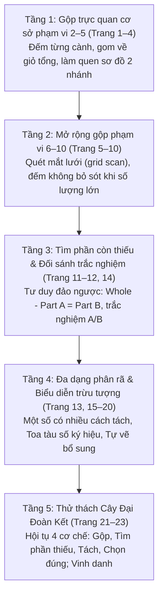

# Chặng 7: Khu Vườn Hai Nhánh — Tách Một Nhóm, Gộp Hai Nhóm

## 1. Objective (Mục tiêu cốt lõi)

Tài liệu này sở hữu đặc tả kỹ thuật và sư phạm nhằm tích hợp toàn diện kho dữ liệu trích xuất từ tài liệu PDF **"Chặng 7: Khu Vườn Hai Nhánh — Tách một nhóm • Gộp hai nhóm"** (`docs/montessori/extracted/chang-07/analysis.json`, nguồn: *7 - Tach va gop so luong.pdf*, 23 trang, thuộc bộ giáo trình *Gấu Logic & Thỏ Quan Sát - Chuyến Tàu Toán Học*, Montessori VN) vào nền tảng **TiniMath v2**.

### Mục tiêu chiến lược:
1. **Thiết lập Vũ trụ Cốt truyện & Động lực Học tập**:
   - **Bối cảnh**: Sau khi vượt qua Thung Lũng Cân Bằng, Chuyến Tàu Toán Học của Gấu Logic và Thỏ Quan Sát tiến vào **Khu Vườn Hai Nhánh**. Nơi đây có **Cây Đại Đoàn Kết** cổ thụ ngàn năm tuổi với tán lá sum suê vươn thành hai nhánh lớn trĩu quả ngọt. Tuy nhiên, sau một trận gió lốc xáo trộn, quả trên các cành bị rơi rụng, mối dây liên kết giữa các nhánh bị đứt đoạn, và **Viên Ngọc Kết Nối** (ngọc lục bảo xanh biếc tỏa ánh sáng ấm áp trên đỉnh ngọn cây) đã bị lu mờ.
   - **Nhiệm vụ sư phạm (Learning Quest)**: Bé đồng hành cùng Gấu Logic và Thỏ Quan Sát, vận dụng tư duy Tách – Gộp (Composing & Decomposing numbers) và cấu trúc sơ đồ số liên kết (Number Bond Part-Part-Whole) để gom quả về giỏ tổng, tìm lại các nhánh quả bị trốn, nối lại các toa tàu số học, phục hồi Cây Đại Đoàn Kết và thắp sáng rực rỡ Viên Ngọc Kết Nối.
2. **Khai thác triệt để các Game Engine hiện hữu (`GT-000`..`GT-037`)**:
   - **TUYỆT ĐỐI KHÔNG TẠO MỚI `GT-038+`**.
   - Phân giải 23 trang PDF thành 3 dạng bài chuẩn (`WB07-D1`, `WB07-D2`, `WB07-D3`) tương thích 100% với 3 khuôn tương tác cốt lõi đã có trong engine:
     - `GT-003` (`DragToBasketSession` / `DragToContainerSession` — Kéo thả vào giỏ gom): Kéo các quả/vật từ hai nhánh cây rơi vào giỏ tổng dưới gốc cây (Part-Part $\rightarrow$ Whole); hoặc kéo bổ sung đúng số quả còn thiếu từ kho vào giỏ để đủ số lượng tổng (Item completion).
     - `GT-007` (`NumberBondSession` — Cây sơ đồ số liên kết Part-Whole): Cây số hai nhánh chuẩn mực. Hỗ trợ cả 3 chế độ: gộp hai nhánh thành tổng, tìm nhánh con còn khuyết khi biết tổng (`is_target: true`), và khảo sát đa dạng cách phân rã của một số cố định (Multi-branch partitions: ví dụ số 4 thành 1+3 và 2+2; số 5 thành 1+4 và 2+3).
     - `GT-008` (`DragToSlotSession` — Kéo khối số vào ô đích): Toa tàu số kết nối (Symbolic Train Bond) — Đầu tàu mang số tổng kéo theo hai toa hàng mang các số thành phần. Trẻ kéo thẻ số vào ô toa tàu còn khuyết để đoàn tàu tiếp tục khởi hành.
3. **Phổ biến Kho Ngữ Liệu `SkillDataset` & `SkillLevelPlan[]`**:
   - Bổ sung hệ thống vật phẩm sinh động (`items`: quả táo đỏ, cam tròn, dâu tây, lê xanh, dưa hấu, cá xanh, hoa mùa xuân, xe ô tô, kim cương...), quan hệ tách gộp tập hợp con (`relations: subset` với `metadata: { bond_id, part_a, part_b, whole }`), lời thoại hướng dẫn (`phrasing`), và thang phát triển 5 bậc (`ladder`) vào các seeder kỹ năng cấu tạo số thuộc strand `C1.NCOMP`:
     - `C1.NCOMP.01`: Tách số 2 (1 + 1 = 2)
     - `C1.NCOMP.02`: Tách số 3 (1 + 2 = 3, 2 + 1 = 3)
     - `C1.NCOMP.03`: Tách số 4 (1 + 3 = 4, 2 + 2 = 4, 3 + 1 = 4)
     - `C1.NCOMP.04`: Tách số 5 (1 + 4 = 5, 2 + 3 = 5, 3 + 2 = 5, 4 + 1 = 5)
   - Cấp mã level chuẩn `GL-<COMP>-<STRAND>-<MECH>-01xx` (sequence $\ge 0101$), gắn nhãn `montessori_ref: "WB07-D<n>"`, phân bổ `access_tier` tương ứng `difficulty` (1: `free`, 2: `login`, 3: `standard`, 4: `premium`), tuân thủ nghiêm ngặt `BR-MCM-06` (không chứa từ khóa thương mại IQ/Raven/trí tuệ).
4. **Hiện thực hóa Tiến trình Sư phạm CPA 5 tầng**:
   - Cụ thể hóa lộ trình từ thao tác gom vật thể trực quan rời rạc $\rightarrow$ sơ đồ cây phân nhánh bán cụ thể (Number Bond Tree) $\rightarrow$ tư duy tìm phần khuyết (Missing Addend) $\rightarrow$ ký hiệu số trừu tượng trên toa tàu $\rightarrow$ thử thách tổng hợp Capstone hội tụ 4 cơ chế tách gộp.

---

## 2. Actors & Pedagogical Roles

| Tác nhân / Nhân vật | Vai trò hệ thống | Vai trò sư phạm & Đặc điểm nhận diện trong Chặng 7 |
|---|---|---|
| **Bé (Kid Player)** | Người chơi chính (3–6 tuổi) | Nhập vai người làm vườn nhí thông thái, tương tác chạm và kéo thả để thu hoạch hoa quả, điền số vào cành cây, nối toa tàu số và khôi phục Cây Đại Đoàn Kết. |
| **Gấu Logic (`gau_logic`)** | Nhân vật đồng hành (Scaffolding Guide - Trục Trừu tượng & Khái niệm) | Đại diện tư duy trật tự, tổng thể và mối quan hệ bộ phận – toàn thể. Ngoại hình: Gấu nâu thông thái mặc vest xanh lam, áo sơ mi trắng, đeo kính tròn trí tuệ, tay cầm bảng kẹp bài giảng. Lời thoại định hướng: *"Hai nhóm nhỏ có thể gộp thành một nhóm lớn!", "Tổng nằm ở giỏ lớn dưới gốc cây!", "Mỗi số có rất nhiều cách tách khác nhau đấy bé yêu!"*. |
| **Thỏ Quan Sát (`tho_quan_sat`)** | Nhân vật đồng hành (Sensory Observer - Trục Thao tác Trực quan & Đếm) | Đại diện tư duy quan sát chi tiết, đếm xúc giác và quét mắt có hệ thống. Ngoại hình: Chú thỏ trắng tinh nghịch đeo túi da chéo vàng, tay cầm kính lúp viền đỏ phát sáng. Lời thoại xúc giác: *"Bé đếm từng cành trước rồi hãy đếm giỏ tổng nhé!", "Đếm từ trái sang phải để không bị bỏ sót!", "Một cành đang bị trốn mất quả rồi, bé tìm giúp nhé!"*. |
| **Phụ huynh / Giáo viên** | Người đồng hành ngoài màn hình | Hỗ trợ bé theo phương pháp Montessori 3 bước (Giới thiệu tên $\rightarrow$ Nhận diện $\rightarrow$ Gọi tên). Quan sát bé thực hành ghép nối thực tế bằng quả hoặc hạt tại nhà trước khi chơi game số. |
| **Content Seeder Engine** | Hệ thống tự động | Tiếp nhận các khai báo `SkillSeed` trong `packages/content/src/skills/c1/ncomp/`, validate cấu trúc dữ liệu và nạp vào database mà không làm biến động schema. |

---

## 3. Entry Points & File Mapping

```
docs/montessori/extracted/chang-07/analysis.json (WB07, 23 trang)
   │
   ├──> docs/montessori/dataset/activity-types-table.md  (Cập nhật WB07-D1, WB07-D2, mở nhận WB07-D3)
   ├──> docs/specs/05-content/montessori-corpus-mapping.md (Cập nhật hàng 07: GT-003, GT-007, GT-008)
   │
   ├──> packages/content/src/skills/c1/ncomp/C1.NCOMP.01.ts (Tách số 2: GL-C1-NCOMP-BSK-0101, GL-C1-NCOMP-BOND-0101)
   ├──> packages/content/src/skills/c1/ncomp/C1.NCOMP.02.ts (Tách số 3: GL-C1-NCOMP-BSK-0102, GL-C1-NCOMP-BOND-0102)
   ├──> packages/content/src/skills/c1/ncomp/C1.NCOMP.03.ts (Tách số 4: GL-C1-NCOMP-BSK-0103, GL-C1-NCOMP-BOND-0103, GL-C1-NCOMP-SLOT-0101)
   └──> packages/content/src/skills/c1/ncomp/C1.NCOMP.04.ts (Tách số 5: GL-C1-NCOMP-BSK-0104, GL-C1-NCOMP-BOND-0104, GL-C1-NCOMP-BOND-0105, GL-C1-NCOMP-SLOT-0102)
```

- **Mã nguồn Engine sử dụng**:
  - `packages/game-engine/src/templates/GT-003/` (`DragToBasketSession` / `DragToContainerSession` — Kéo thả gom nhóm vào giỏ chứa).
  - `packages/game-engine/src/templates/GT-007/` (`NumberBondSession` — Sơ đồ số liên kết hai nhánh Part-Part-Whole).
  - `packages/game-engine/src/templates/GT-008/` (`DragToSlotSession` — Kéo thả thẻ số vào ô toa tàu / khuyết thiếu).
- **Phạm vi kiểm thử & Xác thực**:
  - `packages/content-build/src/gates/montessori-gate.ts`.
  - `packages/content-build/tests/gates/montessori-corpus.test.ts`.

---

## 4. Pedagogical Deconstruction: Tiến Trình 23 Trang PDF Chặng 7

Giáo trình Chặng 7 gồm 23 trang được cấu trúc thành 5 tầng nấc nhận thức theo tinh thần Montessori và tiến trình CPA:



### 4.1. Tầng 1: Gộp trực quan cơ sở phạm vi 2–5 (Trang 1 – 4)
- **Trang 1 (Bìa mở đầu)**: Cây Đại Đoàn Kết tỏa sáng với hai nhánh lớn, các cặp công thức khởi động: $3 + 2 = 5$, $4 + 3 = 7$, $5 + 4 = 9$. Giới thiệu Viên Ngọc Kết Nối.
- **Trang 2 (Hai giỏ nhập lại — Phạm vi 2, 3, 4)**: 
  - $1 \text{ táo} + 1 \text{ táo} = 2 \text{ quả táo}$.
  - $1 \text{ dâu} + 2 \text{ dâu} = 3 \text{ quả dâu}$.
  - $2 \text{ cam} + 2 \text{ cam} = 4 \text{ quả cam}$.
  - $1 \text{ lê} + 3 \text{ lê} = 4 \text{ quả lê}$.
  - Thao tác: Đếm cành trái $\rightarrow$ ghi số, đếm cành phải $\rightarrow$ ghi số, đếm giỏ tổng $\rightarrow$ ghi số tổng.
- **Trang 3 (Khu vườn hoa quả — Khám phá số 5)**:
  - $3 \text{ dưa hấu} + 2 \text{ dưa hấu} = 5 \text{ quả}$.
  - $1 \text{ nho} + 4 \text{ nho} = 5 \text{ chùm}$.
  - $4 \text{ đào} + 1 \text{ đào} = 5 \text{ quả}$.
  - $2 \text{ dâu} + 3 \text{ dâu} = 5 \text{ quả}$.
  - Nhận biết tính giao hoán trực quan ($3+2 = 2+3 = 5$, $1+4 = 4+1 = 5$).
- **Trang 4 (Thế giới hình khối — Gộp hình kỷ hà phạm vi 3–5)**:
  - $1 \text{ tam giác tím} + 2 \text{ tam giác tím} = 3 \text{ hình}$.
  - $2 \text{ vuông xanh} + 2 \text{ vuông xanh} = 4 \text{ hình}$.
  - $3 \text{ tròn đỏ} + 2 \text{ tròn đỏ} = 5 \text{ hình}$.
  - $4 \text{ ngũ giác hồng} + 1 \text{ ngũ giác hồng} = 5 \text{ hình}$.

### 4.2. Tầng 2: Mở rộng gộp phạm vi 6–10 (Trang 5 – 10)
- **Trang 5 (Vườn hoa mùa xuân — Khám phá số 6)**:
  - $3 \text{ hoa đỏ} + 3 \text{ hoa đỏ} = 6 \text{ bông}$.
  - $4 \text{ hoa vàng} + 2 \text{ hoa vàng} = 6 \text{ bông}$.
  - $1 \text{ hoa hồng} + 5 \text{ hoa hồng} = 6 \text{ bông}$.
  - $2 \text{ hoa tím} + 3 \text{ hoa tím} = 5 \text{ bông}$ (bài tập xen kẽ kiểm tra độ chú ý).
- **Trang 6 (Gara xe nhộn nhịp — Phạm vi 3, 4, 6)**:
  - $1 \text{ ô tô vàng} + 2 \text{ ô tô vàng} = 3 \text{ xe}$.
  - $2 \text{ xe buýt xanh} + 2 \text{ xe buýt xanh} = 4 \text{ xe}$.
  - $3 \text{ trực thăng} + 3 \text{ trực thăng} = 6 \text{ máy bay}$.
  - $5 \text{ đầu tàu đỏ} + 1 \text{ đầu tàu đỏ} = 6 \text{ đầu tàu}$.
- **Trang 7 (Kho báu lung linh — Khám phá số 7)**:
  - $3 \text{ kim cương} + 4 \text{ kim cương} = 7 \text{ viên}$.
  - $2 \text{ tiền xu} + 5 \text{ tiền xu} = 7 \text{ đồng}$.
  - $4 \text{ đá quý đỏ} + 3 \text{ đá quý đỏ} = 7 \text{ viên}$.
  - $1 \text{ ngôi sao} + 6 \text{ ngôi sao} = 7 \text{ ngôi sao}$.
- **Trang 8 (Đàn cá bơi lội — Khám phá số 8)**:
  - $4 \text{ cá tím} + 4 \text{ cá tím} = 8 \text{ con}$.
  - $3 \text{ cá cam} + 5 \text{ cá cam} = 8 \text{ con}$.
  - $2 \text{ cá xanh lá} + 6 \text{ cá xanh lá} = 8 \text{ con}$.
  - $1 \text{ cá xanh biển} + 7 \text{ cá xanh biển} = 8 \text{ con}$.
- **Trang 9 (Bầu trời đêm — Khám phá số 9)**:
  - $4 \text{ sao vàng} + 5 \text{ sao vàng} = 9 \text{ ngôi sao}$.
  - $3 \text{ sao xanh} + 6 \text{ sao xanh} = 9 \text{ ngôi sao}$.
  - $2 \text{ sao hồng} + 7 \text{ sao hồng} = 9 \text{ ngôi sao}$.
  - $5 \text{ sao cam} + 4 \text{ sao cam} = 9 \text{ ngôi sao}$.
- **Trang 10 (Cây Đại Đoàn Kết đơm hoa — Chinh phục số 10)**:
  - $5 \text{ táo đỏ} + 5 \text{ táo đỏ} = 10 \text{ quả}$.
  - $4 \text{ cam vàng} + 6 \text{ cam vàng} = 10 \text{ quả}$.
  - $3 \text{ dâu tây} + 7 \text{ dâu tây} = 10 \text{ quả}$.
  - $2 \text{ lê xanh} + 8 \text{ lê xanh} = 10 \text{ quả}$.
  - Luyện chiến lược quét mắt theo hàng (grid scan) đếm không sót khi chạm mốc 10.

### 4.3. Tầng 3: Tìm phần còn thiếu & Trắc nghiệm đối sánh (Trang 11 – 12, 14)
- **Trang 11 (Ô số trốn tìm — Cây tách gộp khuyết một nhánh có hình)**:
  - Cho tổng và 1 nhánh có hình, nhánh kia có hình nhưng khuyết ô số:
    - Tổng $5$: nhánh đã biết $2$ táo $\rightarrow$ nhánh khuyết có $3$ táo $\rightarrow$ điền số $3$.
    - Tổng $6$: nhánh đã biết $4$ sao $\rightarrow$ nhánh khuyết có $2$ sao $\rightarrow$ điền số $2$.
    - Tổng $7$: nhánh đã biết $3$ cá $\rightarrow$ nhánh khuyết có $4$ cá $\rightarrow$ điền số $4$.
    - Tổng $8$: nhánh đã biết $5$ hoa $\rightarrow$ nhánh khuyết có $3$ hoa $\rightarrow$ điền số $3$.
- **Trang 12 (Tìm phần còn thiếu với tổng trừu tượng)**:
  - Ô tổng chuyển thành vòng tròn số trừu tượng (5, 6, 7, 8). Trẻ phải suy luận số lượng còn thiếu:
    - Tổng $5$: nhánh đã có $1$ táo $\rightarrow$ nhánh khuyết là $4$.
    - Tổng $6$: nhánh đã có $3$ sao $\rightarrow$ nhánh khuyết là $3$.
    - Tổng $7$: nhánh đã có $2$ cá $\rightarrow$ nhánh khuyết là $5$.
    - Tổng $8$: nhánh đã có $4$ hoa $\rightarrow$ nhánh khuyết là $4$.
- **Trang 14 (Trắc nghiệm thị giác A/B chọn nhánh còn thiếu)**:
  - Cho tổng và nhánh thứ nhất. Nhánh thứ hai đưa ra 2 lựa chọn A và B (chùm hình ảnh):
    - Tổng $5$: nhánh 1 có $2$ táo $\rightarrow$ chọn A ($3$ táo) hay B ($2$ táo)? $\rightarrow$ Đáp án A.
    - Tổng $6$: nhánh 1 có $1$ sao $\rightarrow$ chọn A ($4$ sao) hay B ($5$ sao)? $\rightarrow$ Đáp án B.
    - Tổng $7$: nhánh 1 có $4$ cá $\rightarrow$ chọn A ($3$ cá) hay B ($2$ cá)? $\rightarrow$ Đáp án A.
    - Tổng $8$: nhánh 1 có $5$ hoa $\rightarrow$ chọn A ($2$ hoa) hay B ($3$ hoa)? $\rightarrow$ Đáp án B.

### 4.4. Tầng 4: Đa dạng hóa phân rã & Tư duy trừu tượng (Trang 13, 15 – 20)
- **Trang 13 (Nhiều cách tách của số 6)**: Khám phá 4 cách gộp tạo 6:
  - Cách 1: $1 + 5 = 6$ (Táo)
  - Cách 2: $2 + 4 = 6$ (Ngôi sao)
  - Cách 3: $3 + 3 = 6$ (Cá)
  - Cách 4: $4 + 2 = 6$ (Hoa tím)
- **Trang 15 (Toa tàu số liên kết — Number Bond thuần chữ số)**:
  - Đầu tàu kéo 2 toa. Không còn hình vẽ, chỉ còn các ô chữ số:
    - Tàu 1: Đầu tàu $7$ $\rightarrow$ Toa A: $3$, Toa B: $[?]$ $\rightarrow$ Đáp án: $4$.
    - Tàu 2: Đầu tàu $8$ $\rightarrow$ Toa A: $[?]$, Toa B: $5$ $\rightarrow$ Đáp án: $3$.
    - Tàu 3: Đầu tàu $9$ $\rightarrow$ Toa A: $4$, Toa B: $[?]$ $\rightarrow$ Đáp án: $5$.
    - Tàu 4: Đầu tàu $10$ $\rightarrow$ Toa A: $[?]$, Toa B: $6$ $\rightarrow$ Đáp án: $4$.
- **Trang 16 & 18 (Tách từ một nhóm lớn thành hai nhóm nhỏ — Whole $\rightarrow$ Part-Part)**:
  - Bắt đầu từ nhóm tổng ở trên, sau đó phân rã xuống 2 nhánh con:
    - Tách $4$ thành $1$ và $3$.
    - Tách $5$ thành $2$ và $3$.
    - Tách $6$ thành $3$ và $3$.
    - Tách $7$ thành $2$ và $5$.
    - Tách $8$ thành $4$ và $4$.
    - Tách $9$ thành $6$ và $3$.
- **Trang 17 (Tự vẽ thêm cho đủ tổng — Item Completion)**:
  - Cho tổng và 1 nhánh có hình. Nhánh thứ hai để khung trống yêu cầu bé vẽ thêm:
    - Tổng $5$, nhánh 1 có $2$ táo $\rightarrow$ vẽ thêm $3$ táo.
    - Tổng $6$, nhánh 1 có $1$ sao $\rightarrow$ vẽ thêm $5$ sao.
    - Tổng $7$, nhánh 1 có $4$ cá $\rightarrow$ vẽ thêm $3$ cá.
    - Tổng $8$, nhánh 1 có $5$ hoa $\rightarrow$ vẽ thêm $3$ hoa.
- **Trang 19 (Nhiều cách tách của số 8)**: Khám phá 4 cách tách: $1+7$, $2+6$, $3+5$, $4+4$.
- **Trang 20 (Nhiều cách tách của số 10)**: Khám phá 4 cách tách: $1+9$, $2+8$, $3+7$, $5+5$.

### 4.5. Tầng 5: Thử thách Cây Đại Đoàn Kết & Vinh danh (Trang 21 – 23)
- **Trang 21 (Cửa ải Cây Đại Đoàn Kết — Capstone Challenge)**: Hội tụ 4 cơ chế tách gộp:
  1. *Thử thách 1 (Gộp)*: $3 \text{ táo} + 4 \text{ táo} = 7 \text{ quả}$.
  2. *Thử thách 2 (Tìm phần thiếu)*: Tổng $9$ táo, có $4$ táo $\rightarrow$ tìm $5$ quả còn thiếu.
  3. *Thử thách 3 (Tách)*: Tổng $8$ ngôi sao $\rightarrow$ tách thành $3$ và $5$.
  4. *Thử thách 4 (Chọn đúng)*: Tổng $10$ lá cây, nhánh 1 có $6$ lá $\rightarrow$ chọn A ($4$ lá) hay B ($5$ lá)? $\rightarrow$ Đáp án A.
- **Trang 22 (Bảng kiểm tra nụ cười)**: Đánh giá quá trình: Bé tự đánh giá mức độ hào hứng và tự tin qua biểu tượng cảm xúc mặt cười.
- **Trang 23 (Vinh danh & Trao tặng Huy hiệu)**: Cây Đại Đoàn Kết bừng sáng, trao tặng danh hiệu "Kỹ sư tách gộp tài ba" và gắn **Viên Ngọc Kết Nối** lên vương miện thành tích của bé.

---

## 5. Dạng Bài Chuẩn Hóa & Ánh Xạ Game Engine

Để tối ưu hóa trải nghiệm tương tác số và tuân thủ nguyên tắc không tạo thêm game engine mới (`GT-038+`), 23 trang PDF Chặng 7 được chuẩn hóa thành **3 dạng bài chủ đạo**:

### 5.1. Dạng bài `WB07-D1`: Gộp hai nhóm về giỏ tổng trực quan (Part-Part $\rightarrow$ Whole)
- **Trang PDF đại diện**: Trang 2, 3, 4, 5, 6, 7, 8, 9, 10.
- **Mục tiêu sư phạm**: Trẻ nhận thức sâu sắc rằng hai nhóm nhỏ có thể hợp nhất thành một nhóm lớn duy nhất (phép gộp sơ đẳng). Nắm vững nguyên lý bảo toàn số lượng và tính giao hoán trực quan ($a + b = b + a$).
- **Khuôn Game Engine**:
  - **`GT-003` (`DragToBasketSession` / drag-to-container)**:
    - *Bố cục*: Cây cổ thụ có 2 cành nhỏ chìa ra hai bên. Mỗi cành chứa một nhóm quả/hoa/xe. Dưới gốc cây là chiếc giỏ lớn (giỏ tổng) mang nhãn rỗng hoặc ô số cần điền.
    - *Tương tác*: Trẻ chạm và kéo từng quả từ hai cành rơi vào giỏ lớn. Sau khi gom hết, trẻ đếm số lượng quả trong giỏ rồi chạm chọn thẻ số đúng từ khay số phía dưới để hoàn thành gộp.
  - **`GT-007` (`NumberBondSession` / number-bond)**:
    - *Bố cục*: Sơ đồ cây Number Bond chuẩn 3 vòng tròn. Hai vòng tròn phía trên chứa các vật thể trực quan (Part A và Part B). Vòng tròn lớn phía dưới (Whole) có dấu hỏi chấm `?`.
    - *Tương tác*: Trẻ đếm số lượng hai nhánh con, sau đó kéo thẻ số tổng vào ô Whole để nối liền hai nhánh.
- **Kỹ năng mục tiêu**: `C1.NCOMP.01` (số 2), `C1.NCOMP.02` (số 3), `C1.NCOMP.03` (số 4), `C1.NCOMP.04` (số 5).

### 5.2. Dạng bài `WB07-D2`: Cây tách gộp & Tìm phần còn thiếu (Missing Part Deduction)
- **Trang PDF đại diện**: Trang 11, 12, 14, 17.
- **Mục tiêu sư phạm**: Trẻ vận dụng tư duy đảo ngược (Inverse Thinking): khi biết số lượng toàn thể (Whole) và một phần thành phần (Part A), suy luận và tìm ra phần còn lại (Part B = Whole - Part A). Đây là nền tảng cốt lõi của phép trừ và đại số phương trình khuyết.
- **Khuôn Game Engine**:
  - **`GT-007` (`NumberBondSession` / number-bond — Chế độ Missing Branch)**:
    - *Bố cục*: Vòng tròn Whole hiển thị số tổng (dạng số hoặc cụm vật). Vòng tròn Part A hiển thị số lượng đã biết. Vòng tròn Part B mang nhãn `?` hoặc hình ảnh chiếc rương kho báu đang khóa.
    - *Tương tác*: Khay phía dưới hiển thị 3 thẻ số (1 đáp án đúng + 2 số nhiễu $\pm 1$). Trẻ tính toán và kéo thẻ số chính xác vào Part B để mở khóa rương và thắp sáng nhánh cây.
  - **`GT-003` (`DragToBasketSession` — Biến thể Item Completion)**:
    - *Bố cục*: Giỏ tổng yêu cầu đạt $N$ quả (ví dụ $5$ quả táo). Hiện tại trong giỏ mới chỉ có $2$ quả.
    - *Tương tác*: Trẻ kéo thêm đúng $3$ quả từ kho quả bên ngoài vào giỏ để làm đầy giỏ theo đúng yêu cầu đề bài.
- **Kỹ năng mục tiêu**: `C1.NCOMP.02`, `C1.NCOMP.03`, `C1.NCOMP.04`, bổ trợ `C1.SUB.05`.

### 5.3. Dạng bài `WB07-D3`: Đa dạng hóa phân rã & Toa tàu số trừu tượng (Partitions & Symbolic Train)
- **Trang PDF đại diện**: Trang 13, 15, 16, 18, 19, 20, 21.
- **Mục tiêu sư phạm**:
  - Nhận biết tính đa dạng của phân rã: cùng một số tổng có nhiều cách phân chia khác nhau (ví dụ: $4 = 1+3 = 2+2$; $5 = 1+4 = 2+3$).
  - Chuyển tiếp CPA từ trực quan sang ký hiệu số trừu tượng (Symbolic Number Bond): nhận diện cấu trúc liên kết số trên toa tàu mà không cần dựa vào hình vẽ vật thể.
- **Khuôn Game Engine**:
  - **`GT-007` (`NumberBondSession` — Chế độ Multi-branch Partition)**:
    - *Bố cục*: Một số tổng cố định (ví dụ 4 hoặc 5). Màn hình hiển thị lần lượt các cặp nhánh khác nhau.
    - *Tương tác*: Trẻ thực hiện liên hoàn các cách tách/gộp để thấy sự bảo toàn số lượng.
  - **`GT-008` (`DragToSlotSession` / drag-to-slot — Toa tàu số kết nối)**:
    - *Bố cục*: Đầu tàu hỏa hơi nước kéo theo 2 toa hàng. Số trên đầu tàu là Whole (ví dụ $4$ hoặc $5$). Toa hàng thứ nhất mang số Part A. Toa hàng thứ hai là một ô rỗng (slot).
    - *Tương tác*: Trẻ kéo khối số thích hợp từ bảng số bên dưới thả vào ô slot của toa hàng thứ hai. Khi thả đúng, móc xích toa tàu phát sáng, còi tàu vang lên và đoàn tàu lăn bánh qua ga.
- **Kỹ năng mục tiêu**: `C1.NCOMP.03`, `C1.NCOMP.04`, `C1.NCOMP.11`, `C1.NCOMP.12`.

---

## 6. Thiết Kế Kho Ngữ Liệu `SkillDataset` (Enriched Corpus)

Kho ngữ liệu được thiết kế đồng bộ với vũ trụ Khu Vườn Hai Nhánh, chuẩn hóa theo interface `SkillDataset` của TiniMath v2:

### 6.1. Dataset Đặc Trưng Chặng 7: `WB07_TREE_BRANCH_DATASET`

```typescript
export const WB07_TREE_BRANCH_DATASET: SkillDataset = {
  skill_code: "C1.NCOMP.04",
  concept_label: "Tách một nhóm và gộp hai nhóm tại Khu Vườn Hai Nhánh",
  surface: "game",
  items: [
    // Vật phẩm hoa quả cành cây (Trang 2-3)
    {
      id: "wb07_apple_single",
      label: "một quả táo đỏ",
      glyph: "🍎",
      value: 1,
      contrast_group: "orchard_fruit",
      ordering: 1,
      image: { kind: "emoji", ref: "🍎" },
      category: { type: "nhánh quả con", role: "phần" }
    },
    {
      id: "wb07_apple_pair",
      label: "hai quả táo đỏ",
      glyph: "🍎🍎",
      value: 2,
      contrast_group: "orchard_fruit",
      ordering: 2,
      image: { kind: "emoji", ref: "🍎" },
      category: { type: "nhánh quả con", role: "phần" }
    },
    {
      id: "wb07_apple_trio",
      label: "ba quả táo đỏ",
      glyph: "🍎🍎🍎",
      value: 3,
      contrast_group: "orchard_fruit",
      ordering: 3,
      image: { kind: "emoji", ref: "🍎" },
      category: { type: "nhánh quả con", role: "phần" }
    },
    {
      id: "wb07_apple_quad",
      label: "bốn quả táo đỏ",
      glyph: "🍎🍎🍎🍎",
      value: 4,
      contrast_group: "orchard_fruit",
      ordering: 4,
      image: { kind: "emoji", ref: "🍎" },
      category: { type: "nhánh quả con", role: "tổng" }
    },
    {
      id: "wb07_apple_basket_5",
      label: "năm quả táo đỏ",
      glyph: "🍎🍎🍎🍎🍎",
      value: 5,
      contrast_group: "orchard_fruit",
      ordering: 5,
      image: { kind: "emoji", ref: "🍎" },
      category: { type: "giỏ tổng", role: "tổng" }
    },
    // Vật phẩm dâu tây và cam (Trang 2-3)
    {
      id: "wb07_strawberry_pair",
      label: "hai quả dâu tây",
      glyph: "🍓🍓",
      value: 2,
      contrast_group: "berry_grove",
      ordering: 6,
      image: { kind: "emoji", ref: "🍓" },
      category: { type: "nhánh quả con", role: "phần" }
    },
    {
      id: "wb07_strawberry_trio",
      label: "ba quả dâu tây",
      glyph: "🍓🍓🍓",
      value: 3,
      contrast_group: "berry_grove",
      ordering: 7,
      image: { kind: "emoji", ref: "🍓" },
      category: { type: "nhánh quả con", role: "phần" }
    },
    {
      id: "wb07_orange_pair",
      label: "hai quả cam vàng",
      glyph: "🍊🍊",
      value: 2,
      contrast_group: "citrus_grove",
      ordering: 8,
      image: { kind: "emoji", ref: "🍊" },
      category: { type: "nhánh quả con", role: "phần" }
    },
    {
      id: "wb07_pear_single",
      label: "một quả lê xanh",
      glyph: "🍐",
      value: 1,
      contrast_group: "citrus_grove",
      ordering: 9,
      image: { kind: "emoji", ref: "🍐" },
      category: { type: "nhánh quả con", role: "phần" }
    },
    {
      id: "wb07_pear_trio",
      label: "ba quả lê xanh",
      glyph: "🍐🍐🍐",
      value: 3,
      contrast_group: "citrus_grove",
      ordering: 10,
      image: { kind: "emoji", ref: "🍐" },
      category: { type: "nhánh quả con", role: "phần" }
    },
    // Sinh vật và hoa vườn xuân (Trang 5, 8)
    {
      id: "wb07_flower_trio",
      label: "ba bông hoa đỏ",
      glyph: "🌺🌺🌺",
      value: 3,
      contrast_group: "spring_garden",
      ordering: 11,
      image: { kind: "emoji", ref: "🌺" },
      category: { type: "nhánh hoa", role: "phần" }
    },
    {
      id: "wb07_fish_pair",
      label: "hai chú cá xanh",
      glyph: "🐟🐟",
      value: 2,
      contrast_group: "garden_pond",
      ordering: 12,
      image: { kind: "emoji", ref: "🐟" },
      category: { type: "đàn cá con", role: "phần" }
    },
    {
      id: "wb07_star_pair",
      label: "hai ngôi sao sáng",
      glyph: "⭐⭐",
      value: 2,
      contrast_group: "night_sky",
      ordering: 13,
      image: { kind: "emoji", ref: "⭐" },
      category: { type: "ánh sao", role: "phần" }
    }
  ],
  relations: [
    // Các cặp quan hệ tách gộp cốt lõi
    {
      type: "subset",
      source_id: "wb07_apple_single",
      target_id: "wb07_apple_pair",
      metadata: { bond_id: "bond_2_1_1", part_a: 1, part_b: 1, whole: 2 }
    },
    {
      type: "subset",
      source_id: "wb07_apple_single",
      target_id: "wb07_apple_trio",
      metadata: { bond_id: "bond_3_1_2", part_a: 1, part_b: 2, whole: 3 }
    },
    {
      type: "subset",
      source_id: "wb07_orange_pair",
      target_id: "wb07_apple_quad",
      metadata: { bond_id: "bond_4_2_2", part_a: 2, part_b: 2, whole: 4 }
    },
    {
      type: "subset",
      source_id: "wb07_pear_single",
      target_id: "wb07_apple_quad",
      metadata: { bond_id: "bond_4_1_3", part_a: 1, part_b: 3, whole: 4 }
    },
    {
      type: "subset",
      source_id: "wb07_apple_pair",
      target_id: "wb07_apple_basket_5",
      metadata: { bond_id: "bond_5_2_3", part_a: 2, part_b: 3, whole: 5 }
    },
    {
      type: "subset",
      source_id: "wb07_apple_single",
      target_id: "wb07_apple_basket_5",
      metadata: { bond_id: "bond_5_1_4", part_a: 1, part_b: 4, whole: 5 }
    }
  ],
  axes: {
    role: {
      values: ["phần", "tổng"]
    }
  },
  ladder: [
    {
      rung: 1,
      dimension: "range",
      description: "Gộp trực quan cơ sở phạm vi 2–3 bằng vật thể rời rạc",
      representation: "discrete-object"
    },
    {
      rung: 2,
      dimension: "range",
      description: "Gộp và tách phạm vi 4–5 với sơ đồ cây hai nhánh trực quan",
      representation: "number-bond-visual"
    },
    {
      rung: 3,
      dimension: "missing_component",
      description: "Tìm phần còn thiếu (Missing Addend) khi biết tổng và một nhánh",
      representation: "missing-addend-visual"
    },
    {
      rung: 4,
      dimension: "partitions_count",
      description: "Khám phá đa dạng các cách tách khác nhau của cùng một số",
      representation: "partitions-grid"
    },
    {
      rung: 5,
      dimension: "symbolic_abstraction",
      description: "Nối toa tàu số liên kết trừu tượng và thử thách tổng hợp Capstone",
      representation: "symbolic-bond-train"
    }
  ],
  phrasing: {
    prompt_template: "Bé hãy {action} để tìm {target} cho Cây Đại Đoàn Kết nhé!",
    narration_template: "Cùng Gấu Logic và Thỏ Quan Sát kết nối các nhánh quả nào!",
    hints: {
      level_1: "Nhấp nháy nhẹ vào cành quả hoặc giỏ cần tương tác.",
      level_2: "Thỏ Quan Sát: 'Bé đếm từng nhánh trước rồi hãy gom về giỏ tổng nhé!'",
      level_3: "Bàn tay làm mẫu kéo một quả vào giỏ hoặc kéo thẻ số vào ô khuyết."
    }
  },
  ordering: [
    "wb07_apple_single",
    "wb07_apple_pair",
    "wb07_apple_trio",
    "wb07_apple_quad",
    "wb07_apple_basket_5"
  ]
};
```

---

## 7. Kế Hoạch Game Level Montessori (`SkillLevelPlan[]`)

Các level được thiết kế với tiền tố chuẩn `GL-C1-NCOMP-<MECH>-01xx` (sequence $\ge 0101$), ánh xạ trực tiếp đến các file seeder tương ứng trong `packages/content/src/skills/c1/ncomp/`:

### 7.1. Bảng Kế Hoạch Game Level Cho `C1.NCOMP.01` (Tách số 2)
*Tập tin: `packages/content/src/skills/c1/ncomp/C1.NCOMP.01.ts`*

| Mã Level (`code`) | Template | Band | Diff | Access Tier | Theme | Montessori Ref | Mô tả Sư phạm |
|---|---|:---:|:---:|---|---|---|---|
| `GL-C1-NCOMP-BSK-0101` | `GT-003` | 3-4 | 1 | `free` | `nature` | `WB07-D1` | Kéo 1 quả táo từ cành trái và 1 quả từ cành phải vào giỏ lớn dưới gốc cây (1 + 1 = 2). |
| `GL-C1-NCOMP-BOND-0101` | `GT-007` | 3-4 | 1 | `free` | `nature` | `WB07-D1` | Cây Number Bond: 2 nhánh trên có 1 quả táo mỗi nhánh. Bé kéo thẻ số 2 vào vòng tròn tổng. |

### 7.2. Bảng Kế Hoạch Game Level Cho `C1.NCOMP.02` (Tách số 3)
*Tập tin: `packages/content/src/skills/c1/ncomp/C1.NCOMP.02.ts`*

| Mã Level (`code`) | Template | Band | Diff | Access Tier | Theme | Montessori Ref | Mô tả Sư phạm |
|---|---|:---:|:---:|---|---|---|---|
| `GL-C1-NCOMP-BSK-0102` | `GT-003` | 3-4 | 1 | `free` | `food` | `WB07-D1` | Gộp dâu tây: Kéo 1 dâu từ cành trái và 2 dâu từ cành phải vào giỏ tổng để tạo 3 dâu (1 + 2 = 3). |
| `GL-C1-NCOMP-BOND-0102` | `GT-007` | 3-4 | 2 | `login` | `food` | `WB07-D2` | Tìm nhánh khuyết: Tổng là 3, nhánh đã có là 1 dâu. Bé chọn thẻ số 2 kéo vào nhánh còn lại. |

### 7.3. Bảng Kế Hoạch Game Level Cho `C1.NCOMP.03` (Tách số 4)
*Tập tin: `packages/content/src/skills/c1/ncomp/C1.NCOMP.03.ts`*

| Mã Level (`code`) | Template | Band | Diff | Access Tier | Theme | Montessori Ref | Mô tả Sư phạm |
|---|---|:---:|:---:|---|---|---|---|
| `GL-C1-NCOMP-BSK-0103` | `GT-003` | 3-4 | 2 | `login` | `nature` | `WB07-D1` | Gộp cam vàng: Cành trái có 2 cam, cành phải có 2 cam. Gom vào giỏ được 4 cam (2 + 2 = 4). |
| `GL-C1-NCOMP-BOND-0103` | `GT-007` | 3-4 | 2 | `login` | `nature` | `WB07-D2` | Tìm nhánh khuyết: Quả cầu tổng là 4, nhánh 1 có 3 quả lê. Bé tìm số quả nhánh 2 ($4 - 3 = 1$). |
| `GL-C1-NCOMP-SLOT-0101` | `GT-008` | 3-4 | 3 | `standard` | `vehicle` | `WB07-D3` | Toa tàu số: Đầu tàu mang số 4, toa 1 mang số 2. Bé kéo khối số 2 vào ô slot của toa 2. |

### 7.4. Bảng Kế Hoạch Game Level Cho `C1.NCOMP.04` (Tách số 5)
*Tập tin: `packages/content/src/skills/c1/ncomp/C1.NCOMP.04.ts`*

| Mã Level (`code`) | Template | Band | Diff | Access Tier | Theme | Montessori Ref | Mô tả Sư phạm |
|---|---|:---:|:---:|---|---|---|---|
| `GL-C1-NCOMP-BSK-0104` | `GT-003` | 3-4 | 2 | `login` | `food` | `WB07-D1` | Gộp dưa hấu: 3 miếng cành trái + 2 miếng cành phải gom về giỏ được 5 miếng dưa hấu. |
| `GL-C1-NCOMP-BOND-0104` | `GT-007` | 3-4 | 3 | `standard` | `nature` | `WB07-D2` | Tìm nhánh khuyết: Tổng 5 quả táo, nhánh 1 có 2 quả táo. Bé kéo thẻ số 3 vào nhánh còn lại. |
| `GL-C1-NCOMP-BOND-0105` | `GT-007` | 3-4 | 3 | `standard` | `nature` | `WB07-D3` | Đa dạng cách tách số 5: Thực hiện 2 vòng tách liên tiếp ($1+4$ và $2+3$) trên Cây Đại Đoàn Kết. |
| `GL-C1-NCOMP-SLOT-0102` | `GT-008` | 3-4 | 4 | `premium` | `vehicle` | `WB07-D3` | Toa tàu số trừu tượng: Đầu tàu số 5, toa 1 số 4. Kéo khối số 1 từ bảng số vào ô toa còn khuyết. |

---

## 8. Cơ Chế Phản Hồi Montessori & Kiểm Soát Lỗi Tự Thân

Tuân thủ nghiêm ngặt nguyên lý giáo dục Montessori và tài liệu `docs/design-system/pages/game-engine.md`:

1. **Phản Hồi Tích Cực (Positive Feedback) — Khi Bé Thao Tác Đúng**:
   - Khi kéo đúng vật thể vào giỏ hoặc thẻ số vào ô nhánh:
     - Pop hạt nhẹ nhàng phát ra tại **chính điểm chạm** (không phát ra từ tọa độ hardcode).
     - Âm thanh chimes trong trẻo, êm dịu vang lên (SFX ramp vào $\ge 20$ms, ramp ra $\ge 40$ms, true peak $\le -1$ dBTP).
     - Nhánh cây khẽ đung đưa và nở hoa rực rỡ; hoặc móc xích toa tàu phát sáng xanh ngọc.
   - Khi hoàn thành toàn bộ màn chơi (Win condition):
     - Không có hiệu ứng nổ pháo hoa gây giật mình. Cây Đại Đoàn Kết bừng sáng hào quang ấm áp.
     - **Viên Ngọc Kết Nối** bay từ ngọn cây về trung tâm màn hình, tỏa ánh sáng ngọc bích êm dịu kèm lời khen ngợi nỗ lực của Gấu Logic: *"Tuyệt vời! Bé đã kết nối các nhánh quả thật khéo léo!"*.
2. **Kiểm Soát Lỗi Tự Thân (Control of Error) — Khi Bé Thao Tác Sai**:
   - **Tuyệt đối KHÔNG có âm thanh buzzer, KHÔNG dấu gạch chéo đỏ, KHÔNG trừ điểm hay phạt**:
     - *Trong `GT-003`*: Nếu bé kéo nhầm vật thể lạ hoặc kéo chưa đủ số lượng, vật thể sẽ từ từ lướt trôi êm ái về vị trí cũ kèm nhịp thở nhẹ màu hổ phách (`amber_soft`). Miệng giỏ khẽ lắc lư báo hiệu chưa đúng.
     - *Trong `GT-007`*: Nếu kéo sai thẻ số vào nhánh khuyết, ô tròn sẽ phát xung nhịp hổ phách nhẹ trong 300ms, thẻ số tự động bật trôi về khay chứa ban đầu.
     - *Trong `GT-008`*: Khối số không vừa vặn với ô slot trên toa tàu sẽ nhẹ nhàng trượt về bảng số dưới đáy.
3. **Trợ Giúp Sư Phạm Bậc Thang (Scaffolding System)**:
   - Hệ thống tự động kích hoạt trợ giúp dựa trên thời gian bất động hoặc số lần thử sai liên tiếp (không bắt trẻ 3 tuổi phải tự nhấn nút xin trợ giúp):
     - **Mức 1 (Nudge - 1 lần sai / sau 10s)**: Viền nhánh cây hoặc ô số mục tiêu nhấp nháy ánh sáng hổ phách nhẹ thu hút sự chú ý (`engine.focusIndex`).
     - **Mức 2 (Guidance - 2 lần sai / sau 18s)**: Thỏ Quan Sát xuất hiện với câu thoại xúc giác: *"Bé thử đếm lại xem cành này có mấy quả nhé!"* kèm bàn tay mờ (ghost hand) chỉ vào từng quả với nhịp đếm chậm rãi.
     - **Mức 3 (Demonstration - 3 lần sai / sau 25s)**: Bàn tay làm mẫu (ghost hand 0.5×) tự động kéo mẫu 1 quả vào giỏ hoặc 1 thẻ số vào nhánh, sau đó hoàn trả lại trạng thái để bé tự tay thực hiện.

---

## 9. Ma Trận Truy Xuất Nguồn Gốc (Traceability Matrix)

| Trang PDF | Tên Bài Tập Trong PDF | Dạng Bài Chuẩn | Engine | Kỹ Năng Mục Tiêu | Game Level Tương Ứng |
|---|---|:---:|:---:|---|---|
| Trang 2 | Hai giỏ nhập lại (phạm vi 2, 3, 4) | `WB07-D1` | `GT-003`, `GT-007` | `C1.NCOMP.01`, `02`, `03` | `GL-C1-NCOMP-BSK-0101`, `GL-C1-NCOMP-BOND-0101`, `0102` |
| Trang 3 | Khu vườn hoa quả (phạm vi 5) | `WB07-D1` | `GT-003`, `GT-007` | `C1.NCOMP.04` | `GL-C1-NCOMP-BSK-0104`, `GL-C1-NCOMP-BOND-0104` |
| Trang 4 | Thế giới hình khối (gộp hình 3–5) | `WB07-D1` | `GT-007` | `C1.NCOMP.02`, `03`, `04` | `GL-C1-NCOMP-BOND-0102`, `GL-C1-NCOMP-BOND-0103` |
| Trang 5–10 | Gộp phạm vi 6–10 (hoa, xe, cá, sao, táo) | `WB07-D1` | `GT-003`, `GT-007` | `C1.NCOMP.04`, `C1.NCOMP.10` | Bổ trợ cho mở rộng phạm vi tổng |
| Trang 11–12 | Ô số trốn tìm (tìm phần còn thiếu) | `WB07-D2` | `GT-007` | `C1.NCOMP.02`, `03`, `04` | `GL-C1-NCOMP-BOND-0102`, `0103`, `0104` |
| Trang 13, 19, 20 | Nhiều cách tách/gộp (số 6, 8, 10) | `WB07-D3` | `GT-007` | `C1.NCOMP.04`, `C1.NCOMP.11` | `GL-C1-NCOMP-BOND-0105` |
| Trang 14 | Trắc nghiệm đối sánh A/B nhánh thiếu | `WB07-D2` | `GT-007` | `C1.NCOMP.03`, `04` | `GL-C1-NCOMP-BOND-0103`, `0104` |
| Trang 15 | Tàu số kết nối (Number Bond trừu tượng) | `WB07-D3` | `GT-008` | `C1.NCOMP.03`, `04`, `12` | `GL-C1-NCOMP-SLOT-0101`, `GL-C1-NCOMP-SLOT-0102` |
| Trang 16, 18 | Tách một nhóm lớn thành hai nhánh | `WB07-D3` | `GT-007` | `C1.NCOMP.03`, `04` | `GL-C1-NCOMP-BOND-0105` |
| Trang 17 | Tự vẽ/bổ sung cho đủ tổng | `WB07-D2` | `GT-003` | `C1.NCOMP.02`, `03`, `04` | `GL-C1-NCOMP-BSK-0103`, `0104` |
| Trang 21 | Cửa ải Cây Đại Đoàn Kết (Tổng hợp) | `WB07-D3` | `GT-007`, `GT-008` | `C1.NCOMP.01`..`04` | Chuỗi liên hoàn Capstone Assessment |
| Trang 23 | Vinh danh trao Viên Ngọc Kết Nối | Hub | `GT-000` | Toàn bộ strand `C1.NCOMP` | Mở khóa huy hiệu `emerald_gem` |

---

## 10. Verification Gates & Tiêu Chuẩn Nghiệm Thu

1. **Tuân thủ Kiến trúc & Hạn ngạch Game Engine**:
   - `0` engine mới được tạo thêm. 100% dạng bài chạy trên `GT-003`, `GT-007`, `GT-008`.
   - Mọi mã game level mang tiền tố `GL-C1-NCOMP-` và sequence $\ge 0101$ (`BR-MGL-02`).
   - Phân tầng `access_tier` khớp tuyệt đối với `difficulty`: 1 = `free`, 2 = `login`, 3 = `standard`, 4 = `premium`.
2. **Tuân thủ Nội dung & Bản quyền Sư phạm**:
   - Đạt chuẩn `BR-MCM-05`: Tái biên soạn toàn diện bối cảnh Khu Vườn Hai Nhánh, Cây Đại Đoàn Kết, không sao chép nguyên văn sách in.
   - Đạt chuẩn `BR-MCM-06`: Tuyệt đối không chứa các từ khóa thương mại IQ/Raven/đo chỉ số trí tuệ.
   - Đạt chuẩn `BR-GLM-08`: Mỗi bước độ khó chỉ tăng đúng 1 chiều (tăng phạm vi số hoặc chuyển đổi từ trực quan sang trừu tượng).
3. **Cổng Kỹ Thuật (Engineering Gates)**:
   - File seeder biên dịch sạch, không lỗi typecheck TypeScript (`pnpm check`).
   - Vượt qua bộ cổng kiểm tra corpus Montessori (`packages/content-build/tests/gates/montessori-corpus.test.ts`).
