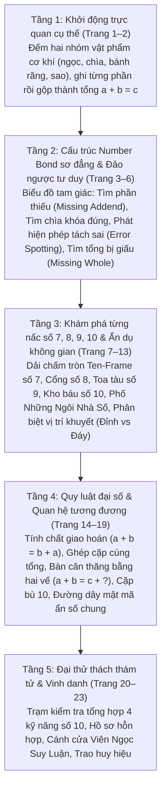

# Chặng 8: Thành Phố Mật Mã — Thám Tử Số Học • Tách – Gộp Phạm Vi 10

## 1. Objective (Mục tiêu cốt lõi)

Tài liệu này sở hữu đặc tả kỹ thuật và sư phạm nhằm tích hợp toàn diện kho dữ liệu trích xuất từ tài liệu PDF **"Chặng 8: Thành Phố Mật Mã — Thám tử số học • Tách – Gộp phạm vi 10"** (`docs/montessori/extracted/chang-08/analysis.json`, nguồn: *8 - Tach va gop pham vi 10.pdf*, 23 trang, thuộc bộ giáo trình *Gấu Logic & Thỏ Quan Sát - Chuyến Tàu Toán Học*, Montessori VN) vào nền tảng **TiniMath v2**.

### Mục tiêu chiến lược:
1. **Thiết lập Vũ trụ Cốt truyện & Động lực Học tập**:
   - **Bối cảnh**: Sau khi phục hồi Khu Vườn Hai Nhánh, Chuyến Tàu Toán Học tiến vào **Thành Phố Mật Mã** trong màn đêm lung linh ánh đèn khí đốt. Đây là một đô thị cổ kính với những tháp đồng hồ cơ khí, các hẻm phố lát đá hoa cương và mạng lưới đường ống năng lượng bí mật. Toàn bộ các cánh cổng sắt mạ đồng, két sắt ngân hàng số học và cửa sổ nhà phố đều bị niêm phong bởi các ổ khóa mật mã số học kỳ bí.
   - **Nhiệm vụ sư phạm (Learning Quest)**: Bé hóa thân thành thám tử nhí số học đồng hành cùng Thám tử trưởng Gấu Logic và Thám tử trợ lý Thỏ Quan Sát, vận dụng tư duy cấu tạo số Part-Part-Whole, mô hình Number Bond tam giác, tính chất giao hoán của phép cộng ($a + b = b + a$), phương trình cân thăng bằng hai vế ($a + b = c + ?$) và tư duy suy luận ẩn số chung để giải mã các ổ khóa, khôi phục trật tự cho thành phố và thắp sáng rực rỡ **Viên Ngọc Suy Luận** (Reasoning Gem) trên đỉnh Tháp Đồng Hồ trung tâm.
2. **Khai thác triệt để các Game Engine hiện hữu (`GT-000`..`GT-037`)**:
   - **TUYỆT ĐỐI KHÔNG TẠO MỚI `GT-038+`**.
   - Phân giải 23 trang PDF thành 3 dạng bài chuẩn (`WB08-D1`, `WB08-D2`, `WB08-D3`) tương thích 100% với 4 khuôn tương tác cốt lõi đã có trong engine:
     - `GT-005` (`PairMatchSession` — Ghép cặp tương ứng): Ghép thẻ bài phép tính với ổ khóa mục tiêu (Target Sum Matching); ghép đôi hai biểu thức tương đương có cùng tổng ($1+4$ ghép với $2+3$).
     - `GT-007` (`NumberBondSession` — Cây liên kết số Part-Part-Whole): Mô hình cây liên kết tam giác 1 đỉnh (Tổng) 2 đáy (Phần). Vận hành linh hoạt cả hai chiều: tìm phần khuyết ở đáy (Missing Addend) và gộp hai phần ở đáy tìm tổng ở đỉnh (Missing Whole).
     - `GT-008` (`DragToSlotSession` — Kéo khối số vào ô đích): Kéo thẻ số vào ô khuyết của phép tính trực quan $a + b = c$; kéo số vào cửa sổ Ngôi nhà số; kéo số vào Toa tàu số 9; kéo số vào phương trình giao hoán và cân bằng hai vế.
     - `GT-010` (`SymbolSubstitutionSession` — Thay thế biểu tượng & Ẩn số chung): Giải mã Đường dây mật mã trung tâm kết nối hai phương trình ràng buộc đồng thời ($A = k_1 + [X]$ và $B = [X] + k_2$) để tìm biến số chung duy nhất $X$.
     - *(Bổ trợ)* `GT-001` (`TapSelectSession`): Chạm chọn dòng sai trong hồ sơ điều tra (Error Spotting).
3. **Phổ biến Kho Ngữ Liệu `SkillDataset` & `SkillLevelPlan[]`**:
   - Bổ sung hệ thống vật phẩm mang phong cách thám tử steampunk cổ điển (`items`: ngọc kim cương lam, hồng ngọc đỏ, chìa khóa mật vàng/tím, bánh răng cơ khí cam/lam, sao dẫn đường vàng/tím, ổ khóa bánh lái, v.v.), mạng lưới quan hệ tách gộp (`relations: subset` với `metadata: { bond_id, part_a, part_b, whole }`), lời thoại hướng dẫn điều tra (`phrasing`), và thang phát triển nhận thức 5 bậc (`ladder`) vào các seeder kỹ năng:
     - `C1.ADD.01`: Cộng bằng đồ vật (Phép gộp trực quan hai nhóm cụ thể)
     - `C1.NCOMP.04`: Tách số 5 (Khóa số 5 và ghép cặp cùng tổng 5)
     - `C1.NCOMP.10`: Gộp số (Gộp hai phần đáy tìm tổng đỉnh)
     - `C1.NCOMP.12`: Sơ đồ liên kết số Number Bond (Cây tách gộp phạm vi 10, Nhà số, Toa tàu số)
     - `C3.RULE.01`: Tìm quy luật (Quy luật giao hoán $a+b=b+a$ và cân bằng phương trình hai vế)
     - `C3.INF.01`: Đoán vật/số còn thiếu (Suy luận ẩn số chung thỏa mãn hệ ràng buộc)
   - Cấp mã level chuẩn `GL-<COMP>-<STRAND>-<MECH>-01xx` (sequence $\ge 0101$), gắn nhãn `montessori_ref: "WB08-D<n>"`, phân bổ `access_tier` tương ứng `difficulty` (1: `free`, 2: `login`, 3: `standard`, 4: `premium`), tuân thủ nghiêm ngặt `BR-MCM-06` (không chứa từ khóa thương mại IQ/Raven/trí tuệ).
4. **Hiện thực hóa Tiến trình Sư phạm CPA & Tiền đại số 5 tầng**:
   - Cụ thể hóa lộ trình từ vật thể cụ thể (đếm ngọc, chìa khóa, bánh răng) $\rightarrow$ sơ đồ biểu tượng bán cụ thể (Cây Number Bond, Dải chấm tròn Ten-Frame) $\rightarrow$ chuyển tiếp CPA (Ngôi nhà số, Toa tàu số) $\rightarrow$ quy luật đại số trừu tượng (Giao hoán, Cân thăng bằng hai vế) $\rightarrow$ suy luận hệ ràng buộc biến số chung và cửa ải tổng hợp Capstone.

---

## 2. Actors & Pedagogical Roles

| Tác nhân / Nhân vật | Vai trò hệ thống | Vai trò sư phạm & Đặc điểm nhận diện trong Chặng 8 |
|---|---|---|
| **Bé (Kid Player)** | Người chơi chính (4–6 tuổi) | Nhập vai thám tử nhí số học, sử dụng kính lúp quan sát, thao tác chạm và kéo thả để giải mã các ổ khóa số, điền số vào cửa sổ nhà phố, thăng bằng bàn cân và mở khóa Viên Ngọc Suy Luận. |
| **Gấu Logic (`gau_logic`)** | Nhân vật đồng hành (Scaffolding Guide - Trục Logic & Khái niệm) | Đại diện tư duy suy luận quy nạp, trừu tượng và bảo toàn cấu trúc số. Ngoại hình: Thám tử trưởng mặc áo gile xanh thắt cà vạt, đội mũ phớt Sherlock Holmes, đeo kính tròn trí tuệ, tay cầm kẹp hồ sơ điều tra án văn. Lời thoại định hướng: *"Mỗi tổng gồm hai phần.", "Mỗi mái nhà là một tổng.", "Hai bên phải bằng nhau.", "Hai số đổi chỗ... tổng vẫn không đổi!", "Một mã số dùng cho cả hai phép tính!"*. |
| **Thỏ Quan Sát (`tho_quan_sat`)** | Nhân vật đồng hành (Sensory Observer - Trục Trực quan & Thao tác) | Đại diện tư duy quan sát chi tiết, đếm xúc giác và tìm kiếm manh mối. Ngoại hình: Thám tử trợ lý tinh mắt, tai dài linh hoạt, đeo túi da chéo thám tử, áo len mang số mục tiêu (8, 9, 10), tay cầm kính lúp viền vàng soi dấu vết. Lời thoại cổ vũ: *"Bé đếm rồi điền số nhé!", "Đếm tiếp từ phần đã biết đến tổng!", "Khoanh cặp có tổng đúng nhé!", "Điền số để chiếc cân thăng bằng!", "Bé tìm mã chung ở giữa nhé!"*. |
| **Phụ huynh / Giáo viên** | Người đồng hành ngoài màn hình | Hướng dẫn bé theo mô hình thám tử 4 bước: Thu thập manh mối $\rightarrow$ Phân tích phần - toàn thể $\rightarrow$ Thử nghiệm giả thuyết $\rightarrow$ Kết luận và khen ngợi nỗ lực. Đánh giá bảng tổng kết trang 23. |
| **Content Seeder Engine** | Hệ thống tự động | Nạp các cấu trúc `SkillSeed` chuẩn vào database, đảm bảo tính bất biến của taxonomy, kiểm tra ràng buộc Zod schema và các cổng kiểm thử `montessori-gate.ts`. |

---

## 3. Entry Points & File Mapping

```
docs/montessori/extracted/chang-08/analysis.json (WB08, 23 trang)
   │
   ├──> docs/montessori/dataset/activity-types-table.md  (Cập nhật WB08-D1, WB08-D2, mở nhận WB08-D3)
   ├──> docs/specs/05-content/montessori-corpus-mapping.md (Cập nhật hàng 08: GT-005, GT-007, GT-008, GT-010)
   │
   ├──> packages/content/src/skills/c1/add/C1.ADD.01.ts (Cộng bằng đồ vật: GL-C1-ADD-SLOT-0101)
   ├──> packages/content/src/skills/c1/ncomp/C1.NCOMP.04.ts (Tách số 5: GL-C1-NCOMP-BOND-0131, GL-C1-NCOMP-PAIR-0101)
   ├──> packages/content/src/skills/c1/ncomp/C1.NCOMP.10.ts (Gộp số: GL-C1-NCOMP-SLOT-0103, GL-C1-NCOMP-BOND-0132)
   ├──> packages/content/src/skills/c1/ncomp/C1.NCOMP.12.ts (Number Bond: GL-C1-NCOMP-BOND-0133, GL-C1-NCOMP-SLOT-0104)
   ├──> packages/content/src/skills/c3/rule/C3.RULE.01.ts (Tìm quy luật: GL-C3-RULE-SLOT-0101)
   └──> packages/content/src/skills/c3/inf/C3.INF.01.ts (Đoán số còn thiếu: GL-C3-INF-SUB-0101)
```

- **Mã nguồn Engine sử dụng**:
  - `packages/game-engine/src/templates/GT-005/` (`PairMatchSession` — Nối cặp tương ứng).
  - `packages/game-engine/src/templates/GT-007/` (`NumberBondSession` — Sơ đồ số liên kết hai nhánh Part-Part-Whole).
  - `packages/game-engine/src/templates/GT-008/` (`DragToSlotSession` — Kéo thả thẻ số vào ô đích / khuyết thiếu).
  - `packages/game-engine/src/templates/GT-010/` (`SymbolSubstitutionSession` — Thay thế biểu tượng / Ẩn số chung).
  - `packages/game-engine/src/templates/GT-001/` (`TapSelectSession` — Chọn một đáp án đúng / Tìm dòng sai).
- **Phạm vi kiểm thử & Xác thực**:
  - `packages/content-build/src/gates/montessori-gate.ts`.
  - `packages/content-build/tests/gates/montessori-corpus.test.ts`.

---

## 4. Pedagogical Deconstruction: Tiến Trình 23 Trang PDF Chặng 8

Giáo trình Chặng 8 gồm 23 trang được cấu trúc thành 5 tầng nhận thức tăng dần, kết hợp chặt chẽ giữa tiến trình CPA và tư duy đại số tiền tiểu học:



### 4.1. Tầng 1: Khởi động trực quan cụ thể (Trang 1 – 2)
- **Trang 1 (Bìa mở đầu)**: Cổng vòm cơ khí Thành Phố Mật Mã với sơ đồ Number Bond khổng lồ: Tổng 10, hai nhánh 6 và 4. Phía trên là Viên Ngọc Suy Luận tỏa sáng. Gấu Logic cầm kẹp tài liệu và kính lúp, Thỏ Quan Sát mang áo số 8 hào hứng dẫn đường. Các biển hiệu mật mã: $7 = 3 + 4$, $9 = 5 + 4$, $10 = 6 + 4$.
- **Trang 2 (Dấu vết hai phần — Đếm từng phần • Gộp thành tổng)**:
  - Khay 1: Ngọc bí ẩn ($2 \text{ kim cương lam} + 1 \text{ hồng ngọc đỏ} \rightarrow 2 + 1 = 3$).
  - Khay 2: Chìa khóa mật ($1 \text{ chìa vàng lớn} + 3 \text{ chìa tím nhỏ} \rightarrow 1 + 3 = 4$).
  - Khay 3: Bánh răng cơ khí ($2 \text{ bánh răng cam} + 2 \text{ bánh răng lam} \rightarrow 2 + 2 = 4$).
  - Khay 4: Sao dẫn đường ($3 \text{ sao vàng} + 2 \text{ sao tím nhạt} \rightarrow 3 + 2 = 5$).
  - Thao tác: Đếm nhóm 1 ghi vào ô thứ nhất, đếm nhóm 2 ghi vào ô thứ hai, đếm tất cả ghi kết quả tổng.

### 4.2. Tầng 2: Cấu trúc Number Bond sơ đẳng & Đảo ngược tư duy (Trang 3 – 6)
- **Trang 3 (Mật mã phần thiếu — Tìm phần còn thiếu)**:
  - Cấu trúc sơ đồ tam giác 1 đỉnh 2 nhánh. Đã biết Tổng và 1 Phần:
    - Bài 1: Khóa số 4 (Đỉnh 4, nhánh trái 1 $\rightarrow$ nhánh phải là $3$).
    - Bài 2: Khóa số 5 (Đỉnh 5, nhánh trái 2 $\rightarrow$ nhánh phải là $3$).
    - Bài 3: Dấu vết 5 (Đỉnh 5, nhánh trái 1 $\rightarrow$ nhánh phải là $4$).
    - Bài 4: Dấu vết 4 (Đỉnh 4, nhánh trái 3 $\rightarrow$ nhánh phải là $1$).
  - Chiến lược: Đếm tiếp (Counting on) từ phần đã biết đến tổng.
- **Trang 4 (Ghép thẻ chìa khóa — Tính nhanh • Chọn đúng)**:
  - Ổ khóa mục tiêu $S$, kèm 3 thẻ chìa khóa phép tính (1 đúng, 2 nhiễu $\pm 1$):
    - Khóa 5: Chọn giữa $1+4$, $2+2$, $1+3$ $\rightarrow$ Chọn $1+4$.
    - Khóa 6: Chọn giữa $2+4$, $1+4$, $3+2$ $\rightarrow$ Chọn $2+4$.
    - Khóa 7: Chọn giữa $5+1$, $3+4$, $2+4$ $\rightarrow$ Chọn $3+4$.
    - Khóa 8: Chọn giữa $4+3$, $2+5$, $5+3$ $\rightarrow$ Chọn $5+3$.
- **Trang 5 (Dấu vết bị ghi sai — Kiểm tra • Tìm phép tách sai / Error Spotting)**:
  - Mỗi hồ sơ có 3 phép tách, trong đó có 1 dòng bị kẻ gian tính sai:
    - Hồ sơ 5: $5 = 1+4$ (Đúng), $5 = 2+2$ (Sai, $2+2=4$), $5 = 3+2$ (Đúng).
    - Hồ sơ 6: $6 = 2+4$ (Đúng), $6 = 3+3$ (Đúng), $6 = 1+4$ (Sai, $1+4=5$).
    - Hồ sơ 7: $7 = 5+2$ (Đúng), $7 = 4+2$ (Sai, $4+2=6$), $7 = 3+4$ (Đúng).
    - Hồ sơ 8: $8 = 6+2$ (Đúng), $8 = 5+2$ (Sai, $5+2=7$), $8 = 4+4$ (Đúng).
  - Rèn luyện năng lực siêu nhận thức (metacognition) và kiểm chứng logic.
- **Trang 6 (Tìm tổng bị giấu — Cộng hai phần • Tìm tổng / Missing Whole)**:
  - Đảo ngược chiều tư duy của sơ đồ Number Bond: Cho sẵn 2 phần ở đáy, tìm tổng ở đỉnh:
    - Hồ sơ 1: Đáy 1 và 5 $\rightarrow$ Đỉnh là $6$.
    - Hồ sơ 2: Đáy 2 và 5 $\rightarrow$ Đỉnh là $7$.
    - Hồ sơ 3: Đáy 3 và 5 $\rightarrow$ Đỉnh là $8$.
    - Hồ sơ 4: Đáy 4 và 5 $\rightarrow$ Đỉnh là $9$.
  - Nhận biết quy luật tăng tiến: khi một số hạng giữ nguyên (5) và số hạng kia tăng 1, tổng tăng 1.

### 4.3. Tầng 3: Khám phá từng nấc số 7, 8, 9, 10 & Ẩn dụ không gian (Trang 7 – 13)
- **Trang 7 (Giải mã số 7 — Dải chấm tròn bán cụ thể Ten-Frame)**:
  - Dải 7 chấm tròn nằm ngang gồm chấm lam đậm (đã biết) và chấm rỗng viền vàng (còn thiếu):
    - $7 = 1 + [6]$ (1 chấm đặc, 6 chấm rỗng).
    - $7 = 2 + [5]$ (2 chấm đặc, 5 chấm rỗng).
    - $7 = 3 + [4]$ (3 chấm đặc, 4 chấm rỗng).
    - $7 = 4 + [3]$ (4 chấm đặc, 3 chấm rỗng).
- **Trang 8 (Cánh cổng số 8 — Bốn dấu vết số 8)**:
  - Bài 1 (Điền khuyết): $8 = 1+[7]$, $8 = 2+[6]$, $8 = 3+[5]$.
  - Bài 2 (Chọn chìa khóa): Mục tiêu 8, chọn giữa $1+6$, $2+6$, $3+6$ $\rightarrow$ Chọn $2+6$.
  - Bài 3 (Number Bond): Đỉnh 8, nhánh trái 5 $\rightarrow$ nhánh phải là $3$.
  - Bài 4 (Tìm dòng sai): $8 = 2+6$, $8 = 4+4$, $8 = 3+4$ $\rightarrow$ Dòng sai là $8 = 3+4$.
- **Trang 9 (Đoàn tàu số 9 — Hai toa gộp lại đủ 9)**:
  - Đầu tàu kéo 2 toa hàng mang số. Hai toa cộng lại phải đủ 9:
    - Tàu 1: $4 + [5] = 9$.
    - Tàu 2: $6 + [3] = 9$.
    - Tàu 3: $[7] + 2 = 9$.
    - Tàu 4: $[8] + 1 = 9$.
- **Trang 10 (Kho báu số 10 — Chinh phục số 10)**:
  - Bài 1 (Number Bond): Tổng 10, nhánh trái 6 $\rightarrow$ nhánh phải là $4$.
  - Bài 2 (Chọn chìa khóa): Mục tiêu 10, chọn giữa $6+3$, $7+3$, $5+4$ $\rightarrow$ Chọn $7+3$.
  - Bài 3 (Điền khuyết): $10 = 1+[9]$, $10 = 2+[8]$, $10 = 3+[7]$.
  - Bài 4 (Tìm dòng sai): $10 = 4+6$, $10 = 5+5$, $10 = 7+2$ $\rightarrow$ Dòng sai là $10 = 7+2$.
- **Trang 11 (Thử thách thám tử — Đại thử thách phạm vi 10)**:
  - Tổng hợp 4 bài kiểm tra độ nhạy bén: Điền phần thiếu dải chấm tròn ($7 = 3+[4]$), Number Bond đáy 4 và 5 tìm đỉnh ($9$), Chọn chìa khóa mục tiêu 10 ($8+2$), Mở 4 ổ khóa ($6=2+[4]$, $8=5+[3]$, $9=4+[5]$, $10=6+[4]$).
- **Trang 12 (Phố những ngôi nhà số — Mái là tổng, Cửa sổ là phần)**:
  - Ẩn dụ kiến trúc: Mỗi ngôi nhà có số trên mái là Tổng, hai cửa sổ là hai Phần:
    - Nhà 1: Mái 6, cửa trái 2 $\rightarrow$ cửa phải là $[4]$.
    - Nhà 2: Mái 7, cửa trái 5 $\rightarrow$ cửa phải là $[2]$.
    - Nhà 3: Mái 8, cửa trái 3 $\rightarrow$ cửa phải là $[5]$.
    - Nhà 4: Mái 9, cửa trái 4 $\rightarrow$ cửa phải là $[5]$.
- **Trang 13 (Bản đồ hai phần — Phân biệt vị trí khuyết Đỉnh vs Đáy)**:
  - Rèn luyện khả năng linh hoạt nhận thức (Cognitive Flexibility) để phân biệt vị trí khuyết:
    - Bài 1: Khuyết đỉnh $\rightarrow$ Phần 2 và 4 $\rightarrow$ Đỉnh là $6$ (thao tác GỘP).
    - Bài 2: Khuyết đáy trái $\rightarrow$ Tổng 7, đáy phải 3 $\rightarrow$ Đáy trái là $4$ (thao tác TÁCH).
    - Bài 3: Khuyết đáy phải $\rightarrow$ Tổng 9, đáy trái 6 $\rightarrow$ Đáy phải là $3$ (thao tác TÁCH).
    - Bài 4: Khuyết đỉnh $\rightarrow$ Phần 5 và 5 $\rightarrow$ Đỉnh là $10$ (thao tác GỘP).

### 4.4. Tầng 4: Quy luật đại số & Quan hệ tương đương (Trang 14 – 19)
- **Trang 14 (Chìa khóa đổi chỗ — Tính chất giao hoán: $a + b = b + a$)**:
  - Khi đổi chỗ hai số hạng, tổng không đổi:
    - $6 = 2 + 4 \implies 6 = 4 + [2]$.
    - $7 = 3 + 4 \implies 7 = 4 + [3]$.
    - $8 = 5 + 3 \implies 8 = 3 + [5]$.
    - $9 = 7 + 2 \implies 9 = 2 + [7]$.
  - Trẻ không cần tính lại mà nhận biết ngay quy luật đối xứng.
- **Trang 15 (Ghép cặp cùng tổng — Biểu thức tương đương)**:
  - Cho thẻ biểu thức gốc, tìm thẻ bên dưới có cùng giá trị tổng:
    - Thẻ gốc $1 + 4 = 5 \rightarrow$ Ghép với $2 + 3 = 5$.
    - Thẻ gốc $2 + 4 = 6 \rightarrow$ Ghép với $3 + 3 = 6$.
    - Thẻ gốc $3 + 4 = 7 \rightarrow$ Ghép với $5 + 2 = 7$.
    - Thẻ gốc $4 + 4 = 8 \rightarrow$ Ghép với $6 + 2 = 8$.
- **Trang 16 (Bảng điều tra mật mã — Cặp tách đối ngẫu)**:
  - Điền hai phần thiếu trong cùng một hồ sơ:
    - Hồ sơ tổng 6: $6 = 1 + [5]$ và $6 = 2 + [4]$.
    - Hồ sơ tổng 7: $7 = 2 + [5]$ và $7 = 5 + [2]$ (Giao hoán).
    - Hồ sơ tổng 8: $8 = 3 + [5]$ và $8 = 6 + [2]$.
    - Hồ sơ tổng 9: $9 = 4 + [5]$ và $9 = 7 + [2]$.
- **Trang 17 (Con đường cân bằng — Bàn cân thăng bằng hai vế: $a + b = c + ?$ )**:
  - Mô hình tiền đại số kinh điển: Chiếc cân đĩa nằm ngang thăng bằng:
    - Cân 1: Đĩa trái $2 + 3 = 5 \implies$ Đĩa phải $4 + [1] = 5$.
    - Cân 2: Đĩa trái $1 + 5 = 6 \implies$ Đĩa phải $3 + [3] = 6$.
    - Cân 3: Đĩa trái $4 + 3 = 7 \implies$ Đĩa phải $5 + [2] = 7$.
    - Cân 4: Đĩa trái $6 + 2 = 8 \implies$ Đĩa phải $3 + [5] = 8$.
- **Trang 18 (Nấc thang số 10 — Các cặp bù đảo chiều có tổng 10)**:
  - Khám phá 4 cặp số bạn thân của 10 (Friends of 10) theo chiều xuôi và ngược:
    - Cặp 1 & 9: $10 = 1 + [9]$ và $10 = 9 + [1]$.
    - Cặp 2 & 8: $10 = 2 + [8]$ và $10 = 8 + [2]$.
    - Cặp 3 & 7: $10 = 3 + [7]$ và $10 = 7 + [3]$.
    - Cặp 4 & 6: $10 = 4 + [6]$ và $10 = 6 + [4]$.
- **Trang 19 (Đường dây mật mã — Ẩn số chung thỏa mãn hai phương trình ràng buộc)**:
  - Đỉnh cao tư duy suy luận đại số sớm: Vòng tròn trung tâm kết nối 2 sợi dây điện tới 2 phương trình. Tìm mã số $X$ duy nhất đúng cho cả hai dòng:
    - Bài 1: $5 = 2 + [X]$ và $7 = [X] + 4 \implies X = 3$.
    - Bài 2: $6 = 2 + [X]$ và $8 = [X] + 4 \implies X = 4$.
    - Bài 3: $7 = 2 + [X]$ và $9 = [X] + 4 \implies X = 5$.
    - Bài 4: $8 = 2 + [X]$ và $10 = [X] + 4 \implies X = 6$.

### 4.5. Tầng 5: Đại thử thách thám tử & Vinh danh (Trang 20 – 23)
- **Trang 20 (Trạm kiểm tra số 10)**: Bốn góc thử thách kiểm tra toàn diện số 10:
  - Chọn chìa khóa ($2+8$), Number Bond tổng 10 nhánh 7 tìm 3, Tìm dòng sai ($10 = 8+1$), Điền 3 phần thiếu ($10 = 1+[9], 3+[7], 5+[5]$).
- **Trang 21 (Hồ sơ hỗn hợp)**:
  - Tìm phần thiếu ($8 = 3+[5]$), Number Bond đáy 4 và 5 tìm đỉnh ($9$), Chọn chìa khóa mục tiêu 7 ($3+4$), Tìm dòng sai ($9 = 7+1$).
- **Trang 22 (Cánh cửa Viên Ngọc — Đại thử thách cuối cùng)**:
  - Cửa ải tổng hợp trước kho báu: Điền phần thiếu chuỗi số cộng 5 ($6=1+[5], 7=2+[5], 8=3+[5], 9=4+[5]$); Điền tổng tăng tiến ($[6]=1+5, [7]=2+5, [8]=3+5, [9]=4+5$); Chọn chìa khóa mục tiêu 10 ($8+2$); Tìm dòng sai ($9 = 6+2$).
- **Trang 23 (Hoàn thành & Vinh danh)**:
  - Cánh cửa kho báu mở ra, tháp đồng hồ ngân vang tiếng chuông hòa bình. Trao tặng danh hiệu "Thám tử số học bậc thầy" và gắn **Viên Ngọc Suy Luận** (Reasoning Gem) lấp lánh lên huy hiệu danh dự của bé.

---

## 5. Dạng Bài Chuẩn Hóa & Ánh Xạ Game Engine

Để bảo toàn nguyên tắc bất biến **không tạo engine mới `GT-038+`**, 23 trang PDF Chặng 8 được chuẩn hóa thành **3 dạng bài chính thức**:

### 5.1. Dạng bài `WB08-D1`: Cây liên kết số Number Bond phạm vi 10 — Tìm phần còn thiếu & Mô hình nhà số / toa tàu
- **Trang PDF đại diện**: Trang 3, 7, 8, 9, 10, 11, 12, 13, 20, 21, 22.
- **Mục tiêu sư phạm**: Trẻ làm chủ cấu trúc 1 tổng - 2 phần trong phạm vi 10. Khi biết trước tổng $N \le 10$ và một phần $k$, trẻ suy luận đếm tiếp hoặc trừ để xác định phần còn thiếu $N - k$. Đồng thời nhận biết cấu trúc này dưới nhiều dạng biểu diễn tương đương (cây tam giác, ngôi nhà số, toa tàu số, dải chấm tròn).
- **Khuôn Game Engine**:
  - **`GT-007` (`NumberBondSession` — Cây liên kết số)**:
    - *Bố cục*: Sơ đồ cây 1 đỉnh (Tổng) liên kết 2 nhánh con (Phần). Đỉnh mang số tổng $N \in [4, 10]$. Nhánh con bên trái mang giá trị $k$, nhánh con bên phải là ô rỗng có viền nhấp nháy chờ điền (`is_target: true`).
    - *Tương tác*: Khay số phía dưới gồm 3 lựa chọn (đáp án đúng + 2 số nhiễu). Trẻ kéo thẻ số chính xác vào ô nhánh con để hoàn thành cây số.
  - **`GT-008` (`DragToSlotSession` — Ngôi nhà số & Toa tàu số)**:
    - *Bố cục*: 
      - Biến thể Nhà số: Mái nhà mang số tổng $N$, cửa sổ bên trái có số đã biết, cửa sổ bên phải là ô đích (`slot`).
      - Biến thể Toa tàu số 9: Đầu tàu mang số 9, toa 1 mang số, toa 2 là ô slot.
    - *Tương tác*: Trẻ kéo khối số thích hợp từ bảng số bên dưới thả vào ô slot.
- **Kỹ năng mục tiêu**: `C1.NCOMP.12` (Number Bond), `C1.NCOMP.04`..`C1.NCOMP.09` (Tách 5..10), `C3.INF.01`.

### 5.2. Dạng bài `WB08-D2`: Đếm trực quan từng phần & Gộp thành tổng — Vật phẩm Thành phố Mật mã
- **Trang PDF đại diện**: Trang 2 (Dấu vết hai phần).
- **Mục tiêu sư phạm**: Mắt xích cụ thể (Concrete) mở đầu hành trình CPA. Trẻ đếm hai nhóm vật phẩm rời rạc mang màu sắc hoặc chủng loại khác biệt (kim cương lam vs hồng ngọc đỏ, chìa vàng vs chìa tím, bánh răng cam vs bánh răng lam, sao vàng vs sao tím), ghi lại số lượng từng phần rồi gộp tất cả để tìm tổng $a + b = c$.
- **Khuôn Game Engine**:
  - **`GT-008` (`DragToSlotSession` — Điền số vào phép tính trực quan)**:
    - *Bố cục*: Màn hình hiển thị 2 khay vật phẩm cạnh nhau kèm biểu thức trực quan $[] + [] = []$.
    - *Tương tác*: Trẻ đếm từng khay, kéo thẻ số vào ô hạng tử 1 và 2, sau đó đếm tất cả để kéo thẻ số tổng vào ô kết quả.
  - **`GT-007` (`NumberBondSession` — Chế độ Discrete Objects)**:
    - *Bố cục*: Hai nhánh con chứa các icon vật phẩm cơ khí trực quan.
    - *Tương tác*: Trẻ đếm và kéo thẻ số tổng vào vòng tròn đỉnh.
- **Kỹ năng mục tiêu**: `C1.ADD.01` (Cộng bằng đồ vật), `C1.NCOMP.10` (Gộp số).

### 5.3. Dạng bài `WB08-D3`: Gộp hai phần tìm tổng, Ghép cặp biểu thức tương đương & Ẩn số chung tiền đại số
- **Trang PDF đại diện**: Trang 4, 6, 14, 15, 16, 17, 18, 19, 21, 22.
- **Mục tiêu sư phạm**:
  - Chiều ngược Number Bond: Gộp hai số ở đáy để tìm tổng ở đỉnh (Trang 6, 11, 13, 21).
  - Ghép cặp biểu thức tương đương: Tìm thẻ phép tính có cùng kết quả tổng (Trang 4, 15).
  - Tính chất giao hoán và cân bằng phương trình hai vế: Nhận biết $a + b = b + a$ và tìm số để $a + b = c + [?]$ (Trang 14, 17).
  - Suy luận ẩn số chung: Tìm mã số $X$ duy nhất thỏa mãn đồng thời hai phương trình ràng buộc độc lập (Trang 19).
- **Khuôn Game Engine**:
  - **`GT-005` (`PairMatchSession` — Nối cặp tương ứng)**:
    - *Bố cục*: Cột bên trái là các thẻ chìa khóa biểu thức gốc (ví dụ: $1+4$, $2+4$). Cột bên phải là các thẻ biểu thức đồng dạng (ví dụ: $2+3$, $3+3$) hoặc ổ khóa mục tiêu.
    - *Tương tác*: Trẻ nối cặp chìa khóa với ổ khóa hoặc nối hai thẻ có cùng giá trị tổng.
  - **`GT-007` (`NumberBondSession` — Khuyết đỉnh)**:
    - *Bố cục*: Nút đỉnh để trống có hiệu ứng nhấp nháy (`is_target: true`), hai nhánh đáy mang hai số đã biết. Trẻ gộp hai số đáy kéo vào đỉnh.
  - **`GT-008` (`DragToSlotSession` — Cân bằng & Giao hoán)**:
    - *Bố cục*: Bàn cân đĩa hai bên nằm ngang. Đĩa trái có biểu thức $a + b$, đĩa phải có $c + [?]$. Trẻ kéo khối số vào ô slot để cân thăng bằng hoàn hảo.
  - **`GT-010` (`SymbolSubstitutionSession` — Đường dây mật mã)**:
    - *Bố cục*: Vòng tròn trung tâm kết nối 2 sợi dây điện tới 2 phương trình: $A = k_1 + [X]$ và $B = [X] + k_2$.
    - *Tương tác*: Trẻ suy luận tìm giá trị của $X$, chọn thẻ số đúng kéo vào vòng tròn trung tâm để thắp sáng cả hai đường dây năng lượng.
- **Kỹ năng mục tiêu**: `C1.NCOMP.10`, `C1.NCOMP.12`, `C3.RULE.01`, `C3.INF.01`.

---

## 6. Thiết Kế Kho Ngữ Liệu `SkillDataset` (Enriched Corpus)

Kho ngữ liệu được thiết kế bám sát chủ đề thám tử thành phố mật mã, chuẩn hóa theo interface `SkillDataset`:

```typescript
export const WB08_CIPHER_CITY_DATASET: SkillDataset = {
  skill_code: "C1.NCOMP.12",
  concept_label: "Tách gộp số và giải mã số học tại Thành Phố Mật Mã",
  surface: "game",
  items: [
    // Vật phẩm khởi động cụ thể (Trang 2)
    {
      id: "wb08_blue_diamond",
      label: "viên kim cương lam",
      glyph: "💎",
      value: 1,
      contrast_group: "cipher_gem",
      ordering: 1,
      image: { kind: "emoji", ref: "💎" },
      category: { type: "ngọc bí ẩn", role: "phần" }
    },
    {
      id: "wb08_red_ruby",
      label: "viên hồng ngọc đỏ",
      glyph: "🔴",
      value: 1,
      contrast_group: "cipher_gem",
      ordering: 2,
      image: { kind: "emoji", ref: "🔴" },
      category: { type: "ngọc bí ẩn", role: "phần" }
    },
    {
      id: "wb08_gold_key",
      label: "chìa khóa vàng lớn",
      glyph: "🗝️",
      value: 1,
      contrast_group: "cipher_key",
      ordering: 3,
      image: { kind: "emoji", ref: "🗝️" },
      category: { type: "chìa khóa mật", role: "phần" }
    },
    {
      id: "wb08_purple_key",
      label: "chìa khóa tím nhỏ",
      glyph: "🔑",
      value: 1,
      contrast_group: "cipher_key",
      ordering: 4,
      image: { kind: "emoji", ref: "🔑" },
      category: { type: "chìa khóa mật", role: "phần" }
    },
    {
      id: "wb08_orange_gear",
      label: "bánh răng cơ khí cam",
      glyph: "⚙️",
      value: 1,
      contrast_group: "cipher_gear",
      ordering: 5,
      image: { kind: "emoji", ref: "⚙️" },
      category: { type: "bánh răng cơ khí", role: "phần" }
    },
    {
      id: "wb08_blue_gear",
      label: "bánh răng cơ khí lam",
      glyph: "🥏",
      value: 1,
      contrast_group: "cipher_gear",
      ordering: 6,
      image: { kind: "emoji", ref: "🥏" },
      category: { type: "bánh răng cơ khí", role: "phần" }
    },
    {
      id: "wb08_gold_star",
      label: "ngôi sao dẫn đường vàng",
      glyph: "⭐",
      value: 1,
      contrast_group: "cipher_star",
      ordering: 7,
      image: { kind: "emoji", ref: "⭐" },
      category: { type: "sao dẫn đường", role: "phần" }
    },
    {
      id: "wb08_purple_star",
      label: "ngôi sao tím nhạt",
      glyph: "✨",
      value: 1,
      contrast_group: "cipher_star",
      ordering: 8,
      image: { kind: "emoji", ref: "✨" },
      category: { type: "sao dẫn đường", role: "phần" }
    },
    // Vật phẩm ổ khóa và số học (Trang 3-22)
    {
      id: "wb08_padlock_brass",
      label: "ổ khóa số mạ đồng",
      glyph: "🔒",
      value: 5,
      contrast_group: "cipher_lock",
      ordering: 9,
      image: { kind: "emoji", ref: "🔒" },
      category: { type: "ổ khóa mục tiêu", role: "tổng" }
    },
    {
      id: "wb08_reasoning_gem",
      label: "Viên Ngọc Suy Luận",
      glyph: "💠",
      value: 10,
      contrast_group: "cipher_badge",
      ordering: 10,
      image: { kind: "emoji", ref: "💠" },
      category: { type: "huy hiệu vinh danh", role: "tổng" }
    }
  ],
  relations: [
    // Các cặp quan hệ tách gộp cốt lõi trong Chặng 8
    {
      type: "subset",
      source_id: "wb08_blue_diamond",
      target_id: "wb08_padlock_brass",
      metadata: { bond_id: "bond_5_1_4", part_a: 1, part_b: 4, whole: 5 }
    },
    {
      type: "subset",
      source_id: "wb08_gold_star",
      target_id: "wb08_padlock_brass",
      metadata: { bond_id: "bond_5_2_3", part_a: 2, part_b: 3, whole: 5 }
    },
    {
      type: "subset",
      source_id: "wb08_orange_gear",
      target_id: "wb08_reasoning_gem",
      metadata: { bond_id: "bond_10_6_4", part_a: 6, part_b: 4, whole: 10 }
    },
    {
      type: "subset",
      source_id: "wb08_purple_key",
      target_id: "wb08_reasoning_gem",
      metadata: { bond_id: "bond_10_7_3", part_a: 7, part_b: 3, whole: 10 }
    },
    {
      type: "subset",
      source_id: "wb08_gold_key",
      target_id: "wb08_reasoning_gem",
      metadata: { bond_id: "bond_10_8_2", part_a: 8, part_b: 2, whole: 10 }
    },
    {
      type: "subset",
      source_id: "wb08_blue_diamond",
      target_id: "wb08_reasoning_gem",
      metadata: { bond_id: "bond_10_9_1", part_a: 9, part_b: 1, whole: 10 }
    }
  ],
  axes: {
    role: {
      values: ["phần", "tổng"]
    }
  },
  ladder: [
    {
      rung: 1,
      dimension: "range",
      description: "Đếm trực quan từng phần và gộp thành tổng phạm vi 5",
      representation: "discrete-object"
    },
    {
      rung: 2,
      dimension: "missing_component",
      description: "Tìm phần còn thiếu (Missing Addend) trong sơ đồ Number Bond phạm vi 6–8",
      representation: "number-bond-tree"
    },
    {
      rung: 3,
      dimension: "spatial_representation",
      description: "Ứng dụng mô hình Ngôi nhà số và Toa tàu số phạm vi 9–10",
      representation: "spatial-house-train"
    },
    {
      rung: 4,
      dimension: "algebraic_relations",
      description: "Vận dụng tính chất giao hoán (a+b=b+a) và cân bằng phương trình hai vế",
      representation: "pan-balance-scale"
    },
    {
      rung: 5,
      dimension: "constraint_satisfaction",
      description: "Suy luận ẩn số chung thỏa mãn hệ ràng buộc hai phương trình và thử thách Capstone",
      representation: "shared-variable-cipher"
    }
  ],
  phrasing: {
    prompt_template: "Bé hãy {action} để mở khóa mật mã {target} nhé!",
    narration_template: "Cùng Thám tử Gấu Logic và Thỏ Quan Sát giải mã Thành Phố Mật Mã nào!",
    hints: {
      level_1: "Nhấp nháy nhẹ vào ô khuyết cần điền thẻ số.",
      level_2: "Gợi ý từ Thỏ: 'Đếm tiếp từ phần đã biết đến tổng nhé!'",
      level_3: "Gợi ý từ Gấu: 'Hai bên bàn cân phải có tổng bằng nhau đấy bé yêu!'"
    }
  },
  ordering: [
    "wb08_blue_diamond",
    "wb08_red_ruby",
    "wb08_gold_key",
    "wb08_purple_key",
    "wb08_orange_gear",
    "wb08_blue_gear",
    "wb08_gold_star",
    "wb08_purple_star",
    "wb08_padlock_brass",
    "wb08_reasoning_gem"
  ]
};
```

---

## 7. Kế Hoạch Game Level Montessori (`SkillLevelPlan[]`)

Các level được thiết kế với tiền tố chuẩn `GL-<COMP>-<STRAND>-<MECH>-01xx` (sequence $\ge 0101$), ánh xạ trực tiếp đến các file seeder kỹ năng tương ứng:

### 7.1. Bảng Kế Hoạch Game Level Cho `C1.ADD.01` (Cộng bằng đồ vật)
*Tập tin: `packages/content/src/skills/c1/add/C1.ADD.01.ts`*

| Mã Level (`code`) | Template | Band | Diff | Access Tier | Theme | Montessori Ref | Mô tả Sư phạm |
|---|---|:---:|:---:|---|---|---|---|
| `GL-C1-ADD-SLOT-0101` | `GT-008` | 4-5 | 1 | `free` | `nature` | `WB08-D2` | Đếm hai khay ngọc/chìa khóa/bánh răng trực quan rồi kéo số vào ô kết quả $a + b = c$ (Trang 2). |

### 7.2. Bảng Kế Hoạch Game Level Cho `C1.NCOMP.04` (Tách số 5)
*Tập tin: `packages/content/src/skills/c1/ncomp/C1.NCOMP.04.ts`*

| Mã Level (`code`) | Template | Band | Diff | Access Tier | Theme | Montessori Ref | Mô tả Sư phạm |
|---|---|:---:|:---:|---|---|---|---|
| `GL-C1-NCOMP-BOND-0131` | `GT-007` | 4-5 | 2 | `login` | `school` | `WB08-D1` | Khóa số 5: Sơ đồ Number Bond tổng 5, nhánh trái 2. Kéo số 3 vào nhánh còn lại (Trang 3). |
| `GL-C1-NCOMP-PAIR-0101` | `GT-005` | 4-5 | 2 | `login` | `school` | `WB08-D3` | Ghép thẻ chìa khóa có tổng 5 ($1+4$ và $2+3$) mở ổ khóa mục tiêu số 5 (Trang 4, 15). |

### 7.3. Bảng Kế Hoạch Game Level Cho `C1.NCOMP.10` (Gộp số)
*Tập tin: `packages/content/src/skills/c1/ncomp/C1.NCOMP.10.ts`*

| Mã Level (`code`) | Template | Band | Diff | Access Tier | Theme | Montessori Ref | Mô tả Sư phạm |
|---|---|:---:|:---:|---|---|---|---|
| `GL-C1-NCOMP-SLOT-0103` | `GT-008` | 4-5 | 1 | `free` | `art` | `WB08-D2` | Gộp hai nhóm vật phẩm cơ khí: Đếm từng nhóm rồi kéo thẻ số tổng vào ô đích (Trang 2). |
| `GL-C1-NCOMP-BOND-0132` | `GT-007` | 4-5 | 2 | `login` | `school` | `WB08-D3` | Tìm tổng bị giấu: Cho hai nhánh đáy (ví dụ 2 và 5), kéo thẻ số 7 vào nút đỉnh (Trang 6, 13). |

### 7.4. Bảng Kế Hoạch Game Level Cho `C1.NCOMP.12` (Number Bond)
*Tập tin: `packages/content/src/skills/c1/ncomp/C1.NCOMP.12.ts`*

| Mã Level (`code`) | Template | Band | Diff | Access Tier | Theme | Montessori Ref | Mô tả Sư phạm |
|---|---|:---:|:---:|---|---|---|---|
| `GL-C1-NCOMP-BOND-0133` | `GT-007` | 4-5 | 3 | `standard` | `school` | `WB08-D1` | Cây Number Bond phạm vi 10: Tổng 10, nhánh trái 7. Kéo thẻ số 3 vào nhánh phải (Trang 8, 10, 20). |
| `GL-C1-NCOMP-SLOT-0104` | `GT-008` | 4-5 | 3 | `standard` | `vehicle` | `WB08-D1` | Phố Ngôi Nhà Số & Toa Tàu Số 9: Kéo số vào cửa sổ còn thiếu hoặc toa tàu rỗng (Trang 9, 12). |

### 7.5. Bảng Kế Hoạch Game Level Cho `C3.RULE.01` (Tìm quy luật)
*Tập tin: `packages/content/src/skills/c3/rule/C3.RULE.01.ts`*

| Mã Level (`code`) | Template | Band | Diff | Access Tier | Theme | Montessori Ref | Mô tả Sư phạm |
|---|---|:---:|:---:|---|---|---|---|
| `GL-C3-RULE-SLOT-0101` | `GT-008` | 4-5 | 3 | `standard` | `school` | `WB08-D3` | Quy luật giao hoán ($a+b = b+a$) & Bàn cân thăng bằng hai vế ($a+b = c+[?]$) (Trang 14, 17). |

### 7.6. Bảng Kế Hoạch Game Level Cho `C3.INF.01` (Đoán vật/số còn thiếu)
*Tập tin: `packages/content/src/skills/c3/inf/C3.INF.01.ts`*

| Mã Level (`code`) | Template | Band | Diff | Access Tier | Theme | Montessori Ref | Mô tả Sư phạm |
|---|---|:---:|:---:|---|---|---|---|
| `GL-C3-INF-SUB-0101` | `GT-010` | 4-5 | 4 | `premium` | `space` | `WB08-D3` | Đường dây mật mã: Tìm ẩn số chung $X$ thỏa mãn đồng thời hai phương trình độc lập (Trang 19). |

---

## 8. Cơ Chế Phản Hồi Montessori & Kiểm Soát Lỗi Tự Thân

1. **Phản Hồi Tích Cực (Positive Feedback) — Khi Bé Giải Mã Đúng**:
   - Khi kéo đúng thẻ số vào ô nhánh Number Bond, cửa sổ nhà số hoặc vòng tròn ẩn số chung:
     - Pop hạt ánh sáng xanh ngọc phát ra tại **chính điểm chạm** (không có tọa độ hardcode).
     - Âm thanh cơ khí bánh răng quay lách cách nhẹ nhàng và tiếng chuông kim loại trong trẻo vang lên (SFX ramp vào $\ge 20$ms, ramp ra $\ge 40$ms, true peak $\le -1$ dBTP).
     - Ổ khóa bật mở, các đường dây điện mật mã phát sáng rực rỡ truyền dẫn năng lượng.
   - Khi hoàn thành toàn bộ màn chơi (Win condition):
     - Không có pháo hoa lòe loẹt gây xao nhãng. Tháp Đồng Hồ trung tâm phát sáng êm dịu.
     - **Viên Ngọc Suy Luận** (Reasoning Gem) lơ lửng giữa màn hình, tỏa ánh sáng kim cương xanh biếc kèm lời khen ngợi của Thám tử Gấu Logic: *"Tuyệt vời! Bé đã giải mã thành công những ổ khóa bí ẩn!"*.
2. **Kiểm Soát Lỗi Tự Thân (Control of Error) — Khi Bé Thao Tác Sai**:
   - **Tuyệt đối KHÔNG có tiếng còi buzzer, KHÔNG chữ đỏ/dấu X đỏ, KHÔNG trừ điểm**:
     - *Trong `GT-007` & `GT-008`*: Nếu bé kéo sai thẻ số vào nhánh khuyết hoặc cửa sổ, ô đích sẽ khẽ thở nhẹ một nhịp màu hổ phách (`amber_soft`) trong 300ms, thẻ số từ từ lướt trôi êm ái về vị trí cũ trên khay số.
     - *Trong `GT-005`*: Nếu nối sai thẻ chìa khóa với ổ khóa, sợi dây nối sẽ tan biến thành làn khói mờ ảo và hai thẻ trượt về trạng thái ban đầu.
     - *Trong `GT-010`*: Nếu chọn số không thỏa mãn đồng thời cả hai phương trình, một sợi dây sáng lên nhưng sợi kia nhấp nháy hổ phách nhẹ nhắc bé kiểm tra lại.
3. **Trợ Giúp Sư Phạm Bậc Thang (Scaffolding System)**:
   - Hệ thống tự động kích hoạt hỗ trợ leo thang không cần bé phải xin trợ giúp:
     - **Mức 1 (Nudge - 1 lần sai / sau 10s)**: Ô khuyết hoặc ổ khóa mục tiêu nhấp nháy ánh sáng hổ phách nhẹ thu hút sự chú ý (`engine.focusIndex`).
     - **Mức 2 (Guidance - 2 lần sai / sau 18s)**: Thỏ Quan Sát xuất hiện với câu thoại xúc giác: *"Bé thử đếm tiếp từ phần đã biết đến tổng nhé!"* kèm bàn tay mờ (ghost hand) chỉ vào số đã biết rồi chỉ lên tổng.
     - **Mức 3 (Demonstration - 3 lần sai / sau 25s)**: Bàn tay làm mẫu (ghost hand 0.5×) kéo mẫu thẻ số đúng vào ô khuyết, sau đó trả về khay để bé tự thực hiện lại.

---

## 9. Ma Trận Truy Xuất Nguồn Gốc (Traceability Matrix)

| Trang PDF | Tên Bài Tập Trong PDF | Dạng Bài Chuẩn | Engine | Kỹ Năng Mục Tiêu | Game Level Tương Ứng |
|---|---|:---:|:---:|---|---|
| Trang 2 | Dấu vết hai phần (đếm từng phần gộp tổng) | `WB08-D2` | `GT-008`, `GT-007` | `C1.ADD.01`, `C1.NCOMP.10` | `GL-C1-ADD-SLOT-0101`, `GL-C1-NCOMP-SLOT-0103` |
| Trang 3 | Mật mã phần thiếu (Khóa 4, 5) | `WB08-D1` | `GT-007` | `C1.NCOMP.04`, `C1.NCOMP.12` | `GL-C1-NCOMP-BOND-0131` |
| Trang 4 | Ghép thẻ chìa khóa (Mục tiêu 5, 6, 7, 8) | `WB08-D3` | `GT-005` | `C1.NCOMP.04`, `C1.NCOMP.10` | `GL-C1-NCOMP-PAIR-0101` |
| Trang 5 | Dấu vết bị ghi sai (Error Spotting 5–8) | `WB08-D3` | `GT-001` | `C3.RULE.01`, `C3.INF.01` | Bổ trợ kiểm tra quy tắc |
| Trang 6 | Tìm tổng bị giấu (Đáy 1..4 và 5) | `WB08-D3` | `GT-007` | `C1.NCOMP.10`, `C1.NCOMP.12` | `GL-C1-NCOMP-BOND-0132` |
| Trang 7 | Giải mã số 7 (Dải 7 chấm tròn Ten-Frame) | `WB08-D1` | `GT-007`, `GT-008` | `C1.NCOMP.12` | Biểu diễn Ten-frame Number Bond |
| Trang 8 | Cánh cổng số 8 (Bốn dấu vết số 8) | `WB08-D1` | `GT-007`, `GT-008` | `C1.NCOMP.12` | `GL-C1-NCOMP-BOND-0133` |
| Trang 9 | Đoàn tàu số 9 (Hai toa gộp lại đủ 9) | `WB08-D1` | `GT-008` | `C1.NCOMP.12` | `GL-C1-NCOMP-SLOT-0104` |
| Trang 10 | Kho báu số 10 (Chinh phục số 10) | `WB08-D1` | `GT-007`, `GT-008` | `C1.NCOMP.12` | `GL-C1-NCOMP-BOND-0133` |
| Trang 11 | Thử thách thám tử (Tổng hợp phạm vi 10) | `WB08-D1` | `GT-007`, `GT-005` | `C1.NCOMP.12` | `GL-C1-NCOMP-BOND-0133` |
| Trang 12 | Phố những ngôi nhà số (Mái tổng, cửa sổ phần) | `WB08-D1` | `GT-008` | `C1.NCOMP.12` | `GL-C1-NCOMP-SLOT-0104` |
| Trang 13 | Bản đồ hai phần (Phân biệt khuyết Đỉnh vs Đáy) | `WB08-D1/D3` | `GT-007` | `C1.NCOMP.10`, `C1.NCOMP.12` | `GL-C1-NCOMP-BOND-0132`, `0133` |
| Trang 14 | Chìa khóa đổi chỗ (Giao hoán a+b = b+a) | `WB08-D3` | `GT-008` | `C3.RULE.01` | `GL-C3-RULE-SLOT-0101` |
| Trang 15 | Ghép cặp cùng tổng (Biểu thức tương đương) | `WB08-D3` | `GT-005` | `C1.NCOMP.04`, `C1.NCOMP.10` | `GL-C1-NCOMP-PAIR-0101` |
| Trang 16 | Bảng điều tra mật mã (Cặp tách đối ngẫu) | `WB08-D3` | `GT-008` | `C3.RULE.01` | `GL-C3-RULE-SLOT-0101` |
| Trang 17 | Con đường cân bằng (Bàn cân 2 vế thăng bằng) | `WB08-D3` | `GT-008` | `C3.RULE.01` | `GL-C3-RULE-SLOT-0101` |
| Trang 18 | Nấc thang số 10 (Cặp bù 10 giao hoán) | `WB08-D3` | `GT-008` | `C3.RULE.01`, `C1.NCOMP.12` | `GL-C3-RULE-SLOT-0101` |
| Trang 19 | Đường dây mật mã (Ẩn số chung 2 phương trình) | `WB08-D3` | `GT-010` | `C3.INF.01` | `GL-C3-INF-SUB-0101` |
| Trang 20–22 | Trạm kiểm tra số 10, Hồ sơ hỗn hợp, Cánh cửa | `WB08-D1/D3` | `GT-007`, `GT-008` | `C1.NCOMP.12`, `C3.RULE.01` | Chuỗi liên hoàn Capstone Assessment |
| Trang 23 | Vinh danh trao Viên Ngọc Suy Luận | Hub | `GT-000` | Toàn bộ strand `C1.NCOMP` | Mở khóa huy hiệu `reasoning_gem` |

---

## 10. Verification Gates & Tiêu Chuẩn Nghiệm Thu

1. **Tuân thủ Kiến trúc & Hạn ngạch Game Engine**:
   - `0` engine mới được tạo thêm. 100% dạng bài chạy trên `GT-005`, `GT-007`, `GT-008`, `GT-010`.
   - Mọi mã game level mang tiền tố `GL-<COMP>-<STRAND>-` và sequence $\ge 0101$ (`BR-MGL-02`).
   - Phân tầng `access_tier` khớp tuyệt đối với `difficulty`: 1 = `free`, 2 = `login`, 3 = `standard`, 4 = `premium`.
2. **Tuân thủ Nội dung & Bản quyền Sư phạm**:
   - Đạt chuẩn `BR-MCM-05`: Tái biên soạn toàn diện bối cảnh Thành Phố Mật Mã, Tháp Đồng Hồ, không sao chép nguyên văn sách in.
   - Đạt chuẩn `BR-MCM-06`: Tuyệt đối không chứa các từ khóa thương mại IQ/Raven/đo chỉ số trí tuệ.
   - Đạt chuẩn `BR-GLM-08`: Mỗi bước độ khó chỉ tăng đúng 1 chiều (tăng phạm vi số hoặc chuyển đổi từ trực quan sang trừu tượng).
3. **Cổng Kỹ Thuật (Engineering Gates)**:
   - File seeder biên dịch sạch, không lỗi typecheck TypeScript (`pnpm check`).
   - Vượt qua bộ cổng kiểm tra corpus Montessori (`packages/content-build/tests/gates/montessori-corpus.test.ts`).
