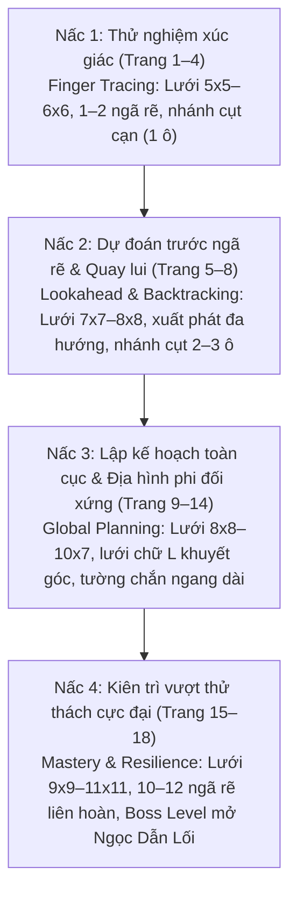

# Chặng 9: Khu Rừng Ngã Rẽ — Mê Cung, Định Hướng, Tìm Đường

## 1. Objective (Mục tiêu cốt lõi)

Tài liệu này xác lập đặc tả kỹ thuật và kiến trúc nội dung sư phạm nhằm số hóa và chuyển giao toàn diện kho ngữ liệu từ tài liệu PDF **"Chặng 9: Khu Rừng Ngã Rẽ — Mê cung • Định hướng • Tìm đường"** (`docs/montessori/extracted/chang-09/analysis.json`, nguồn: *9 - Me cung dinh huong tim duong.pdf*, 19 trang, thuộc bộ giáo trình mầm non *Gấu Logic & Thỏ Quan Sát - Chuyến Tàu Toán Học*, Montessori VN) vào hệ thống **TiniMath v2**.

### Mục tiêu chiến lược:
1. **Thiết lập Vũ trụ Cốt truyện & Động lực Học tập**:
   - **Bối cảnh**: Chuyến Tàu Toán Học số 9 tiến vào **Khu Rừng Ngã Rẽ** — một khu rừng cổ tích rậm rạp với các mê cung hàng rào cây xanh (topiary maze), vách đá hang động và hẻm núi sương mờ. Những lối mòn bị xoắn lại, có nhiều ngã ba, ngã tư và các nhánh cụt đánh lừa thị giác.
   - **Nhiệm vụ học tập (Learning Quest)**: Bé đồng hành cùng Gấu Logic (cầm bản đồ thám hiểm) và Thỏ Quan Sát (cầm ống nhòm tinh anh), vận dụng tư duy định hướng không gian, quét mắt nhìn xa và lập kế hoạch đường đi để vượt qua các mê cung, thu thập vật phẩm, mở các cánh cổng huyền bí và thắp sáng **Viên Ngọc Dẫn Lối (Viên Ngọc Định Hướng - Direction Gem)**.
2. **Khai thác triệt để các Game Engine hiện hữu (`GT-000`..`GT-037`)**:
   - **TUYỆT ĐỐI KHÔNG TẠO MỚI `GT-038+`**.
   - Chuyển thể toàn bộ 19 trang PDF vào 3 khuôn tương tác cốt lõi đã hoàn thiện trong `packages/game-engine/`:
     - **`GT-013`** (`MazeSession` — mechanic `maze-route`): Engine trung tâm của Chặng 9. Quản lý hệ thống lưới mê cung (từ $4 \times 4$ đến $7 \times 7$), kiểm tra từng bước chạm liền kề (`path_step`), ngăn chặn va chạm tường (`path_blocked`), nhịp thở hổ phách khi chạm ngõ cụt để kích hoạt chiến lược quay lui (backtracking), hỗ trợ `required_cells` (nhặt vật phẩm/chìa khóa trước khi về đích) và hỗ trợ cả 2 chế độ điều khiển: `draw` (lướt ngón tay liên tục cho band 4–5) và `arrows` (lập trình chuỗi bước đi cho band 5–6).
     - **`GT-024`** (`TraceSession` — mechanic `trace-path`): Cơ chế xúc giác bổ trợ (Finger Tracing), cho phép trẻ vẽ đường nét liên tục bám theo tim rãnh hành lang mê cung với vùng dung sai 40px (hit band), phù hợp luyện phối hợp tay - mắt ở các bài nhập môn.
     - **`GT-001`** (`TapSelectSession` — mechanic `tap-select`): Lựa chọn một đáp án đúng trong các bài toán tư duy so sánh và tối ưu hóa tuyến đường (đường nào ngắn nhất, đường nào không bị cụt, đường nào thu thập được nhiều vật phẩm nhất).
3. **Phổ biến Kho Ngữ Liệu `SkillDataset` & `SkillLevelPlan[]`**:
   - Bổ sung hệ thống vật phẩm (`items`), câu thoại đồng hành (`phrasing`), mối quan hệ không gian (`relations`), và thang kỹ năng (`ladder`) vào các seeder kỹ năng thuộc competency C2 và C3:
     - `C2.MAZ.01`: Mê cung một đường (Single-path Maze, diff 2)
     - `C2.MAZ.02`: Mê cung nhiều nhánh (Branching Maze, diff 4)
     - `C2.MAZ.03`: Tìm đường ngắn nhất (Shortest / Optimal Route, diff 5)
     - `C2.DIR.01`: Đi lên (Upward Navigation, diff 1)
     - `C2.DIR.02`: Đi xuống (Downward Navigation, diff 1)
     - `C3.ALG.01`: Làm theo chuỗi lệnh / Lập kế hoạch lộ trình (Sequential Commands & Route Planning, diff 2)
   - Cấp mã level chuẩn `GL-<COMP>-<STRAND>-<MECH>-01xx` (sequence $\ge 0101$), gắn nhãn `montessori_ref: "WB09-D<n>"`, phân tầng `access_tier` khớp đúng `difficulty` (1: `free`, 2: `login`, 3: `standard`, 4/5: `premium`), tuân thủ nghiêm ngặt `BR-MCM-06` (không chứa từ khóa thương mại IQ/Raven/trí tuệ).
4. **Hiện thực hóa Tiến trình Sư phạm CPA & 4 Nấc Thang Chiến Lược (Strategy Ladder)**:
   - Cụ thể hóa lộ trình phát triển nhận thức không gian:
     - *Nấc 1: Thử nghiệm xúc giác (Finger Tracing)* $\rightarrow$
     - *Nấc 2: Dự đoán trước ngã rẽ & Quay lui (Lookahead & Backtracking)* $\rightarrow$
     - *Nấc 3: Lập kế hoạch toàn cục & Xử lý địa hình phi đối xứng (Global Route Planning)* $\rightarrow$
     - *Nấc 4: Kiên trì vượt thử thách cực đại (Mastery & Resilience)*.

---

## 2. Actors & Pedagogical Roles

| Tác nhân / Nhân vật | Vai trò hệ thống | Vai trò sư phạm & Đặc điểm nhận diện trong Chặng 9 |
|---|---|---|
| **Bé (Kid Player)** | Người chơi chính (3–6 tuổi) | Nhập vai nhà thám hiểm nhí, quan sát bản đồ, dùng ngón tay dò đường hoặc bấm mũi tên điều hướng để dẫn lối cho Gấu và Thỏ vượt qua các ngã rẽ mê cung an toàn. |
| **Gấu Logic (`gau_logic`)** | Nhân vật đồng hành (Trục Phân Tích & Định Vị) | Đại diện tư duy định hướng, bản đồ và cấu trúc logic. Ngoại hình: Gấu nâu đeo kính tròn trí tuệ, mũ tai bèo thám hiểm, áo vest xanh lam viền vàng, tay cầm bản đồ cổ. Lời thoại định hướng: *"Đường đầu tiên đã bị rối rồi!", "Trong hang có một chiếc đèn!", "Ánh sáng đang ở phía bên kia!", "Mỗi lần chỉ chọn một lối đi!", "Cây cổ thụ ở cuối đường hầm!"*. |
| **Thỏ Quan Sát (`tho_quan_sat`)** | Nhân vật đồng hành (Trục Trực Quan & Cảnh Báo) | Đại diện tư duy quan sát chi tiết, cảnh báo ngõ cụt và nâng đỡ cảm xúc khi gặp thất bại. Ngoại hình: Thỏ trắng tinh anh, túi chéo xanh rêu, tay cầm ống nhòm thám hiểm viền vàng. Lời thoại nhắc nhở: *"Bé giúp mình tìm cánh cổng nhé!", "Dùng ngón tay thử đường trước nhé!", "Có nhánh cụt đấy, bé hãy quay lại khi cần!", "Đừng vội - hãy nhìn xa hơn một đoạn!", "Cố gắng nhé, sắp tới huy hiệu rồi!"*. |
| **Phụ huynh / Giáo viên** | Người hướng dẫn ngoài màn hình | Hỗ trợ bé theo phương pháp Montessori: Khuyến khích trẻ dừng lại trước ngã rẽ, không can thiệp cầm tay chỉ lối ngay; đặt câu hỏi gợi mở *"Đường này phía trước có tường chặn không con?"*, cùng bé đánh giá sao và tô màu Viên Ngọc Dẫn Lối ở trang tổng kết. |
| **Content Seeder Engine** | Hệ thống tự động | Tiếp nhận các `SkillLevelPlan[]`, sinh `ContentSeed` hợp lệ qua `build-levels.ts` và `builders/gt-013.ts`, xác thực qua bộ cổng kiểm thử `montessori-gate.ts`. |

---

## 3. Entry Points & File Mapping

```
docs/montessori/extracted/chang-09/analysis.json (WB09, 19 trang)
   │
   ├──> docs/montessori/dataset/activity-types-table.md
   │      - Cập nhật WB09-D1, WB09-D2, WB09-D3: chuyển từ "Hoãn" sang "Nhận (Lô B)"
   │      - Khai báo khuôn: GT-013, GT-024, GT-001
   │
   ├──> docs/specs/05-content/montessori-corpus-mapping.md
   │      - Cập nhật Hàng 09 (mục 7.1): Vượt mê cung (GT-013, GT-024, GT-001)
   │
   ├──> packages/content/src/skills/c2/maz/
   │      ├── C2.MAZ.01.ts (WB09-D1 -> GT-013: GL-C2-MAZ-MAZE-0101, GT-024: GL-C2-MAZ-TRAC-0101)
   │      ├── C2.MAZ.02.ts (WB09-D1/D2 -> GT-013: GL-C2-MAZ-MAZE-0102, GL-C2-MAZ-MAZE-0103)
   │      └── C2.MAZ.03.ts (WB09-D3 -> GT-001: GL-C2-MAZ-TAP-0101, GL-C2-MAZ-TAP-0102)
   │
   ├──> packages/content/src/skills/c2/dir/
   │      ├── C2.DIR.01.ts (WB09-D1 -> GT-013: GL-C2-DIR-MAZE-0101 - Hướng Lên)
   │      └── C2.DIR.02.ts (WB09-D1 -> GT-013: GL-C2-DIR-MAZE-0102 - Hướng Xuống)
   │
   └──> packages/content/src/skills/c3/alg/
          └── C3.ALG.01.ts (WB09-D2 -> GT-013: GL-C3-ALG-MAZE-0101 - Chuỗi lệnh checkpoint)
```

- **Mã nguồn Engine sử dụng**:
  - `packages/game-engine/src/templates/GT-013/` (`MazeSession` — Tìm đường mê cung Canvas 2D).
  - `packages/game-engine/src/templates/GT-024/` (`TraceSession` — Vẽ theo nét viền hành lang).
  - `packages/game-engine/src/templates/GT-001/` (`TapSelectSession` — Chọn phương án đường đi tối ưu).
- **Hệ thống Builder & Generator**:
  - `packages/content/src/builders/gt-013.ts` (Projector cho GT-013: tự động cấu hình lưới, tường, điểm bắt đầu/đích, và required_cells).
  - `packages/content/src/builders/gt-024.ts` (Projector cho GT-024).
  - `packages/content/src/builders/gt-001.ts` (Projector cho GT-001).
- **Phạm vi kiểm thử & Xác thực**:
  - `packages/content-build/tests/gates/montessori-corpus.test.ts`.
  - `packages/content-build/src/gates/montessori-gate.ts`.

---

## 4. Pedagogical Deconstruction: Phân Tích 19 Trang PDF Chặng 9

Tiến trình sư phạm trong 19 trang PDF của Chặng 9 được xây dựng thành 4 nấc thang chiến lược tăng dần (Strategy Ladder), dẫn dắt trẻ từ tương tác xúc giác ban đầu đến năng lực tư duy dự đoán và lập kế hoạch toàn cục:



### Chi tiết các trang bài tập:
1. **Trang 1 (page-01)**: Bìa & Hub Chặng 9 — "Khu Rừng Ngã Rẽ". Giới thiệu Gấu Logic cầm bản đồ, Thỏ Quan Sát cầm ống nhòm, đoàn tàu số 9 và biểu tượng la bàn Viên Ngọc Dẫn Lối.
2. **Trang 2 (page-02 - Trang 1 sách)**: "Cánh Cổng Lá Xanh" 🚪🌿 — Lưới $6 \times 6$, xuất phát góc dưới trái $\rightarrow$ đích góc trên phải. Ngõ cụt cạn 1 bước. Làm quen với vạch xuất phát mũi tên đỏ.
3. **Trang 3 (page-03 - Trang 2 sách)**: "Lối Mòn Hoa Nắng" 🌻 — Lưới $6 \times 6$, tìm đường tới bông hoa mặt trời. Khuyến khích trẻ dùng ngón tay dò đường trước khi tô nét.
4. **Trang 4 (page-04 - Trang 3 sách)**: "Cầu Gỗ Bên Suối" 🪵🌉 — Lưới $7 \times 6$, xuất phát giữa trái $\rightarrow$ đích giữa phải. Bắt buộc đi vòng tránh tường chắn trung tâm.
5. **Trang 5 (page-05 - Trang 5 sách)**: "Hang Đá Tiếng Vang" 🏮 — Lưới khổ dọc $7 \times 8$, xuất phát đáy giữa $\rightarrow$ đích đỉnh giữa. Kiểm tra định hướng hướng lên (`C2.DIR.01`).
6. **Trang 6 (page-06 - Trang 6 sách)**: "Khu Vườn Mật Ngọt" 🍯 — Lưới $7 \times 7$, tìm hũ mật ong. Rèn luyện chiến lược quay lui (backtracking) khi gặp nhánh cụt hình chữ T sâu.
7. **Trang 7 (page-07 - Trang 8 sách)**: "Ngã Rẽ Gió Xanh" 🎐🌀 — Lưới $8 \times 7$, tới chong chóng xanh. Thông điệp cốt lõi: *"Đừng vội - hãy nhìn xa hơn một đoạn"* (Lookahead strategy).
8. **Trang 8 (page-08 - Trang 9 sách)**: "Tháp Cú Quan Sát" 🦉🏯 — Lưới $8 \times 8$, tới tháp chú cú lông nâu thông thái. Rèn luyện tính kiên định: *"Mỗi lần chỉ chọn một lối đi"*.
9. **Trang 9 (page-09 - Trang 10 sách)**: "Cửa Rừng Sương Mờ" ⛩️🌲 — Lưới $8 \times 8$, bước vào giai đoạn nâng cao. Tường chắn ngang dài ngăn đôi mê cung, buộc phải lượn xuống đáy trước khi lên đỉnh.
10. **Trang 10 (page-10 - Trang 11 sách)**: "Khối Pha Lê Bí Ẩn" 💎✨ — Lưới ngang $9 \times 7$, chia 3 khoang không gian. Rèn luyện quét mắt toàn cảnh (Global scan).
11. **Trang 11 (page-11 - Trang 12 sách)**: "Bờ Suối Ánh Trăng" 🌙🌊 — Lưới dọc đa tầng $8 \times 9$, xuất phát chân đường đi lên bờ suối ánh trăng.
12. **Trang 12 (page-12 - Trang 13 sách)**: "Vườn Hoa Bốn Mùa" 🧺💐 — Lưới $9 \times 9$, ngõ cụt giả dạng (deceptive dead ends) bẫy thị giác.
13. **Trang 13 (page-13 - Trang 15 sách)**: "Hẻm Núi Mây Trắng" 🏔️🚩 — Lưới hình chữ L phi đối xứng (khuyết góc trên phải $4 \times 4$). Phá vỡ tư duy khuôn khổ lưới chữ nhật, thích nghi với đường biên phức tạp.
14. **Trang 14 (page-14 - Trang 16 sách)**: "Thung Lũng Đom Đóm" 🪔✨ — Lưới ngang $10 \times 7$, hành lang dài song song, tới chiếc đèn đom đóm phát sáng.
15. **Trang 15 (page-15 - Trang 17 sách)**: "Lối Lá Phong Đỏ" 🍁 — Lưới $9 \times 9$, bước vào cấp độ Chuyên gia. Mạng lưới ngã ba dày đặc, cành nhánh đan xen đối xứng.
16. **Trang 16 (page-16 - Trang 18 sách)**: "Đường Hầm Rễ Cây" 🌳🚪 — Lưới dọc hẹp $7 \times 11$, đường zigzag 4 tầng rễ cây luồn lách dưới lòng đất tới gốc cây cổ thụ.
17. **Trang 17 (page-17 - Trang 20 sách)**: "Cổng Mây Cuối Rừng" ☁️⛩️ — Lưới $10 \times 10$, đường đi răng cưa bậc thang, thử thách phân biệt nhánh cụt sâu.
18. **Trang 18 (page-18 - Trang 21 sách)**: "Mê Cung Rừng Cỏ" 🏅🏵️ — Lưới Master Grid $11 \times 11$, Boss level của Chặng 9. 12 ngã rẽ liên hoàn, kiểm tra toàn diện năng lực điều hành và tính kiên trì.
19. **Trang 19 (page-19)**: Tổng kết & Vinh danh — Nhận Huy hiệu thám hiểm và thắp sáng Viên Ngọc Dẫn Lối (la bàn 8 cánh phát sáng ngọc lục bảo).

---

## 5. Technical Specification & Activity Mapping (D1, D2, D3)

### 5.1 Dạng bài `WB09-D1`: Tìm đường mê cung cơ bản — Tránh ngõ cụt
- **Mã dạng bài**: `WB09-D1`
- **Tên sư phạm**: *Mê cung đường đơn & nhiều nhánh tránh ngõ cụt (Single-goal Maze Route Navigation)*
- **Cơ chế tương tác**:
  - Trẻ điều khiển nhân vật thám hiểm (hoặc vạch đường bước chân gấu) từ vị trí xuất phát mũi tên đỏ, lần theo hành lang không chạm vào tường rào xanh, dừng lại suy xét tại các ngã rẽ và tránh đi vào ngõ cụt, dẫn lối đến đích an toàn.
- **Engine ánh xạ**:
  1. **`GT-013`** (`MazeSession`):
     - `content_pack.grid`: Định nghĩa kích thước `rows`, `cols` (trong giới hạn 3..7 theo schema GT-013; với các bài lớn trong sách sẽ được thu gọn đại diện tỉ lệ $4 \times 4$ đến $6 \times 6$ trên màn hình tablet), danh sách `walls`, điểm `start`, điểm `goal`.
     - `content_pack.input_mode`: `"draw"` cho band 4–5 (vẽ liên tục) hoặc `"arrows"` cho band 5–6 (chọn mũi tên).
     - `difficulty_params`: `dead_end_count` (1..6), `hint_after_ms` (6000..15000ms), `allow_retry: true`.
  2. **`GT-024`** (`TraceSession`):
     - Dành cho các thử thách Finger Tracing: các waypoint được bố trí dọc theo tim rãnh hành lang mê cung, trẻ kéo ngón tay nối lần lượt các điểm checkpoint từ vạch xuất phát tới cánh cổng đích.
- **Kiểm soát lỗi tự thân (Self-Correction / Montessori Control of Error)**:
  - Khi va vào tường (`path_blocked`): Âm thanh bật nhẹ (`thud_soft.wav`), đường nét không vẽ xuyên qua tường rào.
  - Khi đi vào ngõ cụt: Xuất hiện nhịp thở hổ phách dịu mát (`amber_pulse`), nhân vật dừng lại không thể tiến tiếp, kích hoạt chỉ dẫn lùi lại một bước (backtrack) mà không trừ điểm, không hiện màu đỏ trừng phạt.
  - Khi chạm đích: Cánh cổng mở ra, âm thanh chuông ngân `Ting!`, pháo hoa hạt nhỏ tại điểm đích.

### 5.2 Dạng bài `WB09-D2`: Mê cung có điều kiện — Thu thập vật phẩm theo chuỗi
- **Mã dạng bài**: `WB09-D2`
- **Tên sư phạm**: *Mê cung có trạm dừng checkpoint (Sequential Checkpoint Maze)*
- **Cơ chế tương tác**:
  - Trẻ không được đi thẳng một mạch về đích mà phải lập lộ trình ghé qua 1 hoặc 2 ô bắt buộc (`required_cells`) để nhặt vật phẩm (chìa khóa vàng 🔑 mở cổng lá, bình pha lê 🧪, đèn đom đóm 🪔 thắp sáng đường hầm) trước khi tiến vào ô đích cuối cùng.
- **Engine ánh xạ**:
  - **`GT-013`** (`MazeSession`): Khai thác triệt để trường `required_cells: z.array(cellSchema()).min(1).max(2)` đã có sẵn trong contract của `GT-013`. Engine tự động kiểm tra mảng `visitedRequiredCells`. Nếu trẻ chạm ô `goal` khi chưa ghé đủ mọi ô trong `required_cells`, đích đến sẽ rung nhẹ và hiển thị icon chìa khóa nhấp nháy báo hiệu cần quay lại nhặt đủ.
- **Kiểm soát lỗi tự thân**:
  - Hiển thị thanh tiến trình vật phẩm ở góc trên: Icon chìa khóa/vật phẩm chuyển từ trạng thái mờ (silhouette) sang sáng rực rỡ khi trẻ chạm vào ô checkpoint tương ứng.

### 5.3 Dạng bài `WB09-D3`: So sánh & Đánh giá tuyến đường tối ưu
- **Mã dạng bài**: `WB09-D3`
- **Tên sư phạm**: *Đánh giá và so sánh lộ trình tối ưu (Route Comparison & Optimization)*
- **Cơ chế tương tác**:
  - Màn hình hiển thị sơ đồ mê cung với 2 hoặc 3 phương án tuyến đường được tô các màu tương phản (Đường Xanh lục 🟢, Đường Cam 🟠, Đường Tím 🟣).
  - Trẻ quan sát tổng thể và suy luận:
    - *Câu hỏi loại trừ*: "Đường màu nào dẫn tới hũ mật mà KHÔNG bị cụt?"
    - *Câu hỏi tối ưu độ dài*: "Đường Xanh hay đường Cam NGẮN HƠN để tới khối pha lê?"
  - Trẻ chạm vào thẻ lựa chọn màu tương ứng (Tap Select).
- **Engine ánh xạ**:
  - **`GT-001`** (`TapSelectSession`): Đảm bảo đúng 1 phương án đúng (`is_correct: true`), câu hỏi mệnh lệnh đơn, không đa tiêu chí (tuân thủ `BR-E001-02`, `BR-E001-04`).
- **Kiểm soát lỗi tự thân**:
  - Khi chọn đáp án, nhân vật Gấu và Thỏ sẽ chạy thử hoạt ảnh dọc theo con đường được chọn. Nếu đường cụt, nhân vật dừng lại lắc đầu nhẹ; nếu đường đúng, nhân vật hân hoan chạy thẳng tới đích.

---

## 6. SkillDataset Design: Kho Ngữ Liệu Khu Rừng Ngã Rẽ

Kho ngữ liệu được thiết kế đồng bộ cho các kỹ năng cốt lõi: `C2.MAZ.01`, `C2.MAZ.02`, `C2.MAZ.03`, `C2.DIR.01`, `C2.DIR.02`, `C3.ALG.01`.

### 6.1 Bảng Thực Thể Vật Phẩm (`items`) Lấy Cảm Hứng Từ Chặng 9

| Item ID | Nhãn hiển thị (`label`) | Emoji / Visual | Nhóm (`category`) | Vai trò sư phạm trong mê cung |
|---|---|:---:|---|---|
| `gate_green_leaf` | Cánh cổng lá xanh | 🚪🌿 | `destination` | Đích đến trang 1 (page-02) |
| `sunflower_goal` | Bông hoa mặt trời | 🌻 | `destination` | Đích đến trang 2 (page-03) |
| `wooden_bridge` | Cây cầu gỗ | 🪵🌉 | `destination` | Đích đến trang 3 (page-04) |
| `cave_lantern` | Chiếc đèn hang đá | 🏮 | `destination` | Đích đến trang 5 (page-05), rèn luyện hướng lên |
| `honey_pot` | Hũ mật ong rừng | 🍯 | `destination` | Đích đến trang 6 (page-06), rèn luyện quay lui |
| `wind_pinwheel` | Chong chóng gió xanh | 🎐🌀 | `destination` | Đích đến trang 7 (page-07), rèn luyện nhìn xa |
| `owl_tower` | Tháp cú quan sát | 🦉🏯 | `destination` | Đích đến trang 8 (page-08), quyết đoán một lối |
| `misty_gate` | Cửa rừng sương mờ | ⛩️🌲 | `destination` | Đích đến trang 9 (page-09), vượt tường ngang dài |
| `crystal_cube` | Khối pha lê bí ẩn | 💎✨ | `destination` | Đích đến trang 10 (page-10), quét mắt toàn cảnh |
| `moonlight_stream` | Bờ suối ánh trăng | 🌙🌊 | `destination` | Đích đến trang 11 (page-11), phân tầng không gian |
| `season_flowers` | Giỏ hoa bốn mùa | 🧺💐 | `destination` | Đích đến trang 12 (page-12), phát hiện ngõ cụt giả |
| `mountain_flag` | Đỉnh núi có lá cờ | 🏔️🚩 | `destination` | Đích đến trang 13 (page-13), xử lý lưới chữ L |
| `firefly_lamp` | Đèn đom đóm | 🪔✨ | `destination` | Đích đến trang 14 (page-14), hành lang song song |
| `autumn_leaf` | Chiếc lá phong đỏ | 🍁 | `destination` | Đích đến trang 15 (page-15), ngã ba dày đặc |
| `ancient_tree` | Cây cổ thụ bí ẩn | 🌳🚪 | `destination` | Đích đến trang 16 (page-16), đường zigzag 4 tầng |
| `cloud_gate` | Cổng mây cuối rừng | ☁️⛩️ | `destination` | Đích đến trang 17 (page-17), răng cưa bậc thang |
| `forest_badge` | Huy hiệu rừng cỏ | 🏅🏵️ | `destination` | Boss trang 18 (page-18), lưới cực đại |
| `direction_gem` | Viên Ngọc Dẫn Lối | 🧭✨ | `reward` | Phần thưởng hoàn thành Chặng 9 (page-19) |
| `golden_key` | Chìa khóa vàng | 🔑 | `checkpoint` | Vật phẩm điều kiện mở cổng (WB09-D2) |
| `energy_crystal` | Bình pha lê năng lượng | 🧪 | `checkpoint` | Vật phẩm tích lũy trên đường (WB09-D2) |
| `red_start_arrow` | Mũi tên đỏ bắt đầu | 🔴➡️ | `origin` | Điểm xuất phát chuẩn tại các cửa mê cung |
| `route_green` | Đường màu Xanh lục | 🟢 | `route_choice` | Lộ trình A trong bài toán so sánh đường đi (D3) |
| `route_amber` | Đường màu Cam | 🟠 | `route_choice` | Lộ trình B trong bài toán so sánh đường đi (D3) |
| `route_purple` | Đường màu Tím | 🟣 | `route_choice` | Lộ trình C trong bài toán so sánh đường đi (D3) |

### 6.2 Phrasing & Dialogue Lines (Gấu Logic & Thỏ Quan Sát)

```typescript
phrasing: {
  prompt_template: "Bé hãy tìm đường qua mê cung để đến {label} nhé!",
  narration_template: "Chúng mình cùng thám hiểm Khu Rừng Ngã Rẽ và vượt qua các lối mòn nhé!",
  hints: {
    level_1: "Gợi ý từ Thỏ: Dùng ngón tay thử đường trước khi đi nhé!",
    level_2: "Gợi ý từ Gấu: Có những nhánh cụt đấy — nếu bị chặn, bé hãy bình tĩnh quay lại ngã rẽ!",
    level_3: "Gợi ý từ Thỏ: Đừng vội rẽ ngay, hãy nhìn xa hơn một đoạn trước khi quyết định!",
  },
  dialogues: {
    start: "Chào mừng bé đến Khu Rừng Ngã Rẽ! Cùng Gấu và Thỏ tìm lối ra nào!",
    dead_end_hit: "Lối này bị chặn rồi! Không sao cả, chúng mình cùng lùi lại một bước nhé!",
    checkpoint_got: "Tuyệt vời! Đã nhặt được chìa khóa vàng rồi, giờ cùng tiến về cánh cổng nào!",
    goal_reached: "Hoan hô! Bé đã dẫn đường thật xuất sắc, cánh cổng đã mở ra!",
    completed_all: "Viên Ngọc Dẫn Lối đã bừng sáng! Chúc mừng nhà thám hiểm tài ba!",
  }
}
```

---

## 7. SkillLevelPlan[]: Kế Hoạch Game Level Montessori Chuẩn

Bảng phân bổ các game level Montessori bổ sung cho Chặng 9 (`WB09`), tuân thủ đầy đủ các bất biến hệ thống:
- Mã level: `GL-<COMP>-<STRAND>-<MECH>-01xx` (sequence $\ge 0101$).
- Nhãn tham chiếu: `montessori_ref: "WB09-D1"`, `"WB09-D2"`, `"WB09-D3"`.
- Bậc truy cập: `access_tier` khớp `difficulty` (1: `free`, 2: `login`, 3: `standard`, 4/5: `premium`).
- Cơ chế game: `GT-013` (`MAZE`), `GT-024` (`TRAC`), `GT-001` (`TAP`).

| Mã Level (`code`) | Template | Kỹ năng (`skill_code`) | Dạng bài | Band | Diff | Tier | Tên hiển thị / Mục tiêu bài học | Theme |
|---|:---:|:---:|:---:|:---:|:---:|:---:|---|:---:|
| `GL-C2-DIR-MAZE-0101` | `GT-013` | `C2.DIR.01` | `WB09-D1` | 3-4 | 1 | `free` | Hang đá hướng lên (Từ đáy lên đỉnh tìm đèn) | `nature` |
| `GL-C2-DIR-MAZE-0102` | `GT-013` | `C2.DIR.02` | `WB09-D1` | 3-4 | 1 | `free` | Dẫn lối xuống bờ suối (Điều hướng đi xuống) | `nature` |
| `GL-C2-MAZ-MAZE-0101` | `GT-013` | `C2.MAZ.01` | `WB09-D1` | 4-5 | 2 | `login` | Cánh cổng lá xanh (Mê cung đơn 1 ngã rẽ) | `forest` |
| `GL-C2-MAZ-TRAC-0101` | `GT-024` | `C2.MAZ.01` | `WB09-D1` | 5-6 | 3 | `standard` | Dò nét hoa nắng (Vẽ nét theo rãnh hành lang) | `forest` |
| `GL-C2-MAZ-MAZE-0102` | `GT-013` | `C2.MAZ.02` | `WB09-D1` | 4-5 | 3 | `standard` | Khu vườn mật ngọt (Mê cung ngã ba có quay lui) | `forest` |
| `GL-C2-MAZ-MAZE-0103` | `GT-013` | `C2.MAZ.02` | `WB09-D2` | 5-6 | 4 | `premium` | Cửa rừng sương mờ (Nhặt chìa khóa trước khi mở cổng) | `forest` |
| `GL-C2-MAZ-TAP-0101` | `GT-001` | `C2.MAZ.03` | `WB09-D3` | 5-6 | 4 | `premium` | Ngã rẽ gió xanh (Chọn đường đi không bị cụt) | `forest` |
| `GL-C2-MAZ-TAP-0102` | `GT-001` | `C2.MAZ.03` | `WB09-D3` | 5-6 | 5 | `premium` | Tìm đường ngắn nhất (So sánh lộ trình A vs B) | `forest` |
| `GL-C3-ALG-MAZE-0101` | `GT-013` | `C3.ALG.01` | `WB09-D2` | 4-5 | 2 | `login` | Lộ trình hai chặng (Bắt đầu -> Trạm đèn -> Cây cầu) | `nature` |

---

## 8. Scaffolding & Error Recovery (Hỗ Trợ & Phục Hồi Lỗi)

Tuân thủ nguyên tắc không trừng phạt của TiniMath v2 và Montessori Sensorial:

1. **Thang hỗ trợ leo thang tự động (Adaptive Scaffolding Ladder)**:
   - **Mức 1 (Sau 1 lần miss hoặc 10 giây không tương tác)**: Nhấp nháy nhẹ (highlight pulse) ô ngã rẽ tiếp theo trên tuyến đường đúng.
   - **Mức 2 (Sau 2 lần miss hoặc 18 giây)**: Hiển thị Bàn tay ma (Ghost Hand) lướt nhẹ 2–3 bước theo hướng đi đúng ở tốc độ bình thường.
   - **Mức 3 (Sau 3 lần miss hoặc 25 giây)**: Bàn tay ma lướt chậm ($0.5\times$) từ vị trí hiện tại của nhân vật qua chỗ ngã rẽ khó.
2. **Xử lý ngõ cụt & Va chạm tường**:
   - Khi trẻ chạm vào tường chắn: Nét vẽ dừng lại, phát ra âm thanh nảy nhẹ (`footstep_soft`), đường viền tường phát sáng xanh lam nhạt.
   - Khi trẻ đi sâu vào ngõ cụt: Xuất hiện nhịp thở hổ phách dịu mát (`amber_soft pulse`), nhân vật quay mặt lại, hiển thị mũi tên lùi 1 ô. Tuyệt đối **không dùng màu đỏ, không âm thanh buzzer, không trừ điểm**.

---

## 9. Verification Gates & Business Rules Compliance

1. **Tuân thủ `BR-MCM-01..15` & `BR-MGL-01..12`**:
   - `BR-MCM-06` (Cấm tuyên bố đo trí tuệ): Không sử dụng bất kỳ từ khóa nào liên quan đến IQ, Raven, chỉ số thông minh trong prompt, tên level hay tài liệu.
   - `BR-MGL-02` (Khối mã dành riêng): Mọi game level Montessori bắt đầu từ sequence `0101` (`GL-C2-MAZ-MAZE-0101`, `GL-C2-DIR-MAZE-0101`...).
   - `BR-MGL-03` & `BR-MGL-04` (Tối thiểu 2 level mỗi dạng bài, tăng một chiều): `WB09-D1` có 6 level (tăng từ lưới $4 \times 4$ đến $6 \times 6$, tăng số ngã rẽ), `WB09-D2` có 2 level, `WB09-D3` có 2 level.
   - `BR-MGL-12` (Tier gắn lúc soạn): Khai báo tường minh `access_tier` khớp đúng `difficulty`.
   - `BR-MGL-10` (Đa dạng cơ chế): Kết hợp 3 cơ chế `GT-013` (`MAZE`), `GT-024` (`TRAC`), `GT-001` (`TAP`).
2. **Cổng kiểm thử tự động**:
   - `pnpm check` (lint + typecheck) pass xanh.
   - Cổng `montessori-gate.ts` xác thực tính hợp lệ của metadata và hạn ngạch competency C2.
