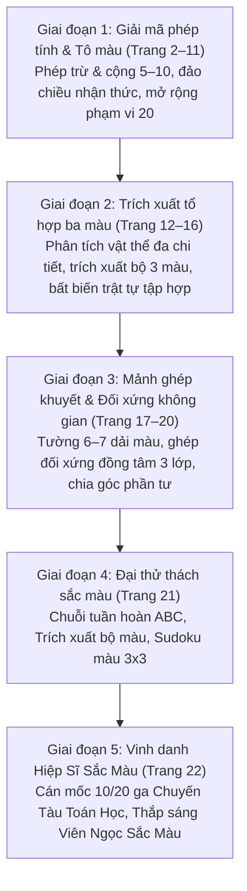

# Chặng 10: Thung Lũng Sắc Màu — Tư Duy Màu Sắc: Giải Mã, Quan Sát, Tìm Quy Luật

## 1. Objective (Mục tiêu cốt lõi)

Tài liệu này sở hữu đặc tả kỹ thuật và kiến trúc nội dung sư phạm nhằm chuyển thể trọn vẹn dữ liệu từ tài liệu PDF **"Chặng 10: Thung Lũng Sắc Màu — Tư duy màu sắc: Giải mã, Quan sát, Tìm quy luật"** (`docs/montessori/extracted/chang-10/analysis.json`, nguồn: *Chặng 10 - Thung lũng màu sắc.pdf*, 22 trang, bộ giáo trình *Gấu Logic & Thỏ Quan Sát - Chuyến Tàu Toán Học*, Nhà xuất bản Dân Trí / Montessori VN) vào nền tảng **TiniMath v2**.

### Mục tiêu chiến lược:

1. **Thiết lập Vũ trụ Cốt truyện & Động lực Học tập (Narrative Quest & Milestone)**:
   - **Bối cảnh**: Chuyến Tàu Toán Học vượt qua hành trình dài để đến với **Thung Lũng Sắc Màu** — một vùng đất thần tiên nơi vạn vật được dệt nên từ ánh sáng và các dải sắc màu rực rỡ. Tuy nhiên, nguồn năng lượng màu sắc bị suy kiệt khiến cảnh quan xung quanh bị mờ nhạt, cổng thần ma thuật bị khóa và **Viên Ngọc Sắc Màu** (viên ngọc kim cương đa diện phát sáng ở trung tâm lâu đài) đã tắt lịm hào quang.
   - **Nhiệm vụ học tập (Learning Quest)**: Bé đồng hành cùng Gấu Logic và Thỏ Quan Sát, vượt qua 21 thử thách sắc màu tăng tiến để mở khóa cánh cổng, thắp sáng các kỳ quan (lâu đài, cánh diều, cỗ xe cầu vồng, thuyền buồm, tượng thỏ pha lê, cá heo, mèo nhỏ, gấu trúc), thu thập trọn vẹn các dải quang phổ để hồi sinh Viên Ngọc Sắc Màu.
   - **Dấu mốc đặc biệt**: Hoàn thành Chặng 10 đánh dấu cột mốc trẻ hoàn thành **10/20 ga trên bản đồ đường ray** (cán mốc 50% toàn bộ giáo trình 3–6 tuổi), nhận danh hiệu **Hiệp Sĩ Sắc Màu** và mở khóa chặng 11.
2. **Khai thác triệt để các Game Engine hiện hữu (`GT-000`..`GT-037`)**:
   - **TUYỆT ĐỐI KHÔNG TẠO MỚI `GT-038+`**.
   - Chuyển thể 22 trang PDF thành 4 nhóm dạng bài chuẩn (`WB10-D1`, `WB10-D2`, `WB10-D3`, `WB10-D4`), tương thích 100% với 5 khuôn tương tác cốt lõi đã có trong engine registry:
     - `GT-000` (`concept-intro` & `celebration-summary`): Hoạt cảnh giới thiệu Thung Lũng Sắc Màu và lễ vinh danh hoàn thành 50% hành trình (Trang 1, 22).
     - `GT-002` (`tap-select-multi` / `tap-fill`): Chạm chọn bút chì/màu từ palette và chạm tô màu vào từng phân vùng tranh mang phép tính hoặc số tương ứng (Trang 2–11).
     - `GT-005` (`pair-match`): Nối cặp đối chiếu giữa vật thể đa chi tiết và bộ 3 lục giác màu (Trang 12–16); nối hai nửa huy hiệu đối xứng đồng tâm (Trang 19); nối vòng tròn 4 góc phần tư với mảnh tròn khuyết (Trang 20).
     - `GT-008` (`drag-to-slot`): Kéo mảnh ghép hình học (tam giác, ngôi sao) thả khít vào khoảng khuyết trên bức tường dải màu (Trang 17, 18); kéo thả ô màu vào ma trận Sudoku (Trang 21).
     - `GT-001` (`tap-select`): Trắc nghiệm chạm chọn đáp án đơn lẻ, fallback tap-tap cho trẻ 3–4 tuổi khi thao tác kéo/nối chưa thuần thục (Trang 17, 18, 21).
3. **Hiện thực hóa 5 Trụ Cột Sư Phạm Montessori & Mô hình CPA (Concrete - Pictorial - Abstract)**:
   - *Cảm thức màu sắc & Phân tách tổ hợp đa thuộc tính (Chromatic Discrimination & Multi-Attribute Abstraction)*: Trẻ quan sát vật thể đa chi tiết để trích xuất bộ ba màu đại diện ({Đỏ, Vàng, Lam}), nhận thức tính bất biến trật tự tập hợp (Order Invariance of Sets: $\{A, B, C\} \equiv \{C, B, A\}$).
   - *Mã hóa toán học (Color by Calculation / Math-to-Color Code)*: Liên kết giữa phép tính trừu tượng ($a + b, a - b$) và màu sắc trực quan, rèn luyện lớp tương đương toán học (Equivalence Classes: các biểu thức khác nhau nhưng cùng kết quả sẽ mang cùng một màu).
   - *Cơ chế đảo chiều nhận thức (Inverse Decoding)*: Giải phép tính tại bảng mã bút chì trước rồi tìm số tương ứng trên tranh để tô (Trang 5).
   - *Tích hợp không gian từ bộ phận đến toàn thể & Đối xứng (Spatial-Color Alignment & Symmetry)*: Ghép mảnh tam giác/ngôi sao dựa trên sự liên tục của 6–7 dải màu ngang; ghép đôi hai nửa bán nguyệt 3 lớp màu đồng tâm; định vị mảnh khuyết tại tâm vs lệch tâm trên vòng tròn 4 góc phần tư.
   - *Tư duy đại số & Ma trận logic Sudoku 3x3*: Hoàn thành chuỗi tuần hoàn ABC và điền ô khuyết trong ma trận Latin Square Sudoku (mỗi hàng, mỗi cột không lặp màu).
4. **Làm giàu hệ thống `SkillDataset` & `SkillLevelPlan[]`**:
   - Bổ sung dataset phong phú `CHANG_10_COLOR_VALLEY_DATASET` vào các seeder thuộc các competency C1, C2, C4:
     - `packages/content/src/skills/c4/sen/C4.SEN.01.ts` (Phân biệt sắc độ màu / tổ hợp màu)
     - `packages/content/src/skills/c4/vis/C4.VIS.01.ts` (Quan sát chi tiết thị giác)
     - `packages/content/src/skills/c1/cnt/C1.CNT.01.ts` (Đếm đồ vật & tương ứng 1-1)
     - `packages/content/src/skills/c1/cmp/C1.CMP.01.ts` (Đối chiếu & so sánh thuộc tính)
     - `packages/content/src/skills/c1/add/` & `c1/sub/` (Cộng trừ giải mã màu)
   - Cấp mã level chuẩn `GL-<COMP>-<STRAND>-<MECH>-01xx` (sequence $\ge 0101$), gắn nhãn `montessori_ref: "WB10-D<n>"`.
   - Phân bổ `access_tier` khớp độ khó `difficulty`: 1=`free`, 2=`login`, 3=`standard`, 4/5=`premium`.
   - Tuân thủ nghiêm ngặt `BR-MCM-06` (không chứa từ khóa thương mại IQ/Raven/trí tuệ).

---

## 2. Actors & Pedagogical Roles

| Tác nhân / Nhân vật | Vai trò hệ thống | Vai trò sư phạm & Đặc điểm nhận diện trong Chặng 10 |
|---|---|---|
| **Bé (Kid Player)** | Người chơi chính (3–6 tuổi) | Nhập vai "Họa sĩ giải mã nhí", dùng thao tác chạm và kéo thả để tô màu giải mã phép tính, đối chiếu tổ hợp màu, ghép mảnh không gian và giải ma trận màu sắc. |
| **Gấu Logic (`gau_logic`)** | Người dẫn đường tư duy logic | Đại diện trục tư duy toán học và quy tắc trừu tượng. Ngoại hình: Gấu nâu đeo kính tròn trí tuệ, áo gile chỉn chu, tay cầm bảng mã bút chì và thước đo. Giọng trầm ấm, giải thích bản chất toán học: *"Mỗi phép tính là một mật mã màu sắc!", "Những phép tính có cùng kết quả sẽ mang chung một màu!", "Bé giải phép tính ở bảng màu trước khi tô nhé!", "Mỗi hàng và mỗi cột của ma trận chỉ có đúng ba màu thôi!"*. |
| **Thỏ Quan Sát (`tho_quan_sat`)** | Bạn đồng hành giác quan thị giác | Đại diện trục quan sát trực quan và phân biệt chi tiết màu sắc. Ngoại hình: Thỏ trắng hoạt bát cầm kính lúp viền vàng, túi da chéo xanh, mắt sáng ngời. Lời thoại nhắc nhở chiến lược quan sát tỉ mỉ: *"Bé nhìn thật kỹ cả ba màu trên đôi cánh nhé!", "Đừng để thứ tự màu làm bé phân vân, hãy tìm đủ ba màu!", "Mảnh ghép đúng phải nối liền dải màu ở cả hai cạnh!", "Hai nửa huy hiệu có ba lớp màu đồng tâm đấy!"*. |
| **Phụ huynh / Giáo viên** | Đồng hành ngoài màn hình | Hỗ trợ bé rèn luyện phản xạ tính nhẩm kết hợp nhận diện màu sắc thực tế. Cùng bé đánh giá 3 ngôi sao và sáng tạo tô màu Viên Ngọc Sắc Màu ở trang hoàn thành chặng (Trang 22). |
| **Content Seeder Engine** | Hệ thống tự động | Biên dịch `SkillLevelPlan[]` thành `ContentSeed` hoàn chỉnh, kiểm tra qua cổng `montessori-gate.ts`. |

---

## 3. Entry Points & File Mapping

```
docs/montessori/extracted/chang-10/analysis.json (WB10, 22 trang)
   │
   ├──> docs/montessori/dataset/activity-types-table.md
   │      └── Cập nhật WB10-D1, WB10-D2; bổ sung WB10-D3, WB10-D4
   ├──> docs/specs/05-content/montessori-corpus-mapping.md
   │      └── Cập nhật hàng 10: GT-001, GT-002, GT-005, GT-008
   │
   ├──> packages/content/src/skills/c4/sen/C4.SEN.01.ts
   │      ├── GL-C4-SEN-FILL-0101 (GT-002: Đánh thức những cánh diều — Phép cộng phạm vi 5, WB10-D1)
   │      ├── GL-C4-SEN-PAIR-0101 (GT-005: Ghép cánh bướm với bảng màu — Bộ 3 màu đối xứng, WB10-D2)
   │      └── GL-C4-SEN-PAIR-0103 (GT-005: Chọn màu cho khinh khí cầu & Đèn lồng, WB10-D2)
   │
   ├──> packages/content/src/skills/c4/vis/C4.VIS.01.ts
   │      ├── GL-C4-VIS-PAIR-0102 (GT-005: Chọn màu cho xe hoa & Xe pha lê — Trích xuất 3 màu, WB10-D2)
   │      └── GL-C4-VIS-CARD-0104 (GT-001: Chạm chọn bộ ba màu đúng — Tap-select fallback, WB10-D2)
   │
   ├──> packages/content/src/skills/c1/add/ & c1/sub/
   │      ├── GL-C1-OPS-FILL-0102 (GT-002: Mở khóa cánh cổng sắc màu — Phép trừ phạm vi 10, WB10-D1)
   │      ├── GL-C1-OPS-FILL-0103 (GT-002: Thắp sáng lâu đài & Cỗ xe cầu vồng — Phép cộng 7 & 9, WB10-D1)
   │      ├── GL-C1-OPS-FILL-0104 (GT-002: Giải mã ngôi nhà pha lê — Đảo chiều nhận thức, WB10-D1)
   │      └── GL-C1-OPS-FILL-0105 (GT-002: Gấu trúc giữ kho báu — Phép tính mở rộng 20, WB10-D1)
   │
   ├──> packages/content/src/skills/c2/ (Hình học & Đối xứng)
   │      ├── GL-C2-GEO-SLOT-0101 (GT-008: Mảnh ghép cầu vồng — Kéo tam giác vào tường 6 dải màu, WB10-D3)
   │      ├── GL-C2-GEO-SLOT-0102 (GT-008: Ngôi sao bị khuyết — Kéo ngôi sao vào tường 7 tầng màu, WB10-D3)
   │      ├── GL-C2-MIR-PAIR-0103 (GT-005: Ghép đôi huy hiệu sắc màu — Đối xứng đồng tâm 3 lớp, WB10-D3)
   │      └── GL-C2-GEO-PAIR-0104 (GT-005: Những vòng tròn bí mật — Nối mảnh tròn góc phần tư, WB10-D3)
   │
   └──> packages/content/src/skills/c4/ (Quy luật & Ma trận)
          ├── GL-C4-PAT-CARD-0101 (GT-001: Tiếp tục chuỗi quy luật hạt màu ABC, WB10-D4)
          └── GL-C4-LOG-SLOT-0102 (GT-008: Ma trận Sudoku màu 3x3 — Điền ô còn thiếu, WB10-D4)
```

- **Mã nguồn Engine sử dụng**:
  - `packages/game-engine/src/templates/GT-000/` (`GT000Session` — Intro & Celebration).
  - `packages/game-engine/src/templates/GT-001/` (`TapSelectSession` — Single Choice Tap Select).
  - `packages/game-engine/src/templates/GT-002/` (`TapSelectMultiSession` / Tap-Fill — Color by Code).
  - `packages/game-engine/src/templates/GT-005/` (`PairMatchSession` — Two-Column Interactive Line Match).
  - `packages/game-engine/src/templates/GT-008/` (`DragToSlotSession` — Drag and Drop to Spatial Slots).
- **Phạm vi kiểm thử & Xác thực**:
  - `packages/content-build/src/gates/montessori-gate.ts`.
  - `packages/content-build/tests/gates/montessori-corpus.test.ts`.

---

## 4. Pedagogical Deconstruction: Phân Tích 22 Trang PDF Chặng 10

Tiến trình Chặng 10 gồm 4 giai đoạn phát triển nhận thức chặt chẽ, đưa trẻ từ nhận diện màu cụ thể qua mã hóa toán học, trừu tượng hóa tổ hợp màu, tích hợp không gian và suy luận ma trận logic:



---

### Nhóm Dạng Bài 1: `WB10-D1` — Tô Màu Giải Mã Phép Tính (Trang 2 – Trang 11)

- **Tên bài học**: *Tô màu giải mã phép tính (Color by Calculation / Math-to-Color Code)*.
- **Phạm vi trang PDF**: Trang 2 đến Trang 11 (10 trang bài tập liên tục).
- **Mục tiêu sư phạm**:
  - Chuyển hóa tư duy toán học trừu tượng (Abstract) thành hành động tô màu trực quan (Pictorial/Concrete).
  - Khắc sâu các lớp tương đương toán học (Equivalence Classes): Dù biểu thức khác nhau ($1+2 = 2+1 = 3-0 = 3$), chúng đều chia sẻ chung một thuộc tính màu sắc.
  - Tăng dần biên độ tính toán:
    - *Trang 2 (Cánh cổng sắc màu)*: Phép trừ phạm vi 10, kết quả 1–6 (3-2=1, 4-2=2, 5-2=3, 6-2=4, 7-2=5, 8-2=6).
    - *Trang 3 (Những cánh diều)*: Phép cộng phạm vi 5, kết quả 1–5, làm quen số 0 ($1+0, 0+3$) và tính giao hoán ($1+2 = 2+1$).
    - *Trang 4 (Lâu đài bảy sắc)*: Phép cộng phạm vi 7, kết quả 1–7, củng cố đếm ngón tay (Finger Gnosia).
    - *Trang 5 (Ngôi nhà pha lê)*: **Cơ chế đảo chiều nhận thức (Inverse Decoding)**: Phép tính đặt tại bút chì ($3-2=1, 6-4=2, 7-4=3, 8-4=4, 8-3=5, 9-3=6, 8-1=7$), tranh vẽ chứa số kết quả. Trẻ phải giải mã bút chì trước rồi tìm các ô số tương ứng trên ngôi nhà để tô.
    - *Trang 6 (Cỗ xe cầu vồng)*: Phép cộng phạm vi 9, kết quả 2–9 với 8 màu sắc phong phú.
    - *Trang 7 (Căng buồm qua hồ)*: Phép cộng phạm vi 8, củng cố tính tương đương nhiều biểu thức cho cùng 1 màu.
    - *Trang 8 (Thỏ pha lê)*: Tích hợp hỗn hợp cả cộng và trừ (Mixed Addition & Subtraction), kết quả 3–6.
    - *Trang 9 (Cá heo tìm màu)*: Cộng trừ hỗn hợp với kết quả 4–8 trên hình thể sóng biển sinh động.
    - *Trang 10 (Mèo nhỏ giữ ngọc)*: Cộng trừ phạm vi 10, làm quen cấu trúc cơ số 10 ($5+5=10, 12-2=10$).
    - *Trang 11 (Gấu trúc giữ kho báu)*: Cộng trừ nâng cao phạm vi 20, kết quả 12–15 ($18-6=12, 6+7=13, 7+7=14, 20-6=14, 7+8=15, 20-5=15$).
- **Cơ chế tương tác số hóa (`GT-002` Tap-Fill & `GT-001` Tap-Select)**:
  - Khay palette bút chì màu hiển thị ở cạnh dưới màn hình.
  - Trẻ chạm chọn một bút chì màu (hệ thống phát âm tên màu và số/phép tính đại diện).
  - Trẻ chạm vào vùng tranh có phép tính tương ứng để phủ màu.
  - Khi một vùng được giải đúng, màu sắc bừng sáng kèm hiệu ứng âm thanh leng keng ramp 20ms; khi chạm sai, nhịp hổ phách (`amber_soft`) nhấp nháy nhẹ nhàng trên vùng chạm, không trừng phạt.
  - Khi hoàn thành 100% vùng tranh, bức tranh mở bung hào quang chuyển động (cánh diều bay lượn, cỗ xe lăn bánh, thỏ pha lê vẫy tai, cá heo nhảy sóng, rương kho báu bật nắp).
- **Kỹ năng liên kết**: `C4.SEN.01`, `C1.ADD.01`, `C1.ADD.02`, `C1.SUB.01`, `C1.SUB.02`, `C1.CNT.01`.

---

### Nhóm Dạng Bài 2: `WB10-D2` — Trích Xuất & Đối Chiếu Tổ Hợp Ba Màu Sắc (Trang 12 – Trang 16)

- **Tên bài học**: *Trích xuất & Đối chiếu tổ hợp ba màu sắc (Multi-Color Triplet Matching)*.
- **Phạm vi trang PDF**: Trang 12 đến Trang 16 (5 trang bài tập).
- **Mục tiêu sư phạm**:
  - Rèn luyện năng lực trích xuất đặc trưng đa thuộc tính (Multi-Attribute Feature Extraction): Phân tích một vật thể đa chi tiết thị giác thành tập hợp 3 màu sắc cấu thành.
  - Nhận thức nguyên lý bất biến theo trật tự sắp xếp không gian (Order Invariance of Sets): Dù 3 múi màu của khinh khí cầu xếp theo thứ tự nào, bộ màu đại diện vẫn là tập hợp $\{A, B, C\}$.
  - Quét tuần tự và chú ý chọn lọc (Sequential Scanning & Selective Attention):
    - *Trang 12 (Xe hoa sắc màu)*: 5 xe tải chở hoa, mỗi xe có thùng, mui, viền mang đúng 3 màu đặc trưng.
    - *Trang 13 (Cánh bướm sắc màu)*: 5 chú bướm với các tầng màu đối xứng hai bên cánh.
    - *Trang 14 (Thắp sáng những chiếc đèn)*: 5 đèn lồng cổ tích với 3 tấm kính màu trong suốt.
    - *Trang 15 (Khinh khí cầu rực rỡ)*: 5 quả khinh khí cầu có 3 múi dải màu uốn cong.
    - *Trang 16 (Xe pha lê mở đường)*: 5 ô tô con đa sắc mui - thân - bánh.
  - Phương án gây nhiễu tinh vi (Distractors): Các bộ màu gây nhiễu chứa 2 màu trùng khớp và 1 màu sai lệch, đòi hỏi trẻ không nhìn lướt mà phải kiểm tra đủ cả 3 thuộc tính.
- **Cơ chế tương tác số hóa (`GT-005` Pair-Match & `GT-001` Tap-Select)**:
  - Cột trái: 5 đối tượng đồ họa trực quan (xe hoa, bướm, đèn, khinh khí cầu, ô tô).
  - Cột phải: 5 cụm 3 ô lục giác màu sắc.
  - Trẻ vuốt kéo dây nối neon từ vật thể sang cụm lục giác màu (hoặc chạm nguồn $\rightarrow$ chạm đích).
  - Khi nối đúng, dây phát sáng neon, phát âm xác nhận ba màu ("Đỏ - Vàng - Xanh lá! Chính xác!"), vật thể có hoạt cảnh ăn mừng nhỏ tại chỗ.
- **Kỹ năng liên kết**: `C4.SEN.01`, `C4.VIS.01`, `C1.CMP.01`, `C1.CNT.01`.

---

### Nhóm Dạng Bài 3: `WB10-D3` — Mảnh Ghép Khuyết & Đối Xứng Không Gian Màu Sắc (Trang 17 – Trang 20)

- **Tên bài học**: *Mảnh ghép khuyết & Đối xứng không gian màu sắc (Spatial-Color Alignment & Symmetry)*.
- **Phạm vi trang PDF**: Trang 17 đến Trang 20 (4 trang chuyên sâu).
- **Mục tiêu sư phạm**:
  - Tích hợp nhận thức không gian hình học và màu sắc liên tục (Spatial-Color Continuity): Mảnh ghép khuyết phải tiếp nối chính xác các dải màu ngang của bức tường ở cả hai cạnh cắt.
  - Tư duy đối xứng trục và cấu trúc đồng tâm (Concentric Radial Symmetry): Ghép nối hai nửa bán nguyệt có 3 lớp màu đồng tâm (vòng ngoài, vòng giữa, tâm) để tạo thành hình tròn hoàn chỉnh.
  - Phân vùng góc phần tư và liên tục đường phân ranh (Quadrant Partitioning & Boundary Continuity): Phân biệt giữa mảnh khuyết lệch tâm (giao thoa giữa 2 màu) và mảnh khuyết ngay tại tâm (giao thoa của cả 4 màu).
  - Chi tiết bài tập:
    - *Trang 17 (Mảnh ghép cầu vồng)*: Bức tường 6 dải màu ngang khuyết mảnh tam giác cân từ tầng 2 đến tầng 6. Trẻ phân tích thứ tự màu: Xanh lơ (đỉnh), Xanh lá, Đỏ, Vàng, Xanh dương đậm (đáy). Chọn phương án B đúng.
    - *Trang 18 (Ngôi sao bị khuyết)*: Bức tường 7 tầng màu pha lê khuyết hình ngôi sao 5 cánh từ tầng 2 đến tầng 6. Trẻ chọn ngôi sao D khớp hoàn toàn: Vàng (đỉnh), Xanh lơ (cánh ngang), Xanh lá (thân), Cam (thân dưới), Tím (hai chân).
    - *Trang 19 (Huy hiệu sắc màu)*: 5 cặp nửa huy hiệu bán nguyệt 3 lớp đồng tâm. Trẻ đối chiếu cả 3 lớp màu để nối thành 5 hình tròn hoàn chỉnh ($1-C, 2-E, 3-A, 4-D, 5-B$).
    - *Trang 20 (Những vòng tròn bí mật)*: 3 vòng tròn chia 4 góc phần tư màu. Vòng 1 khuyết lệch tâm trên (Xanh lá / Vàng $\rightarrow$ chọn mảnh B); Vòng 2 khuyết lệch tâm trái (Tím / Vàng $\rightarrow$ chọn mảnh D); Vòng 3 khuyết ngay chính tâm (giao của cả 4 màu $\rightarrow$ chọn mảnh A).
- **Cơ chế tương tác số hóa (`GT-008` Drag-to-Slot & `GT-005` Pair-Match)**:
  - *Trang 17, 18*: Kéo mảnh ghép tam giác / ngôi sao từ khay bên dưới thả vào khoảng trống khuyết trên bức tường. Nam châm snap với bán kính hit band multiplier 1.5x hút mảnh ghép khít khao, bức tường tỏa sáng lung linh. Có chế độ tap-select fallback chọn nút A, B, C cho trẻ 3–4 tuổi.
  - *Trang 19, 20*: Nối nửa trên với nửa dưới (Trang 19) hoặc kéo mảnh tròn nhỏ thả vào ô khuyết trên vòng tròn lớn (Trang 20).
- **Kỹ năng liên kết**: `C2.GEO.01`, `C2.MIR.01`, `C4.VIS.01`, `C4.SEN.01`.

---

### Nhóm Dạng Bài 4: `WB10-D4` — Đại Thử Thách Sắc Màu & Suy Luận Ma Trận (Trang 21)

- **Tên bài học**: *Đại thử thách sắc màu & Suy luận ma trận (Grand Color Challenge & Matrix Deduction)*.
- **Phạm vi trang PDF**: Trang 21 (Bài đánh giá năng lực tổng hợp cuối chặng).
- **Mục tiêu sư phạm**:
  - Đánh giá khả năng tích hợp 3 năng lực cốt lõi trong cùng một màn chơi tổng kết:
    - *Bài 1 (Chuỗi quy luật tuần hoàn ABC)*: Dãy hạt tròn màu: `Đỏ` $\rightarrow$ `Xanh dương` $\rightarrow$ `Vàng` $\rightarrow$ `Đỏ` $\rightarrow$ `Xanh dương` $\rightarrow$ `[ ? ]`. Trẻ nhận diện chu kỳ 3 bước và chọn hạt màu `Vàng` để hoàn tất chu kỳ.
    - *Bài 2 (Trích xuất bộ ba màu)*: Hình hoa/bướm 4 cánh gồm cánh trên-trái Xanh dương, cánh trên-phải Đỏ, hai cánh dưới Vàng. Trẻ trích xuất chính xác bộ ba màu đại diện: `{Xanh dương, Vàng, Đỏ}` (Đáp án B).
    - *Bài 3 (Ma trận Latin Square Sudoku màu 3x3)*: Lưới $3 \times 3$ với quy tắc: mỗi hàng ngang và mỗi cột dọc đều có đủ 3 màu (Đỏ, Xanh dương, Vàng) và không được lặp lại màu. Ô góc dưới bên phải mang dấu `?`. Hàng 3 đã có Vàng, Đỏ; Cột 3 đã có Vàng, Đỏ $\rightarrow$ Ô khuyết bắt buộc là màu `Xanh dương` (Đáp án B).
- **Cơ chế tương tác số hóa (`GT-001` Tap-Select & `GT-008` Drag-to-Slot)**:
  - Trẻ giải quyết tuần tự 3 bài mini-game trên cùng một màn hình HUD tiến trình (3 ngôi sao nhỏ sáng dần).
  - Khi hoàn thành cả 3 bài, kèn hiệu chiến thắng vang lên, dẫn thẳng vào màn vinh danh Trang 22.
- **Kỹ năng liên kết**: `C4.PAT.01`, `C4.SEN.01`, `C4.VIS.01`, `C1.CMP.01`.

---

### Phân Đoạn 5: Trang 22 — Hoàn Thành Chặng & Vinh Danh Hiệp Sĩ Sắc Màu (`WB10-Celebration`)

- **Bản đồ đường ray 20 ga**: Đánh dấu tích xanh hoàn thành ga số 10. Bảng hiệu *"Bé đang ở đây"* cắm tại ga số 10 — chính thức hoàn thành **50% lộ trình Chuyến Tàu Toán Học**.
- **Thắp sáng Viên Ngọc Sắc Màu**: Viên ngọc kim cương đa diện bừng sáng 7 sắc cầu vồng, phóng hào quang chiếu rọi toàn bộ Thung Lũng Sắc Màu.
- **Đánh giá 3 ngôi sao & Tự do sáng tạo**: Màn hình chúc mừng cho ba mẹ và bé cùng chạm vào 3 ngôi sao vàng và tự do dùng cọ màu tô điểm cho Viên Ngọc Sắc Màu theo sở thích.
- **Tương tác số hóa (`GT-000`)**: Confetti pháo hoa giấy bay ngợp màn hình, còi tàu hú vang 2 hồi dài vui tươi, trao huy hiệu số hóa **"Hiệp Sĩ Sắc Màu"** và nút mở khóa sẵn sàng lên tàu tới Chặng 11.

---

## 5. Game Engine Interaction Architecture

Mọi tương tác trong Chặng 10 được thiết kế tuân thủ nghiêm ngặt các quy chuẩn kỹ thuật của TiniMath v2 (Rule 07 & Rule 13):

```
┌────────────────────────────────────────────────────────────────────────┐
│                   CANVAS 2D LOGIC WORKSPACE (960 x 540)                │
├────────────────────────────────────────────────────────────────────────┤
│ HUD: [Home] [Mute]        Nhiệm vụ: Tô màu / Nối cặp        [Stars ⭐⭐⭐] │
├────────────────────────────────────────────────────────────────────────┤
│                                                                        │
│   [VẬT THỂ CHÍNH / BỨC TRANH / BỨC TƯỜNG]       [BẢNG MÃ / CỘT ĐÍCH]   │
│   - Tranh vẽ nét giải mã phép tính               - Bút chì màu mã hóa  │
│   - Vật thể 3 màu (xe hoa, bướm, đèn, bóng)      - Bộ 3 lục giác màu   │
│   - Tường 6–7 dải màu khuyết tam giác/sao        - Mảnh ghép lựa chọn  │
│   - Vòng tròn 4 góc phần tư                      - Mảnh tròn nhỏ khuyết│
│                                                                        │
├────────────────────────────────────────────────────────────────────────┤
│ KHAY ĐIỀU KHIỂN & PALETTE TƯƠNG TÁC:                                   │
│ [Bút chì 1] [Bút chì 2] [Bút chì 3] [Bút chì 4] [Bút chì 5] [Bút chì 6] │
│ (Touch target: Height >= 64px, hit band tolerance multiplier 1.25x)    │
└────────────────────────────────────────────────────────────────────────┘
```

### 1. Quy chuẩn Bất biến Kỹ thuật:
- **Kích thước logic**: Cố định `960x540`, scale theo DPR, `object-fit: contain`.
- **Zero Hex Literals**: Toàn bộ màu sắc gọi qua `designTokens.ts` (ví dụ: `resolveEntityColorPair("berry")`, `resolveEntityColorPair("sunflower")`, `resolveEntityColorPair("ocean")`).
- **Sàn chạm (Touch Floor)**: Đường kính tương tác tối thiểu $\ge 64$px cho mọi đối tượng chạm; với band 3–4 đạt $\ge 96$px.
- **Hit Band khoan dung**:
  - Đối tượng kéo thả (`DraggableEntity`): Hit multiplier $= 1.25\times$.
  - Ô đích gắn kết (`DropTarget`): Hit multiplier $= 1.50\times$, nam châm snap tự hút khi khoảng cách $< 36$px.
- **Phản hồi sư phạm không trừng phạt**:
  - Trả lời đúng: Hiệu ứng pop hạt tại điểm chạm, âm thanh ramp 20ms, nảy nhẹ scale 1.1x trong 200ms.
  - Trả lời sai: Tuyệt đối không có còi buzzer, không màu đỏ trừng phạt. Nhịp hổ phách (`amber_soft`) nhấp nháy 340ms trên đối tượng + item trôi êm dịu về vị trí cũ.
- **Scaffolding tự động 3 cấp (theo miss count và thời gian)**:
  - *Cấp 1 (L1 - Nudge)*: Highlight viền hổ phách tại đối tượng hoặc ô cần chọn (sau 1 miss hoặc 15s).
  - *Cấp 2 (L2 - Guidance)*: Bàn tay ma (Ghost Hand) di chuyển chỉ từ nguồn tới đích với tốc độ thật (sau 2 miss hoặc 25s).
  - *Cấp 3 (L3 - Demonstration)*: Bàn tay ma làm mẫu kéo thả chậm $0.5\times$ lặp lại và gán `engine.focusIndex` (sau 3 miss hoặc 35s).
- **Âm thanh chuẩn mực**: Master ceiling $-16$ LUFS, true peak $\le -1$ dBTP. Mọi hiệu ứng ramp vào $\ge 20$ms, ramp ra $\ge 40$ms.

---

## 6. Content Dataset Design (`CHANG_10_COLOR_VALLEY_DATASET`)

Dữ liệu bộ thẻ và quan hệ được định nghĩa chặt chẽ theo TypeScript interface của `@mindkid/shared`:

```typescript
import type { SkillDataset } from "@mindkid/shared";

export const CHANG_10_COLOR_VALLEY_DATASET: SkillDataset = {
  skill_code: "C4.SEN.01",
  concept_label: "Tư duy màu sắc — Thung Lũng Sắc Màu",
  surface: "game",
  items: [
    // --- Nhóm D1: Vật thể giải mã phép tính & tranh tô màu ---
    {
      id: "magic_color_gate",
      label: "cánh cổng sắc màu ma thuật",
      image: { kind: "emoji", ref: "⛩️" },
      category: { type: "cảnh quan giải mã" },
      value: 1,
      ordering: 1,
      contrast_group: "gate",
      audio_path: "/audio/vi/c4/magic_color_gate.mp3",
    },
    {
      id: "wind_kite",
      label: "những cánh diều no gió",
      image: { kind: "emoji", ref: "🪁" },
      category: { type: "cảnh quan giải mã" },
      value: 2,
      ordering: 2,
      contrast_group: "kite",
      audio_path: "/audio/vi/c4/wind_kite.mp3",
    },
    {
      id: "crystal_castle",
      label: "lâu đài bảy sắc",
      image: { kind: "emoji", ref: "🏰" },
      category: { type: "cảnh quan giải mã" },
      value: 3,
      ordering: 3,
      contrast_group: "castle",
      audio_path: "/audio/vi/c4/crystal_castle.mp3",
    },
    {
      id: "diamond_house",
      label: "ngôi nhà pha lê kim cương",
      image: { kind: "emoji", ref: "🏠" },
      category: { type: "cảnh quan giải mã" },
      value: 4,
      ordering: 4,
      contrast_group: "house",
      audio_path: "/audio/vi/c4/diamond_house.mp3",
    },
    {
      id: "rainbow_wagon",
      label: "cỗ xe cầu vồng chở pha lê",
      image: { kind: "emoji", ref: "🚂" },
      category: { type: "cảnh quan giải mã" },
      value: 5,
      ordering: 5,
      contrast_group: "wagon",
      audio_path: "/audio/vi/c4/rainbow_wagon.mp3",
    },
    {
      id: "sail_boat",
      label: "thuyền buồm lướt sóng",
      image: { kind: "emoji", ref: "⛵" },
      category: { type: "cảnh quan giải mã" },
      value: 6,
      ordering: 6,
      contrast_group: "boat",
      audio_path: "/audio/vi/c4/sail_boat.mp3",
    },
    {
      id: "crystal_rabbit_statue",
      label: "tượng thỏ pha lê",
      image: { kind: "emoji", ref: "🐇" },
      category: { type: "cảnh quan giải mã" },
      value: 7,
      ordering: 7,
      contrast_group: "statue",
      audio_path: "/audio/vi/c4/crystal_rabbit_statue.mp3",
    },
    {
      id: "dancing_dolphin",
      label: "cá heo tung bóng sóng biển",
      image: { kind: "emoji", ref: "🐬" },
      category: { type: "cảnh quan giải mã" },
      value: 8,
      ordering: 8,
      contrast_group: "dolphin",
      audio_path: "/audio/vi/c4/dancing_dolphin.mp3",
    },
    {
      id: "cat_guardian_gem",
      label: "mèo nhỏ giữ ngọc",
      image: { kind: "emoji", ref: "🐱" },
      category: { type: "cảnh quan giải mã" },
      value: 9,
      ordering: 9,
      contrast_group: "cat",
      audio_path: "/audio/vi/c4/cat_guardian_gem.mp3",
    },
    {
      id: "panda_treasure_chest",
      label: "gấu trúc bên rương kho báu",
      image: { kind: "emoji", ref: "🐼" },
      category: { type: "cảnh quan giải mã" },
      value: 10,
      ordering: 10,
      contrast_group: "panda",
      audio_path: "/audio/vi/c4/panda_treasure_chest.mp3",
    },

    // --- Nhóm D2: Đối tượng trích xuất bộ 3 màu ---
    {
      id: "flower_truck",
      label: "xe hoa rực rỡ",
      image: { kind: "emoji", ref: "🚚" },
      category: { type: "vật thể ba màu" },
      value: 11,
      ordering: 11,
      contrast_group: "triplet_item",
      audio_path: "/audio/vi/c4/flower_truck.mp3",
    },
    {
      id: "crystal_butterfly",
      label: "chú bướm đối xứng",
      image: { kind: "emoji", ref: "🦋" },
      category: { type: "vật thể ba màu" },
      value: 12,
      ordering: 12,
      contrast_group: "triplet_item",
      audio_path: "/audio/vi/c4/crystal_butterfly.mp3",
    },
    {
      id: "fairy_lantern",
      label: "chiếc đèn pha lê cổ tích",
      image: { kind: "emoji", ref: "🏮" },
      category: { type: "vật thể ba màu" },
      value: 13,
      ordering: 13,
      contrast_group: "triplet_item",
      audio_path: "/audio/vi/c4/fairy_lantern.mp3",
    },
    {
      id: "hot_air_balloon",
      label: "khinh khí cầu dải màu",
      image: { kind: "emoji", ref: "🎈" },
      category: { type: "vật thể ba màu" },
      value: 14,
      ordering: 14,
      contrast_group: "triplet_item",
      audio_path: "/audio/vi/c4/hot_air_balloon.mp3",
    },
    {
      id: "crystal_car",
      label: "xe ô tô pha lê",
      image: { kind: "emoji", ref: "🚗" },
      category: { type: "vật thể ba màu" },
      value: 15,
      ordering: 15,
      contrast_group: "triplet_item",
      audio_path: "/audio/vi/c4/crystal_car.mp3",
    },

    // --- Nhóm D3 & D4: Không gian, Đối xứng & Ma trận ---
    {
      id: "rainbow_wall_triangle",
      label: "bức tường sáu dải màu khuyết tam giác",
      image: { kind: "emoji", ref: "🧱" },
      category: { type: "không gian đối xứng" },
      value: 16,
      ordering: 16,
      contrast_group: "spatial_wall",
      audio_path: "/audio/vi/c4/rainbow_wall_triangle.mp3",
    },
    {
      id: "crystal_wall_star",
      label: "bức tường pha lê khuyết ngôi sao",
      image: { kind: "emoji", ref: "⭐" },
      category: { type: "không gian đối xứng" },
      value: 17,
      ordering: 17,
      contrast_group: "spatial_wall",
      audio_path: "/audio/vi/c4/crystal_wall_star.mp3",
    },
    {
      id: "concentric_emblem",
      label: "huy hiệu đối xứng ba lớp đồng tâm",
      image: { kind: "emoji", ref: "🏵️" },
      category: { type: "không gian đối xứng" },
      value: 18,
      ordering: 18,
      contrast_group: "symmetry_circle",
      audio_path: "/audio/vi/c4/concentric_emblem.mp3",
    },
    {
      id: "pie_quadrant_circle",
      label: "vòng tròn bốn góc phần tư",
      image: { kind: "emoji", ref: "🎯" },
      category: { type: "không gian đối xứng" },
      value: 19,
      ordering: 19,
      contrast_group: "symmetry_circle",
      audio_path: "/audio/vi/c4/pie_quadrant_circle.mp3",
    },
    {
      id: "rainbow_gem_crystal",
      label: "Viên Ngọc Sắc Màu",
      image: { kind: "emoji", ref: "💎" },
      category: { type: "biểu tượng chiến thắng" },
      value: 20,
      ordering: 20,
      contrast_group: "gem",
      audio_path: "/audio/vi/c4/rainbow_gem_crystal.mp3",
    },
  ],
  axes: {
    category: {
      values: [
        "cảnh quan giải mã",
        "vật thể ba màu",
        "không gian đối xứng",
        "biểu tượng chiến thắng",
      ],
    },
  },
  relations: [
    // Liên kết mã hóa phép tính -> màu sắc
    { type: "contrast", source_id: "magic_color_gate", target_id: "rainbow_wagon" },
    { type: "contrast", source_id: "crystal_castle", target_id: "diamond_house" },
    { type: "contrast", source_id: "sail_boat", target_id: "dancing_dolphin" },
    { type: "contrast", source_id: "cat_guardian_gem", target_id: "panda_treasure_chest" },
    // Liên kết vật thể 3 màu -> bộ lục giác màu tương ứng
    { type: "contrast", source_id: "flower_truck", target_id: "crystal_car" },
    { type: "contrast", source_id: "crystal_butterfly", target_id: "hot_air_balloon" },
  ],
  ladder: [
    {
      rung: 1,
      dimension: "range",
      description: "Giải mã phép tính cộng trừ phạm vi 5 và tô màu cánh diều",
    },
    {
      rung: 2,
      dimension: "range",
      description: "Giải mã phép trừ phạm vi 10 & Trích xuất bộ 3 màu bướm/xe",
    },
    {
      rung: 3,
      dimension: "distractor_count",
      description: "Ghép đôi huy hiệu đối xứng đồng tâm 3 lớp & Cơ chế đảo chiều nhận thức",
    },
    {
      rung: 4,
      dimension: "item_count",
      description: "Mảnh ghép khuyết tam giác/ngôi sao trên tường 6–7 dải màu & Tính nhẩm 12–15",
    },
    {
      rung: 5,
      dimension: "speed_scaffolding",
      description: "Đại thử thách: Chuỗi tuần hoàn ABC, Trích xuất bộ màu và Ma trận Sudoku màu 3x3",
    },
  ],
  phrasing: {
    prompt_template: "Bé hãy {action} để cùng giải mã Thung Lũng Sắc Màu nhé!",
    narration_template: "Gấu Logic và Thỏ Quan Sát đang cùng bé thắp sáng Viên Ngọc Sắc Màu kỳ diệu!",
  },
  ordering: [
    "magic_color_gate",
    "wind_kite",
    "crystal_castle",
    "diamond_house",
    "rainbow_wagon",
    "sail_boat",
    "crystal_rabbit_statue",
    "dancing_dolphin",
    "cat_guardian_gem",
    "panda_treasure_chest",
    "flower_truck",
    "crystal_butterfly",
    "fairy_lantern",
    "hot_air_balloon",
    "crystal_car",
    "rainbow_wall_triangle",
    "crystal_wall_star",
    "concentric_emblem",
    "pie_quadrant_circle",
    "rainbow_gem_crystal",
  ],
};
```

---

## 7. SkillLevelPlan[] Specifications (Cấp mã chuẩn `GL-...-01xx`)

Tuân thủ nghiêm ngặt quy tắc đặt mã `GL-<COMP>-<STRAND>-<MECH>-01xx` (sequence $\ge 0101$, `BR-MGL-02`) và phân bổ `access_tier` khớp `difficulty` (1: `free`, 2: `login`, 3: `standard`, 4/5: `premium`, `BR-MGL-04`). Tuyệt đối không chứa từ khóa thương mại IQ/Raven (`BR-MCM-06`).

| Mã Level (`code`) | Template | Band | Độ khó (`diff`) | Access Tier | Chủ đề | Số vòng | Mã tham chiếu | Mục tiêu sư phạm cốt lõi |
|---|---|:---:|:---:|:---:|:---:|:---:|---|---|
| `GL-C4-SEN-FILL-0101` | `GT-002` | `3-4` | 1 | `free` | `art` | 1 | `WB10-D1` | Đánh thức những cánh diều — Phép cộng phạm vi 5, tô màu theo mã số |
| `GL-C1-OPS-FILL-0102` | `GT-002` | `4-5` | 2 | `login` | `magic` | 1 | `WB10-D1` | Mở khóa cánh cổng sắc màu — Phép trừ phạm vi 10 (kết quả 1–6) |
| `GL-C1-OPS-FILL-0103` | `GT-002` | `4-5` | 3 | `standard` | `castle` | 1 | `WB10-D1` | Thắp sáng lâu đài & Cỗ xe cầu vồng — Phép cộng phạm vi 7 & 9 |
| `GL-C1-OPS-FILL-0104` | `GT-002` | `4-5` | 3 | `standard` | `crystal` | 1 | `WB10-D1` | Giải mã ngôi nhà pha lê — Đảo chiều nhận thức: tính ở bút chì, tô ở tranh |
| `GL-C1-OPS-FILL-0105` | `GT-002` | `5-6` | 4 | `premium` | `forest` | 1 | `WB10-D1` | Gấu trúc giữ kho báu — Phép tính cộng trừ mở rộng phạm vi 20 (12–15) |
| `GL-C4-SEN-PAIR-0101` | `GT-005` | `4-5` | 2 | `login` | `nature` | 5 | `WB10-D2` | Ghép cánh bướm với bảng màu — Trích xuất bộ 3 màu đối xứng |
| `GL-C4-VIS-PAIR-0102` | `GT-005` | `4-5` | 3 | `standard` | `city` | 5 | `WB10-D2` | Chọn màu cho xe hoa & Xe pha lê — Phân biệt 3 màu mui/thân/bánh |
| `GL-C4-SEN-PAIR-0103` | `GT-005` | `4-5` | 3 | `standard` | `adventure` | 5 | `WB10-D2` | Khinh khí cầu & Đèn cổ tích — Bất biến trật tự không gian của tập hợp màu |
| `GL-C4-VIS-CARD-0104` | `GT-001` | `3-4` | 1 | `free` | `nature` | 3 | `WB10-D2` | Chạm chọn bộ 3 màu đúng cho từng đối tượng đơn lẻ (Tap-select fallback) |
| `GL-C2-GEO-SLOT-0101` | `GT-008` | `4-5` | 2 | `login` | `art` | 1 | `WB10-D3` | Mảnh ghép cầu vồng — Kéo thả tam giác khuyết khớp 6 dải màu tường |
| `GL-C2-GEO-SLOT-0102` | `GT-008` | `5-6` | 4 | `premium` | `magic` | 1 | `WB10-D3` | Ngôi sao bị khuyết — Kéo thả ngôi sao 5 cánh khớp 7 tầng màu tường |
| `GL-C2-MIR-PAIR-0103` | `GT-005` | `4-5` | 3 | `standard` | `space` | 5 | `WB10-D3` | Ghép đôi huy hiệu sắc màu — Đối xứng đồng tâm 3 lớp bán nguyệt |
| `GL-C2-GEO-PAIR-0104` | `GT-005` | `5-6` | 4 | `premium` | `puzzle` | 3 | `WB10-D3` | Những vòng tròn bí mật — Nối mảnh tròn góc phần tư ở tâm & lệch tâm |
| `GL-C4-PAT-CARD-0101` | `GT-001` | `4-5` | 3 | `standard` | `art` | 2 | `WB10-D4` | Đại thử thách Bài 1 & 2 — Tiếp tục chuỗi tuần hoàn ABC & Trích xuất màu |
| `GL-C4-LOG-SLOT-0102` | `GT-008` | `5-6` | 4 | `premium` | `magic` | 1 | `WB10-D4` | Đại thử thách Bài 3 — Điền ô khuyết ma trận Sudoku màu 3x3 Latin Square |

---

## 8. Data Seeder Enrichment Plan

Chi tiết kế hoạch triển khai cho `montessori_code_implementer` cập nhật các tập tin seeder trong monorepo:

### 1. Cập nhật `packages/content/src/skills/c4/sen/C4.SEN.01.ts`:
- Bổ sung `CHANG_10_COLOR_VALLEY_DATASET` vào tập tin.
- Thêm các level: `GL-C4-SEN-FILL-0101` (`GT-002`), `GL-C4-SEN-PAIR-0101` (`GT-005`), `GL-C4-SEN-PAIR-0103` (`GT-005`).
- Gắn nhãn `montessori_ref: "WB10-D1"` và `"WB10-D2"`.

### 2. Cập nhật `packages/content/src/skills/c4/vis/C4.VIS.01.ts`:
- Bổ sung level `GL-C4-VIS-PAIR-0102` (`GT-005`, độ khó 3, tier `standard`, `WB10-D2`).
- Bổ sung level `GL-C4-VIS-CARD-0104` (`GT-001`, độ khó 1, tier `free`, `WB10-D2`).

### 3. Cập nhật `packages/content/src/skills/c1/add/` và `c1/sub/`:
- Bổ sung `GL-C1-OPS-FILL-0102` vào `C1.SUB.02.ts` (Phép trừ phạm vi 10, `WB10-D1`).
- Bổ sung `GL-C1-OPS-FILL-0103` vào `C1.ADD.02.ts` (Phép cộng phạm vi 10, `WB10-D1`).
- Bổ sung `GL-C1-OPS-FILL-0104` vào `C1.SUB.02.ts` (Đảo chiều nhận thức, `WB10-D1`).
- Bổ sung `GL-C1-OPS-FILL-0105` vào `C1.ADD.02.ts` (Phép tính phạm vi 20, `WB10-D1`).

### 4. Cập nhật `packages/content/src/skills/c2/`:
- Bổ sung `GL-C2-GEO-SLOT-0101` và `GL-C2-GEO-SLOT-0102` vào `C2.GEO.02.ts` (Ghép mảnh hình học khuyết trên tường dải màu, `WB10-D3`).
- Bổ sung `GL-C2-MIR-PAIR-0103` vào `C2.MIR.01.ts` (Ghép đôi huy hiệu đối xứng đồng tâm, `WB10-D3`).
- Bổ sung `GL-C2-GEO-PAIR-0104` vào `C2.GEO.03.ts` (Vòng tròn góc phần tư, `WB10-D3`).

### 5. Cập nhật `packages/content/src/skills/c4/`:
- Bổ sung `GL-C4-PAT-CARD-0101` vào `C4.PAT.01.ts` (Quy luật chuỗi hạt ABC, `WB10-D4`).
- Bổ sung `GL-C4-LOG-SLOT-0102` vào `C4.EXP.01.ts` hoặc ma trận logic tương đương (`WB10-D4`).

### 6. Cập nhật các bảng đối chiếu tài liệu:
- `docs/montessori/dataset/activity-types-table.md`: Cập nhật bảng tra cứu dạng bài `WB10-D1`, `WB10-D2`, `WB10-D3`, `WB10-D4`.
- `docs/specs/05-content/montessori-corpus-mapping.md`: Cập nhật Bảng 7.1 dòng 10: khuôn lô A gồm `GT-001`, `GT-002`, `GT-005`, `GT-008`.

---

## 9. Verification Gates & Compliance Checklist

Trước khi tích hợp vào nhánh chính, mọi thay đổi phải vượt qua các cổng kiểm thử:

- [ ] **Zero GT-038+ Policy**: 100% level Chặng 10 sử dụng các template hiện hữu (`GT-000`, `GT-001`, `GT-002`, `GT-005`, `GT-008`). Tuyệt đối không tạo mới mã template.
- [ ] **Mã Level chuẩn Montessori**: Mọi mã đều có dạng `GL-<COMP>-<STRAND>-<MECH>-01xx` với sequence $\ge 0101$ (`BR-MGL-02`).
- [ ] **Access Tier Alignment**: Phân bổ khớp hoàn toàn `access_tier` và `difficulty`: 1=`free`, 2=`login`, 3=`standard`, 4/5=`premium` (`BR-MGL-04`).
- [ ] **Tuân thủ BR-MCM-06**: Không chứa bất kỳ từ khóa thương mại đo trí tuệ nào như IQ, Raven, trí tuệ nhân tạo.
- [ ] **Strict TypeScript & Biome 2**: Không sử dụng `any`, không `unknown`, không ép kiểu `as any`. Kiểm tra `pnpm check` (lint + typecheck) pass xanh 100%.
- [ ] **Cổng Seed Gate**: Chạy `pnpm --filter @mindkid/content-build seed:check` vượt qua kiểm tra `montessori-gate.ts`.
