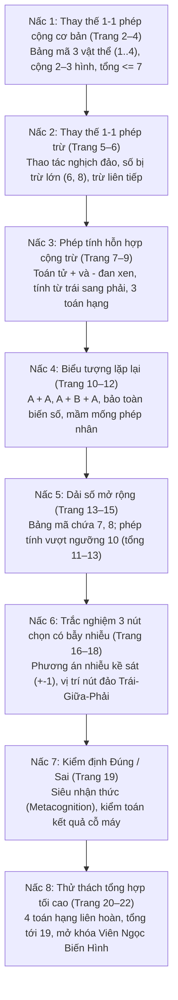

# Chặng 12: Xưởng Máy Biến Hình — Giải Mã, Thay Thế, Suy Luận

## 1. Objective (Mục tiêu cốt lõi)

Tài liệu này sở hữu đặc tả kỹ thuật và kiến trúc nội dung sư phạm nhằm chuyển thể trọn vẹn dữ liệu từ tài liệu PDF **"Chặng 12: Xưởng Máy Biến Hình — Giải mã • Thay thế • Suy luận"** (`docs/montessori/extracted/chang-12/analysis.json`, nguồn: *12 - Bai toan thay the so dang.pdf*, 23 trang, thuộc bộ giáo trình *Gấu Logic & Thỏ Quan Sát - Chuyến Tàu Toán Học*, Nhà xuất bản Dân Trí / Montessori VN) vào nền tảng **TiniMath v2**.

### Mục tiêu chiến lược:
1. **Phổ biến dữ liệu vào các Game Engine hiện hữu (`GT-000`..`GT-037`)**:
   - **TUYỆT ĐỐI KHÔNG TẠO MỚI `GT-038+`**.
   - Phân giải 23 trang PDF thành 3 nhóm dạng bài chuẩn theo spec (`WB12-D1`, `WB12-D2`, `WB12-D3`), ánh xạ tương thích 100% với 3 khuôn tương tác cốt lõi đã có trong `packages/game-engine/src/templates/`:
     - `GT-010` (`SubstitutionSession` — Thay thế biểu tượng): Trẻ tra cứu bảng mã quy ước (Code Table), thay thế từng hình ảnh biểu tượng bằng giá trị số học nguyên dương và tính giá trị biểu thức (phép cộng, phép trừ, phép tính hỗn hợp 3–4 toán hạng, biểu tượng lặp lại, dải số đến 19).
     - `GT-008` (`DragToSlotSession` — Kéo thả vào ô đích): Trẻ kéo thả thẻ số từ khay nguồn đặt vào ô bánh răng kết quả hoặc ô khuyết của cỗ máy biến hình; hỗ trợ nam châm snap tự hút và fallback tap-tap.
     - `GT-001` (`TapSelectSession` — Chọn một đáp án đúng): Trẻ chạm chọn 1 trong 3 nút tròn có phương án nhiễu kề sát ($\pm 1, \pm 2$) bị xáo trộn vị trí ngẫu nhiên, hoặc chọn nút **ĐÚNG** / **SAI** trong trạm kiểm định cỗ máy (siêu nhận thức).
2. **Hiện thực hóa Tiến trình Sư phạm Montessori, CPA & Tiền Đại Số (Early Algebraic Thinking)**:
   - **Biểu tượng hóa (Symbolic Representation)**: Chuyển dịch từ hình ảnh trực quan cụ thể (bánh răng, dâu tây, robot, hộp đồ nghề) sang con số trừu tượng thông qua quy tắc ánh xạ 1-1 của bảng mã cỗ máy.
   - **Bảo toàn giá trị biến số (Variable Constancy)**: Cùng một hình xuất hiện nhiều lần ($A + A$, $A + B + A$) vẫn giữ nguyên giá trị, đặt nền tảng cho phép nhân sơ cấp ($2 \times A$) và giải hệ phương trình hình ảnh.
   - **Thứ tự tính toán & Tính linh hoạt nhận thức (Cognitive Flexibility)**: Xử lý chuỗi biến đổi liên hoàn từ trái sang phải với toán tử hỗn hợp ($+$ và $-$ đan xen), rèn luyện kiểm soát ức chế xung động (Inhibitory Control).
   - **Siêu nhận thức kiểm định (Metacognition / Equation Auditing)**: Đóng vai kỹ sư kiểm toán cỗ máy, thẩm định kết quả cho trước là ĐÚNG hay SAI, phát hiện lỗi sai lệch 1 đơn vị.
3. **Làm giàu hệ thống `SkillDataset` & Thiết kế 12 `SkillLevelPlan[]`**:
   - Khắc phục triệt để tình trạng **0 Montessori levels** hiện tại của WB12 trong `packages/content`.
   - Làm giàu kho từ vựng và dữ liệu seeder trong `packages/content/src/skills/c1/prob/` (`C1.PROB.06`, `C1.PROB.01`) và `packages/content/src/skills/c3/inf/` (`C3.INF.01`, `C3.INF.02`).
   - Cấp mã level chuẩn `GL-<COMP>-<STRAND>-<MECH>-01xx` (sequence $\ge 0101$), gắn nhãn `montessori_ref: "WB12-D1"`, `"WB12-D2"`, `"WB12-D3"`.
   - Phân bổ `access_tier` khớp chính xác độ khó `difficulty`: 1=`free`, 2=`login`, 3=`standard`, 4/5=`premium`.
   - Tuân thủ nghiêm ngặt `BR-MCM-06` (không chứa từ khóa thương mại đo trí tuệ như IQ/Raven).

---

## 2. Actors & Pedagogical Roles

| Tác nhân / Nhân vật | Vai trò hệ thống | Vai trò sư phạm & Đặc điểm nhận diện trong Chặng 12 |
|---|---|---|
| **Bé (Kid Player)** | Người chơi chính (4–6 tuổi) | Nhập vai "Kỹ sư nhí giải mã cỗ máy", tương tác tra bảng mã, thay thế linh kiện bằng số, kéo thẻ số vào ô bánh răng và thẩm định kết quả để khởi động lại cỗ máy xưởng. |
| **Gấu Logic (`gau_logic`)** | Hướng dẫn tư duy trừu tượng & Quy tắc số | Đại diện tư duy đại số, cấu trúc quy ước và thứ tự tính toán. Ngoại hình: Gấu nâu đeo kính kiểm định, cầm bản vẽ kỹ thuật và bảng mã số. Câu thoại định hướng: *"Mỗi hình sẽ biến thành một con số!", "Bảng mã đầu tiên đã sáng rồi!", "Cánh tay máy đang bị kẹt rồi!", "Một hình có thể xuất hiện nhiều lần!", "Hình lặp lại thì giá trị không đổi!", "Các bình màu mang giá trị mới!", "Cỗ máy cần một kết quả chính xác!", "Có vài kết quả chưa chính xác!", "Đây là bộ phận quan trọng nhất!"*. |
| **Thỏ Quan Sát (`tho_quan_sat`)** | Đồng hành hành động & Quan sát chi tiết | Đại diện quan sát giác quan, kiểm soát dấu phép tính và đối chiếu thị giác. Ngoại hình: Thỏ trắng đeo kính lúp thám tử, túi đồ nghề cơ khí. Lời thoại nhắc nhở thao tác: *"Bé xem bảng mã rồi tính nhé!", "Bé thay hình bằng số nhé!", "Bé trừ đúng để sửa máy nhé!", "Bé chú ý cả dấu cộng và trừ nhé!", "Tính lần lượt từ trái sang phải nhé!", "Bé nhớ cộng đủ từng hình lặp lại nhé!", "Bé tính rồi khoanh nút đúng nhé!", "Bé khoanh ĐÚNG hoặc SAI nhé!", "Hoàn thành để nhận viên ngọc nhé!"*. |
| **Phụ huynh / Giáo viên** | Hỗ trợ ngoài màn hình | Theo dõi nhịp tư duy nhẩm của bé, gợi ý bé viết ra giấy nháp các con số tương ứng dưới từng hình trước khi tính nếu bé còn lúng túng. |
| **Content Seeder Engine** | Hệ thống tự động | Chuyển hóa các `SkillLevelPlan[]` thành `ContentSeed` hợp lệ, kiểm tra Zod contract và xác thực qua `montessori-gate.ts`. |

---

## 3. Entry Points & File Mapping

```
docs/montessori/extracted/chang-12/analysis.json (23 trang, WB12)
   │
   ├──> docs/montessori/dataset/activity-types-table.md
   │      └── Đồng bộ hàng WB12-D1, WB12-D2, WB12-D3 (GT-010, GT-008, GT-001)
   ├──> docs/specs/05-content/montessori-corpus-mapping.md
   │      └── Cập nhật hàng 12 mục 7.1, 7.3, 7.9 (giải tỏa nghẽn C1/C3)
   │
   ├──> packages/content/src/skills/c1/prob/
   │      ├── C1.PROB.06.ts
   │      │     ├── Dataset: CHANG_12_WORKSHOP_DATASET (linh kiện xưởng máy, bảng mã)
   │      │     ├── Level WB12-D1 (GT-008): GL-C1-PROB-SLOT-0101 (diff 1, free)
   │      │     ├── Level WB12-D1 (GT-010): GL-C1-PROB-SUBST-0102 (diff 2, login)
   │      │     ├── Level WB12-D1 (GT-008): GL-C1-PROB-SLOT-0103 (diff 2, login)
   │      │     ├── Level WB12-D1 (GT-010): GL-C1-PROB-SUBST-0104 (diff 3, standard)
   │      │     ├── Level WB12-D2 (GT-010): GL-C1-PROB-SUBST-0105 (diff 3, standard)
   │      │     └── Level WB12-D3 (GT-010): GL-C1-PROB-SUBST-0106 (diff 4, premium)
   │      │
   │      └── C1.PROB.01.ts
   │            ├── Level WB12-D3 (GT-010): GL-C1-PROB-SUBST-0107 (diff 4, premium)
   │            └── Level WB12-D3 (GT-010): GL-C1-PROB-SUBST-0108 (diff 5, premium - Final Capstone)
   │
   └──> packages/content/src/skills/c3/inf/
          ├── C3.INF.01.ts
          │     ├── Dataset: Bổ sung linh kiện bảng mã Chặng 12
          │     ├── Level WB12-D1 (GT-010): GL-C3-INF-SUBST-0101 (diff 1, free)
          │     └── Level WB12-D2 (GT-001): GL-C3-INF-TAP-0102 (diff 2, login)
          │
          └── C3.INF.02.ts
                ├── Level WB12-D3 (GT-001): GL-C3-INF-TAP-0103 (diff 3, standard - 3 nút đảo)
                └── Level WB12-D3 (GT-001): GL-C3-INF-TAP-0104 (diff 4, premium - Kiểm định Đúng/Sai)
```

- **Mã nguồn Template Engine sử dụng**:
  - `packages/game-engine/src/templates/GT-010/` (`SubstitutionSession` — Thay thế biểu tượng).
  - `packages/game-engine/src/templates/GT-008/` (`DragToSlotSession` — Kéo thả vào ô đích).
  - `packages/game-engine/src/templates/GT-001/` (`TapSelectSession` — Chạm chọn một đáp án đúng).
- **Phạm vi kiểm thử & Xác thực**:
  - `packages/content-build/tests/gates/montessori-corpus.test.ts`.
  - `packages/content/tests/builders/gt-010.test.ts`.

---

## 4. Pedagogical Deconstruction: Tiến Trình 23 Trang PDF Chặng 12

Giáo trình Chặng 12 được thiết kế theo 8 nấc thang tăng tiến độ khó tinh tế, đưa trẻ từ nhận thức biểu tượng trực quan ban đầu đến khả năng giải quyết các chuỗi biểu thức tiền đại số phức tạp:



---

## 5. Phân Tích Chi Tiết 3 Nhóm Dạng Bài & Ánh Xạ Game Engine

### 5.1 Dạng 1 (`WB12-D1`): Thay thế biểu tượng 1-1 & Phép tính cơ bản (Trang 2–9)
- **Số trang PDF nguồn**: 8 trang (Trang 2, 3, 4, 5, 6, 7, 8, 9), 31 bài tập.
- **Mục tiêu sư phạm**:
  - Trẻ hiểu nguyên lý cơ bản của Bảng mã (Code Table): mỗi biểu tượng thị giác đại diện duy nhất cho một giá trị số học nguyên dương.
  - Chuyển dịch thành thạo từ Pictorial (hình ảnh) sang Abstract (con số).
  - Làm chủ thứ tự tính toán chuẩn từ trái sang phải với phép cộng, phép trừ và phép tính hỗn hợp đan xen.
- **Tiến trình 3 phân nhóm**:
  - *D1.1 Phép cộng 2 và 3 số hạng (Trang 2–4)*:
    - Trang 2 (Cỗ máy thức giấc): Bảng mã 🍓=2, 🧁=3, ⚙️=1. Ví dụ mẫu 🍓 + ⚙️ = 2 + 1 = 3. Bài tập: 🍓 + 🧁 = 5; 🧁 - ⚙️ = 2; ⚙️ + ⚙️ + 🍓 = 4.
    - Trang 3 (Bảng mã đầu tiên): 🍎=1, ⭐️=2, 🤖=3. Bài tập: 🍎 + ⭐️ = 3; ⭐️ + 🤖 = 5; 🍎 + 🤖 = 4; 🤖 + ⭐️ + 🍎 = 6.
    - Trang 4 (Băng chuyền đồ chơi): 🎈=2, 🚂=4, 🧸=1. Bài tập: 🎈 + 🧸 = 3; 🚂 + 🧸 = 5; 🎈 + 🚂 = 6; 🧸 + 🎈 + 🚂 = 7.
  - *D1.2 Phép trừ cơ bản bắt đầu từ số lớn (Trang 5–6)*:
    - Trang 5 (Cánh tay máy kẹt): 🧰=6, 🔧=2, 🔩=1. Bài tập: 🧰 - 🔧 = 4; 🔧 - 🔩 = 1; 🧰 - 🔩 = 5; 🧰 - 🔧 - 🔩 = 3.
    - Trang 6 (Kho năng lượng): 💎=8, 🔋=3, ⚡️=2. Bài tập: 💎 - 🔋 = 5; 🔋 - ⚡️ = 1; 💎 - ⚡️ = 6; 💎 - 🔋 - ⚡️ = 3.
  - *D1.3 Phép tính hỗn hợp đan xen cộng và trừ 3 toán hạng (Trang 7–9)*:
    - Trang 7 (Máy trộn trái cây): 🍊=4, 🍐=2, 🍒=1. Bài tập: 🍊 + 🍐 - 🍒 = 5; 🍐 + 🍒 + 🍒 = 4; 🍊 - 🍒 + 🍐 = 5; 🍊 + 🍐 + 🍒 = 7.
    - Trang 8 (Ống dẫn kẹo ngọt): 🍩=5, 🍭=3, 🍬=2. Bài tập: 🍩 - 🍭 + 🍬 = 4; 🍭 + 🍬 + 🍬 = 7; 🍩 - 🍬 + 🍭 = 6; 🍩 + 🍭 - 🍬 = 6.
    - Trang 9 (Buồng pha màu): 🎨=4, 🧴=3, 🖌️=1. Bài tập: 🎨 + 🧴 - 🖌️ = 6; 🧴 + 🖌️ + 🖌️ = 5; 🎨 - 🖌️ + 🧴 = 6; 🎨 + 🧴 + 🖌️ = 8.
- **Ánh xạ Engine**:
  - `GT-010` (`SubstitutionSession`): Bảng mã hiển thị cố định ở thanh trên/bên trái. Dòng phương trình hiển thị các ô biểu tượng kèm dấu $+$ hoặc $-$. Trẻ giải mã và nhập/chọn giá trị.
  - `GT-008` (`DragToSlotSession`): Kéo thẻ số từ khay phía dưới thả vào ô bánh răng kết quả.

### 5.2 Dạng 2 (`WB12-D2`): Thay thế biểu tượng lặp lại (Trang 10–12)
- **Số trang PDF nguồn**: 3 trang (Trang 10, 11, 12), 12 bài tập.
- **Mục tiêu sư phạm**:
  - Nhận biết nguyên lý bảo toàn giá trị biến số: Dù một biểu tượng xuất hiện bao nhiêu lần trong cùng một biểu thức hoặc trên cùng một trang, giá trị của nó không bao giờ thay đổi.
  - Gieo mầm tư duy phép cộng lặp (Repeated Addition) — tiền đề của phép nhân ($A + A = 2A$).
  - Khám phá tính chất triệt tiêu sơ cấp (Inverse property: $+ A - A = 0$).
- **Chi tiết bài tập trong PDF**:
  - Trang 10 (Bánh răng lặp lại): ⚙️=2, 🌀=3, 🔘=1.
    - ⚙️ + ⚙️ = 2 + 2 = 4 (phép nhân đôi $2 \times 2$)
    - 🌀 + 🌀 - 🔘 = 3 + 3 - 1 = 5
    - 🔘 + ⚙️ + ⚙️ = 1 + 2 + 2 = 5
    - 🌀 + ⚙️ + 🌀 = 3 + 2 + 3 = 8
  - Trang 11 (Dây chuyền bánh ngọt): 🍪=2, 🥨=4, 🥯=1.
    - 🍪 + 🍪 + 🥯 = 2 + 2 + 1 = 5
    - 🥨 - 🍪 + 🥯 = 4 - 2 + 1 = 3
    - 🥯 + 🥨 + 🥨 = 1 + 4 + 4 = 9
    - 🥨 + 🍪 - 🍪 = 4 + 2 - 2 = 4 (tính chất triệt tiêu: $+ 2 - 2 = 0$)
  - Trang 12 (Máy nhân bản đồ chơi): 🚀=3, 🧱=2, ⚽️=1.
    - 🚀 + 🚀 = 3 + 3 = 6
    - 🧱 + 🧱 + ⚽️ = 2 + 2 + 1 = 5
    - 🚀 + ⚽️ + 🚀 = 3 + 1 + 3 = 7
    - 🚀 + 🧱 + ⚽️ = 3 + 2 + 1 = 6
- **Ánh xạ Engine**:
  - `GT-010` (`SubstitutionSession`): Hỗ trợ mảng biểu thức chứa các `symbol_id` trùng nhau trong trường `left` hoặc câu hỏi `question.symbol_ids`.
  - `GT-008` (`DragToSlotSession`): Kéo số đáp án vào ô đích kết quả.
  - `GT-001` (`TapSelectSession`): Chạm chọn kết quả cho biểu thức lặp lại.

### 5.3 Dạng 3 (`WB12-D3`): Dải số mở rộng, Trắc nghiệm bẫy nhiễu, Kiểm định Đúng/Sai & Capstone (Trang 13–22)
- **Số trang PDF nguồn**: 10 trang (Trang 13–22), 36 bài tập.
- **Mục tiêu sư phạm**:
  - Mở rộng phạm vi giá trị bảng mã lên tới 7, 8, 9; tổng kết quả vượt qua ngưỡng 10, vươn tới 15 và chạm trần 19.
  - Rèn luyện kỹ năng phân biệt phương án nhiễu có chủ đích ($\pm 1, \pm 2$) và chống đoán mò theo vị trí (đảo ngẫu nhiên vị trí nút đúng).
  - Nâng lên tầng tư duy siêu nhận thức (Metacognition) thông qua bài toán kiểm toán Đúng/Sai.
  - Chinh phục đỉnh cao Capstone với biểu thức 4 toán hạng liên hoàn.
- **Chi tiết các trạm tiến trình**:
  - *Trạm 1: Dải số lớn mở rộng (Trang 13–15)*:
    - Trang 13 (Phòng thí nghiệm): 🧪=7, ⚗️=4, 🔮=2 $\rightarrow$ 🧪 + 🧪 - ⚗️ = 7 + 7 - 4 = 10; ⚗️ + 🔮 + 🧪 = 4 + 2 + 7 = 13.
    - Trang 14 (Thú cưng cơ khí): 🐱=6, 🐶=5, 🐤=2 $\rightarrow$ 🐱 + 🐶 + 🐤 = 6 + 5 + 2 = 13; 🐱 + 🐶 - 🐤 = 6 + 5 - 2 = 9.
    - Trang 15 (Trạm bầu trời): 🌙=8, ☄️=5, ☁️=2 $\rightarrow$ 🌙 + ☄️ - ☁️ = 8 + 5 - 2 = 11; 🌙 + 🌙 - ☄️ = 8 + 8 - 5 = 11.
  - *Trạm 2: Trắc nghiệm 3 nút chọn kết quả có bẫy nhiễu (Trang 16–18)*:
    - Trang 16 (Bảng điều khiển ba nút): 🕹️=4, 🔘=3, 🟢=2. Bài tập trắc nghiệm có bẫy $\pm 1$.
    - Trang 17 (Máy chọn kết quả): 💡=5, 🗝️=4, 🔴=1. Chạm mốc tròn chục (10).
    - Trang 18 (Bảng nút bị đảo): 💎=7, ⚙️=3, 🧊=2. Vị trí nút đúng xáo trộn tuần tự: Trái $\rightarrow$ Phải $\rightarrow$ Giữa $\rightarrow$ Phải.
  - *Trạm 3: Kiểm định kết quả Đúng / Sai (Trang 19)*:
    - Bảng mã: ⚙️=6, 🧪=4, 🕹️=2.
    - Câu 1: ⚙️ + 🧪 = 10 (6 + 4 = 10) $\rightarrow$ **ĐÚNG**.
    - Câu 2: 🧪 + 🕹️ + 🕹️ = 9 (4 + 2 + 2 = 8 $\neq$ 9) $\rightarrow$ **SAI** (bẫy lệch 1 đơn vị).
    - Câu 3: ⚙️ - 🕹️ + 🧪 = 8 (6 - 2 + 4 = 8) $\rightarrow$ **ĐÚNG**.
    - Câu 4: ⚙️ + 🧪 - 🕹️ = 7 (6 + 4 - 2 = 8 $\neq$ 7) $\rightarrow$ **SAI** (bẫy lệch 1 đơn vị).
  - *Trạm 4: Thử thách tổng hợp tối cao & Mở khóa viên ngọc (Trang 20–22)*:
    - Trang 20: 🌀=5, 🔩=3, 🛑=2 $\rightarrow$ 🌀 + 🔩 + 🛑 = 10; 🌀 + 🔩 + 🔩 = 11.
    - Trang 21 (Cỗ máy trung tâm): 🟢=9, ⚙️=4, 🔩=2 $\rightarrow$ 🟢 + 🟢 - ⚙️ = 9 + 9 - 4 = 14; 🟢 + ⚙️ + 🔩 = 15.
    - Trang 22 (Mở khóa viên ngọc): 👑=8, 🛡️=5, 💎=3.
      - Phép tính 1: 👑 + 💎 = 8 + 3 = 11.
      - Phép tính 2: 🛡️ + 💎 + 💎 = 5 + 3 + 3 = 11.
      - Phép tính 3: 👑 + 🛡️ - 💎 = 8 + 5 - 3 = 10.
      - Phép tính 4 (Boss Capstone 4 toán hạng): 👑 + 🛡️ + 💎 + 💎 = 8 + 5 + 3 + 3 = **19**!
- **Ánh xạ Engine**:
  - `GT-010` (`SubstitutionSession`): Xử lý dải giá trị số lớn, các phương trình 3–4 toán hạng.
  - `GT-001` (`TapSelectSession`): Xử lý trắc nghiệm 3 nút chọn với bẫy nhiễu xáo trộn vị trí và 2 nút lựa chọn **ĐÚNG** / **SAI**.

---

## 6. Business Rules & Bộ Tiêu Chuẩn Kỹ Thuật

| Mã luật | Nội dung quy định | Căn cứ & Cách cưỡng chế hệ thống |
|---|---|---|
| `BR-MCM-06` | **Tuyệt đối không chứa từ khóa thương mại đo trí tuệ** | Cấm toàn bộ từ ngữ: IQ, Raven, bài test trí thông minh, trắc nghiệm trí tuệ trong toàn bộ title, instruction, hint, label. Nội dung giữ thuần túy bản chất toán học Montessori giải mã biểu tượng. |
| `BR-MGL-02` | **Khối mã level Montessori $\ge 0101$** | Toàn bộ mã level sinh ra từ Chặng 12 phải mang định dạng `GL-<COMP>-<STRAND>-<MECH>-01xx` (sequence $\ge 0101$). Cấm chèn vào dải 0001–0050. |
| `BR-MGL-12` | **Phân tầng `access_tier` khớp chính xác `difficulty`** | Độ khó 1 = `free`; Độ khó 2 = `login`; Độ khó 3 = `standard`; Độ khó 4 hoặc 5 = `premium`. Cổng `montessori-gate.ts` tự động kiểm tra và chặn nếu lệch. |
| `BR-MGL-04` | **Tăng tiến một chiều (One-dimension progression)** | Mỗi bước tăng độ khó chỉ thay đổi duy nhất một biến số (tăng giá trị số, thêm toán tử trừ, thêm biểu tượng lặp lại, hoặc thêm toán hạng), không thay đổi đồng thời toàn bộ cấu trúc. |
| `BR-GT010-01` | **Hệ phương trình giải mã có nghiệm nguyên dương duy nhất** | Mọi cấu hình phương trình trong `GT-010` phải được giải bằng `solver.ts` xác nhận đúng 1 nghiệm nguyên dương duy nhất và khớp với phương án đúng. |
| `BR-GT010-02` | **Bảo toàn hiển thị bảng mã trên Canvas** | Bảng mã quy ước phải luôn hiện diện ở vùng nhìn cố định, không bị che khuất khi kéo thả hay chọn nút, kích thước biểu tượng $\ge 48\text{px}$. |
| `BR-E001-01` | **Sàn cảm ứng đạt chuẩn theo lứa tuổi (Touch Floor)** | Với trẻ 4–5 tuổi: Hitbox $\ge 72\text{px}$. Với trẻ 3–4 tuổi: Hitbox $\ge 96\text{px}$. Các nút chọn trắc nghiệm trên Canvas $960 \times 540$ đạt tối thiểu $88\text{px} \times 88\text{px}$. |
| `BR-E001-02` | **100% Design Tokens, 0 Hex Literals** | Toàn bộ màu vẽ và giao diện sử dụng token từ `designTokens.colors` (`brand-500`, `amber-400`, `surface-200`...). Cấm tuyệt đối mã `#hex` inline trong mã nguồn engine. |
| `BR-E001-03` | **Phản hồi không trừng phạt (Non-punitive Feedback)** | Trả lời sai không hiện màu đỏ, không phát tiếng buzzer chói tai; chỉ có nhịp hổ phách nhẹ (`amber_soft`, 340ms), âm thanh trầm êm và item trôi về chỗ cũ. |

---

## 7. Thiết Kế Làm Giàu `SkillDataset` (Bổ Sung Vào Seeder)

Hệ thống seeder trong `packages/content/src/skills/c1/prob/` và `packages/content/src/skills/c3/inf/` sẽ được bổ sung kho ngữ liệu phong phú lấy cảm hứng trực tiếp từ Xưởng Máy Biến Hình Chặng 12.

### 7.1 Bổ sung vào `C1.PROB.06` (`packages/content/src/skills/c1/prob/C1.PROB.06.ts`)

```typescript
// Dataset Xưởng Máy Biến Hình - Bổ sung vào C1_PROB_06_DATASET
export const CHANG_12_WORKSHOP_DATASET: SkillDataset = {
  skill_code: "C1.PROB.06",
  concept_label: "Xưởng máy biến hình - Thay thế biểu tượng",
  surface: "game",
  items: [
    {
      id: "ws_gear_teal",
      label: "bánh răng xanh ngọc",
      glyph: "⚙️",
      value: 1,
      contrast_group: "workshop_tools",
      category: { type: "cơ khí xưởng", color: "teal" },
      image: { kind: "emoji", ref: "⚙️" },
    },
    {
      id: "ws_strawberry_red",
      label: "quả dâu tây đỏ",
      glyph: "🍓",
      value: 2,
      contrast_group: "sweets_fuel",
      category: { type: "nhiên liệu ngọt", color: "red" },
      image: { kind: "emoji", ref: "🍓" },
    },
    {
      id: "ws_cupcake_pink",
      label: "bánh cupcake dâu",
      glyph: "🧁",
      value: 3,
      contrast_group: "sweets_fuel",
      category: { type: "nhiên liệu ngọt", color: "pink" },
      image: { kind: "emoji", ref: "🧁" },
    },
    {
      id: "ws_wrench_orange",
      label: "chiếc cờ lê cam",
      glyph: "🔧",
      value: 2,
      contrast_group: "workshop_tools",
      category: { type: "cơ khí xưởng", color: "orange" },
      image: { kind: "emoji", ref: "🔧" },
    },
    {
      id: "ws_screw_gold",
      label: "đai ốc vít vàng",
      glyph: "🔩",
      value: 1,
      contrast_group: "workshop_tools",
      category: { type: "cơ khí xưởng", color: "yellow" },
      image: { kind: "emoji", ref: "🔩" },
    },
    {
      id: "ws_toolbox_blue",
      label: "hộp đồ nghề xanh",
      glyph: "🧰",
      value: 6,
      contrast_group: "workshop_tools",
      category: { type: "cơ khí xưởng", color: "blue" },
      image: { kind: "emoji", ref: "🧰" },
    },
    {
      id: "ws_battery_green",
      label: "bình pin năng lượng",
      glyph: "🔋",
      value: 3,
      contrast_group: "energy_core",
      category: { type: "năng lượng", color: "green" },
      image: { kind: "emoji", ref: "🔋" },
    },
    {
      id: "ws_lightning_yellow",
      label: "tia chớp điện lực",
      glyph: "⚡️",
      value: 2,
      contrast_group: "energy_core",
      category: { type: "năng lượng", color: "yellow" },
      image: { kind: "emoji", ref: "⚡️" },
    },
    {
      id: "ws_gem_emerald",
      label: "viên ngọc xanh lá",
      glyph: "💎",
      value: 8,
      contrast_group: "energy_core",
      category: { type: "năng lượng", color: "green" },
      image: { kind: "emoji", ref: "💎" },
    },
    {
      id: "ws_spring_spiral",
      label: "lò xo xoắn vàng",
      glyph: "🌀",
      value: 3,
      contrast_group: "repeated_parts",
      category: { type: "linh kiện đàn hồi", color: "yellow" },
      image: { kind: "emoji", ref: "🌀" },
    },
    {
      id: "ws_button_round",
      label: "nút bấm công tắc",
      glyph: "🔘",
      value: 1,
      contrast_group: "repeated_parts",
      category: { type: "linh kiện điều khiển", color: "gray" },
      image: { kind: "emoji", ref: "🔘" },
    },
    {
      id: "ws_flask_purple",
      label: "bình cầu tím hóa chất",
      glyph: "🧪",
      value: 7,
      contrast_group: "lab_solutions",
      category: { type: "dung dịch phòng thí nghiệm", color: "purple" },
      image: { kind: "emoji", ref: "🧪" },
    },
    {
      id: "ws_alembic_gold",
      label: "bình tam giác vàng",
      glyph: "⚗️",
      value: 4,
      contrast_group: "lab_solutions",
      category: { type: "dung dịch phòng thí nghiệm", color: "yellow" },
      image: { kind: "emoji", ref: "⚗️" },
    },
    {
      id: "ws_crystal_cyan",
      label: "tinh thể pha lê xanh",
      glyph: "🔮",
      value: 2,
      contrast_group: "lab_solutions",
      category: { type: "dung dịch phòng thí nghiệm", color: "blue" },
      image: { kind: "emoji", ref: "🔮" },
    },
  ],
  relations: [
    { type: "pair", source_id: "ws_gear_teal", target_id: "ws_wrench_orange" },
    { type: "pair", source_id: "ws_battery_green", target_id: "ws_lightning_yellow" },
    { type: "pair", source_id: "ws_flask_purple", target_id: "ws_alembic_gold" },
  ],
  axes: {
    type: ["cơ khí xưởng", "nhiên liệu ngọt", "năng lượng", "dung dịch phòng thí nghiệm"],
  },
  ladder: [
    { rung: 1, dimension: "range", description: "Thay thế 1-1 phép cộng cơ bản phạm vi 1..7" },
    { rung: 2, dimension: "operation", description: "Thay thế 1-1 phép trừ và phép tính hỗn hợp phạm vi 1..8" },
    { rung: 3, dimension: "repetition", description: "Biểu tượng lặp lại và bảo toàn giá trị biến số" },
    { rung: 4, dimension: "range", description: "Dải số lớn vượt ngưỡng 10 và trắc nghiệm phương án nhiễu" },
    { rung: 5, dimension: "multi_step", description: "Kiểm toán Đúng/Sai và biểu thức 4 toán hạng liên hoàn tới 19" },
  ],
  phrasing: {
    prompt_template: "Bé hãy nhìn bảng mã, thay từng hình bằng số rồi tính kết quả nhé!",
    narration_template: "Gấu Logic và Thỏ Quan Sát đang cùng bé sửa chữa cỗ máy biến hình.",
  },
  ordering: [
    "ws_gear_teal", "ws_strawberry_red", "ws_cupcake_pink", "ws_wrench_orange",
    "ws_screw_gold", "ws_toolbox_blue", "ws_battery_green", "ws_lightning_yellow",
    "ws_gem_emerald", "ws_spring_spiral", "ws_button_round", "ws_flask_purple",
    "ws_alembic_gold", "ws_crystal_cyan",
  ],
};
```

### 7.2 Bổ sung vào `C1.PROB.01` (`packages/content/src/skills/c1/prob/C1.PROB.01.ts`)
- **Vật phẩm bổ sung (`items`)**: Vương miện hoàng gia 👑 (`ws_crown_gold`, value: 8), Khiên hiệp sĩ bạc 🛡️ (`ws_shield_silver`, value: 5), Viên ngọc bích lục bảo 💎 (`ws_gem_emerald_val3`, value: 3), Ngọc bích quyền năng 🟢 (`ws_gem_power_nine`, value: 9).
- **Bộ câu thoại (`phrasing`)**:
  ```typescript
  phrasing: {
    prompt_template: "Thử thách tổng hợp: Bé hãy bình tĩnh tính từng bước từ trái sang phải để mở khóa viên ngọc nhé!",
    narration_template: "Cỗ máy trung tâm sắp sửa khởi động lại rồi, cố lên bé ơi!",
  }
  ```

### 7.3 Bổ sung vào `C3.INF.01` & `C3.INF.02` (`packages/content/src/skills/c3/inf/`)
- **Vật phẩm bổ sung (`items`)**: Cần gạt điều khiển đỏ 🕹️ (`ws_joystick_red`, value: 4), Nút ấn tròn xanh dương 🔘 (`ws_button_blue`, value: 3), Nút ấn tròn xanh lá 🟢 (`ws_button_green`, value: 2), Bóng đèn vàng 💡 (`ws_bulb_yellow`, value: 5), Chìa khóa cơ khí 🗝️ (`ws_key_brass`, value: 4), Nút chuông đỏ 🔴 (`ws_buzzer_red`, value: 1).
- **Bộ câu thoại trắc nghiệm & kiểm định (`phrasing`)**:
  ```typescript
  phrasing: {
    prompt_template: "Bé hãy tính kết quả rồi khoanh vào nút đúng hoặc chọn ĐÚNG / SAI nhé!",
    narration_template: "Thỏ Quan Sát nhắc bé kiểm tra kỹ phương án nhiễu trước khi bấm nút!",
  }
  ```

---

## 8. Danh Mục Chi Tiết 12 `SkillLevelPlan[]` (Khối Mã $\ge 0101$)

Bảng ma trận 12 level được phân bổ khoa học, đảm bảo bao phủ trọn vẹn 3 dạng bài chuẩn (`WB12-D1`, `WB12-D2`, `WB12-D3`), 2 band tuổi (4–5 và 5–6), 5 bậc thang difficulty (1, 2, 3, 4, 5) và các access tiers tương ứng.

| Mã Level Plan | Ref Montessori | Template | Kỹ năng chính | Band | Diff | Access Tier | Số lượt | Mô tả sư phạm chi tiết |
|---|---|:--:|---|:--:|:--:|:--:|:--:|---|
| `GL-C1-PROB-SLOT-0101` | `WB12-D1` | `GT-008` | `C1.PROB.06` | `4-5` | 1 | `free` | 3 | Bảng mã 🍓=2, 🧁=3, ⚙️=1. Kéo thẻ số vào ô bánh răng cho phép cộng 2 số hạng ($2+1=3, 2+3=5$). |
| `GL-C1-PROB-SUBST-0102` | `WB12-D1` | `GT-010` | `C1.PROB.06` | `4-5` | 2 | `login` | 3 | Bảng mã 🍎=1, ⭐️=2, 🤖=3. Thay thế biểu tượng thực hiện phép cộng 2–3 số hạng ($1+2=3, 3+2+1=6$). |
| `GL-C3-INF-SUBST-0101` | `WB12-D1` | `GT-010` | `C3.INF.01` | `4-5` | 1 | `free` | 3 | Bảng mã hộp đồ nghề 🧰=6, 🔧=2, 🔩=1. Thực hiện phép trừ tìm phần còn lại ($6-2=4, 6-2-1=3$). |
| `GL-C1-PROB-SLOT-0103` | `WB12-D1` | `GT-008` | `C1.PROB.06` | `4-5` | 2 | `login` | 3 | Bảng mã kho năng lượng 💎=8, 🔋=3, ⚡️=2. Kéo số mở van năng lượng cho phép trừ liên tiếp ($8-3-2=3$). |
| `GL-C1-PROB-SUBST-0104` | `WB12-D1` | `GT-010` | `C1.PROB.06` | `4-5` | 3 | `standard` | 3 | Buồng pha màu 🎨=4, 🧴=3, 🖌️=1. Phép tính hỗn hợp đan xen $+$ và $-$ 3 toán hạng ($4+3-1=6, 4-1+3=6$). |
| `GL-C1-PROB-SUBST-0105` | `WB12-D2` | `GT-010` | `C1.PROB.06` | `4-5` | 3 | `standard` | 3 | Bánh răng lặp lại ⚙️=2, 🌀=3, 🔘=1. Biểu thức chứa hình lặp lại ($2+2=4, 3+3-1=5, 3+2+3=8$). |
| `GL-C3-INF-TAP-0102` | `WB12-D2` | `GT-001` | `C3.INF.01` | `4-5` | 2 | `login` | 3 | Dây chuyền bánh 🍪=2, 🥨=4, 🥯=1. Chạm chọn kết quả cho biểu thức lặp lại và tính triệt tiêu ($4+2-2=4$). |
| `GL-C1-PROB-SUBST-0106` | `WB12-D3` | `GT-010` | `C1.PROB.06` | `5-6` | 4 | `premium` | 3 | Phòng mã số màu 🧪=7, ⚗️=4, 🔮=2. Dải số lớn vượt ngưỡng 10 ($4+2+7=13, 7+7-4=10$). |
| `GL-C3-INF-TAP-0103` | `WB12-D3` | `GT-001` | `C3.INF.02` | `5-6` | 3 | `standard` | 3 | Bảng 3 nút đảo 💎=7, ⚙️=3, 🧊=2. Trắc nghiệm 3 nút chọn có bẫy nhiễu $\pm 1$, đảo ngẫu nhiên vị trí. |
| `GL-C3-INF-TAP-0104` | `WB12-D3` | `GT-001` | `C3.INF.02` | `5-6` | 4 | `premium` | 4 | Trạm kiểm tra kết quả ⚙️=6, 🧪=4, 🕹️=2. Siêu nhận thức: Khoanh chọn ĐÚNG hoặc SAI cho 4 phép tính. |
| `GL-C1-PROB-SUBST-0107` | `WB12-D3` | `GT-010` | `C1.PROB.01` | `5-6` | 4 | `premium` | 3 | Cỗ máy trung tâm 🟢=9, ⚙️=4, 🔩=2. Phép tính 3 toán hạng dải số cao ($9+9-4=14, 9+4+2=15$). |
| `GL-C1-PROB-SUBST-0108` | `WB12-D3` | `GT-010` | `C1.PROB.01` | `5-6` | 5 | `premium` | 4 | Capstone Boss: Mở khóa viên ngọc 👑=8, 🛡️=5, 💎=3. Biểu thức 4 toán hạng liên hoàn ($8+5+3+3=19$). |

---

## 9. Hợp Đồng Vẽ Canvas 2D & Game Loop (Logic Space $960 \times 540$)

### 9.1 Bố cục Canvas cho từng khuôn

1. **`GT-010` (Bố cục Thay thế Biểu tượng — Equation Rows & Code Table)**:
   - **Thanh Bảng mã quy ước (y = 20 đến 120)**:
     - Nằm ở trên đỉnh màn hình, dạng một bảng điều khiển cơ khí viền kim loại bo góc $20\text{px}$, nền `surface-100`.
     - Chứa 3 biểu tượng trực quan rõ ràng, mỗi biểu tượng gắn kèm dấu $=$ và chữ số tương ứng (cỡ chữ $36\text{px}$, màu `brand-700`).
   - **Khu vực Biểu thức trung tâm (y = 150 đến 360)**:
     - Hiển thị 2–4 dòng phép tính cơ khí. Mỗi dòng chứa các icon biểu tượng xen kẽ với dấu toán tử $+$ hoặc $-$ kích thước lớn ($32\text{px}$, màu `surface-600`), kết thúc bằng dấu $=$ và ô bánh răng chứa kết quả hoặc dấu hỏi `?`.
   - **Khay Lựa chọn / Phím nhập (y = 390 đến 500)**:
     - Hiển thị các nút số tròn hoặc khay thẻ số để bé chạm hoặc kéo thả vào ô kết quả. Hitbox $\ge 72\text{px}$, khoảng cách giữa các nút $\ge 20\text{px}$.

2. **`GT-008` (Bố cục Drag-to-Slot — Kéo Thẻ Số Vào Ô Bánh Răng)**:
   - **Vùng trên (y = 40 đến 340)**: Bảng mã và phép tính biểu tượng đang chờ điền kết quả vào ô bánh răng khuyết (Slot target).
   - **Vùng dưới (y = 380 đến 500)**: Khay chứa các thẻ số nguồn. Nam châm hút snap tự động kích hoạt khi khoảng cách thả $< 48\text{px}$ so với tâm ô đích. Có hỗ trợ tap thẻ nguồn $\rightarrow$ tap ô đích cho trẻ mầm.

3. **`GT-001` (Bố cục Tap-Select — Trắc nghiệm 3 nút chọn & Nút ĐÚNG / SAI)**:
   - **Chế độ 3 nút chọn có nhiễu (D4)**: Biểu thức hiển thị to ở giữa. Phía dưới là 3 nút tròn lớn đường kính $96\text{px}$, căn đều tại các tọa độ $x = 240, 480, 720$. Màu nút `surface-200`, chữ số $44\text{px}$ màu `brand-800`.
   - **Chế độ Kiểm định Đúng / Sai (D5)**: Màn hình hiển thị cỗ máy đưa ra biểu thức kèm kết quả đã in sẵn (ví dụ: `4 + 2 + 2 = 9`). Phía dưới là 2 nút bấm lớn:
     - Nút **ĐÚNG**: Bo góc $24\text{px}$, viền $4\text{px}$ màu `success-500`, nền `surface-50`, chữ xanh lục.
     - Nút **SAI**: Bo góc $24\text{px}$, viền $4\text{px}$ màu `warning-500`, nền `surface-50`, chữ vàng hổ phách (tuyệt đối không dùng màu đỏ trừng phạt).

### 9.2 Bảng 4 Lớp Render Chuẩn

| Lớp | Z-Index | Nội dung hiển thị | Hệ thống phụ trách |
|---|:---:|---|---|
| **L1 Nền** | 0 | Không gian xưởng máy biến hình cổ tích, các bánh răng ngầm chuyển động chậm, ống dẫn hơi nước mờ nhẹ | `renderSystem.drawBackground()` |
| **L2 Khung cỗ máy & Biểu thức** | 10 | Bảng mã số, đường ống phép tính, các biểu tượng linh kiện cơ khí, ô bánh răng slot | `renderSystem.drawEntities()` |
| **L3 Tương tác & Scaffolding** | 20 | Hiệu ứng nhịp thở hổ phách (`amberGlow`), bàn tay ma chỉ dẫn (`ghostHand`), đường viền chọn số | `scaffoldingSystem.render()` |
| **L4 Hiệu ứng & HUD** | 30 | Bánh răng quay tít ăn mừng khi đúng, nổ pop hạt sao vàng, Viên Ngọc Biến Hình phát sáng, thanh tiến trình | `particleSystem.render()`, HUD |

---

## 10. Scaffolding 3 Mức (Hỗ Trợ Leo Thang)

Tuân thủ nguyên tắc không bao giờ để trẻ bế tắc và tuyệt đối không trừng phạt:

- **Mức L1 (Nudge - Nhấp nháy nhẹ sau 10s hoặc 1 lần miss)**:
  - Biểu tượng đang xét trong phép tính và vị trí tương ứng trên Bảng mã nhấp nháy đồng thời ánh vàng hổ phách nhẹ (`amber_soft`, chu kỳ 800ms) để gợi ý bé đối chiếu giá trị.
- **Mức L2 (Guide - Hướng dẫn sau 18s hoặc 2 lần miss)**:
  - Bàn tay ma (`ghostHand`) xuất hiện trôi từ biểu tượng trên phép tính lên biểu tượng trên bảng mã, rồi chỉ vào con số tương ứng.
  - Giọng Thỏ Quan Sát vang lên êm dịu: *"Bé nhìn xem, bánh răng trên bảng mã mang số mấy nhỉ?"*.
- **Mức L3 (Demonstrate - Trình diễn mẫu sau 25s hoặc 3 lần miss)**:
  - Hệ thống tự động điền mờ con số tương ứng dưới chân biểu tượng (ví dụ: số 2 mờ hiện dưới quả dâu 🍓), biến bài toán thành biểu thức số trực tiếp, sau đó bàn tay ma chỉ vào đáp án đúng.

---

## 11. Verification Gates & Kế Hoạch Kiểm Thử

1. **Kiểm tra cú pháp & Typecheck**:
   - `pnpm --filter @mindkid/content typecheck` đạt exit code 0 (không `any`, không `unknown`).
   - `pnpm lint:safe` đảm bảo tuân thủ Biome 2, 0 hex literal ngoài design tokens.
2. **Kiểm tra Cổng Montessori Corpus**:
   - `pnpm --filter @mindkid/content-build test packages/content-build/tests/gates/montessori-corpus.test.ts` pass xanh.
   - Xác nhận 12 level mới xuất hiện trong registry, `montessori_ref` khớp chuẩn `WB12-D1`, `WB12-D2`, `WB12-D3`.
3. **Round-trip Template & Builder Test**:
   - Xác nhận `GT-010`, `GT-008`, `GT-001` parse thành công các level plans mới mà không có lỗi schema validation.
   - Xác nhận `solver.ts` của `GT-010` giải ra nghiệm nguyên dương duy nhất cho toàn bộ các round được tạo.
