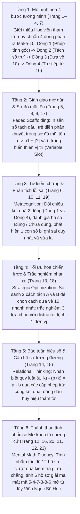

# Chặng 13: Học Viện Thám Tử Số Học — Tách Gộp • Đưa Về 10 • Tính Nhanh

## 1. Objective (Mục tiêu cốt lõi)

Tài liệu này sở hữu đặc tả kỹ thuật và sư phạm nhằm tích hợp toàn diện kho dữ liệu trích xuất từ tài liệu PDF **"Chặng 13: Học Viện Thám Tử Số Học — Tách gộp • Đưa về 10 • Tính nhanh"** (`docs/montessori/extracted/chang-13/analysis.json`, nguồn: *13 - Hoc vien tham tu so hoc.pdf*, 23 trang, thuộc bộ giáo trình *Gấu Logic & Thỏ Quan Sát - Chuyến Tàu Toán Học*, Montessori VN) vào nền tảng **TiniMath v2**.

### Mục tiêu chiến lược:
1. **Thiết lập Vũ trụ Cốt truyện & Động lực Học tập (Narrative-Driven Gamification)**:
   - **Bối cảnh**: Chuyến Tàu Toán Học của Gấu Logic và Thỏ Quan Sát cập bến Ga số 13, đưa các bạn nhỏ tới **Học Viện Thám Tử Số Học**. Đây là một tòa lâu đài thám tử cổ kính phong cách Victorian ban đêm với những ngọn đèn dầu ấm áp, các giá sách gỗ sồi cao ngút ngàn và hàng loạt bảng ghim manh mối chằng chịt dây nối. Tại trung tâm phòng lưu trữ, **Viên Ngọc Số Học** (Purple Arithmetic Gem - viên đá quý đa diện màu tím tỏa ánh sáng huyền bí) đang bị niêm phong nghiêm ngặt bên trong chiếc tủ chứng cứ bằng gỗ mạ đồng, quấn quanh bởi những vòng xích vàng và khóa bằng ổ khóa mật mã 6 chữ số kỳ bí.
   - **Nhiệm vụ sư phạm (Learning Quest)**: Bé hóa thân thành thám tử nhí số học đồng hành cùng Thám tử trưởng Gấu Logic và Thám tử trợ lý Thỏ Quan Sát, vận dụng chiến lược tách số đưa về 10 ("Make-a-10" Subtraction Strategy), mô hình Number Bond phân rã số trừ, kỹ năng tự kiểm chứng logic và phát hiện sửa lỗi sai để giải mã các hồ sơ vụ án, tìm ra chuỗi mật mã 6 chữ số ($5 - 4 - 7 - 3 - 8 - 6$), mở tung cánh cửa tủ chứng cứ và đoạt lấy Viên Ngọc Số Học.
2. **Khai thác triệt để các Game Engine hiện hữu (`GT-000`..`GT-037`)**:
   - **TUYỆT ĐỐI KHÔNG TẠO MỚI `GT-038+`**.
   - Phân giải 23 trang PDF thành 3 dạng bài chuẩn (`WB13-D1`, `WB13-D2`, `WB13-D3`) tương thích 100% với 3 khuôn tương tác cốt lõi đã có trong engine:
     - `GT-007` (`NumberBondSession` — Cây sơ đồ số liên kết Part-Part-Whole): Cây số phân rã số trừ $b$ thành hai nhánh $b_1$ và $b_2$. Nhánh $b_1$ khớp với chữ số hàng đơn vị của số bị trừ để đưa về mốc 10 ($a - b_1 = 10$); nhánh $b_2$ là phần còn lại được trừ tiếp từ 10 ($10 - b_2 = \text{kết quả}$).
     - `GT-008` (`DragToSlotSession` — Kéo khối số vào ô đích): Kéo các thẻ số vào 4 dòng phân rã quy chuẩn của hồ sơ thám tử; kéo số vào vị trí khuyết bất kỳ trong sơ đồ giàn giáo mờ dần (Faded Scaffolding); kéo các chữ số vào băng mật mã 6 ô của tủ chứng cứ; đóng dấu kết quả chung vào huy hiệu thám tử.
     - `GT-003` (`DragToContainerSession` — Phân loại vật phẩm vào giỏ/rổ): Mô phỏng trực quan thao tác tách vật thể cụ thể (Concrete CPA). Trẻ kéo $b$ vật phẩm manh mối (kính lúp, kẹp hồ sơ, ghim vàng) vào hai rổ: "Rổ chạm mốc 10" (chứa $b_1$ vật phẩm) và "Rổ trừ tiếp" (chứa $b_2$ vật phẩm).
     - *(Bổ trợ)* `GT-001` (`TapSelectSession`): Chạm chọn Đúng / Chưa đúng (Trang 11), chạm khoanh tròn vị trí số bị ghi sai trong hồ sơ để sửa lại (Trang 19), chạm chọn bong bóng đáp án trắc nghiệm phản xạ (Trang 13).
     - *(Bổ trợ)* `GT-002` (`MultipleChoiceSession`): So sánh và chạm chọn phương án tách số tối ưu A hoặc B (Trang 18).
     - *(Bổ trợ)* `GT-006` (`MatchPairsSession`): Kéo dây nối hồ sơ phép trừ bên trái với thẻ kết quả tương ứng bên phải (Trang 14).
3. **Phổ biến Kho Ngữ Liệu `SkillDataset` & `SkillLevelPlan[]`**:
   - Bổ sung hệ thống vật phẩm thám tử Victorian cổ điển (`items`: kính lúp vàng, kẹp hồ sơ mật, ghim vàng manh mối, huy hiệu thám tử, con dấu số, tủ chứng cứ, xích khóa đồng, băng mật mã 6 số, mốc tròn 10, viên ngọc số học tím), mạng lưới quan hệ phân rã (`relations: decomposition` & `subset` với `metadata: { subtrahend, part_a, part_b, make_10_target, final_diff }`), lời thoại phá án sống động (`phrasing`), và thang phát triển nhận thức 5 bậc (`ladder`) vào 5 seeder kỹ năng trọng tâm:
     - `C1.NCOMP.08`: Tách số 9 (Phân rã số trừ 9 linh hoạt thành $1+8, 2+7, 3+6, 4+5, 5+4, 6+3, 7+2, 8+1$)
     - `C1.NCOMP.09`: Tách số 10 (Chạm mốc tròn chục 10 và các cặp bù 10)
     - `C1.NCOMP.10`: Gộp số (Hoàn nguyên kiểm tra số trừ $b_1 + b_2 = b$)
     - `C1.ADD.05`: Cộng trong phạm vi 10 (Kiểm tra điều kiện phân tách và tính chất bù 10)
     - `C1.SUB.05`: Tìm số còn lại (Tìm số trừ tiếp từ 10 và tìm thành phần khuyết trong sơ đồ)
   - Cấp mã level chuẩn `GL-<COMP>-<STRAND>-<MECH>-01xx` (sequence $\ge 0101$), gắn nhãn `montessori_ref: "WB13-D<n>"`, phân bổ `access_tier` tương ứng `difficulty` (1: `free`, 2: `login`, 3: `standard`, 4: `premium`), tuân thủ nghiêm ngặt `BR-MCM-06` (không chứa từ khóa thương mại IQ/Raven/trí tuệ).
4. **Hiện thực hóa Tiến trình Sư phạm CPA & Chiến Lược Trừ Qua 10 ("Make-a-10") 6 Tầng**:
   - Cụ thể hóa lộ trình từ thao tác phân loại vật thể trực quan rời rạc vào hai rổ $\rightarrow$ mô hình hóa 4 dòng phân rã cấu trúc $\rightarrow$ giàn giáo mờ dần với sơ đồ mũi tên $\rightarrow$ tư duy phê phán tự kiểm chứng & sửa lỗi sai $\rightarrow$ tối ưu hóa chiến lược tách và bảo toàn hiệu số $\rightarrow$ thành thạo tính nhẩm trừu tượng và giải mã mật mã 6 số mở tủ kho báu.

---

## 2. Actors & Pedagogical Roles

| Tác nhân / Nhân vật | Vai trò hệ thống | Vai trò sư phạm & Đặc điểm nhận diện trong Chặng 13 |
|---|---|---|
| **Bé (Kid Player)** | Người chơi chính (4–6 tuổi) | Nhập vai Thám tử nhí số học, sử dụng kính lúp quan sát, thao tác chạm và kéo thả để phân tách số trừ, đưa số bị trừ về mốc 10, kiểm tra tính đúng đắn của hồ sơ, nhập mật mã 6 số và mở khóa Viên Ngọc Số Học. |
| **Gấu Logic (`gau_logic`)** | Nhân vật đồng hành (Scaffolding Guide - Trục Trừu tượng & Khái niệm) | Đại diện tư duy logic, cấu trúc sư phạm và phương pháp làm tròn 10. Ngoại hình: Thám tử trưởng mặc vest kẻ ca-rô xanh, đeo kính gọng tròn trí tuệ, tay cầm kẹp hồ sơ mật và bút chì ghi chép. Lời thoại định hướng: *"Muốn trừ nhanh, hãy đưa số bị trừ về 10 trước!", "Tách vừa đủ để đưa số bị trừ về 10 nhé!", "Tìm phần cần tách để chạm mốc 10!", "Có hồ sơ đúng, cũng có hồ sơ bị ghi sai! Bé hãy kiểm tra từng bước thật kỹ nhé!", "Mỗi phép trừ cho một chữ số của mật mã!"*. |
| **Thỏ Quan Sát (`tho_quan_sat`)** | Nhân vật đồng hành (Sensory Observer - Trục Thao tác Trực quan & Chi tiết) | Đại diện tư duy quan sát chi tiết, phát hiện manh mối và phản xạ thao tác. Ngoại hình: Thám tử trợ lý mặc áo choàng thám tử màu kem, đeo túi da chéo, tay cầm kính lúp vàng soi chiếu bảng manh mối. Lời thoại cổ vũ: *"Ta tách số trừ thành hai phần nhé!", "Phần còn lại sẽ trừ tiếp từ 10!", "Hai ô kết quả phải giống nhau nhé!", "Mũi tên chỉ cách tách số trừ thành hai phần!", "Điền đủ sáu số để mở tủ chứng cứ nhé!"*. |
| **Phụ huynh / Giáo viên** | Người đồng hành ngoài màn hình | Hướng dẫn bé theo phương pháp thám tử 4 bước: (1) Nhìn số bị trừ để xác định chữ số hàng đơn vị cần bớt; (2) Tách số trừ thành 2 phần; (3) Bớt phần đầu để về 10; (4) Lấy 10 trừ tiếp phần sau. Giám sát trang vinh danh và ký tên chứng nhận hoàn thành chặng tại trang 23. |
| **Content Seeder Engine** | Hệ thống tự động | Tiếp nhận các khai báo `SkillSeed` trong `packages/content/src/skills/c1/`, validate cấu trúc dữ liệu và nạp vào database mà không làm biến động schema hay vi phạm quy tắc gating. |

---

## 3. Entry Points & File Mapping

```
docs/montessori/extracted/chang-13/analysis.json (WB13, 23 trang)
   │
   ├──> docs/montessori/dataset/activity-types-table.md  (Cập nhật WB13-D1, WB13-D2, mở nhận WB13-D3)
   ├──> docs/specs/05-content/montessori-corpus-mapping.md (Cập nhật hàng 13: GT-003, GT-007, GT-008)
   │
   ├──> packages/content/src/skills/c1/ncomp/C1.NCOMP.08.ts (Tách số 9: GL-C1-NCOMP-BOND-0131, GL-C1-NCOMP-SLOT-0105)
   ├──> packages/content/src/skills/c1/ncomp/C1.NCOMP.09.ts (Tách số 10: GL-C1-NCOMP-CONT-0101, GL-C1-NCOMP-SLOT-0106, chuẩn hóa access_tier 0129, 0130)
   ├──> packages/content/src/skills/c1/ncomp/C1.NCOMP.10.ts (Gộp số: GL-C1-NCOMP-CONT-0102, GL-C1-NCOMP-BOND-0134)
   ├──> packages/content/src/skills/c1/add/C1.ADD.05.ts    (Cộng phạm vi 10: GL-C1-ADD-SLOT-0102, GL-C1-ADD-BOND-0101)
   └──> packages/content/src/skills/c1/sub/C1.SUB.05.ts    (Tìm số còn lại: GL-C1-SUB-SLOT-0101, GL-C1-SUB-BOND-0101)
```

- **Mã nguồn Engine sử dụng**:
  - `packages/game-engine/src/templates/GT-007/` (`NumberBondSession` — Cây sơ đồ số phân rã hai nhánh).
  - `packages/game-engine/src/templates/GT-008/` (`DragToSlotSession` — Kéo thả thẻ số vào 4 dòng phân rã và băng mật mã).
  - `packages/game-engine/src/templates/GT-003/` (`DragToContainerSession` — Phân loại vật phẩm vào rổ mốc 10 và rổ trừ tiếp).
  - `packages/game-engine/src/templates/GT-001/` (`TapSelectSession` — Kiểm chứng Đúng/Chưa đúng, phát hiện sửa số sai).
  - `packages/game-engine/src/templates/GT-002/` (`MultipleChoiceSession` — Lựa chọn phương án tách tối ưu A/B).
  - `packages/game-engine/src/templates/GT-006/` (`MatchPairsSession` — Nối cặp hồ sơ và kết quả tương đương).
- **Phạm vi kiểm thử & Xác thực**:
  - `packages/content-build/src/gates/montessori-gate.ts`.
  - `packages/content-build/tests/gates/montessori-corpus.test.ts`.

---

## 4. Pedagogical Deconstruction: Tiến Trình 23 Trang PDF Chặng 13

Giáo trình Chặng 13 gồm 23 trang được cấu trúc thành 6 tầng nhận thức sư phạm tăng dần, kết hợp chặt chẽ giữa tiến trình CPA và kỹ năng siêu nhận thức giải quyết vấn đề:



### 4.1. Tầng 1: Mô hình hóa 4 bước tường minh (Trang 1 – 4, Trang 7)
- **Trang 1 (Bìa mở đầu — Chào mừng đến Học Viện Thám Tử Số Học)**: Bối cảnh học viện thám tử cổ điển. Gấu Logic cầm kẹp hồ sơ và bút chì, Thỏ Quan Sát cầm kính lúp vàng soi chiếu bảng manh mối trung tâm: $13 - 7 \rightarrow$ tách $7 = 3 + 4 \rightarrow 13 - 3 = 10 \rightarrow 10 - 4 = 6$. Tủ chứng cứ mạ đồng khóa bằng xích vàng chứa Viên Ngọc Số Học tím phát sáng.
- **Trang 2 (Hồ sơ phép trừ đầu tiên — Tách số trừ • Đưa về 10 • Tính kết quả)**: Giới thiệu cấu trúc 4 dòng chuẩn mực qua 6 hồ sơ đầu tiên:
  - Hồ sơ 1: $15 - 6 \rightarrow 6 = [5] + [1] \rightarrow 15 - [5] = 10 \rightarrow 10 - [1] = [9] \rightarrow 15 - 6 = [9]$.
  - Hồ sơ 2: $11 - 3 \rightarrow 3 = [1] + [2] \rightarrow 11 - [1] = 10 \rightarrow 10 - [2] = [8] \rightarrow 11 - 3 = [8]$.
  - Hồ sơ 3: $16 - 8 \rightarrow 8 = [6] + [2] \rightarrow 16 - [6] = 10 \rightarrow 10 - [2] = [8] \rightarrow 16 - 8 = [8]$.
  - Hồ sơ 4: $15 - 7 \rightarrow 7 = [5] + [2] \rightarrow 15 - [5] = 10 \rightarrow 10 - [2] = [8] \rightarrow 15 - 7 = [8]$.
  - Hồ sơ 5: $14 - 6 \rightarrow 6 = [4] + [2] \rightarrow 14 - [4] = 10 \rightarrow 10 - [2] = [8] \rightarrow 14 - 6 = [8]$.
  - Hồ sơ 6: $13 - 5 \rightarrow 5 = [3] + [2] \rightarrow 13 - [3] = 10 \rightarrow 10 - [2] = [8] \rightarrow 13 - 5 = [8]$.
- **Trang 3 (Hồ sơ tách số khéo léo)**: Mở rộng với các số trừ lớn hơn (trừ 8, trừ 9): $12 - 5, 17 - 9, 13 - 6, 18 - 9, 16 - 7, 14 - 8$.
- **Trang 4 (Dấu vết đưa về 10)**: Luyện tập tự động nhận diện chữ số hàng đơn vị của số bị trừ để tách số trừ: $11 - 7, 12 - 8, 13 - 9, 14 - 9, 15 - 8, 16 - 9$.
- **Trang 7 (Kho dấu vết mới)**: Củng cố chu kỳ phân rã 4 dòng với bộ dữ liệu số hoàn toàn độc lập: $11 - 5, 12 - 7, 13 - 8, 14 - 7, 15 - 8, 16 - 9$.

### 4.2. Tầng 2: Giàn giáo mờ dần & Sơ đồ phân nhánh (Trang 5, 8, 9, 17)
- **Trang 5 (Bảng chứng cứ bị khuyết)**: Bắt đầu kỹ thuật giàn giáo mờ dần (Fading Scaffolding). Đã in sẵn số tách đầu tiên và phép đưa về 10 (ví dụ: $7 = 4 + [~]; 14 - 4 = 10; 10 - [~] = [~]$ cho bài $14 - 7$). Trẻ suy luận phần còn lại của số trừ và kết quả cuối cùng.
- **Trang 8 (Mở khóa số bí mật)**: Trẻ hoàn thiện các mảnh ghép số học còn thiếu: $17 - 8, 18 - 9, 16 - 8, 15 - 7, 14 - 9, 13 - 7$.
- **Trang 9 (Sơ đồ tách số — State-Transition Arrow Schema)**: Trực quan hóa hành động tách số qua biểu diễn mũi tên: "TÁCH: $b \rightarrow b_1 + [~]$". Ví dụ bài $11 - 8$: TÁCH $8 \rightarrow 1 + [7] \rightarrow 11 - 1 = 10; 10 - [7] = [3]$.
- **Trang 17 (Mật mã ô trống — Variable Slot Flexibility)**: Vị trí khuyết thay đổi linh hoạt:
  - Khuyết kết quả: $14 - 8 = [~]$ và $10 - 4 = [~]$.
  - Khuyết số tách đầu tiên: $7 = [~] + 2$ cho bài $15 - 7 = 8$.
  - Khuyết số tách thứ hai: $9 = 3 + [~]$ cho bài $13 - 9 = 4$; $8 = 7 + [~]$ cho bài $17 - 8 = 9$.

### 4.3. Tầng 3: Tự kiểm chứng & Phân tích sửa sai (Trang 6, 10, 11, 19)
- **Trang 6 & Trang 10 (Thử thách tính nhanh & Đường dây phép tính — Self-Verification)**: Cơ chế tự đối chiếu 2 dòng. Trẻ tính kết quả dòng 1 ($a - b$) và kết quả dòng 4 ($10 - b_2$). Hai ô này bắt buộc phải trùng khớp giá trị số, giúp hình thành niềm tin và kỹ năng tự rà soát bài làm.
- **Trang 11 (Phòng kiểm chứng — Truth Verification / Mathematical Proofing)**: Trẻ đọc 4 dòng trong từng hồ sơ và đánh giá tính đúng đắn (Đúng hay Chưa đúng):
  - Hồ sơ đúng (Hồ sơ 1, 3, 5): mọi bước đều chuẩn xác.
  - Hồ sơ chưa đúng (Hồ sơ 2, 4, 6): chứa bẫy sai ở kết quả dòng 1 so với dòng 4 (ví dụ $12 - 8 = 5$ nhưng $10 - 6 = 4$; $14 - 6 = 7$ nhưng $10 - 2 = 8$; $11 - 6 = 4$ nhưng $10 - 5 = 5$).
- **Trang 19 (Sửa hồ sơ bị sai — Error Spotting & Correction)**: Cấp độ cao nhất của tư duy phản biện. Mỗi hồ sơ có duy nhất 1 con số bị ghi sai tại các vị trí khác nhau:
  - Sai kết quả dòng 1: $13 - 8 = 6$ (sai số 6, sửa thành 5 vì $10 - 5 = 5$).
  - Sai phép tách dòng 2: $7 = 4 + 2$ (sai số 4, sửa thành 5 vì phải tách $5 + 2$ để $15 - 5 = 10$).
  - Sai phép trừ đưa về 10 dòng 3: $12 - 3 = 10$ (sai số 3, sửa thành 2 vì $12 - 2 = 10$).
  - Sai phép trừ dòng 4: $10 - 3 = 8$ (sai số 3, sửa thành 2 vì $8 = 6 + 2$).
  - Sai mốc 10 dòng 3: $17 - 7 = 11$ (sai số 11, sửa thành 10).

### 4.4. Tầng 4: Lựa chọn chiến lược tách tối ưu & Trắc nghiệm phản xạ (Trang 13, 18)
- **Trang 18 (Chọn cách tách đúng — Strategic Optimization)**: Phân biệt giữa "tách đúng về mặt số học" và "tách thông minh để đưa về 10":
  - Bài $12 - 8$: Phương án A ($8 = 2 + 6$) vs Phương án B ($8 = 3 + 5$). Cả hai đều bằng 8, nhưng phương án A tối ưu vì 12 có tận cùng là 2, giúp $12 - 2 = 10$.
  - Bài $15 - 9$: Chọn B ($9 = 5 + 4$) thay vì A ($9 = 4 + 5$).
  - Bài $13 - 7$: Chọn A ($7 = 3 + 4$) thay vì B ($7 = 2 + 5$).
  - Bài $16 - 8$: Chọn B ($8 = 6 + 2$) thay vì A ($8 = 5 + 3$).
- **Trang 13 (Chọn kết quả đúng — Multiple Choice Reflection)**: Trắc nghiệm phản xạ tính nhẩm chọn 1 trong 3 đáp án với các distractor lệch 1 đơn vị: $13 - 9$ (chọn 4 giữa 4, 5, 3); $15 - 8$ (chọn 7 giữa 6, 8, 7); $12 - 7$ (chọn 5 giữa 6, 5, 4); $17 - 8$ (chọn 9 giữa 9, 10, 8).

### 4.5. Tầng 5: Quy luật bảo toàn hiệu số & Cặp hồ sơ tương đương (Trang 14, 15)
- **Trang 14 (Ghép đúng hồ sơ — Matching Pairs)**: Nối 6 hồ sơ phép trừ bên trái với các số kết quả liên tiếp từ 3 đến 8 bên phải: $12 - 9 \rightarrow 3$; $11 - 7 \rightarrow 4$; $13 - 8 \rightarrow 5$; $14 - 8 \rightarrow 6$; $15 - 8 \rightarrow 7$; $16 - 8 \rightarrow 8$.
- **Trang 15 (Cặp hồ sơ cùng kết quả — Subtraction Invariance Property)**: Tư duy tiền đại số sâu sắc: $(a+2) - (b+2) = a - b$. Khi số bị trừ và số trừ cùng tăng thêm 2 đơn vị thì hiệu số không đổi:
  - Cặp hiệu 4: $11 - 7 = 4$ và $13 - 9 = 4$.
  - Cặp hiệu 5: $12 - 7 = 5$ và $14 - 9 = 5$.
  - Cặp hiệu 6: $13 - 7 = 6$ và $15 - 9 = 6$.
  - Cặp hiệu 7: $14 - 7 = 7$ và $16 - 9 = 7$.
  - Cặp hiệu 8: $15 - 7 = 8$ và $17 - 9 = 8$.
  - Cặp hiệu 9: $16 - 7 = 9$ và $18 - 9 = 9$.
  - Trẻ tính cả hai phép tính rồi đóng dấu kết quả chung vào huy hiệu thám tử.

### 4.6. Tầng 6: Thành thạo tính nhẩm & Mở khóa tủ chứng cứ (Trang 12, 16, 20, 21, 22, 23)
- **Trang 12 & Trang 20 (Hồ sơ tính nhẩm & Thử thách tính nhanh — Mental Calculation Drill)**: Tính nhẩm tốc độ cao trực tiếp không cần nháp trung gian: 10–12 hồ sơ liên tiếp bao phủ toàn bộ 36 phép trừ có nhớ phạm vi 20.
- **Trang 16 & Trang 22 (Kỳ kiểm tra giữa chặng & Đại thử thách cuối — Gauntlet Assessment)**: Vượt qua 6 trạm thử thách tổng hợp liên hoàn: Tách số $\rightarrow$ Điền dấu vết $\rightarrow$ Kiểm chứng $\rightarrow$ Chọn đáp án $\rightarrow$ Kết quả chung $\rightarrow$ Tính nhẩm.
- **Trang 21 (Mật mã tủ chứng cứ — Cipher Decryption Quest)**: Đỉnh cao Gamification. Tính 6 phép trừ để thu thập 6 chữ số mật mã theo đúng thứ tự:
  - Hồ sơ 1: $13 - 8 = \mathbf{5}$
  - Hồ sơ 2: $11 - 7 = \mathbf{4}$
  - Hồ sơ 3: $16 - 9 = \mathbf{7}$
  - Hồ sơ 4: $12 - 9 = \mathbf{3}$
  - Hồ sơ 5: $17 - 9 = \mathbf{8}$
  - Hồ sơ 6: $15 - 9 = \mathbf{6}$
  - $\rightarrow$ Chuỗi mật mã hoàn chỉnh: **`5 - 4 - 7 - 3 - 8 - 6`**. Nhập mã vào ổ khóa để mở bung cánh cửa tủ chứng cứ.
- **Trang 23 (Hoàn thành Chặng 13 — Vinh danh & Tô màu)**: Nhận Viên Ngọc Số Học màu tím phát sáng, đoàn tàu cập bến Ga số 13, phụ huynh ký nhận chứng chỉ thám tử tài ba.

---

## 5. Ánh Xạ Dạng Bài Chuẩn (WB13-D1, WB13-D2, WB13-D3) Sang Game Engine Hiện Có

Bảng ánh xạ chuẩn xác phân giải toàn bộ 23 trang PDF thành 3 dạng bài chuẩn Montessori (`WB13-D1`, `WB13-D2`, `WB13-D3`), cam kết **100% sử dụng các template hiện hữu (`GT-000`..`GT-037`), tuyệt đối không tạo `GT-038+`**:

```
+---------------------------------------------------------------------------------------------------+
| BẢNG ÁNH XẠ KHUÔN GAME CHO CHẶNG 13 (HỌC VIỆN THÁM TỬ SỐ HỌC)                                     |
+------------+-------------------------------------+------------------+-----------------------------+
| Mã dạng    | Tên dạng bài                        | Khuôn hiện hữu   | Class Session tương ứng     |
+------------+-------------------------------------+------------------+-----------------------------+
| WB13-D1    | Phân rã 4 bước đưa về 10 tường minh | GT-007, GT-008,  | NumberBondSession,          |
|            | (Make-10 Subtraction Decomposition) | GT-003           | DragToSlotSession,          |
|            |                                     |                  | DragToContainerSession      |
+------------+-------------------------------------+------------------+-----------------------------+
| WB13-D2    | Điền khuyết dấu vết & Sơ đồ Number   | GT-007, GT-008,  | NumberBondSession,          |
|            | Bond (Faded Scaffolding Schema)     | GT-003           | DragToSlotSession,          |
|            |                                     |                  | DragToContainerSession      |
+------------+-------------------------------------+------------------+-----------------------------+
| WB13-D3    | Tự kiểm chứng, Phân định Đúng/Sai & | GT-001, GT-008,  | TapSelectSession,           |
|            | Sửa lỗi sai trong hồ sơ thám tử    | GT-007           | DragToSlotSession,          |
|            |                                     |                  | NumberBondSession           |
+------------+-------------------------------------+------------------+-----------------------------+
```

### 5.1. Dạng bài `WB13-D1`: Phân rã 4 bước đưa về 10 tường minh (Make-10 Decomposition)
- **Tập trang nguồn**: Trang 2, 3, 4, 7 (Sách: Trang 1, 2, 3, 6).
- **Mục tiêu sư phạm**: Trẻ nắm vững cấu trúc tư duy trừ qua 10 bằng cách tách số trừ $b$ thành hai phần: phần đầu $b_1$ giúp bớt số bị trừ $a$ về mốc tròn chục 10 ($a - b_1 = 10$), phần sau $b_2$ được trừ tiếp từ 10 ($10 - b_2 = \text{kết quả}$).
- **Cơ chế tương tác trên Game Engine hiện có**:
  1. **Trên `GT-007` (`NumberBondSession`)**:
     - Hiển thị sơ đồ cây liên kết 2 nhánh. Đỉnh cây là số trừ $b$.
     - Nhánh trái là $b_1$ (chạm mốc 10), nhánh phải là $b_2$.
     - Animation trực quan: Số bị trừ $a$ gặp nhánh $b_1$ hợp nhất thành mốc 10 phát sáng (Hiệu ứng biến đổi màu sapphire sang amber). Sau đó mốc 10 bớt tiếp nhánh $b_2$ để rớt ra đáp án cuối cùng.
  2. **Trên `GT-008` (`DragToSlotSession`)**:
     - Giao diện 4 dòng hồ sơ thám tử cổ điển.
     - Trẻ kéo các thẻ số tròn từ khay manh mối bên dưới thả vào các ô vuông khuyết trên 4 dòng:
       - Dòng 1: $[a] - [b] = [~]$
       - Dòng 2: $[b] = [b_1] + [b_2]$
       - Dòng 3: $[a] - [b_1] = [10]$
       - Dòng 4: $[10] - [b_2] = [~]$
  3. **Trên `GT-003` (`DragToContainerSession`)**:
     - Giai đoạn khởi động Concrete CPA: Màn hình hiển thị $b$ chiếc kính lúp hoặc kẹp tài liệu. Trẻ kéo lần lượt $b_1$ vật phẩm vào "Rổ đưa về 10" và kéo các vật phẩm còn lại vào "Rổ trừ tiếp từ 10".
- **Cấu hình tham số Zod Contract (`difficulty_params` & `content_pack`)**:
  ```typescript
  {
    content_pack: {
      problem_text: "15 - 6",
      minuend: 15,
      subtrahend: 6,
      split_part_a: 5,
      split_part_b: 1,
      ten_stage: 10,
      final_answer: 9,
      theme_props: ["case_folder", "magnifying_glass", "golden_pin"],
    },
    difficulty_params: {
      step_count: 4,
      allow_hint_after_misses: 2,
      scaffolding_level: "full_explicit",
      timer_limit_sec: 0, // Không áp lực thời gian cho trẻ mầm non
    }
  }
  ```
- **Phản hồi nghe nhìn chuẩn TiniMath**:
  - Đúng từng bước: Tiếng *click* ghim giấy nhẹ nhàng, số snap mượt vào ô, viền ô chớp sáng xanh `mint_bright`.
  - Hoàn thành cả 4 dòng: Tiếng chuông thám tử *chime* vang lên, con dấu "ĐÃ PHÁ ÁN" đóng xuống hồ sơ.
  - Thao tác sai: Thẻ số trôi êm về vị trí khay ban đầu, viền ô nhấp nháy màu hổ phách dịu (`amber_soft` 300ms), tuyệt đối không có âm thanh buzzer hay màu đỏ trừng phạt.

### 5.2. Dạng bài `WB13-D2`: Điền khuyết dấu vết & Sơ đồ Number Bond (Faded Scaffolding Schema)
- **Tập trang nguồn**: Trang 5, 8, 9, 17 (Sách: Trang 4, 7, 8, 16).
- **Mục tiêu sư phạm**: Rèn luyện tính linh hoạt khi xử lý các dữ liệu khuyết một phần. Trẻ dựa vào mối quan hệ ràng buộc giữa các dòng hoặc sơ đồ mũi tên chuyển dịch trạng thái để điền đúng các thành phần bị thiếu.
- **Cơ chế tương tác trên Game Engine hiện có**:
  1. **Trên `GT-007` (`NumberBondSession`)**:
     - Cây liên kết số bị khuyết 1 nhánh con (hoặc khuyết nhánh $b_1$, hoặc khuyết nhánh $b_2$).
     - Trẻ chạm hoặc kéo thẻ số từ khay vào nhánh khuyết để hoàn thành việc phân rã.
  2. **Trên `GT-008` (`DragToSlotSession`)**:
     - Hồ sơ đã điền sẵn một số dòng hoặc một số ô (ví dụ: đã có $7 = 4 + [~]$, $14 - 4 = 10$).
     - Trẻ kéo thẻ số vào các ô trống còn lại.
     - Biến thiên vị trí ô khuyết (Variable Slot): ô khuyết có thể nằm ở kết quả, nằm ở số tách đầu, hoặc nằm ở số trừ tiếp.
  3. **Trên `GT-003` (`DragToContainerSession`)**:
     - Một rổ đã có sẵn vật phẩm mốc 10, trẻ chỉ cần kéo số vật phẩm còn lại vào rổ thứ hai để hoàn tất việc phân chia.
- **Cấu hình tham số Zod Contract**:
  ```typescript
  {
    content_pack: {
      problem_text: "14 - 7",
      given_layout: "7 = 4 + [?]; 14 - 4 = 10; 10 - [?] = [?]",
      missing_slots: [
        { key: "split_b2", expected: 3 },
        { key: "step4_sub", expected: 3 },
        { key: "final_res", expected: 7 }
      ]
    },
    difficulty_params: {
      faded_fields_count: 3,
      distractor_count: 2,
    }
  }
  ```

### 5.3. Dạng bài `WB13-D3`: Tự kiểm chứng, Phân định Đúng/Sai & Phân tích sửa sai (Metacognition & Error Analysis)
- **Tập trang nguồn**: Trang 6, 10, 11, 19 (Sách: Trang 5, 9, 10, 18).
- **Mục tiêu sư phạm**: Phát triển năng lực siêu nhận thức (metacognition), tư duy phê phán và tự kiểm tra bài làm. Trẻ biết đối chiếu kết quả hai hướng đi, phát hiện các điểm phi logic và chỉnh sửa chuẩn xác.
- **Cơ chế tương tác trên Game Engine hiện có**:
  1. **Trên `GT-001` (`TapSelectSession`)**:
     - *Chế độ Kiểm chứng Đúng/Chưa đúng (Trang 11)*: Hiển thị hồ sơ 4 dòng. Bên dưới có hai nút bấm thám tử: nút xanh "ĐÚNG" (kèm icon kính lúp) và nút cam "CHƯA ĐÚNG" (kèm icon dấu hỏi). Trẻ chạm chọn nút tương ứng.
     - *Chế độ Soi kính lúp tìm điểm sai (Trang 19)*: Hồ sơ chứa đúng 1 con số bị sai. Trẻ chạm vào vị trí số bị sai, kính lúp vàng sẽ phóng to vị trí đó và khoanh tròn hổ phách.
  2. **Trên `GT-008` (`DragToSlotSession`)**:
     - *Chế độ Đối chiếu hai dòng (Trang 6, 10)*: Trẻ kéo số kết quả vào ô dòng 1 và ô dòng 4. Khi hai số giống nhau, một tia sáng liên kết màu xanh lục `mint_bright` nối hai ô lại báo hiệu sự trùng khớp hoàn hảo.
     - *Chế độ Sửa số sai (Trang 19)*: Sau khi chạm chọn số sai, trẻ kéo thẻ số đúng từ khay manh mối vào ô "SỐ ĐÚNG" để hoàn thành sửa đổi.
  3. **Trên `GT-007` (`NumberBondSession`)**:
     - Hiển thị cây liên kết số bị sai 1 nhánh, trẻ chạm để bẻ gãy nhánh sai và kéo nhánh đúng vào thay thế.
- **Cấu hình tham số Zod Contract**:
  ```typescript
  {
    content_pack: {
      case_id: "CASE-19-01",
      lines: [
        "13 - 8 = 6",
        "8 = 3 + 5",
        "13 - 3 = 10",
        "10 - 5 = 5"
      ],
      error_line_index: 0,
      wrong_number: 6,
      correct_number: 5,
      explanation_vi: "10 - 5 = 5 nên kết quả phép trừ 13 - 8 phải bằng 5."
    },
    difficulty_params: {
      mode: "spot_and_fix", // hoặc "dual_line_check", "true_false_eval"
      highlight_error_after_misses: 2
    }
  }
  ```

---

## 6. Thiết Kế Kho Ngữ Liệu `SkillDataset` Chặng 13

Kho ngữ liệu `SkillDataset` của Chặng 13 được thiết kế chuyên biệt để tái hiện trọn vẹn không gian Học Viện Thám Tử Số Học, tuân thủ nguyên tắc cách ly thuộc tính (`BR-MCM-13`) và không chứa bất kỳ từ khóa thương mại đo trí tuệ nào (`BR-MCM-06`).

### 6.1. Danh mục Vật Phẩm Thám Tử Cổ Điển (`items`)

```typescript
export const WB13_DETECTIVE_ITEMS = [
  {
    id: "wb13_magnifying_glass",
    label: "kính lúp điều tra",
    glyph: "🔍",
    value: 1,
    contrast_group: "detective_tool",
    ordering: 1,
    image: { kind: "emoji", ref: "🔍" },
    category: { type: "dụng cụ thám tử", role: "công cụ" }
  },
  {
    id: "wb13_case_clipboard",
    label: "kẹp hồ sơ phá án",
    glyph: "📋",
    value: 2,
    contrast_group: "detective_tool",
    ordering: 2,
    image: { kind: "emoji", ref: "📋" },
    category: { type: "tài liệu chứng cứ", role: "manh mối" }
  },
  {
    id: "wb13_golden_pin",
    label: "ghim vàng manh mối",
    glyph: "📌",
    value: 3,
    contrast_group: "detective_prop",
    ordering: 3,
    image: { kind: "emoji", ref: "📌" },
    category: { type: "vật phẩm liên kết", role: "ghim đính" }
  },
  {
    id: "wb13_detective_badge",
    label: "huy hiệu thám tử vàng",
    glyph: "🛡️",
    value: 4,
    contrast_group: "detective_badge",
    ordering: 4,
    image: { kind: "emoji", ref: "🛡️" },
    category: { type: "huy hiệu chứng nhận", role: "kết quả chung" }
  },
  {
    id: "wb13_number_stamp",
    label: "con dấu số thám tử",
    glyph: "💮",
    value: 5,
    contrast_group: "detective_tool",
    ordering: 5,
    image: { kind: "emoji", ref: "💮" },
    category: { type: "dấu mộc phá án", role: "dấu kết quả" }
  },
  {
    id: "wb13_case_folder",
    label: "thẻ hồ sơ mật",
    glyph: "📁",
    value: 6,
    contrast_group: "detective_prop",
    ordering: 6,
    image: { kind: "emoji", ref: "📁" },
    category: { type: "thẻ hồ sơ phép tính", role: "phần" }
  },
  {
    id: "wb13_chain_lock",
    label: "xích vàng và ổ khóa đồng",
    glyph: "🔐",
    value: 7,
    contrast_group: "detective_prop",
    ordering: 7,
    image: { kind: "emoji", ref: "🔐" },
    category: { type: "niêm phong tủ", role: "chốt chặn" }
  },
  {
    id: "wb13_evidence_cabinet",
    label: "tủ kính chứng cứ mạ vàng",
    glyph: "🗄️",
    value: 8,
    contrast_group: "detective_cabinet",
    ordering: 8,
    image: { kind: "emoji", ref: "🗄️" },
    category: { type: "tủ bảo quản bảo vật", role: "mục tiêu mở khóa" }
  },
  {
    id: "wb13_cipher_bar",
    label: "băng mật mã 6 ô số",
    glyph: "🔢",
    value: 9,
    contrast_group: "detective_cipher",
    ordering: 9,
    image: { kind: "emoji", ref: "🔢" },
    category: { type: "ổ khóa mã số", role: "chuỗi 6 số" }
  },
  {
    id: "wb13_ten_milestone",
    label: "mốc tròn 10 thám tử",
    glyph: "🔟",
    value: 10,
    contrast_group: "number_milestone",
    ordering: 10,
    image: { kind: "emoji", ref: "🔟" },
    category: { type: "mốc tròn chục trung gian", role: "bước đệm đưa về 10" }
  },
  {
    id: "wb13_arithmetic_gem",
    label: "Viên Ngọc Số Học tím",
    glyph: "💎",
    value: 20,
    contrast_group: "detective_treasure",
    ordering: 11,
    image: { kind: "emoji", ref: "💎" },
    category: { type: "bảo vật học viện", role: "phần thưởng tối thượng" }
  }
];
```

### 6.2. Mạng Lưới Quan Hệ Phân Rã & Mật Mã 6 Số (`relations`)

```typescript
export const WB13_DECOMPOSITION_RELATIONS = [
  // 1. Chuỗi mật mã 6 số mở tủ chứng cứ (Trang 21): 5 - 4 - 7 - 3 - 8 - 6
  {
    type: "decomposition",
    source_id: "wb13_case_folder",
    target_id: "wb13_cipher_bar",
    metadata: {
      slot_order: 1,
      minuend: 13,
      subtrahend: 8,
      part_a: 3, // 13 - 3 = 10
      part_b: 5, // 10 - 5 = 5
      digit: 5,
      formula: "13 - 8 = 5"
    }
  },
  {
    type: "decomposition",
    source_id: "wb13_case_folder",
    target_id: "wb13_cipher_bar",
    metadata: {
      slot_order: 2,
      minuend: 11,
      subtrahend: 7,
      part_a: 1, // 11 - 1 = 10
      part_b: 6, // 10 - 6 = 4
      digit: 4,
      formula: "11 - 7 = 4"
    }
  },
  {
    type: "decomposition",
    source_id: "wb13_case_folder",
    target_id: "wb13_cipher_bar",
    metadata: {
      slot_order: 3,
      minuend: 16,
      subtrahend: 9,
      part_a: 6, // 16 - 6 = 10
      part_b: 3, // 10 - 3 = 7
      digit: 7,
      formula: "16 - 9 = 7"
    }
  },
  {
    type: "decomposition",
    source_id: "wb13_case_folder",
    target_id: "wb13_cipher_bar",
    metadata: {
      slot_order: 4,
      minuend: 12,
      subtrahend: 9,
      part_a: 2, // 12 - 2 = 10
      part_b: 7, // 10 - 7 = 3
      digit: 3,
      formula: "12 - 9 = 3"
    }
  },
  {
    type: "decomposition",
    source_id: "wb13_case_folder",
    target_id: "wb13_cipher_bar",
    metadata: {
      slot_order: 5,
      minuend: 17,
      subtrahend: 9,
      part_a: 7, // 17 - 7 = 10
      part_b: 2, // 10 - 2 = 8
      digit: 8,
      formula: "17 - 9 = 8"
    }
  },
  {
    type: "decomposition",
    source_id: "wb13_case_folder",
    target_id: "wb13_cipher_bar",
    metadata: {
      slot_order: 6,
      minuend: 15,
      subtrahend: 9,
      part_a: 5, // 15 - 5 = 10
      part_b: 4, // 10 - 4 = 6
      digit: 6,
      formula: "15 - 9 = 6"
    }
  },

  // 2. Quan hệ bảo toàn hiệu số (Trang 15): (a+2) - (b+2) = a - b
  {
    type: "equivalence",
    source_id: "wb13_case_folder",
    target_id: "wb13_detective_badge",
    metadata: { pair: ["11 - 7", "13 - 9"], common_result: 4, diff_offset: 2 }
  },
  {
    type: "equivalence",
    source_id: "wb13_case_folder",
    target_id: "wb13_detective_badge",
    metadata: { pair: ["12 - 7", "14 - 9"], common_result: 5, diff_offset: 2 }
  },
  {
    type: "equivalence",
    source_id: "wb13_case_folder",
    target_id: "wb13_detective_badge",
    metadata: { pair: ["13 - 7", "15 - 9"], common_result: 6, diff_offset: 2 }
  },
  {
    type: "equivalence",
    source_id: "wb13_case_folder",
    target_id: "wb13_detective_badge",
    metadata: { pair: ["14 - 7", "16 - 9"], common_result: 7, diff_offset: 2 }
  },
  {
    type: "equivalence",
    source_id: "wb13_case_folder",
    target_id: "wb13_detective_badge",
    metadata: { pair: ["15 - 7", "17 - 9"], common_result: 8, diff_offset: 2 }
  },
  {
    type: "equivalence",
    source_id: "wb13_case_folder",
    target_id: "wb13_detective_badge",
    metadata: { pair: ["16 - 7", "18 - 9"], common_result: 9, diff_offset: 2 }
  }
];
```

### 6.3. Thang Phát Triển Nhận Thức 5 Bậc (`ladder`)

```typescript
export const WB13_LADDER = [
  {
    rung: 1,
    dimension: "concrete_manipulation",
    description: "Thao tác kéo vật phẩm vào 2 rổ: rổ chạm mốc 10 và rổ trừ tiếp (Concrete CPA)"
  },
  {
    rung: 2,
    dimension: "structural_schema",
    description: "Nhận biết và điền đầy đủ cấu trúc 4 dòng phân rã quy chuẩn đưa về 10"
  },
  {
    rung: 3,
    dimension: "faded_scaffolding",
    description: "Tự suy luận các thành phần khuyết thiếu trong sơ đồ mũi tên và ô trống thay đổi vị trí"
  },
  {
    rung: 4,
    dimension: "evaluative_metacognition",
    description: "Tự đối chiếu kết quả 2 dòng, phân định hồ sơ Đúng/Sai và sửa 1 con số bị ghi sai"
  },
  {
    rung: 5,
    dimension: "mental_fluency",
    description: "Tính nhẩm trừu tượng siêu tốc và giải mã mật mã 6 số mở tủ chứng cứ"
  }
];
```

### 6.4. Hệ Thống Câu Thoại Phá Án Sư Phạm (`phrasing`)

- **Lời dẫn nhập cuộc (Prompt Templates)**:
  - `"Tách số trừ • Đưa về 10 • Tính kết quả"`
  - `"Tìm dấu vết • Tách đúng • Tính nhanh"`
  - `"Đọc dấu vết • Điền số thiếu • Kiểm tra"`
  - `"Kiểm tra phép tính • Đánh dấu lựa chọn Đúng hay Chưa đúng"`
  - `"Kiểm tra từng dòng • Sửa một con số bị ghi sai"`
  - `"Tính kết quả • Ghi mật mã đúng thứ tự để mở tủ chứng cứ"`
- **Hệ thống giàn giáo leo thang theo đồng hồ & misses (Scaffolding Hints)**:
  - **Mức L1 (Nudge - Nhắc nhở gợi ý)**: Highlight phát sáng viền ô chữ số hàng đơn vị của số bị trừ. Lời thoại Gấu Logic: *"Bé nhìn chữ số hàng đơn vị của số bị trừ để biết cần tách bao nhiêu nhé!"*
  - **Mức L2 (Guided Prompt - Hướng dẫn chi tiết)**: Ghost hand chỉ vào số trừ và chỉ sang 2 nhánh phân rã. Lời thoại Thỏ Quan Sát: *"Tách số trừ thành hai phần: phần đầu bớt cho tròn 10, phần sau trừ tiếp nha!"*
  - **Mức L3 (Demonstration - Thị phạm trực quan)**: Ghost hand di chuyển chậm tốc độ 0.5x kéo mẫu con số đầu tiên vào ô đưa về 10, hiển thị mốc 10 phát sáng. Lời thoại Gấu Logic: *"Hãy xem Gấu Logic đưa về 10 trước này: 15 trừ 5 là 10, rồi lấy 10 trừ tiếp 1 là 9 nhé!"*

---

## 7. Kế Hoạch Cấp Mã & Cấu Hình `SkillLevelPlan[]`

Căn cứ quy chuẩn mã hoá `GL-<COMP>-<STRAND>-<MECH>-01xx` (sequence $\ge 0101$), `access_tier` khớp đúng `difficulty` (1: `free`, 2: `login`, 3: `standard`, 4/5: `premium`), toàn bộ 10 game level chuẩn hóa cho Chặng 13 được phân bổ vào 5 file seeder thuộc `packages/content/src/skills/c1/`:

| STT | Mã Level | Template | Skill Code | Band | Diff | Access Tier | Montessori Ref | Mô Tả Trọng Tâm Sư Phạm & Game Board |
|---|---|:---:|---|:---:|:---:|:---:|:---:|---|
| 1 | `GL-C1-NCOMP-BOND-0129` | `GT-007` | `C1.NCOMP.09` | 5-6 | 3 | `standard` | `WB13-D1` | Cây Number Bond phân rã số trừ đưa về 10 cho các bài toán phạm vi 15 (Chuẩn hóa access_tier) |
| 2 | `GL-C1-NCOMP-BOND-0130` | `GT-007` | `C1.NCOMP.09` | 5-6 | 4 | `premium` | `WB13-D1` | Cây Number Bond phân rã số trừ có nhớ lớn (trừ 8, trừ 9) đưa về 10 (Chuẩn hóa access_tier) |
| 3 | `GL-C1-NCOMP-CONT-0101` | `GT-003` | `C1.NCOMP.09` | 4-5 | 2 | `login` | `WB13-D1` | Kéo vật phẩm manh mối vào 2 rổ: rổ chạm mốc 10 và rổ trừ tiếp từ 10 (Concrete CPA) |
| 4 | `GL-C1-NCOMP-SLOT-0106` | `GT-008` | `C1.NCOMP.09` | 5-6 | 3 | `standard` | `WB13-D2` | Kéo thẻ số vào 4 dòng phân rã quy chuẩn có ô khuyết giàn giáo mờ dần |
| 5 | `GL-C1-NCOMP-BOND-0131` | `GT-007` | `C1.NCOMP.08` | 5-6 | 3 | `standard` | `WB13-D1` | Phân rã số trừ 9 thành $b_1 + b_2$ trên sơ đồ cây để trừ qua 10 cho các số $11..18$ |
| 6 | `GL-C1-NCOMP-SLOT-0105` | `GT-008` | `C1.NCOMP.08` | 5-6 | 4 | `premium` | `WB13-D2` | Điền khuyết vị trí biến thiên trong sơ đồ mũi tên phân rã số 9 |
| 7 | `GL-C1-NCOMP-CONT-0102` | `GT-003` | `C1.NCOMP.10` | 4-5 | 1 | `free` | `WB13-D1` | Gom gộp 2 phần tách kiểm tra lại số trừ ban đầu $b_1 + b_2 = b$ trước khi đưa về 10 |
| 8 | `GL-C1-NCOMP-BOND-0134` | `GT-007` | `C1.NCOMP.10` | 4-5 | 2 | `login` | `WB13-D2` | Number Bond 2 nhánh đáy gộp lại tìm số trừ ở đỉnh hồ sơ thám tử |
| 9 | `GL-C1-ADD-SLOT-0102` | `GT-008` | `C1.ADD.05` | 5-6 | 3 | `standard` | `WB13-D2` | Kéo số vào phương trình cộng bù 10 và kiểm tra phân rã $b_1 + b_2 \le 10$ |
| 10 | `GL-C1-SUB-SLOT-0101` | `GT-008` | `C1.SUB.05` | 5-6 | 3 | `standard` | `WB13-D2` | Tìm số còn lại ở bước trừ cuối cùng $10 - b_2 = \text{kết quả}$ và kéo mật mã tủ chứng cứ |
| 11 | `GL-C1-SUB-BOND-0101` | `GT-007` | `C1.SUB.05` | 5-6 | 4 | `premium` | `WB13-D3` | Phát hiện con số bị ghi sai duy nhất trong sơ đồ phân rã phép trừ và sửa lại |

---

## 8. Quality Gates, Invariants & Verification Checklist

### 8.1. Các Bất Biến Không Thương Lượng (Core Invariants)
- **Tập khuôn đóng (`GT-000`..`GT-037`)**: Tuyệt đối không tạo mới `GT-038+`. Chỉ sử dụng `GT-007`, `GT-008`, `GT-003` và các khuôn bổ trợ `GT-001`, `GT-002`, `GT-006`.
- **Quy chuẩn mã level**: Tuân thủ nghiêm ngặt regex `^GL-C1-[A-Z]{3,5}-[A-Z]{3,5}-01\d{2}$` với sequence $\ge 0101$ (`BR-MGL-02`).
- **Access Ladder Matching**: Bắt buộc `access_tier` khớp đúng `difficulty` (1: `free`, 2: `login`, 3: `standard`, 4/5: `premium`).
- **Tuân thủ `BR-MCM-06`**: Tuyệt đối không chứa bất kỳ từ khóa thương mại đo trí tuệ nào như IQ, Raven, bài kiểm tra trí thông minh.
- **Canvas 2D Invariants**: Canvas logic 960x540 cố định, 60fps RAF loop thuần TypeScript, 0 hex literals ngoài `designTokens.ts`, touch target floor $\ge 64$px trên mọi bề mặt trẻ nhỏ.
- **Phản hồi Montessori phi trừng phạt**: Khi trẻ thao tác sai, tuyệt đối không có âm thanh buzzer hay màu đỏ cảnh báo. Sử dụng nhịp thở hổ phách (`amber_soft` 300ms), item trôi êm về khay và kích hoạt scaffolding tương ứng.

### 8.2. Danh Mục Kiểm Tra Xác Thực Trước Khi Merge (Verification Checklist)
- [ ] Đã phân tích chi tiết toàn bộ 23 trang PDF của Chặng 13 từ `analysis.json`.
- [ ] Bảng tra dạng bài `activity-types-table.md` được cập nhật đồng bộ cho `WB13-D1`, `WB13-D2`, `WB13-D3`.
- [ ] Bảng ánh xạ corpus `montessori-corpus-mapping.md` hàng 13 ghi nhận đầy đủ các khuôn `GT-003`, `GT-007`, `GT-008`.
- [ ] 5 file seeder kỹ năng (`C1.NCOMP.08`, `C1.NCOMP.09`, `C1.NCOMP.10`, `C1.ADD.05`, `C1.SUB.05`) được bổ sung đầy đủ ngữ liệu vật phẩm thám tử và level plans chuẩn.
- [ ] Level `GL-C1-NCOMP-BOND-0129` và `0130` đã được bổ sung `access_tier` hợp lệ.
- [ ] Cổng kiểm thử `pnpm --filter @mindkid/content-build seed:check` và vitest `montessori-corpus.test.ts` pass 100% xanh.
