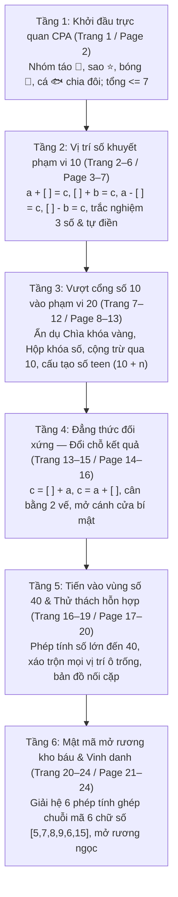

# Chặng 14: Thung Lũng Số Bí Ẩn — Tìm Số Còn Thiếu & Suy Luận Mật Mã

## 1. Objective (Mục tiêu cốt lõi)

Tài liệu này sở hữu đặc tả kỹ thuật và kiến trúc nội dung sư phạm nhằm chuyển thể trọn vẹn dữ liệu từ giáo trình PDF **"Chặng 14: Bé Tìm Số Bí Ẩn — Bí ẩn những con số biến mất • Thung lũng số bí ẩn"** (`docs/montessori/extracted/chang-14/analysis.json`, nguồn: *14 - Be tim so bi an.pdf*, 24 trang, thuộc bộ giáo trình *Gấu Logic & Thỏ Quan Sát (Thỏ Sáng Tạo) - Chuyến Tàu Toán Học*, Nhà xuất bản Dân Trí / Montessori VN) vào nền tảng **TiniMath v2**.

### Mục tiêu chiến lược:
1. **Phổ biến dữ liệu vào các Game Engine hiện hữu (`GT-000`..`GT-037`)**:
   - **TUYỆT ĐỐI KHÔNG TẠO MỚI `GT-038+`**.
   - Phân giải 24 trang PDF thành 3 nhóm dạng bài chuẩn theo spec (`WB14-D1`, `WB14-D2`, `WB14-D3`) cùng mạch suy luận thám tử tích hợp (`WB14-DED-1`, `WB14-DED-2`, `WB14-D5`), ánh xạ tương thích 100% với 3 khuôn tương tác cốt lõi đã có trong `packages/game-engine/src/templates/`:
     - `GT-009` (`ClueEliminationSession` — Loại trừ theo manh mối): Trẻ nhận 1–3 manh mối thám tử định lượng (lớn hơn, nhỏ hơn, chẵn/lẻ, điều kiện phủ định `not_equal`), loại bỏ các ứng viên số không phù hợp để tìm ra con số bí ẩn duy nhất.
     - `GT-001` (`TapSelectSession` — Chạm chọn một đáp án đúng): Trẻ chạm chọn 1 trong 3 chìa khóa vàng, thẻ ghi chú ghim gỗ, hoặc ổ khóa mang số đúng với các phương án nhiễu kề sát ($\pm 1, \pm 2$) bị xáo trộn vị trí.
     - `GT-008` (`DragToSlotSession` — Kéo thả vào ô đích): Trẻ kéo thả thẻ số từ khay số vào ô vuông khuyết trong phương trình hình ảnh CPA hoặc ghép chuỗi mật mã 6 chữ số mở rương kho báu; hỗ trợ nam châm snap tự hút và fallback tap-tap.
2. **Hiện thực hóa Tiến trình Sư phạm Montessori, CPA & Tiền Đại Số (Pre-Algebra Thinking)**:
   - **Phương pháp CPA trực quan (Concrete - Pictorial - Abstract)**: Khởi đầu bằng hình ảnh táo đỏ, ngôi sao, bóng bay chia đôi để trẻ cảm nhận phần bù còn thiếu trước khi chuyển hóa sang phương trình số trừu tượng.
   - **Linh hoạt vị trí số khuyết (Cognitive Positional Flexibility)**: Rèn luyện tính linh hoạt nhận thức khi số bí ẩn xuất hiện ở vị trí số hạng thứ hai ($a + [ ] = c$), số hạng đầu ($[ ] + b = c$), số trừ ($a - [ ] = c$), hoặc số bị trừ ($[ ] - b = c$).
   - **Tính chất đối xứng của đẳng thức (Symmetry of Equality)**: Phá vỡ tư duy máy móc "kết quả luôn ở bên phải", làm quen với dạng phương trình đảo vế ($c = [ ] + a$ và $c = a + [ ]$), đặt nền móng bản chất dấu bằng là quan hệ tương đương (Equivalence relation).
   - **Mở rộng phạm vi số từng nấc (Number Range Scaffolding)**: Phạm vi 10 (cộng trừ cơ bản) $\rightarrow$ Phạm vi 20 (cộng trừ qua 10, tách gộp số teen $10 + n$) $\rightarrow$ Phạm vi 40 (số tròn chục và số có hai chữ số).
   - **Trí nhớ làm việc & Chuỗi mật mã đa bước (Working Memory Code Quest)**: Thu thập 6 số bí ẩn từ 6 bài toán độc lập để ghép thành chuỗi mã số mở khóa rương báu Thung lũng số bí ẩn.
3. **Làm giàu hệ thống `SkillDataset` & Thiết kế 13 `SkillLevelPlan[]`**:
   - Khắc phục triệt để tình trạng **0 Montessori levels** hiện tại của WB14 trong `packages/content`.
   - Bổ sung Montessori levels đầu tiên cho Competency C3 trong `packages/content/src/skills/c3/ded/` (`C3.DED.01`, `C3.DED.02`, `C3.DED.03`), giải tỏa khoảng trống Montessori của C3.
   - Bổ sung Montessori levels cho Competency C1 trong `packages/content/src/skills/c1/add/` (`C1.ADD.03`) và `packages/content/src/skills/c1/sub/` (`C1.SUB.03`).
   - Cấp mã level chuẩn `GL-<COMP>-<STRAND>-<MECH>-01xx` (sequence $\ge 0101$), gắn nhãn `montessori_ref: "WB14-D1"`, `"WB14-D2"`, `"WB14-D3"`.
   - Phân bổ `access_tier` khớp chính xác độ khó `difficulty`: 1=`free`, 2=`login`, 3=`standard`, 4/5=`premium`.
   - Tuân thủ nghiêm ngặt `BR-MCM-06` (không chứa từ khóa thương mại đo trí tuệ như IQ/Raven).

---

## 2. Actors & Pedagogical Roles

| Tác nhân / Nhân vật | Vai trò hệ thống | Vai trò sư phạm & Đặc điểm nhận diện trong Chặng 14 |
|---|---|---|
| **Bé (Kid Player)** | Người chơi chính (4–6 tuổi) | Nhập vai "Thám tử số học nhí", truy tìm con số biến mất trong các phương trình khuyết, thu thập chìa khóa vàng, mở các cánh cửa bí mật và giải mã mật mã 6 chữ số mở rương báu Thung lũng số bí ẩn. |
| **Gấu Logic (`gau_logic`)** | Hướng dẫn tư duy trừu tượng & Phân tích cấu trúc | Đại diện tư duy logic, cấu trúc đại số và quy tắc dấu bằng. Ngoại hình: Gấu nâu mặc áo măng tô thám tử, đeo kính gọng tròn đen, nơ đỏ, tay cầm kính lúp soi sáng phương trình. Lời thoại tiêu biểu: *"Một con số đã biến mất khỏi phép tính rồi!", "Những phép tính này bị mất một số rồi!", "Có những phép tính, số bí ẩn đứng ở đầu này!", "Số bí ẩn có thể ở giữa, ở đầu hoặc ở cuối!", "Không có hình minh họa nữa, chỉ có phép tính thôi!", "Số bí ẩn giờ lớn hơn rồi!", "Mỗi chìa khóa mở một phép tính!", "Mình giải mật mã theo hai cột nhé!", "Ô! Kết quả chạy lên trước rồi!", "Bây giờ mình gặp các số lớn hơn!", "Chúng mình sắp mở được rương báu rồi!"*. |
| **Thỏ Quan Sát / Thỏ Sáng Tạo (`tho_quan_sat`)** | Đồng hành hành động & Quan sát chi tiết | Đại diện quan sát trực quan, khích lệ cảm xúc và kiểm soát nhẩm tính. Ngoại hình: Thỏ trắng mặc áo thám tử màu be nhạt, đội mũ thám tử tai thỏ, nơ đỏ, tay cầm bản đồ kho báu. Lời thoại tiêu biểu: *"Bé hãy tìm số còn thiếu nhé!", "Bé hãy khoanh vào số đúng nhé!", "Bé tìm xem số nào là số bí ẩn nhé!", "Bé hãy tìm số thích hợp để phép tính đúng nhé!", "Con số đúng đang ẩn trong ô vuông đó!", "Bé nhìn thật kỹ rồi nối đúng nha!", "Nhưng bé vẫn tìm được đúng thôi!", "Bé chọn chìa khóa đúng nhé!", "Bé điền số thật cẩn thận nha!", "Mình vẫn tìm được số bí ẩn thôi!", "Bé cứ tìm số còn thiếu như cũ nhé!", "Bé giải đúng để lấy mật mã nhé!"*. |
| **Phụ huynh / Giáo viên** | Hỗ trợ ngoài màn hình | Quan sát cách bé xử lý dấu phép tính khi số bí ẩn đứng ở các vị trí khác nhau; gợi ý dùng ngón tay hoặc vật đếm nếu bé lúng túng ở các phép tính qua 10. |
| **Content Seeder Engine** | Hệ thống tự động | Chuyển hóa các `SkillLevelPlan[]` thành `ContentSeed` hợp lệ, kiểm tra Zod contract và xác thực qua `montessori-gate.ts`. |

---

## 3. Entry Points & File Mapping

```
docs/montessori/extracted/chang-14/analysis.json (24 trang, WB14)
   │
   ├──> docs/montessori/dataset/activity-types-table.md
   │      └── Đồng bộ hàng WB14-D1, WB14-D2, WB14-D3 (GT-009, GT-001, GT-008)
   ├──> docs/specs/05-content/montessori-corpus-mapping.md
   │      └── Cập nhật hàng 14 mục 7.1, 7.3, 7.9 (bổ sung Montessori cho C3.DED & C1)
   │
   ├──> packages/content/src/skills/c3/ded/
   │      ├── C3.DED.01.ts
   │      │     ├── Dataset: CHANG_14_DETECTIVE_DATASET (thám tử số học, kính lúp, chìa khóa vàng)
   │      │     ├── Level WB14-D1 (GT-009): GL-C3-DED-CLUE-0101 (diff 2, login)
   │      │     ├── Level WB14-D2 (GT-001): GL-C3-DED-TAP-0102 (diff 2, login)
   │      │     └── Level WB14-D3 (GT-008): GL-C3-DED-SLOT-0103 (diff 3, standard)
   │      │
   │      ├── C3.DED.02.ts
   │      │     ├── Dataset: Bổ sung items điều kiện phủ định & bảng số thám tử
   │      │     ├── Level WB14-D1 (GT-009): GL-C3-DED-CLUE-0104 (diff 3, standard - 3 manh mối NOT)
   │      │     └── Level WB14-D2 (GT-001): GL-C3-DED-TAP-0105 (diff 4, premium - bẫy nhiễu đảo)
   │      │
   │      └── C3.DED.03.ts
   │            ├── Dataset: Bổ sung vật phẩm rương báu & chuỗi mật mã
   │            ├── Level WB14-D1 (GT-009): GL-C3-DED-CLUE-0106 (diff 4, premium - Mastermind clues)
   │            └── Level WB14-D3 (GT-008): GL-C3-DED-SLOT-0107 (diff 5, premium - Final Capstone Chest Code)
   │
   └──> packages/content/src/skills/c1/
          ├── add/C1.ADD.03.ts
          │     ├── Dataset: Bổ sung thẻ ghi chú thám tử & chìa khóa vàng
          │     ├── Level WB14-D1 (GT-008): GL-C1-ADD-SLOT-0101 (diff 1, free)
          │     ├── Level WB14-D2 (GT-001): GL-C1-ADD-TAP-0102 (diff 2, login)
          │     └── Level WB14-D3 (GT-008): GL-C1-ADD-SLOT-0103 (diff 3, standard - Đẳng thức đảo vế)
          │
          └── sub/C1.SUB.03.ts
                ├── Dataset: Bổ sung thẻ số bí ẩn & ổ khóa cửa vòm đá
                ├── Level WB14-D1 (GT-008): GL-C1-SUB-SLOT-0101 (diff 1, free)
                ├── Level WB14-D2 (GT-001): GL-C1-SUB-TAP-0102 (diff 2, login)
                └── Level WB14-D3 (GT-008): GL-C1-SUB-SLOT-0103 (diff 3, standard - Số trừ/Số bị trừ)
```

- **Mã nguồn Template Engine sử dụng**:
  - `packages/game-engine/src/templates/GT-009/` (`ClueEliminationSession` — Loại trừ theo manh mối).
  - `packages/game-engine/src/templates/GT-001/` (`TapSelectSession` — Chạm chọn một đáp án đúng).
  - `packages/game-engine/src/templates/GT-008/` (`DragToSlotSession` — Kéo thả vào ô đích).
- **Phạm vi kiểm thử & Xác thực**:
  - `packages/content-build/tests/gates/montessori-corpus.test.ts`.
  - `packages/content/tests/builders/gt-009.test.ts`.
  - `packages/content/tests/builders/gt-001.test.ts`.
  - `packages/content/tests/builders/gt-008.test.ts`.

---

## 4. Pedagogical Deconstruction: Tiến Trình 24 Trang PDF Chặng 14

Giáo trình Chặng 14 được xây dựng theo hành trình khám phá Thung lũng số bí ẩn với 6 tầng nhận thức tăng tiến chặt chẽ:



### Chi tiết các tầng tiến trình:
1. **Tầng 1 — Trực quan CPA (Trang 1 / Page 2)**: Điểm tựa hình ảnh trực quan giúp trẻ nhận biết phần bù còn thiếu bằng trực giác đếm. Vạch ngăn chia đôi nhóm vật thể tạo cầu nối tự nhiên sang phép cộng/trừ.
2. **Tầng 2 — Vị trí số khuyết trong phạm vi 10 (Trang 2–6 / Page 3–7)**: Rèn luyện nhận thức cấu trúc phương trình. Trẻ chuyển từ trắc nghiệm 3 số sang tự điền số khi kính lúp soi vào ô vuông.
3. **Tầng 3 — Vượt ngưỡng số 10 vào phạm vi 20 (Trang 7–12 / Page 8–13)**: Giới thiệu ẩn dụ chìa khóa vàng và ổ khóa số. Các phép tính qua 10 như $9 + [ ] = 15$, $17 - [ ] = 9$ đòi hỏi kỹ năng tách gộp số với mốc 10.
4. **Tầng 4 — Tính chất đối xứng của đẳng thức (Trang 13–15 / Page 14–16)**: Đảo kết quả lên trước ($21 = [ ] + 10$). Trẻ hiểu bản chất dấu bằng là sự cân bằng hai vế, chuẩn bị tư duy tiền đại số vững chắc.
5. **Tầng 5 — Vùng số 40 & Thử thách hỗn hợp (Trang 16–19 / Page 17–20)**: Mở rộng phạm vi số có hai chữ số ($[ ] + 18 = 34$, $40 = 20 + [ ]$). Lời dẫn trấn an: *"Số lớn hơn nhưng cách tìm vẫn vậy"*, giúp chuyển giao nguyên lý toán học.
6. **Tầng 6 — Mật mã mở rương kho báu & Vinh danh (Trang 20–24 / Page 21–24)**: Nhiệm vụ giải mã 6 chữ số `[5, 7, 8, 9, 6, 15]` để mở nắp rương kho báu, nhận huy hiệu Thám tử số học xuất sắc và tô màu viên ngọc Chặng 14.

---

## 5. Phân Tích Chi Tiết Các Nhóm Dạng Bài & Ánh Xạ Game Engine

### 5.1 Dạng 1 (`WB14-D1`): Phương trình hình ảnh CPA & Suy luận loại trừ qua manh mối
- **Số trang PDF nguồn**: Trang 2 (Bài 1), tích hợp mở rộng định hướng thám tử số học.
- **Mục tiêu sư phạm**:
  - Trẻ quan sát nhóm vật thể trực quan được chia thành 2 phần (bên trái và bên phải vạch ngăn) kèm tổng số lượng.
  - Nhận biết manh mối định lượng để suy luận loại trừ số không phù hợp.
- **Bài tập mẫu trong PDF**:
  - Táo đỏ 🍎: 4 quả bên trái + [ 2 ] = 6 quả táo.
  - Ngôi sao vàng ⭐: [ 2 ] quả bên trái + 3 quả bên phải = 5 ngôi sao.
  - Bóng bay 🎈: 7 quả bóng - [ 3 ] = 4 quả còn lại.
  - Đàn cá xanh 🐟: [ 5 ] con bên trái + 2 con bên phải = 7 con cá.
- **Mạch suy luận loại trừ manh mối (`WB14-DED-1`)**:
  - Manh mối 1: "Tôi lớn hơn 4".
  - Manh mối 2: "Tôi nhỏ hơn 8 và là số chẵn" $\rightarrow$ Đáp án: 6.
- **Ánh xạ Engine**:
  - `GT-009` (`ClueEliminationSession`): Lưới số 1–10, trẻ nhận 2 manh mối thám tử, chạm để loại bỏ các số vi phạm, giữ lại số bí ẩn duy nhất.
  - `GT-008` (`DragToSlotSession`): Kéo thẻ số thả vào ô trống khuyết của phương trình hình ảnh CPA.

### 5.2 Dạng 2 (`WB14-D2`): Trắc nghiệm chọn số bí ẩn 3 phương án (Chìa khóa vàng & Thẻ ghim gỗ)
- **Số trang PDF nguồn**: 13 trang (Trang 3, 4, 5, 8, 9, 10, 12, 13, 14, 15, 17, 18, 19).
- **Mục tiêu sư phạm**:
  - Mỗi bài toán đưa ra một phương trình khuyết kèm 3 số lựa chọn đặt trong vòng tròn, thẻ giấy ghim, hoặc chiếc chìa khóa vàng.
  - Trẻ tính nhẩm phép bù/hiệu và chạm chọn phương án chính xác; phân biệt các phương án nhiễu kề sát ($\pm 1, \pm 2$).
- **Mẫu bài tập tiêu biểu**:
  - Trang 3: $4 + [ ] = 7$ (lựa chọn: 2, 3, 5; đáp án: 3); $10 - [ ] = 5$ (lựa chọn: 3, 5, 6; đáp án: 5).
  - Trang 4: $[ ] + 3 = 7$ (lựa chọn: 2, 3, 4; đáp án: 4); $[ ] - 5 = 5$ (lựa chọn: 8, 9, 10; đáp án: 10).
  - Trang 8: $9 + [ ] = 15$ (lựa chọn: 4, 5, 6; đáp án: 6); $12 - [ ] = 7$ (lựa chọn: 4, 5, 6; đáp án: 5).
  - Trang 9 (Chiếc chìa khóa bị thiếu): $8 + [ ] = 14$ (chìa khóa: 4, 5, 6; đáp án: 6); $17 - [ ] = 9$ (chìa khóa: 7, 8, 9; đáp án: 8).
  - Trang 14 (Những cánh cửa bí mật): $18 = [ ] + 8$ (chìa khóa: 8, 9, 10; đáp án: 10).
- **Ánh xạ Engine**:
  - `GT-001` (`TapSelectSession`): Chạm chọn 1 trong 3 chìa khóa vàng / thẻ số tròn. Khi chạm đúng, phát âm thanh "tách" mở khóa và hiệu ứng ánh sáng vàng.

### 5.3 Dạng 3 (`WB14-D3`): Tự điền số bí ẩn theo biến thiên vị trí & Chuỗi mật mã mở rương
- **Số trang PDF nguồn**: 19 trang (Trang 2, 3, 4, 6, 7, 8, 9, 10, 11, 12, 13, 14, 15, 16, 17, 18, 19, 20, 22).
- **Mục tiêu sư phạm**:
  - Dạng bài tự luận cốt lõi: Trẻ phân tích vai trò của ô trống trong phương trình (số hạng 1, số hạng 2, số trừ, số bị trừ, hoặc kết quả đứng trước/sau dấu bằng) và kéo thả số chính xác vào ô vuông.
  - Thử thách đỉnh cao Mật mã mở rương (Trang 21, 23): Giải 6 bài toán tìm số bí ẩn, ghép thành dãy mã số 6 chữ số `[5, 7, 8, 9, 6, 15]` để mở rương báu.
- **Ánh xạ Engine**:
  - `GT-008` (`DragToSlotSession`): Kéo thẻ số từ khay số vào ô vuông khuyết trong phương trình, hoặc kéo 6 thẻ số mật mã vào hàng ổ khóa của rương kho báu; khi hoàn tất nắp rương bật mở và pháo hoa ăn mừng tung bay.

---

## 6. Thiết Kế `SkillDataset` Cho Seeder

Lấy cảm hứng trọn vẹn từ vũ trụ Thám tử số học của Chặng 14, `CHANG_14_DETECTIVE_DATASET` mang phong cách bí ẩn, hấp dẫn với các vật phẩm điều tra toán học:

```typescript
export const CHANG_14_DETECTIVE_DATASET: SkillDataset = {
  skill_code: "C3.DED.01",
  concept_label: "Thung lũng số bí ẩn — Thám tử tìm số còn thiếu",
  surface: "game",
  items: [
    {
      id: "mag_glass",
      label: "kính lúp thám tử",
      image: { kind: "emoji", ref: "🔍" },
      category: { type: "dụng cụ thám tử", color: "blue", size: "medium" },
      contrast_group: "tools",
      value: 1,
      ordering: 1,
    },
    {
      id: "gold_key",
      label: "chìa khóa vàng",
      image: { kind: "emoji", ref: "🗝️" },
      category: { type: "chìa khóa bí mật", color: "gold", size: "small" },
      contrast_group: "keys",
      value: 2,
      ordering: 2,
    },
    {
      id: "secret_map",
      label: "bản đồ thung lũng",
      image: { kind: "emoji", ref: "🗺️" },
      category: { type: "manh mối dẫn đường", color: "brown", size: "large" },
      contrast_group: "clues",
      value: 3,
      ordering: 3,
    },
    {
      id: "stone_door",
      label: "cánh cổng vòm đá",
      image: { kind: "emoji", ref: "🚪" },
      category: { type: "cửa mật thất", color: "gray", size: "large" },
      contrast_group: "doors",
      value: 4,
      ordering: 4,
    },
    {
      id: "treasure_chest",
      label: "rương kho báu",
      image: { kind: "emoji", ref: "📦" },
      category: { type: "kho báu bí mật", color: "gold", size: "large" },
      contrast_group: "treasures",
      value: 5,
      ordering: 5,
    },
    {
      id: "blue_gem",
      label: "viên ngọc xanh lục",
      image: { kind: "emoji", ref: "💎" },
      category: { type: "đá quý phần thưởng", color: "cyan", size: "medium" },
      contrast_group: "treasures",
      value: 6,
      ordering: 6,
    },
    {
      id: "pin_note",
      label: "thẻ giấy ghim gỗ",
      image: { kind: "emoji", ref: "📌" },
      category: { type: "manh mối ghi chép", color: "red", size: "small" },
      contrast_group: "clues",
      value: 7,
      ordering: 7,
    },
    {
      id: "star_badge",
      label: "huy hiệu thám tử sao",
      image: { kind: "emoji", ref: "⭐" },
      category: { type: "danh hiệu vinh danh", color: "yellow", size: "medium" },
      contrast_group: "badges",
      value: 8,
      ordering: 8,
    },
    {
      id: "lock_padlock",
      label: "ổ khóa đồng cổ",
      image: { kind: "emoji", ref: "🔒" },
      category: { type: "ổ khóa thử thách", color: "gold", size: "medium" },
      contrast_group: "keys",
      value: 9,
      ordering: 9,
    },
    {
      id: "spark_lamp",
      label: "đèn lồng phát sáng",
      image: { kind: "emoji", ref: "🏮" },
      category: { type: "dụng cụ thám tử", color: "orange", size: "medium" },
      contrast_group: "tools",
      value: 10,
      ordering: 10,
    },
  ],
  relations: [
    {
      type: "match",
      source_id: "gold_key",
      target_id: "lock_padlock",
      explanation: "chìa khóa vàng dùng để mở ổ khóa đồng cổ",
    },
    {
      type: "match",
      source_id: "mag_glass",
      target_id: "pin_note",
      explanation: "kính lúp soi sáng manh mối trên thẻ ghi chú",
    },
    {
      type: "match",
      source_id: "secret_map",
      target_id: "stone_door",
      explanation: "bản đồ chỉ đường tới cánh cổng vòm đá bí mật",
    },
    {
      type: "match",
      source_id: "treasure_chest",
      target_id: "blue_gem",
      explanation: "mở rương kho báu để nhận viên ngọc xanh lấp lánh",
    },
  ],
  axes: {
    type: ["dụng cụ thám tử", "chìa khóa bí mật", "manh mối ghi chép", "kho báu bí mật"],
  },
  ladder: [
    {
      rung: 1,
      dimension: "range",
      description: "Khám phá số bí ẩn qua hình ảnh cụ thể và phương trình phạm vi 7",
    },
    {
      rung: 2,
      dimension: "range",
      description: "Suy luận loại trừ qua 2 manh mối và trắc nghiệm 3 chìa khóa phạm vi 10",
    },
    {
      rung: 3,
      dimension: "distractor_count",
      description: "Vượt cổng số 10 vào phạm vi 20, phương trình đảo vế c = a + [ ]",
    },
    {
      rung: 4,
      dimension: "item_count",
      description: "Suy luận đa manh mối có phủ định NOT và vùng số lớn tới 40",
    },
    {
      rung: 5,
      dimension: "speed_scaffolding",
      description: "Giải mã chuỗi mật mã 6 chữ số mở rương báu Thung lũng số bí ẩn",
    },
  ],
  phrasing: {
    prompt_template: "Bé hãy tìm con số bí ẩn để mở khóa nhé!",
    narration_template: "Cùng Gấu Logic và Thỏ Sáng Tạo phá án số học nào!",
  },
  ordering: [
    "mag_glass",
    "gold_key",
    "secret_map",
    "stone_door",
    "treasure_chest",
    "blue_gem",
    "pin_note",
    "star_badge",
    "lock_padlock",
    "spark_lamp",
  ],
};
```

---

## 7. Thiết Kế Chi Tiết 13 `SkillLevelPlan[]`

Để đảm bảo giải quyết triệt để tình trạng **0 Montessori levels** của WB14, bổ sung Montessori levels cho Competency C3 (`C3.DED.01`, `C3.DED.02`, `C3.DED.03`) và Competency C1 (`C1.ADD.03`, `C1.SUB.03`), kế hoạch thiết lập 13 levels chuẩn mực như sau:

| STT | Mã Level | Kỹ năng | Khuôn | Band | Diff | Access Tier | Ref | Vòng | Chủ đề | Tên sư phạm & Nội dung tương tác |
|:---:|---|---|:---:|:---:|:---:|:---:|:---:|:---:|:---:|---|
| 1 | `GL-C3-DED-CLUE-0101` | `C3.DED.01` | `GT-009` | 4-5 | 2 | `login` | `WB14-D1` | 3 | detective | **Manh mối thám tử 1**: Lưới 1–6, 2 manh mối định lượng (lớn hơn 2, nhỏ hơn 5) tìm số bí ẩn. |
| 2 | `GL-C3-DED-TAP-0102` | `C3.DED.01` | `GT-001` | 4-5 | 2 | `login` | `WB14-D2` | 3 | detective | **Chìa khóa mở khóa**: Chạm chọn 1 trong 3 chìa khóa vàng chứa số đúng cho phương trình phạm vi 10. |
| 3 | `GL-C3-DED-SLOT-0103` | `C3.DED.01` | `GT-008` | 4-5 | 3 | `standard` | `WB14-D3` | 3 | detective | **Kính lúp soi số khuyết**: Kéo thẻ số vào ô vuông trong phương trình đổi vị trí phạm vi 10. |
| 4 | `GL-C3-DED-CLUE-0104` | `C3.DED.02` | `GT-009` | 4-5 | 3 | `standard` | `WB14-D1` | 3 | detective | **Manh mối phủ định NOT**: 3 manh mối (lớn hơn 3, nhỏ hơn 7, khác 4) loại trừ tìm số 5 bí ẩn. |
| 5 | `GL-C3-DED-TAP-0105` | `C3.DED.02` | `GT-001` | 5-6 | 4 | `premium` | `WB14-D2` | 3 | detective | **Ổ khóa bí mật phạm vi 20**: Chạm chọn chìa khóa đúng giữa 2 phương án gây nhiễu kề sát $\pm 1$. |
| 6 | `GL-C3-DED-CLUE-0106` | `C3.DED.03` | `GT-009` | 5-6 | 4 | `premium` | `WB14-D1` | 3 | detective | **Thám tử giải mã số lớn**: 3 manh mối kết hợp chẵn/lẻ và khoảng số trong phạm vi 1–20. |
| 7 | `GL-C3-DED-SLOT-0107` | `C3.DED.03` | `GT-008` | 5-6 | 5 | `premium` | `WB14-D3` | 3 | detective | **Mật mã rương báu Capstone**: Kéo 6 chữ số mật mã đã giải vào hàng ổ khóa rương báu mở kho ngọc. |
| 8 | `GL-C1-ADD-SLOT-0101` | `C1.ADD.03` | `GT-008` | 4-5 | 1 | `free` | `WB14-D1` | 3 | detective | **CPA hình ảnh thêm vào**: Đếm nhóm táo/sao chia đôi, kéo thẻ số còn thiếu vào ô vuông tổng $\le 7$. |
| 9 | `GL-C1-ADD-TAP-0102` | `C1.ADD.03` | `GT-001` | 4-5 | 2 | `login` | `WB14-D2` | 3 | detective | **Số hạng biến mất**: Chạm chọn số hạng còn thiếu ($a + [ ] = c$ và $[ ] + b = c$) phạm vi 10. |
| 10 | `GL-C1-ADD-SLOT-0103` | `C1.ADD.03` | `GT-008` | 4-5 | 3 | `standard` | `WB14-D3` | 3 | detective | **Đẳng thức đảo vế**: Kéo số vào ô khuyết trong phương trình kết quả đứng trước ($c = [ ] + a$). |
| 11 | `GL-C1-SUB-SLOT-0101` | `C1.SUB.03` | `GT-008` | 4-5 | 1 | `free` | `WB14-D1` | 3 | detective | **CPA bớt đi trực quan**: Đếm số bóng bay/cá bớt đi, kéo thẻ số vào ô trừ trực quan phạm vi 7. |
| 12 | `GL-C1-SUB-TAP-0102` | `C1.SUB.03` | `GT-001` | 4-5 | 2 | `login` | `WB14-D2` | 3 | detective | **Tìm số trừ chưa biết**: Chạm chọn số trừ thích hợp ($a - [ ] = c$) trong phạm vi 10. |
| 13 | `GL-C1-SUB-SLOT-0103` | `C1.SUB.03` | `GT-008` | 5-6 | 3 | `standard` | `WB14-D3` | 3 | detective | **Tìm số bị trừ ở đầu**: Kéo số bị trừ ($[ ] - b = c$) vào đầu phương trình trong phạm vi 20. |

---

## 8. Ràng Buộc Bất Biến & Tiêu Chuẩn Nghiệm Thu

1. **Tuyệt đối không tạo `GT-038+` (`BR-GT-MAX`)**:
   - Mọi hoạt động trong Chặng 14 phải được ánh xạ hoàn toàn vào các game engine hiện hữu: `GT-009` (clue-elimination), `GT-001` (tap-select), `GT-008` (drag-to-slot).
2. **Quy tắc cấp mã Level Montessori (`BR-MGL-02`)**:
   - Mọi mã level Montessori phải có sequence $\ge 0101$ (ví dụ: `GL-C3-DED-CLUE-0101`, `GL-C1-ADD-SLOT-0101`), không được trùng hay chèn vào dải level thông thường ($0001..0099$).
3. **Quy tắc nhãn tham chiếu (`BR-MGL-03`)**:
   - Thuộc tính `montessori_ref` bắt buộc mang giá trị `"WB14-D1"`, `"WB14-D2"`, hoặc `"WB14-D3"`.
4. **Quy tắc Access Ladder (`BR-MGL-12`)**:
   - `difficulty = 1` $\rightarrow$ `access_tier = "free"`.
   - `difficulty = 2` $\rightarrow$ `access_tier = "login"`.
   - `difficulty = 3` $\rightarrow$ `access_tier = "standard"`.
   - `difficulty = 4, 5` $\rightarrow$ `access_tier = "premium"`.
5. **Tuân thủ quy chuẩn thương mại (`BR-MCM-06`)**:
   - Tuyệt đối không chứa các từ khóa thương mại đo lường trí tuệ: "IQ", "Raven", "thông minh", "trí tuệ".
6. **Tiêu chuẩn Game Engine (`07-game-engine.md`)**:
   - Canvas 2D thuần TypeScript, 60fps, 960×540 logic space.
   - Sàn touch tối thiểu 64px (72px cho 5-6 tuổi, 96px cho 4-5 tuổi).
   - Âm thanh SFX ramp $\ge 20$ms, không âm giật, không buzzer khi sai, feedback nhịp hổ phách nhẹ nhàng.
