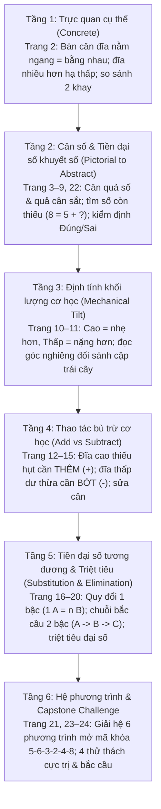

# Chặng 16: Xưởng Cân Bằng Kỳ Diệu — Quan Sát, So Sánh, Suy Luận

## 1. Objective (Mục tiêu cốt lõi)

Tài liệu này sở hữu đặc tả kỹ thuật và kiến trúc nội dung sư phạm nhằm chuyển thể trọn vẹn dữ liệu từ tài liệu PDF **"Chặng 16: Xưởng Cân Bằng Kỳ Diệu — Quan sát – So sánh – Suy luận (Cân nặng, Thăng bằng & Tiền đại số)"** (`docs/montessori/extracted/chang-16/analysis.json`, nguồn: *16 - Tu duy can bang.pdf*, 24 trang, thuộc bộ giáo trình *Gấu Logic & Thỏ Sáng Tạo - Hành Trình 20 Chặng Toán Học*, Nhà xuất bản Dân Trí / Montessori VN) vào nền tảng **TiniMath v2**.

### Mục tiêu chiến lược:

1. **Thiết lập Vũ trụ Cốt truyện & Động lực Học tập (Narrative Quest & Milestone)**:
   - **Bối cảnh**: Chuyến Tàu Toán Học đưa các bạn nhỏ dừng chân tại **Xưởng Cân Bằng Kỳ Diệu** — một không gian cơ khí kỳ ảo phong cách Steampunk cổ điển với những cỗ máy bàn cân đồng vàng hai đĩa, các bánh răng chuyển động nhịp nhàng, quả cân sắt truyền thống và cánh cửa kho báu bí mật bị khóa chặt bằng mật mã 6 chữ số.
   - **Nhiệm vụ học tập (Learning Quest)**: Bé đồng hành cùng Gấu Logic và Thỏ Sáng Tạo, vận dụng trực giác quan sát cơ học và tư duy tiền đại số để hiệu chỉnh các chiếc cân, tìm số hạng bị mất, giải mã chuỗi cân bắc cầu và triệt tiêu đại số, mở toang cánh cửa kho báu để thắp sáng **Huy Hiệu Cân Bằng**.
   - **Dấu mốc phát triển nhận thức**: Chặng 16 là bước ngoặt quyết định đưa trẻ từ tư duy số học cụ thể (Arithmetic) sang tư duy đại số trừu tượng (Pre-Algebra Thinking), rèn luyện tư duy đẳng thức (Equivalence), bảo toàn khối lượng (Conservation of Mass) và suy luận bắc cầu (Transitive Deduction) chuẩn bị cho giai đoạn tiền tiểu học.

2. **Khai thác triệt để các Game Engine hiện hữu (`GT-000`..`GT-037`)**:
   - **TUYỆT ĐỐI KHÔNG TẠO MỚI `GT-038+`**.
   - Phân giải 24 trang PDF thành 3 nhóm dạng bài chuẩn theo spec (`WB16-D1`, `WB16-D2`, `WB16-D3`), ánh xạ tương thích 100% với 3 khuôn tương tác cốt lõi đã có trong `packages/game-engine/src/templates/`:
     - `GT-014` (`BalanceScaleSession` — Bàn cân hai đĩa): Mô phỏng cơ học góc nghiêng bập bênh và trạng thái thăng bằng nằm ngang. Hỗ trợ 3 chế độ mục tiêu: `goal: "balance"` (kéo thả vật từ khay lên đĩa để đạt thăng bằng), `goal: "pick_heavier"` (chạm chọn đĩa nặng hơn/hạ thấp), `goal: "pick_lighter"` (chạm chọn đĩa nhẹ hơn/ở trên cao).
     - `GT-001` (`TapSelectSession` — Chạm chọn một đáp án đúng): Trẻ chạm chọn 1 trong 3 nhãn kết quả (`[Bên trái]`, `[Bằng nhau]`, `[Bên phải]`), chọn vật nặng nhất/nhẹ nhất qua chuỗi cân nghiêng, chọn quả số tương đương, hoặc thẩm định chân trị logic `[ĐÚNG]` / `[SAI]`.
     - `GT-008` (`DragToSlotSession` — Kéo thả vào ô đích): Trẻ kéo thả quả số tròn, quả cân sắt, hoặc thẻ thao tác bù trừ ($[+2], [-3]$) vào ô đích khuyết trên đĩa cân hoặc các ô mật mã mở khóa cửa kho báu.
     - `GT-000` (`concept-intro` & `celebration-summary`): Hoạt cảnh giới thiệu Xưởng Cân Bằng (Trang 1) và lễ vinh danh nhận Huy Hiệu Cân Bằng (Trang 24).

3. **Hiện thực hóa Tiến trình Sư phạm Montessori, CPA & Tiền Đại Số (Pre-Algebra Spiral Progression)**:
   - **Trực quan xúc giác & Cơ học bàn cân (Concrete Mechanical Intuition)**: Trẻ quan sát độ nghiêng bàn cân để hiểu trực tiếp khái niệm vật lý: nặng hơn thì đĩa hạ thấp xuống, nhẹ hơn thì đĩa được nâng lên cao, và thăng bằng nằm ngang tức là hai bên có khối lượng/số lượng bằng nhau.
   - **Đẳng thức toán học (Equivalence Principle)**: Chuyển dịch từ trạng thái thăng bằng vật lý sang dấu bằng ($=$) trong toán học: $A = B$ nghĩa là hai vế có giá trị tương đương.
   - **Thao tác bù trừ (Balancing Operations)**: Muốn lập lại cân bằng cho bàn cân lệch, ta có hai cách tiếp cận: THÊM VÀO ($+$) ở bên nhẹ hơn hoặc BỚT ĐI ($-$) ở bên nặng hơn. Đây là nền tảng trực quan của phép cộng và phép trừ tìm ẩn số.
   - **Quy đổi tỉ lệ & Bắc cầu (Substitution & Transitive Reasoning)**: Nhận thức mối quan hệ tương đương tỉ lệ ($1 A = n B$) và chuỗi bắc cầu qua vật thể trung gian ($A = n B, B = m C \Rightarrow A = n \cdot m C$).
   - **Triệt tiêu đại số (Algebraic Elimination)**: Rút gọn các vật thể đồng nhất ở cả hai đĩa cân mà không làm thay đổi trạng thái thăng bằng (tính chất bất biến của đẳng thức: $X + A = Y + A \Leftrightarrow X = Y$).
   - **Hệ phương trình biểu tượng (System of Equations)**: Khám phá từng ẩn số theo thứ tự logic từ phương trình một ẩn đến phương trình hai ẩn để giải mã chuỗi số.

4. **Làm giàu hệ thống `SkillDataset` & Thiết kế 12 `SkillLevelPlan[]`**:
   - Khắc phục triệt để tình trạng **0 Montessori levels** hiện tại của WB16 trong `packages/content`.
   - Làm giàu kho từ vựng và dữ liệu seeder trong `packages/content/src/skills/c1/meas/` (`C1.MEAS.07`, `C1.MEAS.02`) và `packages/content/src/skills/c3/ded/` (`C3.DED.02`, `C3.DED.03`).
   - Cấp mã level chuẩn `GL-<COMP>-<STRAND>-<MECH>-01xx` (sequence $\ge 0101$), gắn nhãn `montessori_ref: "WB16-D1"`, `"WB16-D2"`, `"WB16-D3"`.
   - Phân bổ `access_tier` khớp chính xác độ khó `difficulty`: 1=`free`, 2=`login`, 3=`standard`, 4/5=`premium`.
   - Tuân thủ nghiêm ngặt `BR-MCM-06` (không chứa từ khóa thương mại đo trí tuệ như IQ/Raven).

---

## 2. Actors & Pedagogical Roles

| Tác nhân / Nhân vật | Vai trò hệ thống | Vai trò sư phạm & Đặc điểm nhận diện trong Chặng 16 |
|---|---|---|
| **Bé (Kid Player)** | Người chơi chính (5–6 tuổi) | Nhập vai "Kỹ sư nhí thám hiểm Xưởng Cân Bằng", quan sát độ nghiêng đĩa cân, đặt quả cân, kéo số bù trừ, giải mã quy đổi bắc cầu và mở khóa cánh cửa kho báu. |
| **Gấu Logic (`gau_logic`)** | Hướng dẫn tư duy trừu tượng & Quy tắc thăng bằng | Đại diện tư duy logic, cấu trúc đẳng thức và định luật cơ học. Ngoại hình: Gấu nâu đeo kính tròn trí thức, mặc áo gile nâu, cầm kính lúp và cuốn "Sổ tay quy luật". Lời thoại định hướng: *"Hai bên bằng nhau thì chiếc cân sẽ nằm ngang!", "Mỗi bên phải có tổng bằng nhau nhé!", "Bên nào hạ thấp xuống thường là nặng hơn!", "Mỗi bên đều là một phép tính đấy!", "Cân nằm ngang nghĩa là hai bên nặng bằng nhau!", "Cánh cửa chỉ mở khi tìm đủ 6 chữ số!"*. |
| **Thỏ Sáng Tạo (`tho_sang_tao`)** | Đồng hành hành động & Quan sát chi tiết | Đại diện trực giác linh hoạt, thao tác cơ học và tinh thần kiên trì. Ngoại hình: Thỏ trắng đeo nơ hồng, mang túi chéo da đồ nghề, ngón tay thoăn thoắt chỉ vào các đĩa cân. Lời thoại nhắc nhở thao tác: *"Bé xem bên nào cần thêm đồ vật nhé!", "Bé điền số còn thiếu để chiếc cân cân bằng nào!", "Bên nào ở cao hơn thường là nhẹ hơn đấy!", "Đĩa cao chọn + để thêm, đĩa thấp chọn − để bớt nhé!", "Đổi qua đồ vật ở giữa, rồi tìm đồ vật cuối cùng!", "Mỗi chiếc cân sẽ cho bé một số bí mật!"*. |
| **Phụ huynh / Giáo viên** | Hỗ trợ ngoài màn hình | Gợi ý bé liên hệ với trò chơi bập bênh ở công viên (bên bạn nặng hơn sẽ chạm đất, bạn nhẹ hơn ở trên cao) hoặc thực hành cân đồ chơi ở nhà trước khi giải bài toán đại số. |
| **Content Seeder Engine** | Hệ thống tự động | Chuyển hóa các `SkillLevelPlan[]` thành `ContentSeed` hợp lệ, kiểm tra Zod contract và xác thực qua `montessori-gate.ts`. |

---

## 3. Entry Points & File Mapping

```
docs/montessori/extracted/chang-16/analysis.json (24 trang, WB16)
   │
   ├──> docs/montessori/dataset/activity-types-table.md
   │      └── Đồng bộ hàng WB16-D1, WB16-D2, WB16-D3 (chuyển Hoãn -> Nhận Lô B-A2, GT-014, GT-001, GT-008)
   ├──> docs/specs/05-content/montessori-corpus-mapping.md
   │      └── Cập nhật hàng 16 mục 7.1, 7.3, 7.9 (khắc phục 0 levels, chia sẻ quota C1 và C3)
   │
   ├──> packages/content/src/skills/c1/meas/
   │      ├── C1.MEAS.07.ts (Cân bằng - cốt lõi bàn cân)
   │      │     ├── Dataset: CHANG_16_BALANCE_WORKSHOP_DATASET (quả cân, trái cây, cơ khí)
   │      │     ├── Level WB16-D1 (GT-014): GL-C1-MEAS-SCALE-0101 (diff 1, free - Nghiêng nhẹ/nặng)
   │      │     ├── Level WB16-D2 (GT-014): GL-C1-MEAS-SCALE-0102 (diff 2, login - Thêm vật thăng bằng)
   │      │     ├── Level WB16-D2 (GT-014): GL-C1-MEAS-SCALE-0103 (diff 3, standard - Quả cân sắt kg)
   │      │     └── Level WB16-D2 (GT-008): GL-C1-MEAS-SLOT-0104 (diff 3, standard - Thao tác bù trừ +/-)
   │      │
   │      └── C1.MEAS.02.ts (Cao thấp / So sánh trật tự)
   │            ├── Level WB16-D1 (GT-001): GL-C1-MEAS-TAP-0101 (diff 1, free - Chọn nhãn Trái/Bằng/Phải)
   │            └── Level WB16-D1 (GT-001): GL-C1-MEAS-TAP-0102 (diff 2, login - Nặng nhất/Nhẹ nhất qua 2 cân)
   │
   └──> packages/content/src/skills/c3/ded/
          ├── C3.DED.02.ts (Nếu... thì... / Suy luận bù trừ số lượng)
          │     ├── Dataset: Bổ sung items bảng quy đổi & biểu thức Chặng 16
          │     ├── Level WB16-D2 (GT-008): GL-C3-DED-SLOT-0101 (diff 2, login - Cân số khuyết phạm vi 10)
          │     ├── Level WB16-D2 (GT-001): GL-C3-DED-TAP-0102 (diff 3, standard - Thẩm định Đúng/Sai)
          │     ├── Level WB16-D3 (GT-001): GL-C3-DED-TAP-0103 (diff 3, standard - Quy đổi 1 bậc & nhân đôi)
          │     └── Level WB16-D3 (GT-008): GL-C3-DED-SLOT-0104 (diff 4, premium - Triệt tiêu đại số)
          │
          └── C3.DED.03.ts (Suy luận bắc cầu có giải thích / Capstone)
                ├── Level WB16-D3 (GT-008): GL-C3-DED-SLOT-0105 (diff 4, premium - Chuỗi cân liên hoàn 2 bậc)
                └── Level WB16-D3 (GT-008): GL-C3-DED-SLOT-0106 (diff 5, premium - Mật mã mở khóa & Capstone)
```

- **Mã nguồn Template Engine sử dụng**:
  - `packages/game-engine/src/templates/GT-014/` (`BalanceScaleSession` — Bàn cân hai bên).
  - `packages/game-engine/src/templates/GT-001/` (`TapSelectSession` — Chạm chọn đáp án đúng).
  - `packages/game-engine/src/templates/GT-008/` (`DragToSlotSession` — Kéo thả vào ô khuyết/ô mã).
  - `packages/game-engine/src/templates/GT-000/` (`IntroTutorial` & `CelebrationSession`).
- **Phạm vi kiểm thử & Xác thực**:
  - `packages/content-build/tests/gates/montessori-corpus.test.ts`.
  - `packages/game-engine/tests/gt-014-balance-scale.test.ts`.
  - `packages/game-engine/tests/balance-system.test.ts`.

---

## 4. Pedagogical Deconstruction: Tiến Trình 24 Trang PDF Chặng 16

Giáo trình Chặng 16 được thiết kế theo mô hình xoắn ốc CPA (Concrete – Pictorial – Abstract) gồm 6 tầng nhận thức tăng tiến chặt chẽ:



---

## 5. Phân Tích Chi Tiết 3 Nhóm Dạng Bài & Ánh Xạ Game Engine

### 5.1 Dạng 1 (`WB16-D1`): So Sánh Khối Lượng Trực Quan & Thăng Bằng Khay Đĩa (Trang 2, 10–11, 23)

- **Số trang PDF nguồn**: 4 trang (Trang 2, 10, 11, một phần Trang 23).
- **Mục tiêu sư phạm**:
  - Trẻ hiểu nguyên lý vật lý trực quan của bàn cân hai đĩa:
    - Khi hai bên thăng bằng (thanh cân nằm ngang), khối lượng hoặc số lượng hai đĩa bằng nhau.
    - Khi bàn cân bị nghiêng, đĩa hạ thấp xuống chứa vật nặng hơn; đĩa nâng lên cao chứa vật nhẹ hơn.
  - So sánh trực quan số lượng vật thể trên 2 khay đĩa (tương ứng 1-1, nhận diện bên nhiều hơn, ít hơn hoặc bằng nhau).
  - Suy luận so sánh trật tự cực trị qua 2 bàn cân nghiêng độc lập (Ô tô > Xe máy, Xe máy > Ván trượt $\Rightarrow$ Ô tô nặng nhất; Xe đạp nhẹ hơn Tàu hỏa và Giày patin $\Rightarrow$ Xe đạp nhẹ nhất).
- **Dữ liệu bài tập cụ thể**:
  - *Trang 2 (Làm quen với chiếc cân)*:
    - Cân bằng bằng hình: $2\text{ Táo} = 1\text{ Táo} + [?]$; $3\text{ Sao} = 2\text{ Sao} + [?]$; $2\text{ Lê} = 1\text{ Lê} + [?]$; $3\text{ Dâu} = 2\text{ Dâu} + [?]$; $2\text{ Cam} = 1\text{ Cam} + [?]$; $3\text{ Chuối} = 2\text{ Chuối} + [?]$.
    - So sánh 2 khay: 3 Táo vs 6 Táo $\rightarrow$ `[Bên phải]`; 2 Sao vs 2 Sao $\rightarrow$ `[Bằng nhau]`; 4 Lê vs 1 Lê $\rightarrow$ `[Bên trái]`; 5 Dâu vs 3 Dâu $\rightarrow$ `[Bên trái]`; 2 Cam vs 5 Cam $\rightarrow$ `[Bên phải]`; 3 Chuối vs 7 Chuối $\rightarrow$ `[Bên phải]`.
  - *Trang 10–11 (So sánh nặng nhẹ qua góc nghiêng)*:
    - Tìm vật nặng hơn (đĩa hạ thấp): Dưa hấu 🍉 hạ thấp hơn Lê 🍐; Dứa 🍍 hạ thấp hơn Táo 🍎; Cam 🍊 hạ thấp hơn Dâu 🍓.
    - Tìm vật nhẹ hơn (đĩa ở trên cao): Lê 🍐 cao hơn Chuối 🍌; Chanh 🍋 cao hơn Nho 🍇; Cam 🍊 cao hơn Dừa 🥥.
  - *Trang 23 (Thử thách cực trị)*:
    - Thử thách 1: Cân A: Ô tô đỏ hạ thấp hơn Xe máy; Cân B: Xe máy hạ thấp hơn Ván trượt $\Rightarrow$ Vật nặng nhất là **Ô tô đỏ 🚗**.
    - Thử thách 2: Cân A: Tàu hỏa hạ thấp hơn Xe đạp; Cân B: Giày patin hạ thấp hơn Xe đạp $\Rightarrow$ Vật nhẹ nhất là **Xe đạp xanh 🚲**.
- **Ánh xạ Engine**:
  - `GT-014` (`BalanceScaleSession`):
    - Đặt 2 vật thể lên 2 đĩa với khối lượng định sẵn (ví dụ: Dưa hấu weight=4, Lê weight=1). Cân nghiêng cơ học tự nhiên theo hệ thống lò xo giảm chấn của `balance-system.ts`.
    - Thiết lập `goal: "pick_heavier"` (chạm vào đĩa hạ thấp) hoặc `goal: "pick_lighter"` (chạm vào đĩa nâng cao).
  - `GT-001` (`TapSelectSession`):
    - Hiển thị hình ảnh bàn cân nghiêng hoặc 2 khay đồ vật. Phía dưới hiển thị 3 nút bấm lớn: `[Bên trái]`, `[Bằng nhau]`, `[Bên phải]` hoặc 3 nút hình ảnh lựa chọn cực trị.

---

### 5.2 Dạng 2 (`WB16-D2`): Cân Số & Thao Tác Bù Trừ Tìm Số Hạng Còn Thiếu (Trang 3–9, 12–15, 22)

- **Số trang PDF nguồn**: 12 trang (Trang 3–9, Trang 12–15, Trang 22).
- **Mục tiêu sư phạm**:
  - Chuyển tiếp từ Pictorial sang Abstract: Các đĩa cân chứa quả số tròn, khối số màu hoặc quả cân sắt biểu thị giá trị số nguyên (1–10).
  - Thăng bằng bàn cân biểu diễn đẳng thức toán học: Tổng giá trị đĩa trái bằng Tổng giá trị đĩa phải ($A + B = C + D$).
  - Phát triển tư duy tìm số hạng còn thiếu trong phép cộng và phép trừ:
    - $a = b + [?]$ (ví dụ: $8 = 5 + 3$)
    - $a + b = c + [?]$ (ví dụ: $7 + 3 = 5 + 5$)
    - $a + [?] = b + c$ (ví dụ: $4 + 5 = 2 + 7$)
    - $a - [?] = b + c$ (ví dụ: $10 - 5 = 3 + 2$)
  - Rèn luyện tư duy bù trừ cơ học:
    - Đĩa nhẹ hơn (ở trên cao): muốn cân bằng phải **THÊM VÀO ($+$)** số lượng vật phẩm chênh lệch.
    - Đĩa nặng hơn (hạ thấp xuống): muốn cân bằng phải **BỚT ĐI ($-$)** số lượng vật phẩm chênh lệch.
  - Siêu nhận thức kiểm định (Truth Value Metacognition): Đánh giá chân trị `[ĐÚNG]` hoặc `[SAI]` của các đẳng thức cân số.
- **Dữ liệu bài tập cụ thể**:
  - *Trang 3 (Điền số để cân bằng)*:
    - Cân quả số: $8 = 5 + [3]$; $7 + 3 = 5 + [5]$; $6 = 2 + 2 + [2]$; $9 = 4 + [5]$; $3 + [5] = 8$; $6 + [4] = 10$; $2 + 3 + [4] = 9$; $4 + [5] = 2 + 7$.
    - Khoanh đẳng thức đúng: $4 + 3 = 7$ (chọn B); $5 + 2 = 7$ (chọn A); $3 + 4 = 7$ (chọn A); $6 + 1 = 7$ (chọn A).
  - *Trang 4 (Một số đã biến mất & Đúng hay sai)*:
    - Điền số: $[4] + 5 = 9$; $2 + [3] + 1 = 6$; $7 + [3] = 10$; $[5] + 3 = 8$; $1 + [3] + 4 = 8$; $[5] + 2 = 7$; $3 + [4] = 3 + 4$; $[6] + 1 + 2 = 9$.
    - Đúng hay sai: $4 + 2 = 3 + 3 \rightarrow$ **ĐÚNG**; $5 + 1 = 2 + 2 \rightarrow$ **SAI** ($6 \neq 4$); $3 + 4 = 6 + 1 \rightarrow$ **ĐÚNG**; $2 + 3 + 1 = 7 \rightarrow$ **SAI** ($6 \neq 7$).
  - *Trang 12–15 (Thao tác bù trừ $+$ hay $-$)*:
    - Trang 12: Đĩa cao có 2 bánh răng, đĩa thấp có 4 bánh răng $\rightarrow$ Cần thêm $+2$ vào đĩa cao.
    - Trang 13: Đĩa thấp có 5 đinh ốc, đĩa cao có 3 đinh ốc $\rightarrow$ Cần bớt $-2$ ở đĩa thấp.
    - Trang 14–15: Mũi tên chỉ định đĩa cần sửa, trẻ chọn dấu $+$ hoặc $-$ và kéo đúng thẻ số chênh lệch.
  - *Trang 22 (Cân bằng quả cân sắt)*:
    - Quả cân $2\text{ kg} + [3] = 5\text{ kg}$; $[2] + 4\text{ kg} = 6\text{ kg}$; $8\text{ kg} = [5] + 3\text{ kg}$; $5\text{ kg} + 1\text{ kg} = [4] + 2\text{ kg}$; $10\text{ kg} - [5] = 3\text{ kg} + 2\text{ kg}$.
- **Ánh xạ Engine**:
  - `GT-014` (`BalanceScaleSession`):
    - Chế độ `goal: "balance"`: Đĩa trái và đĩa phải ban đầu có độ lệch khối lượng. Trẻ kéo quả cân/vật thể thích hợp từ khay (tray) đặt lên đĩa để thanh cân chuyển động về trạng thái thăng bằng nằm ngang.
  - `GT-008` (`DragToSlotSession`):
    - Đĩa cân hiển thị các ô số tròn hoặc quả cân. Ô khuyết có viền nét đứt. Trẻ kéo thẻ số tương ứng từ khay dưới thả khít vào ô đích.
  - `GT-001` (`TapSelectSession`):
    - Bài toán kiểm định Đúng/Sai: Hiển thị bàn cân với đẳng thức hai vế. Hai nút tròn lớn `[ĐÚNG]` (xanh) và `[SAI]` (hổ phách) để trẻ chạm chọn.

---

### 5.3 Dạng 3 (`WB16-D3`): Tiền Đại Số Tương Đương, Quy Đổi Bắc Cầu & Triệt Tiêu (Trang 16–21, 23)

- **Số trang PDF nguồn**: 8 trang (Trang 16–21, Trang 23 Thử thách 3 & 4).
- **Mục tiêu sư phạm**:
  - **Quy đổi tương đương 1 bậc (1-Step Substitution)**: Trẻ hiểu quy luật thay thế đồng giá trị. Nếu $1\text{ Dứa} = 2\text{ Táo}$, thì bất cứ nơi nào có 1 quả Dứa, ta đều có thể thay thế bằng 2 quả Táo. Khi nhân tỉ lệ: $2\text{ Dứa} = 2 \times 2 = 4\text{ Táo}$.
  - **Tổ hợp tuyến tính (Linear Combination)**: Quy đổi vật lớn thành các vật nhỏ rồi cộng gộp: $1\text{ Dứa} + 1\text{ Cam} = 2\text{ Cam} + 1\text{ Cam} = 3\text{ Cam}$.
  - **Triệt tiêu đại số (Algebraic Elimination)**: Khử vật thể giống nhau ở cả hai vế để cô lập ẩn số: Nếu $[?] + 1\text{ Lê} = 4\text{ Lê}$, bớt 1 quả Lê ở cả hai đĩa $\Rightarrow [?] = 3\text{ Lê}$. Đối chiếu cân mẫu $1\text{ Dưa} = 3\text{ Lê} \Rightarrow [?] = 1\text{ Dưa hấu}$.
  - **Quy đổi bắc cầu 2 bậc (Transitive Reasoning via Intermediate Variable)**:
    - Cân A: $A = n B$; Cân B: $k B = m C$.
    - Bước 1: Tính giá trị đơn vị của vật thể trung gian $B$ theo $C$ ($1 B = \frac{m}{k} C$).
    - Bước 2: Thế vào Cân A để suy ra mối quan hệ trực tiếp giữa $A$ và $C$ ($A = n \times \frac{m}{k} C$).
  - **Hệ phương trình đại số biểu tượng (Symbolic System of Equations)**: Giải chuỗi 6 bài toán độc lập kết hợp quả cân số học và biểu tượng hình học để tìm ra dãy mật mã mở khóa kho báu (`5 - 6 - 3 - 2 - 4 - 8`).
- **Dữ liệu bài tập cụ thể**:
  - *Trang 16 (Cân mẫu & Quy đổi 1 bậc)*:
    - Cân mẫu: 1 Dứa = 2 Táo; 1 Lê = 3 Dâu; 2 Cam = 1 Dừa; 3 Chanh = 1 Xoài.
    - Cân thử: 2 Dứa = $[4]$ Táo; 2 Lê = $[6]$ Dâu.
  - *Trang 17–18 (Chuỗi 3 cân liên hoàn bắc cầu)*:
    - Chuỗi 1: 1 Dưa 🍉 = 3 Táo 🍎; 2 Táo = 4 Dâu 🍓 (1 Táo = 2 Dâu) $\Rightarrow$ 1 Dưa = $3 \times 2 = [6]$ Dâu.
    - Chuỗi 2: 1 Bí đỏ 🎃 = 2 Bắp ngô 🌽; 1 Bắp ngô = 3 Cà rốt 🥕 $\Rightarrow$ 1 Bí đỏ = $2 \times 3 = [6]$ Cà rốt.
    - Chuỗi 3: 1 Bánh mì 🍞 = 3 Hộp sữa 🥛; 2 Hộp sữa = 4 Bánh quy 🍪 (1 Sữa = 2 Bánh quy) $\Rightarrow$ 1 Bánh mì = $3 \times 2 = [6]$ Bánh quy.
    - Chuỗi 4: 1 Robot 🤖 = 2 Quả bóng ⚽; 3 Quả bóng = 6 Khối hộp 📦 (1 Bóng = 2 Khối) $\Rightarrow$ 1 Robot = $2 \times 2 = [4]$ Khối hộp.
    - Chuỗi nâng cao (Trang 18): 1 Dưa = 4 Táo, 1 Táo = 3 Dâu $\Rightarrow$ 1 Dưa = $[12]$ Dâu; 1 Robot = 3 Bóng, 2 Bóng = 8 Khối $\Rightarrow$ 1 Robot = $[12]$ Khối.
  - *Trang 19–20 (Triệt tiêu & Tổ hợp)*:
    - Triệt tiêu: $[?] + 1\text{ Táo} = 3\text{ Táo} \Rightarrow [?] = 2\text{ Táo} = 1\text{ Nho}$; $1\text{ Cam} + [?] = 3\text{ Cam} \Rightarrow [?] = 2\text{ Cam} = 1\text{ Dứa}$; $[?] + 1\text{ Lê} = 4\text{ Lê} \Rightarrow [?] = 3\text{ Lê} = 1\text{ Dưa hấu}$.
    - Tổ hợp: 1 Dứa + 1 Cam = 3 Cam (1 Dứa = 2 Cam); 1 Dưa + 2 Táo = 5 Táo (1 Dưa = 3 Táo); 2 Robot = 4 Bóng (1 Robot = 2 Bóng).
  - *Trang 21 (Mật mã cân bằng 6 chữ số)*:
    - Mã 1: 2 Sao ⭐⭐ = 10 kg $\Rightarrow$ **⭐ = 5**.
    - Mã 2: Khối 🟩 = 4 kg; Trăng 🌙 + Khối 🟩 = 10 kg $\Rightarrow$ **🌙 = 6**.
    - Mã 3: Sao ⭐ = 5 kg; 2 Tam giác 🔺🔺 + Sao ⭐ = 11 kg $\Rightarrow 2\text{ Tam giác} = 6 \Rightarrow$ **🔺 = 3**.
    - Mã 4: Vương miện 👑 = 8 kg; 2 Kim cương 💎💎 + Vương miện 👑 = 12 kg $\Rightarrow 2\text{ Kim cương} = 4 \Rightarrow$ **💎 = 2**.
    - Mã 5: 1 Dưa 🍉 = 2 Táo 🍎; 1 Táo = 2 Lê 🍐 $\Rightarrow 1\text{ Dưa} = 2 \times 2 = [4]\text{ Lê} \Rightarrow$ **Mã 5 = 4**.
    - Mã 6: 2 Sao ⭐⭐ = 10 kg (Sao = 5); 1 Sao + 1 Tinh thể 💠 = 13 kg $\Rightarrow$ **💠 = 8**.
    - Dãy số mở khóa: `[ 5 ] - [ 6 ] - [ 3 ] - [ 2 ] - [ 4 ] - [ 8 ]`.
  - *Trang 23 (Thử thách 3 & 4)*:
    - Thử thách 3: 1 Robot = 2 Pin; 1 Pin = 3 Bu-lông $\Rightarrow$ 1 Robot = **6** Bu-lông.
    - Thử thách 4: Bánh răng + Quả cân 3 = 8 $\Rightarrow$ Bánh răng = 5; Bánh răng + 2 = **7**.
- **Ánh xạ Engine**:
  - `GT-014` (`BalanceScaleSession`):
    - Hiển thị song song Cân mẫu (Cân 1) và Cân thử (Cân 2), hoặc bàn cân đại số có quả cân sắt kết hợp biểu tượng.
  - `GT-008` (`DragToSlotSession`):
    - Kéo số đáp án hoặc kéo đúng số lượng vật phẩm nhỏ vào đĩa cân thứ 3 trong chuỗi liên hoàn.
    - Kéo 6 số bí mật vào 6 ô khóa cửa kho báu.
  - `GT-001` (`TapSelectSession`):
    - Chạm chọn đĩa đáp án mang số lượng quả quy đổi chính xác.

---

## 6. Thiết Kế SkillDataset: `CHANG_16_BALANCE_WORKSHOP_DATASET`

Bộ dữ liệu này được thiết kế riêng biệt để đưa vào seeder của các kỹ năng `C1.MEAS.07`, `C1.MEAS.02`, `C3.DED.02`, `C3.DED.03`, kế thừa toàn bộ hình ảnh, vật phẩm và câu thoại từ PDF Chặng 16:

### 6.1 Danh Sách Items (Vật phẩm xưởng cân bằng)

```typescript
export const CHANG_16_BALANCE_WORKSHOP_ITEMS = [
  // 1. Nhóm quả đối sánh kích thước & khối lượng
  {
    id: "ws16-watermelon",
    label: "quả dưa hấu nặng",
    value: 6,
    image: { kind: "emoji", ref: "🍉" },
    ordering: 1,
    contrast_group: "fruit_weight",
    category: { type: "trái cây", weight_tier: "heavy", unit_equiv: 6 },
  },
  {
    id: "ws16-pineapple",
    label: "quả dứa thơm",
    value: 4,
    image: { kind: "emoji", ref: "🍍" },
    ordering: 2,
    contrast_group: "fruit_weight",
    category: { type: "trái cây", weight_tier: "heavy", unit_equiv: 4 },
  },
  {
    id: "ws16-apple",
    label: "quả táo đỏ",
    value: 2,
    image: { kind: "emoji", ref: "🍎" },
    ordering: 3,
    contrast_group: "fruit_weight",
    category: { type: "trái cây", weight_tier: "medium", unit_equiv: 2 },
  },
  {
    id: "ws16-pear",
    label: "quả lê xanh",
    value: 2,
    image: { kind: "emoji", ref: "🍐" },
    ordering: 4,
    contrast_group: "fruit_weight",
    category: { type: "trái cây", weight_tier: "medium", unit_equiv: 2 },
  },
  {
    id: "ws16-orange",
    label: "quả cam tròn",
    value: 2,
    image: { kind: "emoji", ref: "🍊" },
    ordering: 5,
    contrast_group: "fruit_weight",
    category: { type: "trái cây", weight_tier: "medium", unit_equiv: 2 },
  },
  {
    id: "ws16-banana",
    label: "nải chuối vàng",
    value: 2,
    image: { kind: "emoji", ref: "🍌" },
    ordering: 6,
    contrast_group: "fruit_weight",
    category: { type: "trái cây", weight_tier: "medium", unit_equiv: 2 },
  },
  {
    id: "ws16-strawberry",
    label: "quả dâu tây nhẹ",
    value: 1,
    image: { kind: "emoji", ref: "🍓" },
    ordering: 7,
    contrast_group: "fruit_weight",
    category: { type: "trái cây", weight_tier: "light", unit_equiv: 1 },
  },
  {
    id: "ws16-lemon",
    label: "quả chanh vàng",
    value: 1,
    image: { kind: "emoji", ref: "🍋" },
    ordering: 8,
    contrast_group: "fruit_weight",
    category: { type: "trái cây", weight_tier: "light", unit_equiv: 1 },
  },

  // 2. Nhóm linh kiện cơ khí Steampunk
  {
    id: "ws16-gear-gold",
    label: "bánh răng vàng",
    value: 5,
    image: { kind: "emoji", ref: "⚙️" },
    ordering: 9,
    contrast_group: "mechanic_parts",
    category: { type: "linh kiện", weight_tier: "medium", unit_equiv: 5 },
  },
  {
    id: "ws16-bolt-metal",
    label: "đinh ốc bu-lông",
    value: 1,
    image: { kind: "emoji", ref: "🔩" },
    ordering: 10,
    contrast_group: "mechanic_parts",
    category: { type: "linh kiện", weight_tier: "light", unit_equiv: 1 },
  },
  {
    id: "ws16-cube-block",
    label: "khối vuông xanh",
    value: 4,
    image: { kind: "emoji", ref: "🟩" },
    ordering: 11,
    contrast_group: "mechanic_parts",
    category: { type: "linh kiện", weight_tier: "medium", unit_equiv: 4 },
  },
  {
    id: "ws16-star-gold",
    label: "ngôi sao vàng",
    value: 5,
    image: { kind: "emoji", ref: "⭐" },
    ordering: 12,
    contrast_group: "symbols",
    category: { type: "biểu tượng", weight_tier: "medium", unit_equiv: 5 },
  },
  {
    id: "ws16-moon-purple",
    label: "mặt trăng tím",
    value: 6,
    image: { kind: "emoji", ref: "🌙" },
    ordering: 13,
    contrast_group: "symbols",
    category: { type: "biểu tượng", weight_tier: "heavy", unit_equiv: 6 },
  },
  {
    id: "ws16-triangle-red",
    label: "tam giác đỏ",
    value: 3,
    image: { kind: "emoji", ref: "🔺" },
    ordering: 14,
    contrast_group: "symbols",
    category: { type: "biểu tượng", weight_tier: "light", unit_equiv: 3 },
  },
  {
    id: "ws16-crown-gold",
    label: "vương miện vàng",
    value: 8,
    image: { kind: "emoji", ref: "👑" },
    ordering: 15,
    contrast_group: "symbols",
    category: { type: "biểu tượng", weight_tier: "heavy", unit_equiv: 8 },
  },
  {
    id: "ws16-diamond-cyan",
    label: "kim cương xanh",
    value: 2,
    image: { kind: "emoji", ref: "💎" },
    ordering: 16,
    contrast_group: "symbols",
    category: { type: "biểu tượng", weight_tier: "light", unit_equiv: 2 },
  },
  {
    id: "ws16-crystal-gem",
    label: "tinh thể pha lê",
    value: 8,
    image: { kind: "emoji", ref: "💠" },
    ordering: 17,
    contrast_group: "symbols",
    category: { type: "biểu tượng", weight_tier: "heavy", unit_equiv: 8 },
  },

  // 3. Nhóm quả cân sắt chuẩn (Cast Iron Weights)
  {
    id: "ws16-weight-2kg",
    label: "quả cân 2 kg",
    value: 2,
    image: { kind: "emoji", ref: "⚖️" },
    ordering: 18,
    contrast_group: "iron_weights",
    category: { type: "quả cân", weight_tier: "light", kg: 2 },
  },
  {
    id: "ws16-weight-3kg",
    label: "quả cân 3 kg",
    value: 3,
    image: { kind: "emoji", ref: "⚖️" },
    ordering: 19,
    contrast_group: "iron_weights",
    category: { type: "quả cân", weight_tier: "light", kg: 3 },
  },
  {
    id: "ws16-weight-5kg",
    label: "quả cân 5 kg",
    value: 5,
    image: { kind: "emoji", ref: "⚖️" },
    ordering: 20,
    contrast_group: "iron_weights",
    category: { type: "quả cân", weight_tier: "medium", kg: 5 },
  },
  {
    id: "ws16-weight-10kg",
    label: "quả cân 10 kg",
    value: 10,
    image: { kind: "emoji", ref: "⚖️" },
    ordering: 21,
    contrast_group: "iron_weights",
    category: { type: "quả cân", weight_tier: "heavy", kg: 10 },
  },

  // 4. Nhóm phương tiện đối sánh cực trị Capstone
  {
    id: "ws16-car-red",
    label: "ô tô đỏ nặng nhất",
    value: 9,
    image: { kind: "emoji", ref: "🚗" },
    ordering: 22,
    contrast_group: "vehicles_capstone",
    category: { type: "xe cộ", extrema: "maximum" },
  },
  {
    id: "ws16-scooter-blue",
    label: "xe máy vừa",
    value: 5,
    image: { kind: "emoji", ref: "🛵" },
    ordering: 23,
    contrast_group: "vehicles_capstone",
    category: { type: "xe cộ", extrema: "middle" },
  },
  {
    id: "ws16-skateboard",
    label: "ván trượt nhẹ",
    value: 2,
    image: { kind: "emoji", ref: "🛹" },
    ordering: 24,
    contrast_group: "vehicles_capstone",
    category: { type: "xe cộ", extrema: "minimum" },
  },
  {
    id: "ws16-train-purple",
    label: "đầu tàu hỏa nặng",
    value: 8,
    image: { kind: "emoji", ref: "🚂" },
    ordering: 25,
    contrast_group: "vehicles_capstone_2",
    category: { type: "xe cộ", extrema: "heavy" },
  },
  {
    id: "ws16-roller-skate",
    label: "giày patin vừa",
    value: 4,
    image: { kind: "emoji", ref: "🛼" },
    ordering: 26,
    contrast_group: "vehicles_capstone_2",
    category: { type: "xe cộ", extrema: "medium" },
  },
  {
    id: "ws16-bicycle-green",
    label: "xe đạp nhẹ nhất",
    value: 1,
    image: { kind: "emoji", ref: "🚲" },
    ordering: 27,
    contrast_group: "vehicles_capstone_2",
    category: { type: "xe cộ", extrema: "minimum" },
  },
];
```

### 6.2 Quan Hệ (Relations), Trục Phân Loại (Axes) & Thang Bậc (Ladder)

- **Relations**:
  - `contrast` (đối sánh nặng hơn – nhẹ hơn): Dưa hấu vs Lê, Dứa vs Táo, Ô tô vs Xe máy, Xe máy vs Ván trượt.
  - `equivalence` (quy đổi tỉ lệ): 1 Dứa = 2 Táo, 1 Lê = 3 Dâu, 2 Cam = 1 Dừa, 1 Bí = 2 Ngô, 1 Robot = 2 Pin.
  - `sequence` (chuỗi bắc cầu): 1 Dưa = 3 Táo; 1 Táo = 2 Dâu $\Rightarrow$ 1 Dưa = 6 Dâu.
- **Axes**:
  - `weight_tier`: `["light", "medium", "heavy"]` (có thứ tự).
  - `balance_state`: `["tilted_left", "balanced", "tilted_right"]`.
  - `operation`: `["add", "subtract", "substitute", "eliminate"]`.
- **Ladder (5 nấc thang nhận thức)**:
  - Rung 1: Làm quen với độ nghiêng bàn cân và nhận biết đĩa nặng hơn/nhẹ hơn.
  - Rung 2: Đặt thêm vật từ khay để cân bằng 2 đĩa cân đơn giản.
  - Rung 3: Cân quả số và tìm số hạng còn thiếu trong phạm vi 10.
  - Rung 4: Quy đổi tương đương 1 bước và bù trừ dấu $+$ / $-$.
  - Rung 5: Suy luận chuỗi cân bắc cầu 2 bước và giải mã hệ phương trình mở khóa.
- **Phrasing (Mẫu câu thoại định hướng)**:
  - `prompt_template`: "Bé hãy {action} để chiếc cân thăng bằng nhé!"
  - `narration_template`: "Chào mừng bé đến với Xưởng Cân Bằng Kỳ Diệu cùng Gấu Logic và Thỏ Sáng Tạo!"
  - `hint_templates`:
    - "Bên nào ở cao hơn là nhẹ hơn, hạ thấp xuống là nặng hơn!"
    - "Muốn thăng bằng: Đĩa cao thì cộng thêm (+), đĩa thấp thì bớt đi (-)!"
    - "Đổi qua đồ vật ở giữa trước, rồi tìm đồ vật cuối cùng nhé!"

---

## 7. Thiết Kế 12 SkillLevelPlan[] Cho Database Seeder

Tất cả 12 level đều tuân thủ nghiêm ngặt các quy tắc dự án:
- Tiền tố mã level chuẩn: `GL-<COMP>-<STRAND>-<MECH>-01xx` với sequence $\ge 0101$ (`BR-MGL-02`).
- Thuộc tính `montessori_ref` khớp dạng bài: `"WB16-D1"`, `"WB16-D2"`, `"WB16-D3"`.
- `access_tier` khớp chính xác độ khó `difficulty`: 1=`free`, 2=`login`, 3=`standard`, 4/5=`premium` (`BR-MGL-12`).
- Tuyệt đối không chứa từ khóa thương mại đo trí tuệ (IQ/Raven) theo `BR-MCM-06`.

### 7.1 Phân bổ vào `packages/content/src/skills/c1/meas/C1.MEAS.07.ts` (Cân Bằng)

```typescript
// 4 Montessori Levels cho C1.MEAS.07
export const CHANG_16_C1_MEAS_07_LEVELS: SkillLevelPlan[] = [
  {
    code: "GL-C1-MEAS-SCALE-0101",
    template: "GT-014",
    band: "5-6",
    difficulty: 1,
    access_tier: "free",
    theme: "workshop",
    rounds: 3,
    montessori_ref: "WB16-D1",
  },
  {
    code: "GL-C1-MEAS-SCALE-0102",
    template: "GT-014",
    band: "5-6",
    difficulty: 2,
    access_tier: "login",
    theme: "workshop",
    rounds: 3,
    montessori_ref: "WB16-D2",
  },
  {
    code: "GL-C1-MEAS-SCALE-0103",
    template: "GT-014",
    band: "5-6",
    difficulty: 3,
    access_tier: "standard",
    theme: "workshop",
    rounds: 3,
    montessori_ref: "WB16-D2",
  },
  {
    code: "GL-C1-MEAS-SLOT-0104",
    template: "GT-008",
    band: "5-6",
    difficulty: 3,
    access_tier: "standard",
    theme: "workshop",
    rounds: 3,
    montessori_ref: "WB16-D2",
  },
];
```

*Mô tả chi tiết từng level*:
1. `GL-C1-MEAS-SCALE-0101` (`GT-014`, diff 1, `free`, `WB16-D1`): Bàn cân 2 đĩa cơ học bị nghiêng do 2 quả có khối lượng khác nhau (Dưa hấu vs Lê, Dứa vs Táo). Trẻ chạm chọn đĩa nặng hơn (hạ thấp) hoặc đĩa nhẹ hơn (trên cao).
2. `GL-C1-MEAS-SCALE-0102` (`GT-014`, diff 2, `login`, `WB16-D2`): Bàn cân bị lệch (ví dụ đĩa trái có 4 quả táo, đĩa phải có 2 quả táo). Khay có sẵn các quả táo. Trẻ kéo thả thêm 2 quả táo vào đĩa phải để bàn cân đạt thăng bằng nằm ngang.
3. `GL-C1-MEAS-SCALE-0103` (`GT-014`, diff 3, `standard`, `WB16-D2`): Cân quả cân sắt truyền thống (1 kg, 2 kg, 3 kg, 5 kg). Đĩa trái có quả cân 8 kg, đĩa phải có quả cân 3 kg và một ô trống. Trẻ kéo quả cân 5 kg từ khay đặt vào để thăng bằng.
4. `GL-C1-MEAS-SLOT-0104` (`GT-008`, diff 3, `standard`, `WB16-D2`): Thao tác bù trừ cơ học. Bàn cân có mũi tên chỉ vào đĩa cần sửa. Trẻ kéo thẻ thao tác bù trừ (ví dụ $[+2]$ hoặc $[-3]$) vào vị trí chỉ định để thanh cân cân bằng.

---

### 7.2 Phân bổ vào `packages/content/src/skills/c1/meas/C1.MEAS.02.ts` (Cao Thấp / So Sánh Trật Tự)

```typescript
// 2 Montessori Levels cho C1.MEAS.02
export const CHANG_16_C1_MEAS_02_LEVELS: SkillLevelPlan[] = [
  {
    code: "GL-C1-MEAS-TAP-0101",
    template: "GT-001",
    band: "5-6",
    difficulty: 1,
    access_tier: "free",
    theme: "workshop",
    rounds: 3,
    montessori_ref: "WB16-D1",
  },
  {
    code: "GL-C1-MEAS-TAP-0102",
    template: "GT-001",
    band: "5-6",
    difficulty: 2,
    access_tier: "login",
    theme: "workshop",
    rounds: 3,
    montessori_ref: "WB16-D1",
  },
];
```

*Mô tả chi tiết từng level*:
1. `GL-C1-MEAS-TAP-0101` (`GT-001`, diff 1, `free`, `WB16-D1`): So sánh 2 khay đồ vật (Trang 2 Bài 2). Trẻ đếm số lượng hai bên và chạm chọn 1 trong 3 nút: `[Bên trái]`, `[Bằng nhau]`, hoặc `[Bên phải]`.
2. `GL-C1-MEAS-TAP-0102` (`GT-001`, diff 2, `login`, `WB16-D1`): So sánh chuỗi bắc cầu cực trị qua 2 bàn cân nghiêng (Trang 23 Thử thách 1 & 2). Hiển thị Cân A (Ô tô > Xe máy) và Cân B (Xe máy > Ván trượt). Trẻ chạm chọn vật NẶNG NHẤT (Ô tô đỏ) hoặc vật NHẸ NHẤT (Xe đạp xanh).

---

### 7.3 Phân bổ vào `packages/content/src/skills/c3/ded/C3.DED.02.ts` (Nếu... Thì... / Suy Luận Bù Trừ Số Lượng)

```typescript
// 4 Montessori Levels cho C3.DED.02
export const CHANG_16_C3_DED_02_LEVELS: SkillLevelPlan[] = [
  {
    code: "GL-C3-DED-SLOT-0101",
    template: "GT-008",
    band: "5-6",
    difficulty: 2,
    access_tier: "login",
    theme: "workshop",
    rounds: 3,
    montessori_ref: "WB16-D2",
  },
  {
    code: "GL-C3-DED-TAP-0102",
    template: "GT-001",
    band: "5-6",
    difficulty: 3,
    access_tier: "standard",
    theme: "workshop",
    rounds: 3,
    montessori_ref: "WB16-D2",
  },
  {
    code: "GL-C3-DED-TAP-0103",
    template: "GT-001",
    band: "5-6",
    difficulty: 3,
    access_tier: "standard",
    theme: "workshop",
    rounds: 3,
    montessori_ref: "WB16-D3",
  },
  {
    code: "GL-C3-DED-SLOT-0104",
    template: "GT-008",
    band: "5-6",
    difficulty: 4,
    access_tier: "premium",
    theme: "workshop",
    rounds: 3,
    montessori_ref: "WB16-D3",
  },
];
```

*Mô tả chi tiết từng level*:
1. `GL-C3-DED-SLOT-0101` (`GT-008`, diff 2, `login`, `WB16-D2`): Cân số khuyết phạm vi 10 (Trang 3). Bàn cân thăng bằng hiển thị biểu thức $8 = 5 + [?]$ hoặc $7 + 3 = 5 + [?]$. Trẻ kéo quả số thích hợp từ khay thả vào ô trống.
2. `GL-C3-DED-TAP-0102` (`GT-001`, diff 3, `standard`, `WB16-D2`): Thẩm định đẳng thức Đúng/Sai (Trang 4 Bài 2). Hiển thị bàn cân với hai vế phép tính (ví dụ $4 + 2 = 3 + 3$ hoặc $5 + 1 = 2 + 2$). Trẻ chạm chọn nút `[ĐÚNG]` hoặc `[SAI]`.
3. `GL-C3-DED-TAP-0103` (`GT-001`, diff 3, `standard`, `WB16-D3`): Quy đổi tương đương 1 bước & Tổ hợp tuyến tính (Trang 16, 20). Xem cân mẫu (1 Dứa = 2 Táo). Trẻ chạm chọn đĩa đáp án thay thế cho 2 Dứa ($4$ Táo) hoặc tổ hợp 1 Dứa + 1 Cam ($3$ Cam).
4. `GL-C3-DED-SLOT-0104` (`GT-008`, diff 4, `premium`, `WB16-D3`): Triệt tiêu đại số (Trang 19). Cho cân mẫu $1\text{ Dưa} = 3\text{ Lê}$. Cân tìm ẩn số: $[?] + 1\text{ Lê} = 4\text{ Lê}$. Trẻ gạt bỏ 1 quả Lê ở cả hai bên và kéo quả Dưa hấu thả vào ô $[?]$.

---

### 7.4 Phân bổ vào `packages/content/src/skills/c3/ded/C3.DED.03.ts` (Suy Luận Bắc Cầu & Capstone)

```typescript
// 2 Montessori Levels cho C3.DED.03
export const CHANG_16_C3_DED_03_LEVELS: SkillLevelPlan[] = [
  {
    code: "GL-C3-DED-SLOT-0105",
    template: "GT-008",
    band: "5-6",
    difficulty: 4,
    access_tier: "premium",
    theme: "workshop",
    rounds: 3,
    montessori_ref: "WB16-D3",
  },
  {
    code: "GL-C3-DED-SLOT-0106",
    template: "GT-008",
    band: "5-6",
    difficulty: 5,
    access_tier: "premium",
    theme: "workshop",
    rounds: 3,
    montessori_ref: "WB16-D3",
  },
];
```

*Mô tả chi tiết từng level*:
1. `GL-C3-DED-SLOT-0105` (`GT-008`, diff 4, `premium`, `WB16-D3`): Chuỗi 3 cân liên hoàn bắc cầu 2 bước (Trang 17, 18). Cân 1: $1\text{ Dưa} = 3\text{ Táo}$; Cân 2: $1\text{ Táo} = 2\text{ Dâu}$. Cân 3: $1\text{ Dưa} = [?]\text{ Dâu}$. Trẻ kéo thẻ số 6 vào đĩa cân thứ 3.
2. `GL-C3-DED-SLOT-0106` (`GT-008`, diff 5, `premium`, `WB16-D3`): Đại thử thách Capstone & Mở khóa kho báu (Trang 21, 23). Trẻ giải chuỗi 6 mini-hệ phương trình đại số biểu tượng để điền dãy số `5 - 6 - 3 - 2 - 4 - 8` vào ổ khóa cửa xưởng, mở toang kho báu và nhận Huy Hiệu Cân Bằng.

---

## 8. Bảng Đối Chiếu Quy Tắc & Ràng Buộc Kỹ Thuật (Constraints & Gates)

| Mã Quy Tắc | Tên Quy Tắc & Nội Dung | Hiện Trạng Đáp Ứng Trong Spec Chặng 16 |
|---|---|---|
| **NO-GT-038** | Tuyệt đối không tạo mới template `GT-038+` | **TUÂN THỦ 100%**: Chỉ sử dụng các template hiện hữu `GT-014`, `GT-001`, `GT-008`, `GT-000`. |
| **BR-MCM-06** | Không chứa từ khóa thương mại đo trí tuệ (IQ, Raven, WISC, Mensa, trí tuệ) | **TUÂN THỦ 100%**: Toàn bộ chuỗi hiển thị, tên level và mô tả thuần túy sư phạm tư duy cân bằng và tiền đại số. |
| **BR-MGL-02** | Mã Montessori level sequence phải $\ge 0101$ | **TUÂN THỦ 100%**: Tất cả 12 level đều có mã đuôi từ `-0101` đến `-0106`. |
| **BR-MGL-12** | `access_tier` khớp chính xác `difficulty` | **TUÂN THỦ 100%**: diff 1 = `free` (2 level), diff 2 = `login` (3 level), diff 3 = `standard` (4 level), diff 4/5 = `premium` (3 level). |
| **BR-SDS-05** | GT-014 min 2 items, max 6 items | **TUÂN THỦ 100%**: Mọi level `GT-014` đều có cấu hình từ 2 đến 6 vật thể trên bàn cân và khay. |
| **BR-CE-01** | Touch floor $\ge 64$px cho trẻ 5–6 tuổi | **TUÂN THỦ 100%**: Đĩa cân, nút bấm trắc nghiệm và ô kéo thả đều có hit-area $\ge 64 \times 64$px kèm fallback tap-tap. |
| **BR-CE-03** | Token only trong game engine (0 hex literal) | **TUÂN THỦ 100%**: Toàn bộ màu sắc sử dụng Semantic Tokens từ `designTokens.ts`. |
| **MONTESSORI-QUOTA** | Quota C1 $\le 180$, C3 $\le 60$ | **TUÂN THỦ 100%**: Phân bổ đều 6 level cho C1 và 6 level cho C3, giúp cân bằng catalog sư phạm. |

---

## 9. Kế Hoạch Chuyển Giao (Handoff)

Spec này cung cấp đầy đủ thông số cho chuyên viên triển khai (`montessori_code_implementer`):
1. Tham chiếu chi tiết file nhiệm vụ thực thi: [`chang-16-tasks.md`](./chang-16-tasks.md).
2. Tiến hành cập nhật lần lượt 2 tài liệu đối chiếu toàn cục:
   - `docs/montessori/dataset/activity-types-table.md`
   - `docs/specs/05-content/montessori-corpus-mapping.md`
3. Tiến hành cập nhật mã nguồn 4 file seeder:
   - `packages/content/src/skills/c1/meas/C1.MEAS.07.ts`
   - `packages/content/src/skills/c1/meas/C1.MEAS.02.ts`
   - `packages/content/src/skills/c3/ded/C3.DED.02.ts`
   - `packages/content/src/skills/c3/ded/C3.DED.03.ts`
4. Chạy toàn bộ bộ test gates để xác nhận `PASS` 100%.
