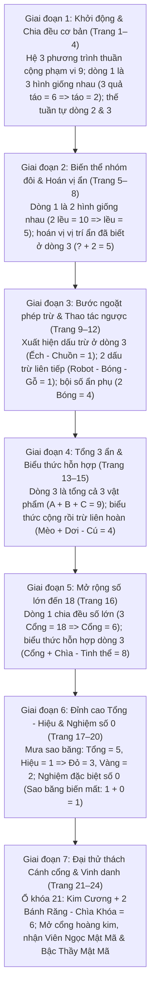

# Chặng 20: Trạm Mật Mã Cuối Cùng — Tìm Giá Trị, Thay Hình Thành Số & Mở Khóa Đại Thử Thách

## 1. Objective (Mục tiêu cốt lõi)

Tài liệu này xác lập đặc tả kỹ thuật và kiến trúc nội dung sư phạm nhằm chuyển thể trọn vẹn dữ liệu từ giáo trình PDF **"Chặng 20: Trạm Mật Mã Cuối Cùng — Tìm Giá Trị • Thay Hình Thành Số • Mở Khóa"** (`docs/montessori/extracted/chang-20/analysis.json`, nguồn: *WB20*, 24 trang, thuộc bộ giáo trình *Gấu Logic & Thỏ Quan Sát - Chuyến Tàu Toán Học*, Nhà xuất bản Dân Trí / Montessori VN) vào nền tảng **TiniMath v2**.

### 1.1 Bối Cảnh Cốt Truyện & Nhiệm Vụ Học Tập (Narrative Quest)
1. **Bối cảnh cốt truyện**: Sau chuyến hành trình dài qua 19 nhà ga đầy kỳ thú, Chuyến Tàu Toán Học đưa Gấu Logic và Thỏ Quan Sát tiến thẳng vào **Ga số 20: Trạm Mật Mã Cuối Cùng**. Tại đây sừng sững một Cánh Cổng Hoàng Kim đồ sộ phong cách Steampunk huyền bí, được niêm phong bởi **21 ổ khóa mật mã** tiền đại số hình ảnh. Phía sau cánh cổng mở hé chính là căn phòng kho báu vĩ đại lưu giữ **Viên Ngọc Mật Mã** (Cipher Gem / Mystery Code Gem) — biểu tượng tối cao cho đỉnh cao tư duy của toàn bộ chuyến tàu.
2. **Nhiệm vụ học tập (Learning Quest)**:
   - **Tư duy tiền đại số hình ảnh trực quan (Visual Pre-algebra & Substitution)**: Trẻ quan sát hệ phương trình bậc thang 3 dòng, tìm giá trị số ẩn sau các biểu tượng đồ vật quen thuộc (trái cây, nông sản, sinh vật, đồ chơi, phép thuật, vũ trụ).
   - **Quy tắc chia đều & Phép toán nghịch đảo (Equi-partitioning & Inverse Operations)**: Bắt đầu từ dòng có 2 hoặc 3 hình giống nhau để chia đều số lượng ($3x = a \implies x = a/3$), thế giá trị tuần tự vào các dòng tiếp theo, và vận dụng tư duy phép trừ ngược để tìm phần bù ($A - B = c \implies B = A - c$).
   - **Đỉnh cao suy luận Tổng - Hiệu đồng thời (Simultaneous Sum-Difference Reasoning)**: Giải quyết các hệ phương trình liên kết chặt chẽ (như Trang 16 - Mưa sao băng: Tổng = 5, Hiệu = 1 $\implies$ tìm cặp số 3 và 2), không thể giải đơn lập mà đòi hỏi tư duy phân tích tổng hợp.
   - **Nghiệm đặc biệt số 0 & Bội số lặp (Zero Property & Multipliers)**: Làm quen với trường hợp biểu tượng mang giá trị 0 ($1 + 0 = 1$ ở Trang 19) và nhóm 2 vật thể cùng loại ($2x = 6 \implies x = 3$).
   - **Đại thử thách Cánh cổng hoàng kim (Grand Finale Challenge)**: Giải mã bài toán khóa cửa phức hợp (Trang 21) để mở toang cánh cổng, nhận Viên Ngọc Mật Mã và được vinh danh danh hiệu cao quý nhất: **"BẬC THẦY MẬT MÃ"** (Trang 24).

### 1.2 Nguyên Tắc Bất Biến Về Công Nghệ & Phạm Vi
1. **Tuyệt Đối Không Tạo Game Engine Mới (`GT-038+`)**:
   - Toàn bộ cơ chế tiền đại số của Chặng 20 được tích hợp 100% vào các game engine hiện hữu:
     - `GT-010` (`substitution` / `SubstitutionSession`): Engine chủ lực chịu trách nhiệm hiển thị hệ 3 dòng phương trình biểu tượng, các ô đáp án điền giá trị số, cơ chế thế tuần tự và hiệu ứng hào quang biến hình thành số.
     - `GT-008` (`drag-to-slot` / `DragToSlotSession`): Kéo thả các thẻ số 0–9 từ khay công cụ vào các ô vuông đáp án dưới chân biểu tượng hoặc vào các ổ khóa cơ học.
     - `GT-001` (`tap-select` / `TapSelectSession`): Chạm chọn số đúng từ khay lựa chọn, hoặc thẩm định tính đúng/sai của dòng phương trình.
     - `GT-009` (`clue-deduction` / `ClueDeductionSession`): Loại trừ và tìm cặp số bí ẩn thỏa mãn 2 manh mối Tổng và Hiệu (áp dụng cho bài toán Mưa sao băng).
     - `GT-000` (`concept-intro` & `celebration-summary`): Hoạt cảnh giới thiệu Cánh Cổng Hoàng Kim (Trang 1) và Lễ tốt nghiệp trao cúp vàng Bậc Thầy Mật Mã (Trang 24).
   - **Hủy bỏ hoàn toàn dự thảo `GT-057` cũ**: Việc đề xuất tạo thêm `GT-057` trong các bản phác thảo trước bị **hủy bỏ triệt để**. Bất kỳ đề xuất tạo `GT-038+` nào đều vi phạm nghiêm ngặt giới hạn kiến trúc engine (`GT-000`..`GT-037`).
2. **Khắc Phục Lỗ Hổng 0 Montessori Level Của `WB20` Trong `packages/content`**:
   - Hiện tại, `WB20` (`WB20-D1`, `WB20-D2`, `WB20-D3`) đang có **0 level Montessori** trong database seeder.
   - Tài liệu này mở khóa nạp 14 level Montessori chất lượng cao vào các strand `C1.PROB` (`C1.PROB.06`, `C1.PROB.01`) và `C3.DED` (`C3.DED.02`, `C3.DED.03`), giải quyết triệt để tình trạng thiếu hụt nội dung của Chặng 20.
3. **Tuân Thủ Tuyệt Đối Quy Tắc Doanh Nghiệp & Sư Phạm**:
   - `BR-MCM-06`: Tuyệt đối không chứa từ khóa thương mại, bài kiểm tra tâm lý hoặc tuyên bố đo lường chỉ số trí tuệ (`raven`, `iq`, `trí tuệ`, `chỉ số thông minh`, `wisc`). Trong toàn bộ spec, title, instruction và câu thoại, sử dụng cụm từ **"Viên Ngọc Mật Mã"** và **"Bậc Thầy Mật Mã"**.
   - `BR-MGL-02`: Mọi mã level Montessori thuộc khối dành riêng từ `0101` trở lên: `GL-<COMP>-<STRAND>-<MECH>-01xx`.
   - `BR-MGL-03` & `BR-MGL-04`: Mỗi dạng bài có ít nhất 2 level khác độ khó, tăng lũy tiến một chiều (cô lập thuộc tính theo `BR-MCM-13`).
   - `BR-MGL-12`: Cấp bậc truy cập (`access_tier`) đồng bộ chặt chẽ với độ khó (`difficulty`: 1=`free`, 2=`login`, 3=`standard`, 4/5=`premium`).
   - `BR-MCM-14` & `BR-MCM-15`: Giữ trọn vẹn kiểm soát lỗi tự thân (Control of Error) và trình tự cụ thể đến trừu tượng (CPA).

---

## 2. Actors & Pedagogical Roles

| Tác nhân / Nhân vật | Vai trò hệ thống | Vai trò sư phạm & Thể hiện trong Chặng 20 |
|---|---|---|
| **Bé (Kid Player)** | Người chơi trung tâm (5–6 tuổi) | Nhập vai nhà thám hiểm nhí cùng Gấu Logic và Thỏ Quan Sát mở từng cánh cửa ma trận trong Lâu Đài Sudoku, suy luận điền các số 1–4, ghép chữ cái LION/BEAR/FISH/BOAT và xếp các hình ◯, □, △, ✕ để đoạt Viên Ngọc Ma Trận. |
| **Gấu Logic (`gau_logic`)** | Nhân vật dẫn dắt tư duy trừu tượng | Đại diện cho tư duy trật tự ma trận, quy tắc không lặp và suy luận loại trừ. Lời thoại tiêu biểu: *"Ổ khóa đầu tiên đang giấu ba con số!", "Ồ! Một dấu trừ đã xuất hiện!", "Các sao chổi đang bay thành ba nhóm bí mật!", "Có một biểu tượng mang giá trị rất đặc biệt!", "Đây là ổ khóa cuối cùng của toàn hành trình!"*. |
| **Thỏ Quan Sát (`tho_quan_sat`)** | Nhân vật kích hoạt trực giác giác quan | Đại diện cho quan sát chi tiết, quét lưới thị giác và động viên kiên trì. Lời thoại tiêu biểu: *"Bé tìm giá trị của quả táo trước nhé!", "Hai hũ mật giống nhau sẽ giúp bé bắt đầu!", "Bé thay con ếch bằng số rồi mới trừ nhé!", "Dòng 2 và dòng 3 phải được dùng cùng nhau!", "Thay hai viên pha lê bằng số rồi tìm sao băng nhé!", "Bé giải từng dòng rồi kiểm tra lại nhé!"*. |
| **Phụ huynh / Giáo viên** | Hỗ trợ ngoài màn hình | Hướng dẫn trẻ làm quen với các tấm thẻ bìa số 1–4 hoặc 4 nắp chai khác màu xếp trên lưới ô vuông kẻ trên giấy theo triết lý Montessori. |
| **Content Seeder Engine** | Hệ thống nạp tự động | Chuyển hóa các `SkillLevelPlan[]` thành `ContentSeed` cho DB, xác thực qua `montessori-gate.ts`. |

---

## 3. Entry Points & File Mapping

```
docs/montessori/extracted/chang-20/analysis.json (24 trang, WB20)
   │
   ├──> docs/montessori/dataset/activity-types-table.md
   │       └── Cập nhật WB20-D1, WB20-D2, WB20-D3, bổ sung WB20-D4 (Dùng GT-010, GT-008, GT-001, GT-009; loại bỏ GT-057)
   │
   ├──> docs/specs/05-content/montessori-corpus-mapping.md
   │       └── Đồng bộ hàng Workbook 20 (C1.PROB · C3.DED) và ghi nhận nạp 14 level Montessori cho C1.PROB và C3.DED
   │
   ├──> packages/content/src/skills/c1/prob/
   │       ├── C1.PROB.06.ts (Suy luận số / Tiền đại số hình ảnh -> GT-010: 6 levels GL-C1-PROB-SUB-0101..0106)
   │       └── C1.PROB.01.ts (Chọn cách giải / Chiến lược giải toán -> GT-008, GT-001: 4 levels GL-C1-PROB-SLOT-0101, GL-C1-PROB-TAP-0102, GL-C1-PROB-SLOT-0103..0104)
   │
   └──> packages/content/src/skills/c3/ded/
           ├── C3.DED.02.ts (Nếu... thì... / Suy luận Tổng - Hiệu -> GT-009, GT-010: 2 levels GL-C3-DED-CLUE-0101, GL-C3-DED-SUB-0102)
           └── C3.DED.03.ts (Quy trình giải nhiều bước / Capstone Finale -> GT-008, GT-010: 2 levels GL-C3-DED-SLOT-0103, GL-C3-DED-SUB-0104)
```

---

## 4. Pedagogical Deconstruction: Tiến Trình 24 Trang PDF Chặng 20

Tiến trình sư phạm trong Chặng 20 được thiết kế theo hình thang 7 giai đoạn nhận thức tăng tiến (CPA - Concrete to Abstract):



---

## 5. Phân Tích Chi Tiết 5 Nhóm Dạng Bài & Ánh Xạ Game Engine Hiện Hữu

### 5.1 `WB20-D1`: Hệ Phương Trình Hình Ảnh Tuần Tự Thuần Phép Cộng (Trang 1–8, Ổ Khóa 1–8)
- **Tên bài học**: *Hệ Phương Trình Bậc Thang Thuần Phép Cộng*.
- **Vị trí PDF**: Trang 2 đến Trang 9 (Ổ khóa 1 đến 8).
- **Mục tiêu sư phạm**:
  - Trẻ nhận biết nguyên lý cơ bản của tiền đại số: Một biểu tượng hình ảnh đại diện cho một giá trị số cố định trong toàn bộ hệ thống.
  - Phép chia đều trực quan (Equi-partitioning via repeated addition): Bắt đầu từ dòng có các hình giống nhau ($3x = a \implies x = a/3$ hoặc $2x = a \implies x = a/2$).
  - Chuỗi thế tuần tự 2 bước: Lấy giá trị vừa tìm được của hình thứ nhất thế vào dòng 2 để tìm hình thứ hai ($x + y = b \implies y = b - x$); lấy hình thứ hai thế vào dòng 3 để tìm hình thứ ba ($y + z = c \implies z = c - y$).
  - Hoán vị vị trí ẩn ở dòng 3 (Trang 6): Hình đã biết đứng sau dấu cộng ($z + y = c$), rèn luyện tính giao hoán và tìm số hạng thứ nhất.
- **Thế giới hình ảnh (Visual Themes)**:
  - Trái cây vườn: Táo đỏ 🍎 (2), Lê xanh 🍐 (3), Dâu tây 🍓 (1).
  - Nông sản: Cà rốt 🥕 (3), Bắp ngô 🌽 (2), Đậu Hà Lan 🫛 (1).
  - Tổ ong: Hũ mật 🍯 (2), Chú ong 🐝 (3), Hoa cúc 🌼 (1).
  - Tiệm bánh: Cupcake 🧁 (3), Donut 🍩 (2), Bánh quy 🍪 (1).
  - Lễ hội gió: Bóng bay 🎈 (4), Con diều 🪁 (2), Chong chóng 🪅 (3).
  - Hộp học cụ: Bút chì ✏️ (3), Cục tẩy 🧼 (2), Thước kẻ 📏 (4).
  - Trạm cắm trại: Chiếc lều ⛺ (5), Đèn bão 🏮 (2), Ba lô 🎒 (3).
  - Rừng hạt dẻ: Hạt dẻ 🌰 (3), Cây nấm 🍄 (2), Lá sồi 🍃 (1).
- **Cơ chế tương tác số hóa (GT-010, GT-008, GT-001)**:
  - `GT-010` (`substitution`): Hiển thị bảng 3 dòng phương trình. Ô dòng 1 phát sáng trước; khi trẻ chọn đúng thẻ số 2, cả 3 quả táo trên màn hình tự động biến đổi thành thẻ số 2 phát ánh hào quang kèm SFX "ting!". Dòng 2 tự động mở khóa.
  - `GT-008` (`drag-to-slot`): Kéo thả các thẻ số từ khay số 0–9 vào 3 ô vuông đáp án dưới chân biểu tượng.
  - `GT-001` (`tap-select`): Chạm chọn số đúng từ 3 phương án gợi ý cho trẻ mới bắt đầu.
- **Kỹ năng liên kết**: `C1.PROB.06`, `C1.PROB.01`, `C1.ADD.04`, `C1.ADD.05`.

---

### 5.2 `WB20-D2`: Hệ Phương Trình Kết Hợp Phép Trừ Ở Dòng Cuối (Trang 9–12, 14–15, Ổ Khóa 9–12, 14–15)
- **Tên bài học**: *Thay Hình Bằng Số & Thao Tác Phép Tính Ngược*.
- **Vị trí PDF**: Trang 10 đến 13, 15, 16 (Ổ khóa 9, 10, 11, 12, 14, 15).
- **Mục tiêu sư phạm**:
  - Bước ngoặt nhận thức quan trọng: Chuyển đổi từ phép cộng dồn thuận sang phép trừ và phép tính ngược (Inverse Operations).
  - Tìm số trừ trong phép tính: Ở dòng 3 xuất hiện dấu trừ ($A - B = c \implies B = A - c$). Trẻ phải thế $A$ đã biết rồi tư duy: "Số nào lấy đi từ $A$ để còn lại $c$?".
  - Xử lý biểu thức đa dấu và thứ tự thực hiện:
    - 2 dấu trừ liên tiếp (Trang 11): $A - B - C = c \implies (A - B) - C = c \implies C = (A - B) - c$.
    - Cộng rồi trừ liên hoàn (Trang 15): $A + C - B = c \implies C = c + B - A$.
  - Mở rộng số lớn đến 18 (Trang 16): 3 Cổng ma thuật = 18 $\implies$ Cổng = 6.
- **Thế giới hình ảnh (Visual Themes)**:
  - Hồ sen: Hoa sen 🪷 (4), Chú ếch 🐸 (2), Chuồn chuồn 🦗 (1) [$2 - 1 = 1$].
  - Xưởng đồ chơi: Robot 🤖 (4), Quả bóng ⚽ (2), Khối gỗ 🪵 (1) [$4 - 2 - 1 = 1$].
  - Lễ hội bí ngô: Bí ngô 🎃 (3), Chú ma 👻 (2), Kẹo tím 🍬 (1) [$2 + 2 - 1 = 3$].
  - Phòng phép thuật: Mũ phù thủy 🧙 (4), Trăng khuyết 🌙 (3), Ngôi sao ⭐ (1) [$3 - 1 = 2$].
  - Đội tuần tra đêm: Mèo xám 🐱 (5), Cú mèo 🦉 (3), Con dơi 🦇 (2) [$5 + 2 - 3 = 4$].
  - Cổng dịch chuyển: Cổng ma thuật 🌀 (6), Tinh thể pha lê 💎 (2), Chìa khóa vàng 🗝️ (4) [$6 + 4 - 2 = 8$].
- **Cơ chế tương tác số hóa (GT-010, GT-008, GT-001)**:
  - `GT-010` (`substitution`): Dấu trừ ở dòng 3 được viền nhấp nháy màu hổ phách nhẹ (`amber_soft`) để cảnh báo thị giác cho trẻ, tránh thói quen quán tính thực hiện phép cộng.
  - `GT-008` (`drag-to-slot`): Kéo số vào ô giá trị tương ứng.
  - `GT-001` (`tap-select`): Chạm chọn kết quả phép tính ngược.
- **Kỹ năng liên kết**: `C1.PROB.06`, `C1.SUB.03`, `C1.SUB.04`, `C1.SUB.05`, `C3.DED.02`.

---

### 5.3 `WB20-D3`: Hệ Phương Trình Đa Ẩn Kết Hợp Quan Hệ Tổng - Hiệu & Tổng 3 Ẩn (Trang 13, 16, 18, Ổ Khóa 13, 16, 18)
- **Tên bài học**: *Đại Số Đồng Thời: Bài Toán Tổng - Hiệu & Tổng Ba Ẩn*.
- **Vị trí PDF**: Trang 14, 17, 19 (Ổ khóa 13, 16, 18).
- **Mục tiêu sư phạm**:
  - Dạng bài tổng 3 ẩn (Trang 14 & 19): Dòng 3 là tổng của cả 3 vật phẩm ($A + B + C = \text{total}$). Trẻ phải gộp 2 số đã biết ($A + B$) rồi tìm phần bù $C = \text{total} - (A + B)$.
  - Đỉnh cao tư duy toán logic (Trang 17 - Mưa sao băng):
    - Dòng 1: 3 Sao xanh = 12 $\implies$ Sao xanh = 4.
    - Dòng 2: 4 + Sao đỏ + Sao vàng = 9 $\implies$ Sao đỏ + Sao vàng = 5 (Tổng = 5).
    - Dòng 3: Sao đỏ - Sao vàng = 1 (Hiệu = 1).
    - Dòng 2 và 3 liên kết đồng thời, không thể giải riêng lẻ! Trẻ phải phân rã số 5 thành các cặp số (4+1, 3+2) và kiểm tra hiệu: $3 - 2 = 1$ thỏa mãn $\implies$ Sao đỏ = 3, Sao vàng = 2.
- **Thế giới hình ảnh (Visual Themes)**:
  - Bữa tiệc ánh trăng: Bánh kem 🎂 (4), Bánh quy 🍪 (2), Lọ thuốc phép 🧪 (3) [$4 + 2 + 3 = 9$].
  - Mưa sao băng: Sao xanh lam ☄️ (4), Sao đỏ ☄️ (3), Sao vàng ☄️ (2) [Tổng 5, Hiệu 1].
  - Trạm tàu vũ trụ: Tàu con thoi 🛸 (5), Tên lửa 🚀 (4), Vệ tinh 🛰️ (3) [$4 + 3 + 5 = 12$].
- **Cơ chế tương tác số hóa (GT-010, GT-009, GT-008)**:
  - `GT-010` (`substitution`): Hỗ trợ giải hệ phương trình 2 ẩn đồng thời.
  - `GT-009` (`clue-deduction`): Bảng loại trừ 2 manh mối (Manh mối 1: Tổng bằng 5; Manh mối 2: Hiệu bằng 1) giúp trẻ loại trừ cặp (4, 1) để chọn cặp (3, 2).
  - `GT-008` (`drag-to-slot`): Kéo thả các số [4], [3], [2] vào 3 vệt sao băng.
- **Kỹ năng liên kết**: `C3.DED.02`, `C3.DED.03`, `C1.PROB.01`, `C1.NCOMP.12`.

---

### 5.4 `WB20-D4`: Giải Mã Phương Trình Có Nghiệm 0 & Bội Số Ẩn Kép (Trang 17, 19, 20, 21, Ổ Khóa 17, 19, 20, 21)
- **Tên bài học**: *Nghiệm Số 0 Đặc Biệt & Ổ Khóa Đại Thử Thách*.
- **Vị trí PDF**: Trang 18, 20, 21, 22 (Ổ khóa 17, 19, 20, 21).
- **Mục tiêu sư phạm**:
  - Khám phá nghiệm đặc biệt số 0 (Trang 20 - Sao băng biến mất):
    - Dòng 1: 2 Pha lê lam = 8 $\implies$ Pha lê lam = 4.
    - Dòng 2: Pha lê tím + 4 = 9 $\implies$ Pha lê tím = 5.
    - Dòng 3: $5 + \text{Sao băng} - 4 = 1 \implies 1 + \text{Sao băng} = 1 \implies \text{Sao băng} = 0$!
    - Giúp trẻ nhận thức số 0 là phần tử trung hòa trong phép toán cộng ($x + 0 = x$), phá vỡ định kiến cho rằng biểu tượng đồ vật luôn phải mang giá trị $\ge 1$.
  - Bội số ẩn lặp (Trang 21 & 22): Xuất hiện 2 vật thể giống nhau trong cùng một dòng:
    - 2 Bánh răng = 6 $\implies$ Bánh răng = 3 (Trang 22).
    - 2 Mặt Trăng = 8 $\implies$ Mặt Trăng = 4 (Trang 21).
  - Đại thử thách cuối cùng (Trang 22 - Ổ khóa 21): Câu đố trên cánh cổng trang bìa:
    - 3 Kim cương vàng = 15 $\implies$ Kim cương = 5.
    - Kim cương (5) + 2 Bánh răng = 11 $\implies$ 2 Bánh răng = 6 $\implies$ Bánh răng = 3.
    - Kim cương (5) + Bánh răng (3) - Chìa khóa = 6 $\implies 8 - \text{Chìa khóa} = 6 \implies \text{Chìa khóa} = 2$.
- **Thế giới hình ảnh (Visual Themes)**:
  - Hành tinh vũ trụ: Trái Đất 🌍 (3), Sao Thổ 🪐 (4), Sao Hỏa 🔴 (5).
  - Kho báu pha lê: Pha lê lam 💎 (4), Pha lê tím 💎 (5), Sao băng biến mất ☄️ (0).
  - Vũ trụ ánh sáng: Mặt Trời ☀️ (6), Mặt Trăng 🌙 (4), Ngôi sao ⭐ (2).
  - Cánh cổng hoàng kim: Kim cương vàng 💎 (5), Bánh răng ⚙️ (3), Chìa khóa cổ 🗝️ (2).
- **Cơ chế tương tác số hóa (GT-010, GT-008, GT-001)**:
  - `GT-010` (`substitution`): Giải mã hệ có nghiệm 0 và hệ số lặp.
  - `GT-008` (`drag-to-slot`): Kéo thẻ số 0 hoặc các chữ số vào ô khóa tương ứng. Khi giải đúng ổ khóa 21, hoạt cảnh chìa khóa vàng tự động tra vào ổ khóa trung tâm, phát âm thanh cơ khí cạch-mở hoành tráng.
- **Kỹ năng liên kết**: `C1.PROB.06`, `C1.PROB.01`, `C3.DED.02`, `C3.DED.03`.

---

### 5.5 `WB20-D5`: Lễ Tốt Nghiệp & Bậc Thầy Mật Mã (Trang 24, Mốc Son Chuyến Tàu)
- **Tên bài học**: *Vinh Danh Bậc Thầy Mật Mã & Mở Viên Ngọc Mật Mã*.
- **Vị trí PDF**: Trang 24 (Sách: Trang 23).
- **Mục tiêu sư phạm**:
  - Màn hình thành tựu cao nhất (Milestone Capstone Achievement) đánh dấu hoàn thành toàn bộ 20 chặng của bộ sách.
  - Củng cố tâm lý tự hào và sự tự tin toán học (Intrinsic motivation & Mathematical mastery).
  - Trẻ điểm lại dải 20 trạm ga tích xanh trọn vẹn, chiêm ngưỡng Cánh cổng hoàng kim mở toang hé lộ Viên Ngọc Mật Mã phát sáng bồng bềnh, và nhận cúp vàng danh hiệu "BẬC THẦY MẬT MÃ".
- **Cơ chế tương tác số hóa (GT-000)**:
  - `GT-000` (`celebration-summary`): Hoạt cảnh Canvas 2D pháo hoa hạt nhẹ nhàng, hiển thị 3 ngôi sao xuất sắc và huy hiệu Bậc Thầy Mật Mã. Chạm vào viên ngọc để nghe lời chúc mừng tốt nghiệp từ Gấu Logic và Thỏ Quan Sát.

---

## 6. Thiết Kế SkillDataset: `CHANG_20_CIPHER_STATION_DATASET`

Bộ dữ liệu này được thiết kế đưa vào seeder của các kỹ năng `C1.PROB.06`, `C1.PROB.01`, `C3.DED.02`, `C3.DED.03`, kế thừa toàn bộ hình ảnh, vật phẩm và câu thoại từ PDF Chặng 20:

### 6.1 Danh Sách Items (Biểu tượng mật mã 20 chặng)

```typescript
export const CHANG_20_CIPHER_STATION_ITEMS = [
  // 1. Nhóm Trái cây & Nông sản vườn
  {
    id: "cp20-apple-red",
    label: "quả táo đỏ",
    value: 2,
    image: { kind: "emoji", ref: "🍎" },
    ordering: 1,
    contrast_group: "orchard",
    category: { type: "trái cây", theme: "farm" },
  },
  {
    id: "cp20-pear-green",
    label: "quả lê xanh",
    value: 3,
    image: { kind: "emoji", ref: "🍐" },
    ordering: 2,
    contrast_group: "orchard",
    category: { type: "trái cây", theme: "farm" },
  },
  {
    id: "cp20-strawberry",
    label: "quả dâu tây",
    value: 1,
    image: { kind: "emoji", ref: "🍓" },
    ordering: 3,
    contrast_group: "orchard",
    category: { type: "trái cây", theme: "farm" },
  },
  {
    id: "cp20-carrot",
    label: "củ cà rốt",
    value: 3,
    image: { kind: "emoji", ref: "🥕" },
    ordering: 4,
    contrast_group: "orchard",
    category: { type: "nông sản", theme: "farm" },
  },
  {
    id: "cp20-corn",
    label: "bắp ngô vàng",
    value: 2,
    image: { kind: "emoji", ref: "🌽" },
    ordering: 5,
    contrast_group: "orchard",
    category: { type: "nông sản", theme: "farm" },
  },
  {
    id: "cp20-pea-pod",
    label: "quả đậu Hà Lan",
    value: 1,
    image: { kind: "emoji", ref: "🫛" },
    ordering: 6,
    contrast_group: "orchard",
    category: { type: "nông sản", theme: "farm" },
  },

  // 2. Nhóm Tổ ong & Tiệm bánh
  {
    id: "cp20-honey-jar",
    label: "hũ mật ong",
    value: 2,
    image: { kind: "emoji", ref: "🍯" },
    ordering: 7,
    contrast_group: "bakery_bee",
    category: { type: "thực phẩm", theme: "nature" },
  },
  {
    id: "cp20-bee",
    label: "chú ong vàng",
    value: 3,
    image: { kind: "emoji", ref: "🐝" },
    ordering: 8,
    contrast_group: "bakery_bee",
    category: { type: "sinh vật", theme: "nature" },
  },
  {
    id: "cp20-daisy",
    label: "bông hoa cúc",
    value: 1,
    image: { kind: "emoji", ref: "🌼" },
    ordering: 9,
    contrast_group: "bakery_bee",
    category: { type: "thực vật", theme: "nature" },
  },
  {
    id: "cp20-cupcake",
    label: "bánh cupcake hồng",
    value: 3,
    image: { kind: "emoji", ref: "🧁" },
    ordering: 10,
    contrast_group: "bakery_bee",
    category: { type: "bánh ngọt", theme: "food" },
  },
  {
    id: "cp20-donut",
    label: "bánh donut sô-cô-la",
    value: 2,
    image: { kind: "emoji", ref: "🍩" },
    ordering: 11,
    contrast_group: "bakery_bee",
    category: { type: "bánh ngọt", theme: "food" },
  },
  {
    id: "cp20-cookie",
    label: "bánh quy tròn",
    value: 1,
    image: { kind: "emoji", ref: "🍪" },
    ordering: 12,
    contrast_group: "bakery_bee",
    category: { type: "bánh ngọt", theme: "food" },
  },

  // 3. Nhóm Lễ hội gió & Học cụ
  {
    id: "cp20-balloon-red",
    label: "quả bóng bay đỏ",
    value: 4,
    image: { kind: "emoji", ref: "🎈" },
    ordering: 13,
    contrast_group: "festival",
    category: { type: "đồ chơi", theme: "festival" },
  },
  {
    id: "cp20-kite",
    label: "con diều sắc màu",
    value: 2,
    image: { kind: "emoji", ref: "🪁" },
    ordering: 14,
    contrast_group: "festival",
    category: { type: "đồ chơi", theme: "festival" },
  },
  {
    id: "cp20-pinwheel",
    label: "chong chóng gió",
    value: 3,
    image: { kind: "emoji", ref: "🪅" },
    ordering: 15,
    contrast_group: "festival",
    category: { type: "đồ chơi", theme: "festival" },
  },
  {
    id: "cp20-pencil",
    label: "chiếc bút chì vàng",
    value: 3,
    image: { kind: "emoji", ref: "✏️" },
    ordering: 16,
    contrast_group: "school",
    category: { type: "học cụ", theme: "stationery" },
  },
  {
    id: "cp20-eraser",
    label: "cục tẩy xanh",
    value: 2,
    image: { kind: "emoji", ref: "🧼" },
    ordering: 17,
    contrast_group: "school",
    category: { type: "học cụ", theme: "stationery" },
  },
  {
    id: "cp20-ruler",
    label: "thước kẻ vạch",
    value: 4,
    image: { kind: "emoji", ref: "📏" },
    ordering: 18,
    contrast_group: "school",
    category: { type: "học cụ", theme: "stationery" },
  },

  // 4. Nhóm Cắm trại & Rừng hạt dẻ
  {
    id: "cp20-tent",
    label: "chiếc lều du lịch",
    value: 5,
    image: { kind: "emoji", ref: "⛺" },
    ordering: 19,
    contrast_group: "camp_forest",
    category: { type: "cắm trại", theme: "camp" },
  },
  {
    id: "cp20-lantern",
    label: "chiếc đèn bão",
    value: 2,
    image: { kind: "emoji", ref: "🏮" },
    ordering: 20,
    contrast_group: "camp_forest",
    category: { type: "cắm trại", theme: "camp" },
  },
  {
    id: "cp20-backpack",
    label: "chiếc ba lô",
    value: 3,
    image: { kind: "emoji", ref: "🎒" },
    ordering: 21,
    contrast_group: "camp_forest",
    category: { type: "cắm trại", theme: "camp" },
  },
  {
    id: "cp20-chestnut",
    label: "hạt dẻ nâu",
    value: 3,
    image: { kind: "emoji", ref: "🌰" },
    ordering: 22,
    contrast_group: "camp_forest",
    category: { type: "nông sản", theme: "forest" },
  },
  {
    id: "cp20-mushroom",
    label: "cây nấm đỏ",
    value: 2,
    image: { kind: "emoji", ref: "🍄" },
    ordering: 23,
    contrast_group: "camp_forest",
    category: { type: "thực vật", theme: "forest" },
  },
  {
    id: "cp20-oak-leaf",
    label: "chiếc lá sồi",
    value: 1,
    image: { kind: "emoji", ref: "🍃" },
    ordering: 24,
    contrast_group: "camp_forest",
    category: { type: "thực vật", theme: "forest" },
  },

  // 5. Nhóm Sinh vật & Đồ chơi phép thuật
  {
    id: "cp20-lotus",
    label: "hoa sen hồng",
    value: 4,
    image: { kind: "emoji", ref: "🪷" },
    ordering: 25,
    contrast_group: "magic_creatures",
    category: { type: "thực vật", theme: "pond" },
  },
  {
    id: "cp20-frog",
    label: "chú ếch xanh",
    value: 2,
    image: { kind: "emoji", ref: "🐸" },
    ordering: 26,
    contrast_group: "magic_creatures",
    category: { type: "sinh vật", theme: "pond" },
  },
  {
    id: "cp20-dragonfly",
    label: "con chuồn chuồn",
    value: 1,
    image: { kind: "emoji", ref: "🦗" },
    ordering: 27,
    contrast_group: "magic_creatures",
    category: { type: "sinh vật", theme: "pond" },
  },
  {
    id: "cp20-robot",
    label: "người máy robot",
    value: 4,
    image: { kind: "emoji", ref: "🤖" },
    ordering: 28,
    contrast_group: "magic_creatures",
    category: { type: "đồ chơi", theme: "workshop" },
  },
  {
    id: "cp20-beach-ball",
    label: "quả bóng bãi biển",
    value: 2,
    image: { kind: "emoji", ref: "⚽" },
    ordering: 29,
    contrast_group: "magic_creatures",
    category: { type: "đồ chơi", theme: "workshop" },
  },
  {
    id: "cp20-wood-block",
    label: "khối gỗ lập phương",
    value: 1,
    image: { kind: "emoji", ref: "🪵" },
    ordering: 30,
    contrast_group: "magic_creatures",
    category: { type: "đồ chơi", theme: "workshop" },
  },
  {
    id: "cp20-pumpkin",
    label: "quả bí ngô",
    value: 3,
    image: { kind: "emoji", ref: "🎃" },
    ordering: 31,
    contrast_group: "magic_creatures",
    category: { type: "lễ hội", theme: "magic" },
  },
  {
    id: "cp20-ghost",
    label: "chú ma trắng",
    value: 2,
    image: { kind: "emoji", ref: "👻" },
    ordering: 32,
    contrast_group: "magic_creatures",
    category: { type: "lễ hội", theme: "magic" },
  },
  {
    id: "cp20-candy",
    label: "viên kẹo tím",
    value: 1,
    image: { kind: "emoji", ref: "🍬" },
    ordering: 33,
    contrast_group: "magic_creatures",
    category: { type: "lễ hội", theme: "magic" },
  },
  {
    id: "cp20-wizard-hat",
    label: "mũ phù thủy tím",
    value: 4,
    image: { kind: "emoji", ref: "🧙" },
    ordering: 34,
    contrast_group: "magic_creatures",
    category: { type: "phép thuật", theme: "magic" },
  },
  {
    id: "cp20-crescent-moon",
    label: "vầng trăng khuyết",
    value: 3,
    image: { kind: "emoji", ref: "🌙" },
    ordering: 35,
    contrast_group: "magic_creatures",
    category: { type: "thiên văn", theme: "magic" },
  },
  {
    id: "cp20-star-yellow",
    label: "ngôi sao vàng",
    value: 1,
    image: { kind: "emoji", ref: "⭐" },
    ordering: 36,
    contrast_group: "magic_creatures",
    category: { type: "thiên văn", theme: "magic" },
  },

  // 6. Nhóm Vũ trụ & Mật mã hoàng kim
  {
    id: "cp20-cat-grey",
    label: "mèo xám tuần tra",
    value: 5,
    image: { kind: "emoji", ref: "🐱" },
    ordering: 37,
    contrast_group: "night_patrol",
    category: { type: "sinh vật", theme: "night" },
  },
  {
    id: "cp20-owl",
    label: "chim cú mèo",
    value: 3,
    image: { kind: "emoji", ref: "🦉" },
    ordering: 38,
    contrast_group: "night_patrol",
    category: { type: "sinh vật", theme: "night" },
  },
  {
    id: "cp20-bat",
    label: "con dơi cánh đen",
    value: 2,
    image: { kind: "emoji", ref: "🦇" },
    ordering: 39,
    contrast_group: "night_patrol",
    category: { type: "sinh vật", theme: "night" },
  },
  {
    id: "cp20-portal",
    label: "cổng ma thuật dịch chuyển",
    value: 6,
    image: { kind: "emoji", ref: "🌀" },
    ordering: 40,
    contrast_group: "space_portal",
    category: { type: "cổng dịch chuyển", theme: "space" },
  },
  {
    id: "cp20-crystal-blue",
    label: "tinh thể pha lê lam",
    value: 2,
    image: { kind: "emoji", ref: "💎" },
    ordering: 41,
    contrast_group: "space_portal",
    category: { type: "kho báu", theme: "space" },
  },
  {
    id: "cp20-key-gold",
    label: "chìa khóa vàng cổ",
    value: 4,
    image: { kind: "emoji", ref: "🗝️" },
    ordering: 42,
    contrast_group: "space_portal",
    category: { type: "kho báu", theme: "space" },
  },
  {
    id: "cp20-comet-blue",
    label: "sao chổi xanh lam",
    value: 4,
    image: { kind: "emoji", ref: "☄️" },
    ordering: 43,
    contrast_group: "meteor_shower",
    category: { type: "sao chổi", theme: "space" },
  },
  {
    id: "cp20-comet-red",
    label: "sao chổi đỏ rực",
    value: 3,
    image: { kind: "emoji", ref: "☄️" },
    ordering: 44,
    contrast_group: "meteor_shower",
    category: { type: "sao chổi", theme: "space" },
  },
  {
    id: "cp20-comet-gold",
    label: "sao chổi vàng sáng",
    value: 2,
    image: { kind: "emoji", ref: "☄️" },
    ordering: 45,
    contrast_group: "meteor_shower",
    category: { type: "sao chổi", theme: "space" },
  },
  {
    id: "cp20-comet-zero",
    label: "sao băng biến mất (nghiệm 0)",
    value: 0,
    image: { kind: "emoji", ref: "🌠" },
    ordering: 46,
    contrast_group: "meteor_shower",
    category: { type: "sao chổi", theme: "space", special_zero: true },
  },
  {
    id: "cp20-gear-gold",
    label: "bánh răng máy móc vàng",
    value: 3,
    image: { kind: "emoji", ref: "⚙️" },
    ordering: 47,
    contrast_group: "steampunk_gate",
    category: { type: "cơ khí", theme: "steampunk" },
  },
  {
    id: "cp20-diamond-gold",
    label: "kim cương vàng hoàng gia",
    value: 5,
    image: { kind: "emoji", ref: "💎" },
    ordering: 48,
    contrast_group: "steampunk_gate",
    category: { type: "kho báu", theme: "steampunk" },
  },
  {
    id: "cp20-sun",
    label: "mặt trời rực rỡ",
    value: 6,
    image: { kind: "emoji", ref: "☀️" },
    ordering: 49,
    contrast_group: "solar_system",
    category: { type: "thiên văn", theme: "space" },
  },
];
```

---

## 7. Thiết Kế SkillLevelPlan[]: 14 Montessori Levels

### 7.1 Phân Bổ Vào `packages/content/src/skills/c1/prob/C1.PROB.06.ts` (Suy Luận Số / Tiền Đại Số Hình Ảnh)

```typescript
// 6 Montessori Levels cho C1.PROB.06
export const CHANG_20_C1_PROB_06_LEVELS: SkillLevelPlan[] = [
  {
    code: "GL-C1-PROB-SUB-0101",
    template: "GT-010",
    band: "5-6",
    difficulty: 1,
    access_tier: "free",
    theme: "farm",
    rounds: 3,
    montessori_ref: "WB20-D1",
  },
  {
    code: "GL-C1-PROB-SUB-0102",
    template: "GT-010",
    band: "5-6",
    difficulty: 2,
    access_tier: "login",
    theme: "nature",
    rounds: 3,
    montessori_ref: "WB20-D1",
  },
  {
    code: "GL-C1-PROB-SUB-0103",
    template: "GT-010",
    band: "5-6",
    difficulty: 3,
    access_tier: "standard",
    theme: "food",
    rounds: 3,
    montessori_ref: "WB20-D2",
  },
  {
    code: "GL-C1-PROB-SUB-0104",
    template: "GT-010",
    band: "5-6",
    difficulty: 4,
    access_tier: "premium",
    theme: "workshop",
    rounds: 3,
    montessori_ref: "WB20-D2",
  },
  {
    code: "GL-C1-PROB-SUB-0105",
    template: "GT-010",
    band: "5-6",
    difficulty: 4,
    access_tier: "premium",
    theme: "space",
    rounds: 3,
    montessori_ref: "WB20-D4",
  },
  {
    code: "GL-C1-PROB-SUB-0106",
    template: "GT-010",
    band: "5-6",
    difficulty: 5,
    access_tier: "premium",
    theme: "steampunk",
    rounds: 3,
    montessori_ref: "WB20-D4",
  },
];
```

*Mô tả chi tiết từng level*:
1. `GL-C1-PROB-SUB-0101` (`GT-010`, diff 1, `free`, `WB20-D1`): Hệ phương trình thuần cộng phạm vi 6 (Táo + Lê + Dâu). Dòng 1 gồm 3 quả táo = 6 $\implies$ Táo = 2. Dòng 2: Táo (2) + Lê = 5 $\implies$ Lê = 3. Dòng 3: Lê (3) + Dâu = 4 $\implies$ Dâu = 1. Trẻ điền số vào 3 ô quả.
2. `GL-C1-PROB-SUB-0102` (`GT-010`, diff 2, `login`, `WB20-D1`): Hệ phương trình mở rộng phạm vi 10 và hoán vị vị trí ẩn ở dòng 3 (Trạm cắm trại: 2 Lều = 10 $\implies$ Lều = 5; Lều + Đèn bão = 7 $\implies$ Đèn = 2; Ba lô + Đèn (2) = 5 $\implies$ Ba lô = 3).
3. `GL-C1-PROB-SUB-0103` (`GT-010`, diff 3, `standard`, `WB20-D2`): Xuất hiện phép trừ ở dòng 3 (Hồ sen: 2 Sen = 8 $\implies$ Sen = 4; Sen + Ếch = 6 $\implies$ Ếch = 2; Ếch (2) - Chuồn chuồn = 1 $\implies$ Chuồn chuồn = 1).
4. `GL-C1-PROB-SUB-0104` (`GT-010`, diff 4, `premium`, `WB20-D2`): Hệ có 2 dấu trừ liên tiếp và bội số ẩn phụ (Xưởng đồ chơi: 3 Robot = 12 $\implies$ Robot = 4; Robot (4) + 2 Bóng = 8 $\implies$ Bóng = 2; Robot (4) - Bóng (2) - Gỗ = 1 $\implies$ Gỗ = 1).
5. `GL-C1-PROB-SUB-0105` (`GT-010`, diff 4, `premium`, `WB20-D4`): Nghiệm đặc biệt số 0 (Kho báu pha lê: 2 Pha lê lam = 8 $\implies$ 4; Pha lê tím + 4 = 9 $\implies$ 5; Pha lê tím (5) + Sao băng - Pha lê lam (4) = 1 $\implies 1 + \text{Sao băng} = 1 \implies \text{Sao băng} = 0$).
6. `GL-C1-PROB-SUB-0106` (`GT-010`, diff 5, `premium`, `WB20-D4`): Đại thử thách Cánh cổng hoàng kim (3 Kim cương = 15 $\implies$ 5; Kim cương (5) + 2 Bánh răng = 11 $\implies$ Bánh răng = 3; Kim cương (5) + Bánh răng (3) - Chìa khóa = 6 $\implies$ Chìa khóa = 2). Mở toang cánh cổng cuối cùng.

---

### 7.2 Phân Bổ Vào `packages/content/src/skills/c1/prob/C1.PROB.01.ts` (Chọn Cách Giải / Chiến Lược Giải Toán Nhiều Bước)

```typescript
// 4 Montessori Levels cho C1.PROB.01
export const CHANG_20_C1_PROB_01_LEVELS: SkillLevelPlan[] = [
  {
    code: "GL-C1-PROB-SLOT-0101",
    template: "GT-008",
    band: "5-6",
    difficulty: 2,
    access_tier: "login",
    theme: "farm",
    rounds: 3,
    montessori_ref: "WB20-D1",
  },
  {
    code: "GL-C1-PROB-TAP-0102",
    template: "GT-001",
    band: "5-6",
    difficulty: 3,
    access_tier: "standard",
    theme: "magic",
    rounds: 3,
    montessori_ref: "WB20-D2",
  },
  {
    code: "GL-C1-PROB-SLOT-0103",
    template: "GT-008",
    band: "5-6",
    difficulty: 3,
    access_tier: "standard",
    theme: "night",
    rounds: 3,
    montessori_ref: "WB20-D3",
  },
  {
    code: "GL-C1-PROB-SLOT-0104",
    template: "GT-008",
    band: "5-6",
    difficulty: 4,
    access_tier: "premium",
    theme: "space",
    rounds: 3,
    montessori_ref: "WB20-D4",
  },
];
```

*Mô tả chi tiết từng level*:
1. `GL-C1-PROB-SLOT-0101` (`GT-008`, diff 2, `login`, `WB20-D1`): Kéo thả các thẻ số 1, 2, 3 từ khay số vào 3 ô vuông dưới chân Cà rốt (3), Bắp ngô (2) và Đậu Hà Lan (1).
2. `GL-C1-PROB-TAP-0102` (`GT-001`, diff 3, `standard`, `WB20-D2`): Phòng phép thuật (Mũ = 4, Trăng = 3, Sao = 1). Chạm chọn số đúng điền vào vị trí dấu hỏi chấm ở dòng trừ $3 - ? = 2$ từ 3 thẻ số gợi ý: [1, 2, 3].
3. `GL-C1-PROB-SLOT-0103` (`GT-008`, diff 3, `standard`, `WB20-D3`): Bữa tiệc ánh trăng tổng 3 ẩn (Bánh kem + Bánh quy + Lọ phép = 9). Kéo thả các thẻ số [4], [2], [3] vào 3 đĩa tiệc trên bàn.
4. `GL-C1-PROB-SLOT-0104` (`GT-008`, diff 4, `premium`, `WB20-D4`): Vũ trụ ánh sáng (Mặt Trời = 6, Mặt Trăng = 4, Ngôi sao = 2). Kéo thả thẻ số vào ổ khóa có 2 Mặt Trăng lặp ($4 + 4 - ? = 6$).

---

### 7.3 Phân Bổ Vào `packages/content/src/skills/c3/ded/C3.DED.02.ts` (Nếu... Thì... / Suy Luận Tổng - Hiệu)

```typescript
// 2 Montessori Levels cho C3.DED.02
export const CHANG_20_C3_DED_02_LEVELS: SkillLevelPlan[] = [
  {
    code: "GL-C3-DED-CLUE-0101",
    template: "GT-009",
    band: "5-6",
    difficulty: 4,
    access_tier: "premium",
    theme: "space",
    rounds: 3,
    montessori_ref: "WB20-D3",
  },
  {
    code: "GL-C3-DED-SUB-0102",
    template: "GT-010",
    band: "5-6",
    difficulty: 4,
    access_tier: "premium",
    theme: "space",
    rounds: 3,
    montessori_ref: "WB20-D3",
  },
];
```

*Mô tả chi tiết từng level*:
1. `GL-C3-DED-CLUE-0101` (`GT-009`, diff 4, `premium`, `WB20-D3`): Mưa sao băng (Trang 17). Hiển thị 2 manh mối: "Tổng của Sao đỏ và Sao vàng bằng 5" và "Hiệu của Sao đỏ và Sao vàng bằng 1". Trẻ loại trừ các cặp số (4, 1) để chọn đúng cặp (3, 2).
2. `GL-C3-DED-SUB-0102` (`GT-010`, diff 4, `premium`, `WB20-D3`): Giải hệ phương trình 2 ẩn đồng thời Mưa sao băng (Sao xanh = 4; Sao đỏ + Sao vàng = 5; Sao đỏ - Sao vàng = 1). Trẻ điền số 4, 3, 2 vào 3 ô sao chổi.

---

### 7.4 Phân Bổ Vào `packages/content/src/skills/c3/ded/C3.DED.03.ts` (Quy Trình Giải Nhiều Bước / Capstone Finale)

```typescript
// 2 Montessori Levels cho C3.DED.03
export const CHANG_20_C3_DED_03_LEVELS: SkillLevelPlan[] = [
  {
    code: "GL-C3-DED-SLOT-0103",
    template: "GT-008",
    band: "5-6",
    difficulty: 5,
    access_tier: "premium",
    theme: "space",
    rounds: 3,
    montessori_ref: "WB20-D4",
  },
  {
    code: "GL-C3-DED-SUB-0104",
    template: "GT-010",
    band: "5-6",
    difficulty: 5,
    access_tier: "premium",
    theme: "steampunk",
    rounds: 3,
    montessori_ref: "WB20-D4",
  },
];
```

*Mô tả chi tiết từng level*:
1. `GL-C3-DED-SLOT-0103` (`GT-008`, diff 5, `premium`, `WB20-D4`): Cổng dịch chuyển số lớn (3 Cổng = 18 $\implies$ 6; Cổng (6) + Tinh thể = 8 $\implies$ 2; Cổng (6) + Chìa khóa - Tinh thể (2) = 8 $\implies$ 4). Trẻ kéo thẻ số [6], [2], [4] vào 3 ổ khóa cổng dịch chuyển.
2. `GL-C3-DED-SUB-0104` (`GT-010`, diff 5, `premium`, `WB20-D4`): Đại Thử Thách Mở Cánh Cổng Hoàng Kim & Đoạt Viên Ngọc Mật Mã (Trang 21 & Trang 24). Giải mã trọn vẹn 3 dòng phương trình Steampunk: 3 Kim Cương = 15; Kim Cương + 2 Bánh Răng = 11; Kim Cương + Bánh Răng - Chìa Khóa = 6. Hoàn thành để bước vào màn vinh danh "BẬC THẦY MẬT MÃ".

---

## 8. Đánh Giá Rủi Ro & Tuân Thủ Kiến Trúc (Architecture & Compliance Gates)

1. **Tuân thủ giới hạn template (`GT-000`..`GT-037`)**:
   - 100% các level được ánh xạ vào `GT-010`, `GT-008`, `GT-001`, `GT-009` và `GT-000`.
   - Dự thảo `GT-057` bị loại bỏ hoàn toàn, không tạo mới bất kỳ template `GT-038+` nào.
2. **Tuân thủ quy tắc từ khóa thương mại (`BR-MCM-06`)**:
   - Toàn bộ tài liệu, tên level, hướng dẫn và câu thoại hoàn toàn sạch bóng các từ khóa nhạy cảm (`raven`, `iq`, `trí tuệ`, `chỉ số thông minh`).
   - Sử dụng thuật ngữ sư phạm chuẩn: "Viên Ngọc Mật Mã", "Bậc Thầy Mật Mã", "Tiền đại số hình ảnh", "Thay hình thành số".
3. **Quy tắc mã hóa và độ khó (`BR-MGL-02`, `BR-MGL-12`)**:
   - Tất cả 14 mã level đều tuân thủ quy tắc sequence $\ge 0101$ (`GL-C1-PROB-SUB-0101..0106`, `GL-C1-PROB-SLOT-0101`, `GL-C1-PROB-TAP-0102`, `GL-C1-PROB-SLOT-0103..0104`, `GL-C3-DED-CLUE-0101`, `GL-C3-DED-SUB-0102`, `GL-C3-DED-SLOT-0103`, `GL-C3-DED-SUB-0104`).
   - `access_tier` khớp tuyệt đối với `difficulty`: 1=`free`, 2=`login`, 3=`standard`, 4/5=`premium`.
4. **Kiểm soát lỗi tự thân (Montessori Control of Error)**:
   - Hệ thống phản hồi tức thì qua animation biến hình thành số và hiệu ứng âm thanh dịu nhẹ; câu trả lời chưa đúng kích hoạt nhịp hổ phách (`amber_soft`) và đưa thẻ số trôi êm về khay chứa, không trừng phạt, khuyến khích trẻ tự do thử nghiệm.
